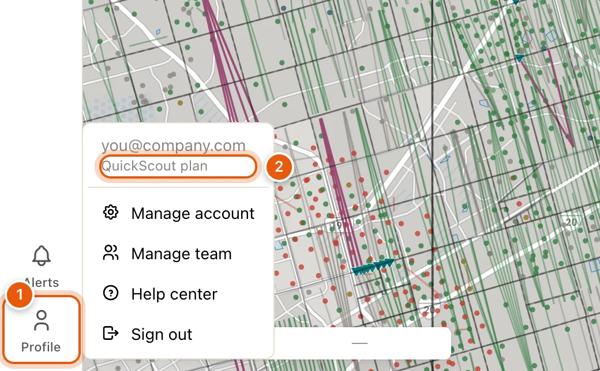

A free account is enough to search the map by name, work in the data tables, use the Owner Portal and ask QuickScout AI. Most other Maps features need a [paid plan](/get-started/plans).

## Create an account

<Steps>
  <Step title="Open the sign-up form">
    On the home page, click **Get Started**. On some pages the button reads **Sign up** instead.

    Inside Maps, open **Profile** at the bottom of the left rail and choose **Create account**.
  </Step>
  <Step title="Choose Sign up">
    If you land on the sign-in form, use the **Sign up** link under it. **Create account** in Maps opens the sign-in form, so you'll need the link there.
  </Step>
  <Step title="Finish signing up">
    Follow the prompts to confirm your email. When you're done, you're signed in and on the map.
  </Step>
</Steps>

<Tip>
  Invited by your company? Use the link in your invitation email. It creates your account and adds you to your team in one step.
</Tip>

## Sign in

Click **Log in** at the top of the home page, or open **Profile** → **Sign in** inside Maps. Signing in from the home page takes you to the map.

## Your account menu

In Maps, click **Profile** at the bottom of the left rail. The top of the menu shows your email, and under it, the plan you're on.

<Frame>
  
</Frame>

| The plan line reads | What it means |
|---|---|
| *Free account* | You're signed in, with no plan. |
| *Independent · $250/month* | A plan of your own, and its price. |
| *Independent · ends Nov 30* | Your plan is set to end that day. To keep it, open **Billing**. |
| *Independent · card declined* | Your last payment didn't go through. Open **Billing** to update your card. |
| *Access through Dec 31*, or *Maps plan* | Access we've given your account, with no subscription of your own to manage. |
| *‹Your company› plan*, or *‹Your company› · trial through Nov 30* | Your access comes with your company's account. |

The rest of the menu:

| Item | What it does |
|---|---|
| **Manage account** | Change your name, email, password and connected sign-ins. |
| **Manage team** / **Team** | See your organization's members. Admins can invite and remove people. This only appears when you belong to an organization. |
| **See plans** | On a free account: shows the plans right on the map, so you can [subscribe](/get-started/plans#subscribe) without leaving it. |
| **Billing** | On a plan of your own: opens [Billing](/get-started/billing), where you update your card, see invoices, or cancel. |
| **Help center** | Opens this help site in a new tab. |
| **Sign out** | Signs you out and returns you to the sign-in page. |

When your access comes with your company's account, the menu has no billing item: there's nothing for you to manage.

## Light and dark mode

Click the theme icon in the header and choose **Light**, **Dark** or **System**. Some pages call the last one **Auto**. Both follow your computer's setting.

In Maps, it's under **Settings** (the gear on the right) → **APPEARANCE**: **Light**, **Dark** or **Auto**.
