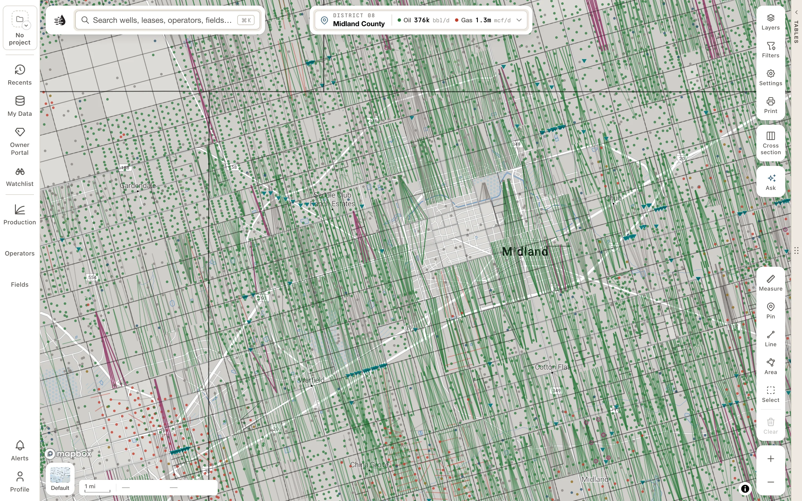

QuickScout puts Texas Railroad Commission records, production, completions, frac disclosures and satellite activity on one map. It also gives you tables, charts and exports built from the same data.

<Frame>
  
</Frame>

<Card title="Export data" icon="download" href="/maps/exports" horizontal>
  Download production, wells and leases as CSV, or as GeoGraphix, OpenWorks and DRI files. One lease, or thousands.
</Card>

<CardGroup cols={2}>
  <Card title="What's new" icon="bullhorn" href="/whats-new">
    Records open as cards, a new search, selecting an area, county cards, compare, well logs and cross-sections.
  </Card>
  <Card title="Get started" icon="rocket" href="/get-started/sign-in">
    Create an account, sign in, and find your way around.
  </Card>
  <Card title="Tour the map" icon="map" href="/maps/tour">
    What every part of the Maps screen does.
  </Card>
  <Card title="Work in the tables" icon="table" href="/maps/data-panel">
    Filter, sort, chart and export wells, leases, operators, fields and more.
  </Card>
  <Card title="Plans & access" icon="key" href="/get-started/plans">
    What's free, and what each plan unlocks.
  </Card>
  <Card title="Get alerted" icon="bell" href="/maps/alerts">
    An email or text when a permit or completion lands in your area.
  </Card>
  {/* enterprise-hold: this card takes the place of "Get alerted" above, or sits beside it.
  <Card title="Enterprise workspace" icon="briefcase" href="/enterprise/overview">
    Projects, daily briefs, economics and deals for your team.
  </Card>
  */}
  <Card title="Mineral owners" icon="gem" href="/owners/overview">
    The free Owner Portal: production, valuation and offers.
  </Card>
</CardGroup>

## Start with a task

- **Find a well or lease:** [search by name or number](/maps/search).
- **Sum up an area:** [select it on the map](/maps/selection) for its production, leases, operators and wells on one card.
- **Set wells or leases side by side:** [add them to compare](/maps/compare).
- **Read a well log:** [open it from the map](/maps/well-logs).
- **Compare formation tops across wells:** [build a cross-section](/maps/cross-section).
- **Download production:** [export one lease](/maps/exports#export-one-lease), or filter and export a table.
- **Get an area's or a county's files:** [export them in one zip](/maps/exports#export-an-area-or-a-county): well spots, production, the land grid and more.
- **Make a map for a report:** [print a scaled sheet](/maps/printing).
- **Fix a payment or cancel:** [manage billing](/get-started/billing).

## What you can do

- **Find anything.** Search by API number, lease, operator, field or place, and open the record's card.
- **See activity.** Permits and completions are on the map from the start. Turn on heatmaps, allocated production, production units, injection wells, well logs, satellite pad detections and rig watch. Right-click for the land and surface owner under any spot.
- **Screen and export.** Open the data tables beside the map to filter every well, lease, operator and field in Texas, rank who operates where, and build charts and type curves. Then [export](/maps/exports) what you've found as CSV, or as GeoGraphix, OpenWorks and DRI files. Any lease exports its own production and wells from its card, and a selected area or a county exports everything in it, shapefiles and the land grid included, in one zip.
- **Get alerted.** Draw an area and get an email when a new permit or completion lands inside it.
- **Mineral owners:** the [Owner Portal](/owners/overview) is free. It shows production, valuation and offers for the interests you own.

## Need help?

You can reach this help site from inside QuickScout:

- In Maps, open **Profile** → **Help center**.
- Anywhere else, use **Help** in the page footer, or press <kbd>⌘</kbd> <kbd>K</kbd> and choose **Help center**.

{/* enterprise-hold: a second bullet for the list above.
- In the Enterprise workspace, open the **Help** menu (the question mark) → **Help center**.
*/}

Still stuck? Email [craig@quickscout.io](mailto:craig@quickscout.io).
