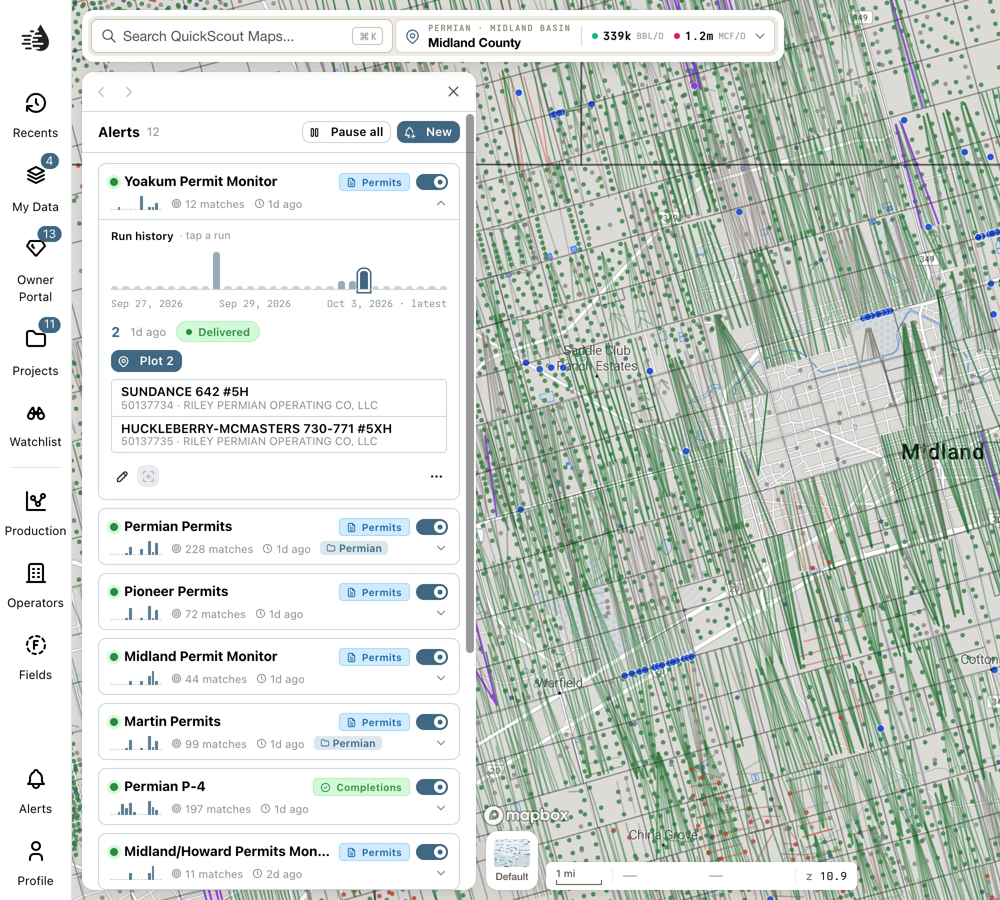
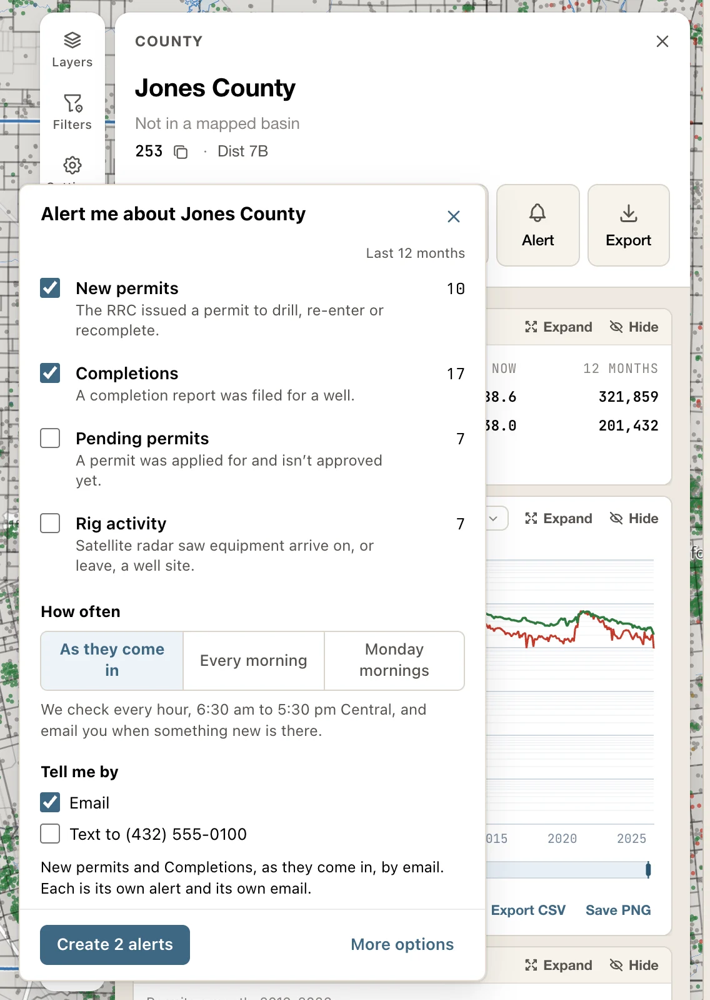
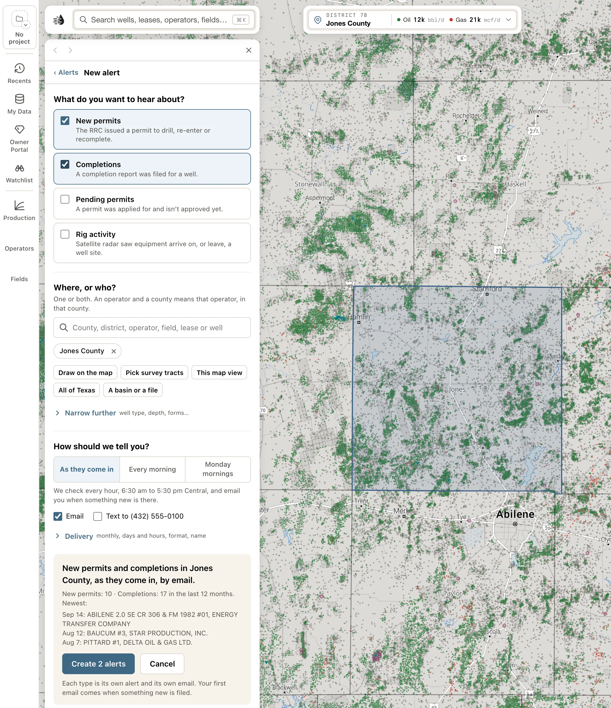
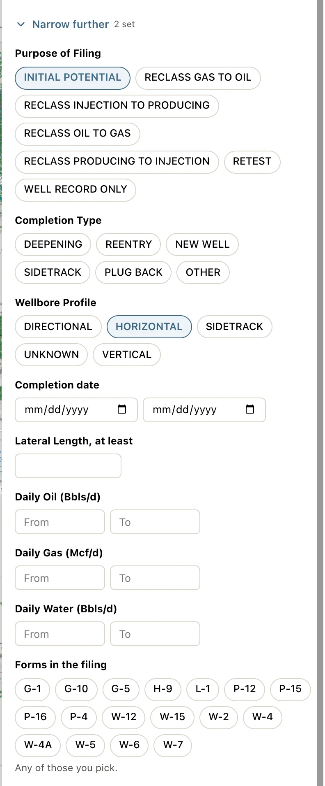
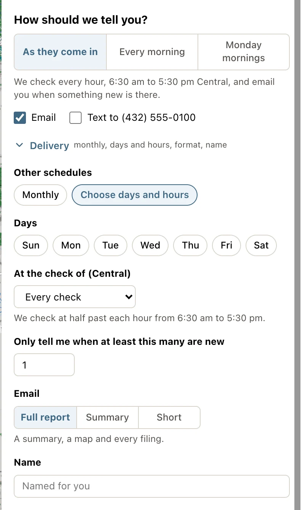

An alert tells you when something new is filed: a permit is applied for or issued, a completion report comes in, or satellite radar sees equipment arrive on a well site. You choose what you want to hear about, and where or who it's about. We check every hour from 6:30 am to 5:30 pm Central, and tell you by email, by text, or both.

Alerts are part of the [paid plans](/get-started/plans). Click **Alerts** at the bottom of the left rail, just above **Profile**, to open the Alerts drawer. Without a plan, the drawer offers **View plans** instead.

<Frame>
  
</Frame>

## Alert from a record

The quickest way to set an alert is from the record you care about. The cards for a county, operator, field, lease, well and [selected area](/maps/selection) have an **Alert** button.

<Steps>
  <Step title="Click Alert on the card">
    A panel opens, titled *Alert me about ‹name›*, listing what this record can tell you about. **Last 12 months** shows how many of each there were.
  </Step>
  <Step title="Tick what you want to hear about">
    **New permits** and **Completions** start ticked.
  </Step>
  <Step title="Choose how often, and how">
    **How often** and **Tell me by** work as they do [in the form](#how-should-we-tell-you).
  </Step>
  <Step title="Click Create alert">
    With two types ticked it reads **Create 2 alerts**: each is its own alert and its own email. **Undo** shows for a few seconds afterwards.
  </Step>
</Steps>

<Frame>
  
</Frame>

**More options** opens the [whole form](#create-an-alert) with your choices in it, to add a place or a filter.

Each kind of record offers what it can answer:

| Card | Offers | Matches |
|---|---|---|
| County, or a selected area | All four types | Filings in that place. |
| Operator | All four types | Anywhere in Texas. **More options** can narrow it to a place. |
| Field | **New permits**, **Completions** | By field number. |
| Lease | **Completions**, **New permits**, **Pending permits** | Completions go by lease number. A permit has no lease number until the lease exists, so permits match the lease's name in the counties it lies in. One under the same name in another county won't be told. |
| Well, or wells you selected one by one | **New permits**, **Completions**, **Pending permits** | By API. A new permit on an API means a re-entry or a recompletion. |

The button is off when it can't be used, and hovering it says why: you need to sign in or have a paid plan, or a well you added yourself has no RRC number to file against.

**Alert** is also in a well's popup and under **Land & owners**. Those open the form with the well or survey tract filled in. On a selected area's **Activity** block, **Alert me about new activity here** does the same for the area.

If you already have an alert on the record, the button is lit, and pressing it lists them as *Your alerts on ‹name›*, each with its **Active** switch and **Edit**. **Add another** sets one more type, and **All alerts** opens the drawer. The button never deletes anything.

## Create an alert

Click **New alert** at the top of the drawer. If you have no alerts yet, it's also under *No alerts yet*.

The form is one screen with three questions. Filters and delivery details stay folded until you open them, and a section with something set in it opens by itself. To leave without saving, click **‹ Alerts** at the top or **Cancel** at the foot.

<Frame>
  
</Frame>

### What do you want to hear about?

Tick one or more. Each type you tick becomes its own alert, with its own email.

| Type | Tells you when |
|---|---|
| **New permits** | The RRC issued a permit to drill, re-enter or recomplete. |
| **Completions** | A completion report was filed for a well. |
| **Pending permits** | A permit was applied for and isn't approved yet: the earliest sign of a new well. |
| **Rig activity** | Satellite radar saw equipment arrive on, or leave, a well site. Covers the counties [Rig Watch](/maps/layers#wells) watches. |

A type that can't answer what you've picked is greyed out and says why, such as *Pending permits can't be told by a field number.*

<Tip>
  To follow a well from application to completion, tick all four over the same place.
</Tip>

### Where, or who?

Add a place, someone or something to follow, or both.

Search the box for a county, district, operator, field, lease or well. Click into it with nothing typed to choose an RRC district or **All of Texas**. For a place without a name, use the buttons below it:

| Button | Adds |
|---|---|
| **Draw on the map** | A shape. Click the map to drop corners, then double-click to finish. To change it afterwards, drag its corners on the map. **Cancel** stops drawing and keeps nothing. |
| **Pick survey tracts** | Tracts. Click one to add it and again to drop it, then click **Done**. The survey lines show when you zoom in closer, and **Zoom in** takes you there. |
| **This map view** | The part of the map you can see, a little inside its edges, named *Map view*. Frame the map first. |
| **All of Texas** | Every county. |
| **A basin or a file** | Opens **Add from library**, with **Counties**, **Basins**, **Districts** and **File**. A file can be GeoJSON, GeoPackage, KML, FlatGeobuf or a shapefile. |

{/* enterprise-hold: a row for the table above, after "A basin or a file".
    | **Your areas** | The open project's areas (Enterprise, when the project has areas). |
*/}

What you add shows as a chip, and its **✕** takes it off. Here's how they combine:

- **Places add up.** A county and a drawn shape mean either one.
- **An operator, field, lease or well narrows the places.** An operator and a county means that operator, in that county. Any of them also works alone, with no place at all.

On a phone, **Draw on the map**, **Pick survey tracts** and **A basin or a file** aren't offered. Use a computer or an iPad for those.

### Narrow further

**Narrow further** opens every filter the ticked types have, in the RRC's own words. A filter you leave empty matches everything.

| Type | Filters |
|---|---|
| **New permits** | **Well Type**, **Completion Type** (Drill, Recompletion, Re-enter…), **Permit date**, **Total Depth (Ft)**, **Lateral Length (Ft)** and **Operator name contains** |
| **Completions** | **Purpose of Filing** (Initial Potential, Retest, reclassifications…), **Completion Type** (New Well, Deepening, Sidetrack…), **Wellbore Profile** (Horizontal, Vertical…), **Completion date**, **Lateral Length**, **Daily Oil (Bbls/d)**, **Daily Gas (Mcf/d)**, **Daily Water (Bbls/d)** and **Forms in the filing** |
| **Pending permits** | **Well Type** (Horizontal, Vertical, Directional, and their sidetracks), **Filing Purpose**, **Filed date** and **Total Depth (Ft)** |
| **Rig activity** | **Event** (`arrived`, `drilling_reported`, `gone`), **Only when the records back it** (`drilling`, `drilling_likely`, `frac`) and **Minimum new metal (pixels)** |

**Forms in the filing** matches any of the forms you pick. **P-4** also finds *P-4 Data* and *P-4(2)*, and **G-1** doesn't find **G-10**.

<Frame>
  
</Frame>

### How should we tell you?

| Choice | What you get |
|---|---|
| **As they come in** | We check every hour, 6:30 am to 5:30 pm Central, and email you when something new is there. |
| **Every morning** | One email about 6:30 am Central for each alert, on days something new was filed. |
| **Monday mornings** | One email Monday about 6:30 am Central for each alert, if something new was filed. |

Tick **Email**, **Text**, or both. **Text** shows the number on your account. If there isn't one, type it under **Mobile number**. We keep one number for all your alerts, and texts wait until 8 am if something comes in overnight.

**Delivery** opens the rest:

- **Monthly**, or **Choose days and hours**: pick the **Days**, and a time under **At the check of (Central)**.
- **Only tell me when at least this many are new**: starts at 1.
- **Email**: **Full report** (a summary, a map and every filing), **Summary** (totals and charts) or **Short** (a line or two).
- **Name**: an alert is named for you after what it watches, such as *New permits in Jones County*. Type your own here. This only shows with one type ticked.

<Frame>
  
</Frame>

### Check the sentence, then create

The foot of the form says what you're about to get in one sentence: *New permits in Jones County, as they come in, by email.* Under it is how many there were in the last 12 months, and the newest few filings. When **As they come in** would be a lot of email, the form says so and offers **Use every morning**.

Click **Create alert**, or **Create 2 alerts** with two types ticked. We start checking within the hour. Your first email comes when something new is filed: what's already on file isn't sent. **Undo** shows for a few seconds afterwards.

## Your alerts

The drawer lists every alert, most recently active first. Each row shows:

- Its name, and a tag for what it reads, such as **Permits** or **Completions**.
- A 14-day chart of matches, how many it has found in the last 30 days, and when it last found something.
- The **Active** switch. Switch it off to pause the alert: no more emails or texts until you switch it back on. A paused alert is dimmed and marked **PAUSED**.

**Pause all**, at the top, pauses every alert without deleting any. While all of them are paused, it stays lit; click it again to resume them all.

A number on the **Alerts** button in the rail counts the alerts that have found something since you last opened the drawer.

### See what an alert found

Click an alert to expand it. If it watches a shape, the map outlines it in blue and flies there.

- **Check history** has a bar for each of the last 30 runs, sized by how many matches it found. Click a bar to see that run. A run is **Delivered**, found **No matches**, or **Failed**.
- The run's matches are listed underneath: the lease and well number, API, operator and county. Click a match to open the well's [card](/maps/records).
- **Plot *N*** puts the run's matches on the map as blue pins and frames them. Hover a pin for the well, or click it to open the well's card. The button then reads **Zoom to**, which frames them again after you've moved the map.
- When a run found more than eight wells, click **View all**.

### View all, and export

**View all** opens the run's full results in **Replay**:

- **MATCHES**, **EXECUTION** time and **STATUS** across the top.
- Breakdowns **By operator**, **By field** and **By county**, and the average **Lateral length**.
- Every result in a table. **Filter results…** narrows it, and **Export CSV** downloads the rows you're looking at.

Replay shows the results stored when the alert ran. It doesn't run the search again.

### Edit, duplicate and delete

On an expanded alert, the buttons under its matches:

- **Edit** opens the form with the alert filled in. Change its places, filters, delivery or name, then click **Save changes**. If you add a place, you're told only about what's new from then on, not what's already on file there.
- **Zoom to** frames the alert's shape. It's greyed out when the alert goes by county, district or operator and has no shape.
- **Duplicate** and **Delete**.

An alert can't change type, because that would send you everything already on file. To hear about something else, create a new alert.

**Duplicate** tries to make an active copy named *‹name› (copy)*. Two identical alerts aren't allowed, so if the settings match you'll see *An identical alert already exists — tweak a filter and try again.* To watch something similar, use **New alert**.

**Delete** asks first, then gives you about six seconds to **Undo**. The alert's run history is kept. **Edit** has its own **Delete** at the foot of the form, which asks *Delete this alert?* with **Keep it** to back out, and has no **Undo**.

## Limits

- Up to **50** active alerts. Pause or delete one to make room.
- We check at half past each hour from 6:30 am to 5:30 pm Central, every day.
- Each alert sends its own email. There's no combined digest.
- Operator transfers (P-4s), frac jobs and satellite pads aren't types of alert yet.

## Troubleshooting

<AccordionGroup>
  <Accordion title="Create alert is greyed out">
    The line above the button says what's missing:

    - *Tick what you want to hear about.*
    - *Pick a place, an operator, a field or a well.*
    - *Choose email or text.*

    With **Text** ticked and no number on your account, it also needs a **Mobile number**.
  </Accordion>
  <Accordion title="You already have this alert">
    One of the types you ticked matches an alert you already have, so nothing can be created until that changes, even with other types ticked. **Open it** takes you to that alert. Otherwise untick that type, or change the place or a filter.
  </Accordion>
  <Accordion title="One alert saved and another didn't">
    The form says which is set and which wasn't saved. **Try again** only tries the ones that didn't land, so nothing is made twice.
  </Accordion>
  <Accordion title="You have the most alerts one account can hold">
    The limit is 50 active alerts, and **Duplicate** words it as *Active-alert limit reached (50)*. Pause or delete an alert you no longer need, then save again.
  </Accordion>
  <Accordion title="My alert hasn't sent anything">
    - Expand it and look at **Check history**. *No runs yet* means the first check is still due, within the hour.
    - Runs marked **No matches** mean nothing new was filed. Widen the area, or clear a filter.
    - An alert only tells you about new filings. What was on file when you set it isn't sent.
    - **Every morning** and **Monday mornings** only send at their time.
    - Under **Delivery**, check **Only tell me when at least this many are new**.
    - Check it isn't **PAUSED**.
    - Texts go to the one number on your QuickScout account, and wait until 8 am if something comes in overnight.
  </Accordion>
  <Accordion title="An older alert says it has both a county and a drawn area">
    Alerts saved before places added up only tell you about filings inside both, and the form says so. Nothing changes unless you change it. **Tell me about either place** switches it to the way places work now.
  </Accordion>
</AccordionGroup>

## The Alerts page

Every alert you create in Maps also appears on the separate [Alerts page](/tools/alerts), which lists all their matches together, and the other way round.
