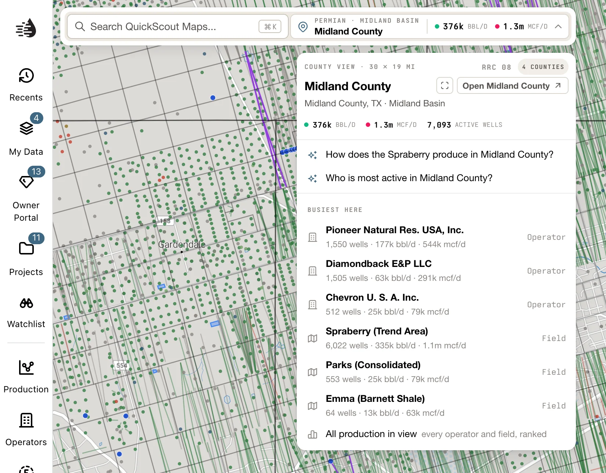
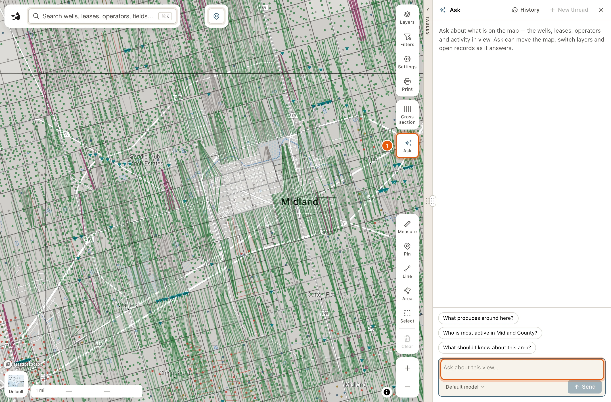
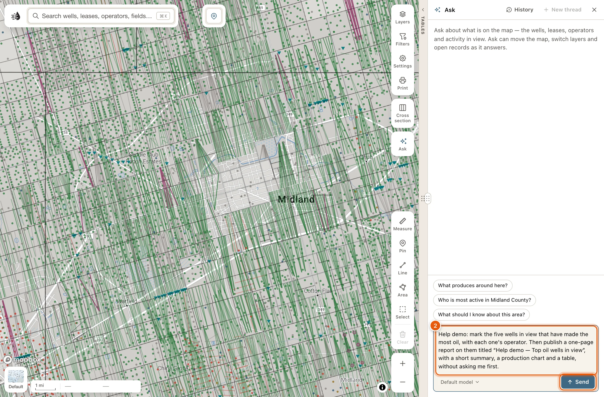
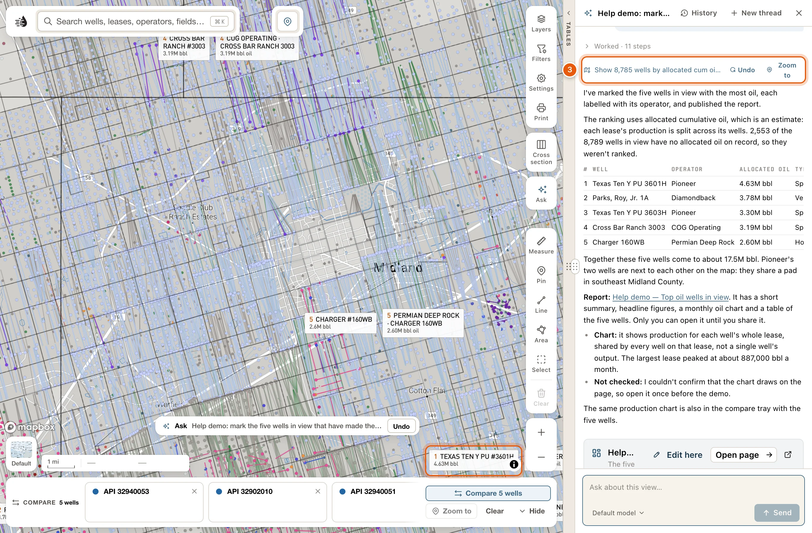
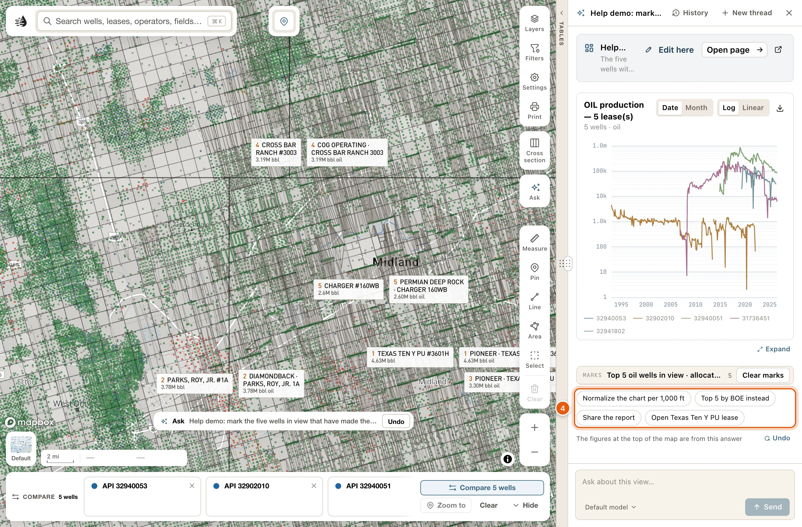
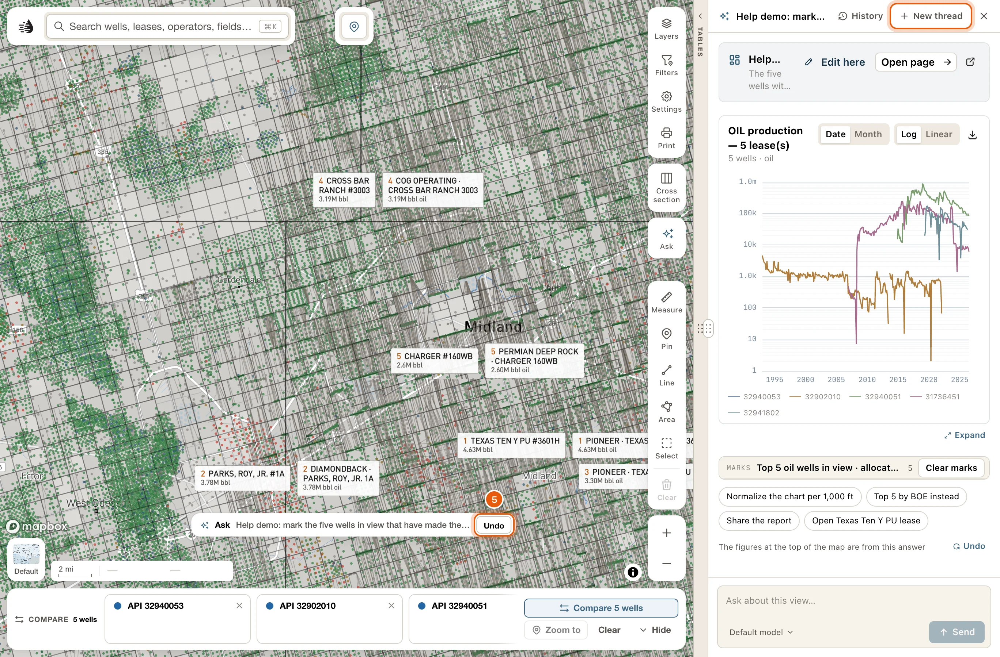

Two tools answer the question "what's here?":

- The place card lists the leases producing in the view, the busiest operators and fields, and two questions worth asking. It's free.
- **Ask** is the map's assistant. Type a question in plain English. It answers in a column beside the map, and can fly the map, switch layers, mark wells and open records as it goes. Each question uses credits.

<Note>
  - The place control and **Zoom to county** work for everyone, signed in or not.
  - The card's lists and production figures need a free account. See [Sign in](/get-started/sign-in).
  - Ask needs a free account, and each question uses credits.
  - Opening a well, lease, operator, field or county card needs a [paid plan](/get-started/plans). That includes **View county**.
</Note>

## The place card

The place control sits at the top centre of the map. It names the county you're looking at, with its RRC district above, or the basin or play when you're zoomed out. Beside the name is what the wells in view produce, like *Oil 632 bbl/d · Gas 40 mcf/d*. Where nothing in view produces, it says *No production*.

Click it to open the place card. Click it again, click outside the card, press <kbd>Esc</kbd> or click the card's **✕** to close it. Opening a card on the right side of the map, such as **Layers**, closes it too.

<Frame>
  
</Frame>

On a narrow window the control shrinks to its 📍 pin. Click the pin for the same card, which then names the place and what it produces at its top.

### Zoom to county and View county

The card's top line gives the size of the view, like *12 × 9 mi view* or *3 counties · 53 × 54 mi*. Beside it:

- **Zoom to county** frames the county under the middle of the map. Zoomed far out, where there's no county boundary to frame, it's greyed out.
- **View county** opens that county's card. See [Record cards](/maps/records).

### Two questions to ask

Under the top line are two questions written for this view, like *What produces around here?* or *Who is most active in Midland County?* Click one to put it to [Ask](#ask-a-question).

### Leases in view

**LEASES IN VIEW, COUNTED WHOLE** lists the producing leases in the view, highest rate first, in barrels of oil equivalent a day (boe/d). A lease is in view when one of its producing wells is, or its centre is. Each rate is the whole lease's, its wells off screen included; the place control counts only the wells in view. The number beside the heading is how many leases there are. When there are more than eight, **All ‹N›** opens [Production in view](/maps/production-panel) with every one of them.

- Click a lease to open its [card](/maps/records). The map doesn't move.
- Point at a lease to light it up on the map.
- Click a lease's well count at the right of its row, like *3 wells*, to list its wells: each well's number, API and share of the lease's rate. Click a well to open its card.

A rate marked ≈ is an estimate. Texas reports oil by lease, so a lease's rate is split between its wells by each well's allocated share.

A lease that produced this year but has no current rate shows a dash and sorts last.

### Wells in view

Where nothing in view is producing, the card lists **WELLS IN VIEW** instead: permits that can still be drilled come first, then shut-in, plugged and dry holes. The heading says when anything in view last produced, like *No production since Mar 2019*.

Click a well to open its card. **Show ‹N› more** adds the next wells to the list.

### Busiest here

**BUSIEST HERE** lists the top three operators and the top three fields in view, each with its number of wells and its rate in boe/d. Click one to open its [card](/maps/records).

**All production in view** opens [Production in view](/maps/production-panel), with every operator and field in the view ranked.

Neither appears where nothing in view is producing.

### Signed out

Signed out, the card keeps its top line and its two questions. In place of the lists it says *Sign in to see what's in this view — its leases, what each produces, and the operators and fields busiest here.* Click **Sign in**.

<Tip>
  To see one rate in boe/d instead of oil and gas side by side, open **Settings** on the right side of the map and choose **boe/d** under **PLACE PRODUCTION**. **Oil & gas** goes back. See [Map settings](/maps/settings).
</Tip>

## Ask a question

Ask reads what's on your screen: the map view, the layers that are on, the table that's open and its filters, the record card that's open, and your compare tray. So frame the area first, then ask.

You can start a question from:

- **Ask**, on its own at the bottom of the controls on the right side of the map. On a short window, it moves up into the group with **Layers** and **Print**.
- One of the two questions on the [place card](#the-place-card).
- The search box. Type a question and click **Ask about “‹what you typed›”**, or press <kbd>⌘</kbd> <kbd>Enter</kbd> (<kbd>Ctrl</kbd> <kbd>Enter</kbd> on Windows). With nothing typed, the search panel suggests questions under **ASK ABOUT THIS VIEW**, and **Ask anything about this view…** opens the column.
- A follow-up question under an answer.

<Steps>
  <Step title="Frame the area, then click Ask">
    Pan and zoom until the map shows what you want to ask about. Then click **Ask** on the right side of the map. The Ask column opens beside the map, ready for your question.

    <Frame>
      
    </Frame>
  </Step>
  <Step title="Type your question and press Enter">
    Ask in plain words, like *Which operators permitted horizontal wells here in the last 90 days?* Press <kbd>Enter</kbd> to send it. <kbd>Shift</kbd> <kbd>Enter</kbd> starts a new line.

    You can also click one of the suggested questions above the box.

    <Frame>
      
    </Frame>
  </Step>
  <Step title="Read the answer and look at the map">
    While the agent works, one line says what it's doing, like *Thinking…*. Then the answer appears, and the map shows what it found: wells lit up, numbered labels beside the ones it names, or a layer switched on.

    <Frame>
      
    </Frame>
  </Step>
  <Step title="Open what it found, or ask a follow-up">
    Click a numbered label to open its card. In a ranked set of wells, whose labels carry each well's rank and value, click the well itself, then **View well** in its popup. Under the answer, click a follow-up question, or type your own. The agent remembers everything earlier in the thread.

    <Frame>
      
    </Frame>
  </Step>
  <Step title="Take its changes off when you're done">
    **Undo** on the answer's map line takes that answer's changes off. To take off everything the agent changed, click **Undo** on the **Ask** row at the bottom of the map, or start a **New thread**.

    <Frame>
      
    </Frame>
  </Step>
</Steps>

## The Ask column

The column docks on the right side of the window, beside the map. Drag its left edge to make it wider or narrower. It stays open or closed the way you left it, on this device.

Its header shows the thread's name, or **Ask** for a new one, and these buttons:

| Button | What it does |
|---|---|
| **Restore map** | Appears on a thread you reopened. Puts back the layers, Ask's own layers and the view that thread left on the map. |
| **History** | Your saved threads in this project, newest first. Click one to reopen it. **Rename** renames a thread: **Save** keeps the new name and **Cancel** the old one. **Delete** deletes it after asking *Delete this thread?* |
| **New thread** | Starts over. It also takes off everything the agent changed on the map. Changes you made yourself since are kept. The thread you leave stays in **History**. |
| ✕ (**Close Ask**) | Closes the column. The thread and the agent's changes stay as they are. |

Every thread is saved as you go. When the column is empty, a **Continue:** line names your last thread; click it to pick up where you left off.

<Note>
  Reopening a thread brings back its conversation, not its map, and takes the current thread's changes off the map first. Click **Restore map** to put the old thread's layers and view back.
</Note>

### The question box

- <kbd>Enter</kbd> sends. <kbd>Shift</kbd> <kbd>Enter</kbd> starts a new line. <kbd>⌘</kbd> <kbd>Enter</kbd> also sends.
- The model menu under the box reads **Default model** until you pick another. A lighter model answers faster and uses fewer credits.
- While an answer is being written, **Send** becomes **Stop**.

Signed out, the box is replaced by *Sign in to ask about this view — the wells, leases, operators and activity in it.* and **Sign in**.

## Each answer

While the agent works, one line says what it's doing, like *Thinking…* or *Working…*. Click the line to watch the steps.

When it's done, that line folds into a row like *Worked · 7 steps*. Click the row to see every step. A step that couldn't be done shows a cross and its reason, and the row adds *· 2 not applied*.

Under that row, one line names what the answer did to the map, like *Show 26 wells by allocated cum +2*:

- **Undo** takes that answer's changes off.
- **Zoom to** appears when the agent wanted to move the map a second time. The map moves only once per answer, so the second move waits for your click.

The answer itself can hold:

- Charts, well maps, well searches (*‹N› wells matched*, with **View on map**) and [pages](/maps/pages). **Expand** shows a chart or map full size.
- Legends for the colours it drew on the map. **MARKS** has **Clear marks**, and **HIGHLIGHTS** has **Clear highlights**.
- Follow-up questions, under the last answer. Clicking one may also move the map or open what it names.

When the agent adds a layer of its own, a legend card for it appears under the answer. Its buttons:

- **On map**, a switch: lit while the layer is drawn. Click it to take the layer off the map, and again to put it back.
- **Zoom to** moves the map to the layer.
- **Save** keeps the layer in [My Data](/maps/my-data), which is part of the paid plans.
- **Remove** takes the layer off the map and out of the list.

Inside the steps, some changes have their own button: **Undo**, **Put wells back**, **Clear marks**, **Remove alert** or **Close**, and **Zoom to** for a move that waited. On a reopened thread, **Run again** does a step again.

## What Ask can do

### On the map

- Fly to a place, once per answer.
- Turn layers on or off, change their settings, and switch the basemap.
- Narrow a layer to just what it's talking about, such as one operator's permits.
- Show only certain wells and hide the rest, up to 30,000 of them. **Put wells back** returns the others.
- Draw a ranked set of wells in their reservoir colours, the top ones labelled with their rank and value.
- Light up wells, leases or operators, or up to six groups, each in its own colour with a legend.
- Write a numbered label beside up to 200 things it names. Click a label to open its card.
- Show a popup at a spot, with a few lines and buttons.
- Outline an area or draw a line, with a label.
- Add layers of its own from what it found.

### Records and tools

- Open a well, lease, field, operator or county card; an injection well, pipeline or frac job; or the land at a spot.
- Open a well's log in the **Log** tab. See [Well logs on the map](/maps/well-logs).
- Build a [cross-section](/maps/cross-section) of up to 30 wells.
- Add records to [compare](/maps/compare), up to 12 of each kind, and open the comparison.
- Filter and sort a [data table](/maps/data-panel) with column filters you can see and change.

### In its answers

- Charts: production on the standard log chart, time series, bars, type curves and crossplots.
- [Pages](/maps/pages): a report or dashboard on a page of its own, which you can share.
- An [alert](/maps/alerts), only when you ask for one. The Alerts drawer opens on it, and **Remove alert** deletes it.

### Limits

- Up to 40 map changes and six added layers per answer.
- It can't change the **Formation tops** or **W-1 plats** layers.
- It doesn't see an open log or the cross-section.
- What it opens keeps its own access. A record card still needs a paid plan, for example.

## Undo what the agent changed

While the agent has anything on the map, a row sits at the bottom centre of the map: a sparkle, **Ask**, your question, and **Undo**.

- **Undo** on the row takes off everything the agent changed.
- Click the rest of the row (its tooltip reads *What Ask changed on the map*) to see the list:
  - **ON THE MAP**: the answer's marks, highlights and drawings. **Clear** removes them.
  - **CHANGED IN YOUR WORKSPACE**: each layer, basemap, filter or sort the agent changed, each with its own **Undo**.
  - **ASK’S LAYERS**: the agent's own layers, with the same buttons as their legend cards.
  - **Undo all of Ask’s changes**, at the bottom.

If you changed something yourself after the agent did, your change is kept, and the row says so for a moment, like *Kept 1 change you made since*.

The row is saved with your map, so it's still there after you reload the page, on another computer, and with the Ask column closed.

## Credits

<Note>
  Asking costs credits. The place card is free. If your credits run out, the column says so and may offer a lighter model: click it to ask again with that model.

  {/* enterprise-hold: link "credits" to /enterprise/credits */}
</Note>

{/* enterprise-hold: out of credits, the column also offers **Top up credits**, which opens the credits page; link it to /enterprise/credits. Today it sends every reader to the Enterprise billing page. */}

## Troubleshooting

<AccordionGroup>
  <Accordion title="The place control can't be clicked">
    It reads *No QuickScout data here* when the middle of the map is outside Texas. Pan back over Texas. If the card says *Place lookup is unavailable right now.*, try again in a few minutes.
  </Accordion>
  <Accordion title="The question box is greyed out">
    It reads *Waiting for the map…* or *Getting ready to answer…* while the map starts up. Wait a moment and it becomes available.
  </Accordion>
  <Accordion title="The map didn't move to the second place the answer mentions">
    The map moves only once per answer. Click **Zoom to** on the answer's map line to make the second move.
  </Accordion>
  <Accordion title="The answer says some steps were not applied">
    Click the *Worked* row to see each step and why it wasn't done. For example, a set of more than 30,000 wells isn't drawn, and the agent is told the count instead.
  </Accordion>
  <Accordion title="I reopened a thread and the map stayed the same">
    Reopening a thread brings back its conversation only. Click **Restore map** in the column's header to put its layers and view back.
  </Accordion>
  <Accordion title="New thread took layers off my map">
    **New thread** takes off what the agent changed, including layers it switched on. A change you made yourself after the agent's is kept. To keep what the agent did, don't start a new thread: ask your next question in the same one, or close the column.
  </Accordion>
</AccordionGroup>

## Ask QuickScout AI

For questions about RRC forms, permits, compliance or geology, use [Ask QuickScout AI](/tools/ask).
