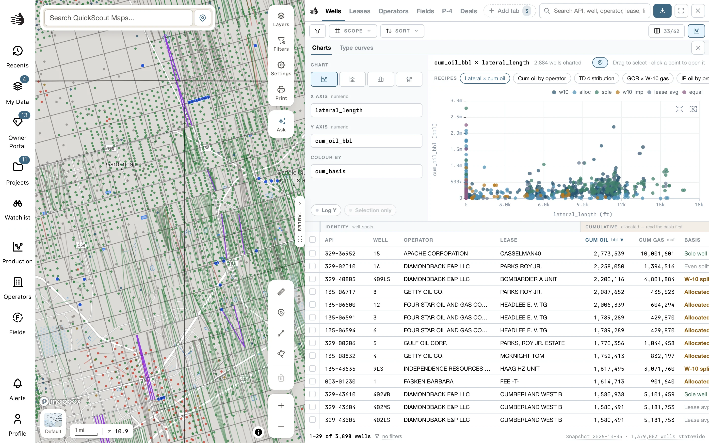

Click **Analyze** at the right end of the data tables' toolbar. The analysis panel opens above the rows, and works on whatever the table is listing: your filters and scope.

The panel has tabs. Which ones you see depends on the table:

| Tab | On | What it does |
|---|---|---|
| [**Charts**](#charts) | Every table | Scatter, histogram, bar and box charts of the rows. |
| [**Type curves**](#type-curves) | Wells, Leases | How the wells in the map's area perform over their first months. |
| [**Midstream**](#midstream) | Leases | Who gathers the oil and who takes the gas, over the leases in view. |
| [**Compare**](#compare-production) | Leases | Production of the leases you ticked, side by side. |
| [**Production**](#operator-production) | Operators | Monthly production of the operators you ticked. |

The panel and the tab you chose stay open when you switch tables. Close the panel with its **×** (**Close the analysis panel**), or click **Analyze** again.

<Tip>
  When the tables are narrow, the chart's controls sit in a band above the plot that scrolls. Widen the tables, or click **Full screen**, to have them beside it.
</Tip>

## Charts

<Frame>
  
</Frame>

### Start from a recipe

**Recipes** are ready-made charts. Click one to draw it.

| Table | Recipes |
|---|---|
| **Wells** | *Lateral × cum oil*, *Cum oil by operator*, *TD distribution*, *GOR × W-10 gas*, *IP oil by profile*, *Alloc share × cum* |
| **Leases** | *12-month trend*, *T12 oil × PV-10*, *NAV by operator*, *Decline distribution*, *Acres × NAV*, *Wells by district*, *Daily oil by reservoir* |
| **Operators** | *Daily boe by operator*, *PV-10 by operator*, *Leases × daily boe*, *Here vs Texas*, *Share of TX oil in view* |
| **Fields** | *RRC lifetime oil by field*, *Oil this year by field*, *RRC lifetime gas by field*, *Gas this year by field*, *How much the map can place*, *Lost oil by field*, *Older than the archive, by field*, *RRC lifetime × placed* |
| **P-4** | *Leases acquired by buyer*, *Leases divested by seller*, *Transfer size distribution*, *Held months by era*, *Transfer size × oil today* (on **Filings**, the recipes look at whole filings) |
| **Frac** | *Proppant intensity × 12-mo boe/kft*, *Same-bench spacing × 12-mo boe/kft*, *Proppant intensity by unit*, *Treatments through time*, *Treatments by pumper (inferred)*, *Treatments by operator*, *Lateral length distribution*, *Water × proppant intensity* |
| **Pads** | *Detections by what was on record*, *Detections by county*, *The model's readings*, *Area distribution*, *Area by what was on record*, *Area × score* |
| **Rigs** | *Sites by what we read*, *Sites by operator*, *Sites by county*, *Against the record*, *Peak signal distribution*, *Peak signal × wells on the pad* |

### Build your own

1. Pick a chart type from the menu under **Chart**, which reads your choice: **Scatter**, **Histogram**, **Bar by category**, **Box by category**, or **12-month production trend** (Leases only).
2. Choose what to plot. A scatter has an **X axis** and a **Y axis**. A histogram has **Distribution of**. Bar and box charts have **Group by** and **Measure**.
3. On a scatter, pick **Color by** to color the points. On a bar chart, pick an **Aggregate**: **Median**, **Average**, **Total** or **Count**.
4. Turn on **Log Y** for wide ranges (**Log X** on bar charts), or **Selection only** to chart just your ticked rows. **Selection only** stays greyed out until you tick some.

When more than 30,000 rows match, a scatter plots a random sample of 30,000 and says so under its title. On a table the QuickScout server answers, the sample is 5,000 rows. The server always answers **P-4** and **Frac**, and answers **Wells**, **Leases**, **Operators** and **Fields** while this device has no copy of their data; see [Map data on this device](/maps/offline#answer-from-the-server-instead).

### Select from the chart

- On a scatter, **drag** to select points, or click a point to open that row.
- On a histogram, bar or box chart, click a bar or box to select its rows.
- Hover a point or a bar to highlight those rows on the map.

Selections from a chart work like ticked rows, so you can [export](/maps/exports#shortcuts-for-ticked-rows) them from any tab. **Show on map**, at the top of the chart, shows only the selected rows on the map, or the rows charted when nothing is selected. It stays pressed while it's on; click it again to put the rest back. **Clear *N* selected** drops the selection.

A chart selects at most 10,000 rows (4,999 on a table the server answers). If more match, only the first ones are selected; narrow the view first.

## Type curves

**Type curves** shows how the wells in the map's area perform: cumulative production (or rate) against months online. Pan the map to change the area.

The controls down the side:

- **Wells**: **Horizontal** or **Vertical**.
- **Stream · curve**: **Oil**, **Gas** or **boe**, as **Cumulative** or **Rate**.
- **Normalize** (horizontal wells): **Per 1,000 ft** of lateral, or **Per well**.
- **Leases**: **Single-well**, **Steady** or **All**. Because the RRC reports oil by lease, single-well leases give the cleanest per-well curve.
- **Split by**: **Operator**, **Vintage**, **Reservoir**, **Lateral length**, **Landing depth**, or **No split**.
- **Tighten the cohort**: narrow by **First production** year, **Lateral per well**, **Landing depth (TVD)** (click a bar on the histogram; <kbd>Shift</kbd>-click to widen), **Reservoir** or **Operator**.
- **Compare**: tick up to 8 wells or leases in the table, then **Lay over *N* ticked wells** (or leases) to draw them over the curve. Each says how it ranks, for example *beats 72% of 310 comparable leases at 12 months*. **Reset every setting** starts over.

The headline tiles give the P50 (with the mean underneath) at 6, 12, 24 and 36 months, and an Arps **EUR** with its b-factor and initial decline. **By ‹split›** lists each group's 12-month P50; click a row to draw its line. The footer says what was **Left out** and why.

## Midstream

**Midstream** (Leases) shows who hauls the liquids and who takes the gas from the leases in view, from the RRC's gatherer and purchaser filings.

- **Role**: **Crude gatherer**, **Gas gatherer** or **Gas purchaser**.
- **Group by**: **Brand** (companies grouped under one name) or **As filed**.

Each company shows its share, its volume and how many leases it serves. The header sums it up, for example *18 companies · 42,000 bopd · top 4 hold 71%*. Click **Show on map** on a row to list that company's leases in a [Record tab](/maps/data-panel#record-tab) and show only them on the map. Your Leases tab and its filters stay as they were.

## Compare production

On Leases, tick up to 12 leases and click **Compare production** in the selection bar. A **Compare** tab opens in the analysis panel with their production on one chart.

- **Measure**: **Oil** or **Gas**.
- **Normalize**: **Total**, **Per well**, or **Per 1,000 ft** of lateral.
- **X axis**: **From first month**, **Producing months** or **Calendar**.
- **Log Y**.

With more than 12 ticked, the first 12 in your sort are charted. Close the tab with its **×**.

<Note>
  This **Compare** belongs to Analyze and charts only ticked leases. It isn't the compare tray at the foot of the map, or the **Compare** tab beside your tables, which set wells, leases, fields, operators and selected areas side by side with their facts. To use those, click **Add to compare** in the selection bar instead. See [Compare](/maps/compare).
</Note>

## Operator production

On Operators, tick operators and click **Chart production**. The **Production** tab draws a small chart for each one, over its leases in view.

- **Lines**: **Total**, or **By lease**.
- **Measure**: **boe**, **Oil** or **Gas**.
- **Log Y**.

Over 60 operators, it asks before charting them all.
