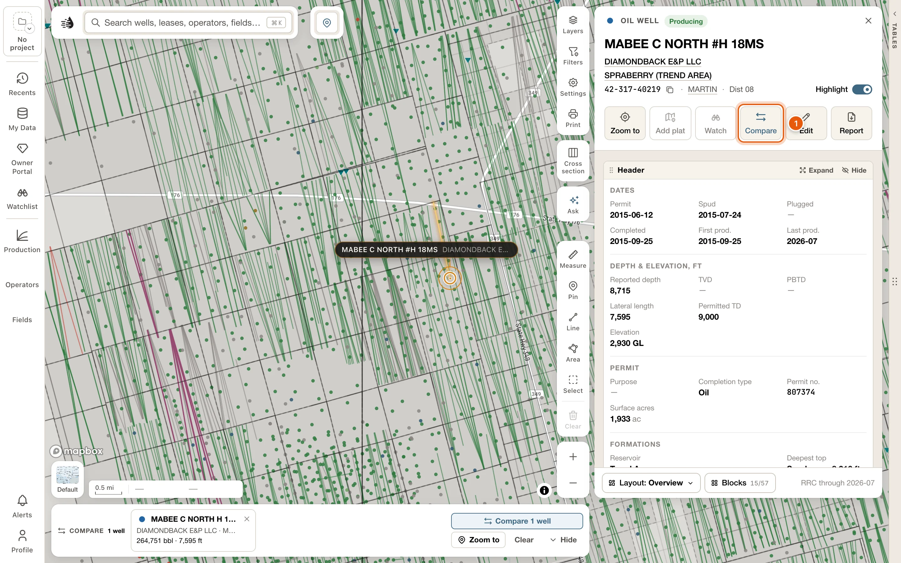
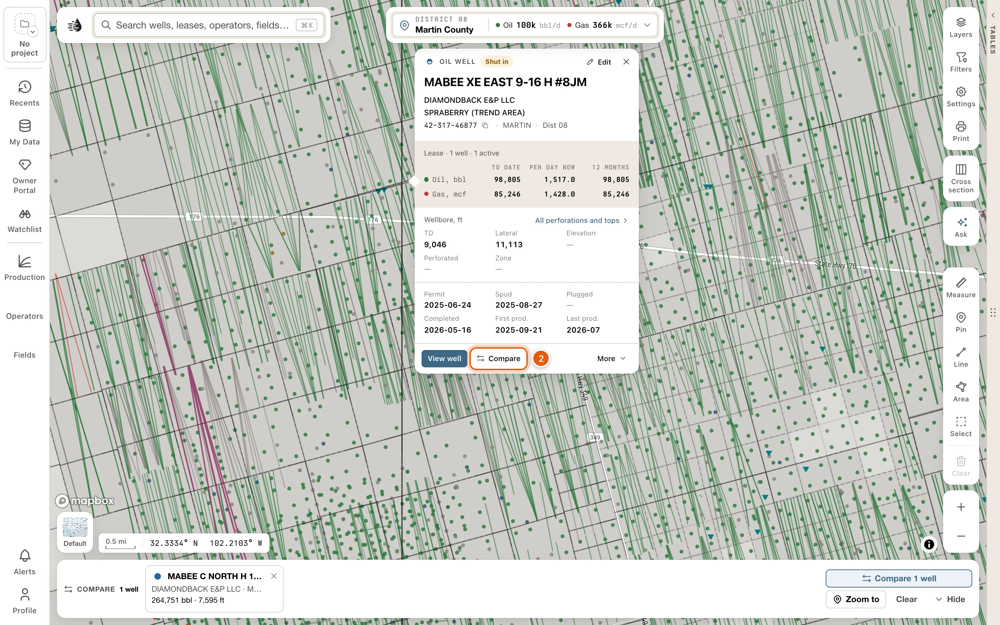
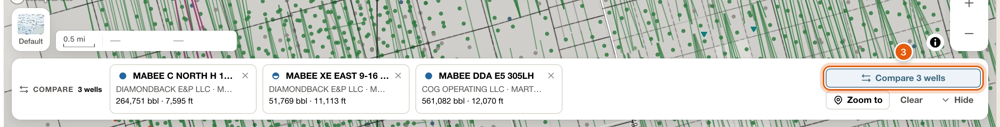
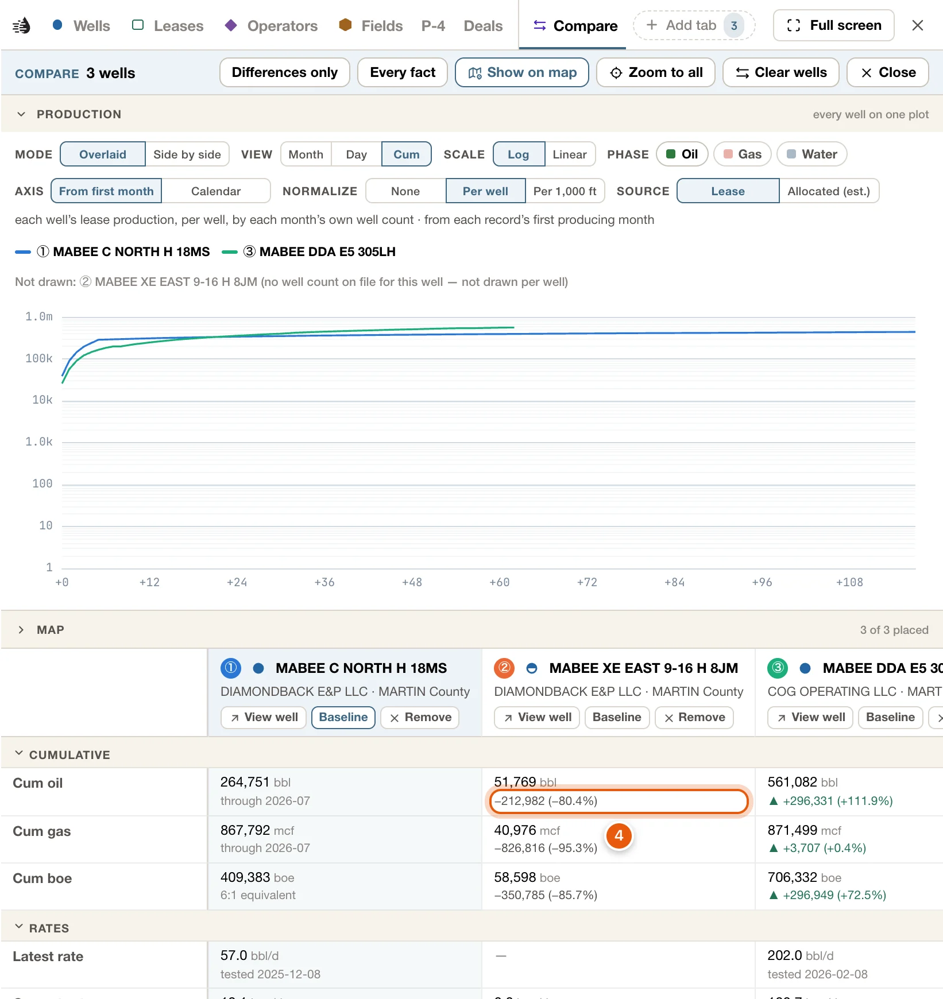
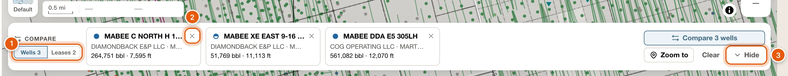
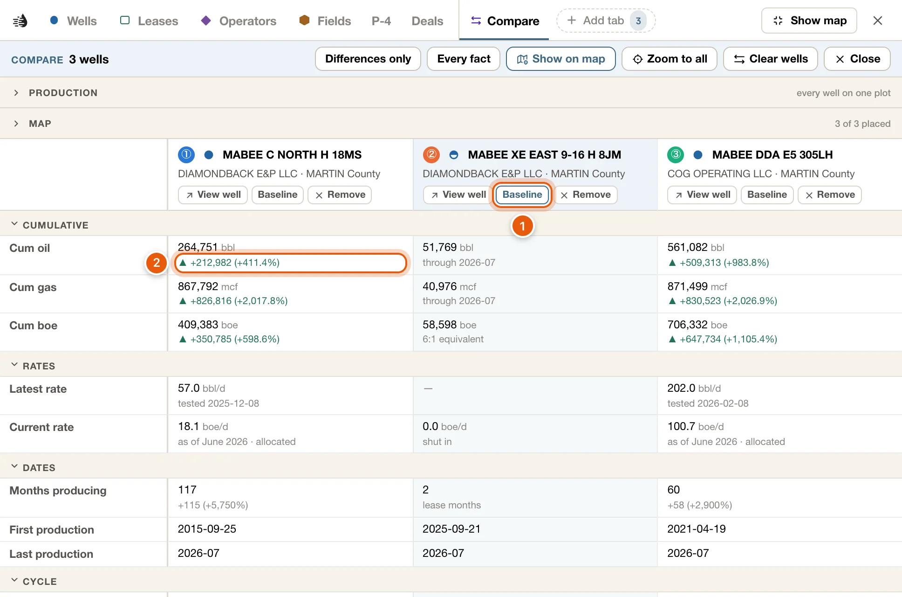

Set up to 12 wells side by side, or 12 leases, fields, operators or selected areas: their production on one chart, and their facts in a grid with the differences worked out. You collect the records in the compare tray at the foot of the map, and compare them on the **Compare** tab beside it.

<Note>
  Compare works with a free account. You need to be signed in to see the comparison.
</Note>

## Compare wells side by side

<Steps>
  <Step title="Add the first well">
    Open a well's [card](/maps/records) and click **Compare**. The button is now pressed, and the compare tray appears at the foot of the map with the well in it.

    <Frame>
      
    </Frame>
  </Step>
  <Step title="Add the wells to set beside it">
    Click another well on the map and click **Compare** in its popup, or open its card and click **Compare** there. Each well joins the tray, in the order you add them.

    <Frame>
      
    </Frame>
  </Step>
  <Step title="Open the comparison">
    Click **Compare *N* wells** on the tray, such as *Compare 3 wells*. The **Compare** tab opens beside the map, and the data tables open with it if they were shut.

    <Frame>
      
    </Frame>
  </Step>
  <Step title="Read the comparison">
    The **Production** chart draws the wells on one plot, each from its first producing month. The line under the controls says what's drawn. Under the chart, the facts grid puts each well in a column, with every figure's difference from the first well.

    <Frame>
      
    </Frame>
  </Step>
</Steps>

## Ways to add a record

| From | How |
|---|---|
| A card | **Compare** on a well, lease, field or operator card, or <kbd>c</kbd> while the card is open. The button is pressed while the record is in the tray. |
| A well's popup | **Compare**. It's pressed while the well is in the tray. |
| A right-click on a well | **Compare** in the popup. |
| The land box | **Compare**, when you opened the box from a well's **Land & owners**. See [Land and owners](/maps/records#land-and-owners). |
| The data tables | Tick rows on the **Wells**, **Leases**, **Operators** or **Fields** tab, then click **Add to compare** in the selection bar under the table. |
| The search panel | **Add to compare** at the end of a row, or <kbd>⌥</kbd> <kbd>Enter</kbd> on it. See [Search](/maps/search). |
| The Search tab | **Compare** at the end of a row, or <kbd>c</kbd> on it. It's pressed while the record is in the tray. See [Search results](/maps/search-results#add-to-compare). |
| A selected area | **Compare** on the **Selected area** card puts the area itself in the tray, to set beside other areas. In its **Operators**, **By lease** and **Fields** blocks, **Compare the top 3** adds the biggest of them. See [Select an area](/maps/selection#add-reshape-save-and-compare). |
| Ask | Ask it to compare wells, leases, fields or operators, and it fills the tray. See [The place card and Ask](/maps/ask-the-map). |

To take a record out, click the same button again (**Compare**, or **Remove from compare** in the search panel), or the record's **×** on the tray.

## The compare tray

The tray appears at the foot of the map with the first record you add, and goes when you take the last one out. Opening and closing cards, drawers or the tables doesn't touch it.

<Frame>
  
</Frame>

- Each record shows its mark, its name as filed, and a line about where it is or who runs it. Under that, a well shows its cumulative oil and lateral, an operator or an area its oil and gas per day, and a lease or field twelve months of oil as small bars.
- Hover a well or a lease to light it on the map. Click any record to open its card. An area opens as the selection on the map, with its card.
- Its **×** takes a record out.
- Drag a record to move it, or press <kbd>⌥</kbd> <kbd>←</kbd> / <kbd>⌥</kbd> <kbd>→</kbd> on it. The order is the comparison's: it sets each record's column, number and color.
- When the tray holds more than one kind of record, chips such as *Wells 3* and *Leases 2* choose which kind it shows, and which the Compare tab compares.

Its buttons:

- **Compare *N* wells** (or leases, fields, operators or areas) opens the **Compare** tab.
- **Zoom to** frames the records on the map. It's the only thing on the tray that moves the map.
- **Clear** takes everything out of the tray.
- **Hide** shrinks the tray to a chip, such as *Compare tray · 3 wells*. Click the chip to bring the tray back.

When the drawer and the tables leave the map too little room, the tray shows only as a chip reading *Compare 3 wells*, which opens the comparison.

## The Compare tab

**Compare *N* wells**, on the tray, opens the tab. While the tray holds records, a **Compare** tab also sits on the row of table tabs, with how many records it holds. The tab never changes your own tabs or their filters.

The band at the top says what's compared, such as *Compare 3 wells*, with the kind chips when the tray holds more than one kind. Then:

- **Differences only** hides the facts every record shares. It needs two records or more.
- **Every fact** shows every fact the cards know. At first, the grid shows the ones that decide between records.
- **Show on map**, on at first, draws the compared wells or leases on the map, on top of whatever it shows. Click it to leave the map as your own tabs have it. Areas are drawn by their own outline, so it's greyed out for them.
- **Zoom to all** frames the records on the map.
- **Clear wells** (or leases, fields, operators or areas) takes that kind out of the tray.
- **Close** closes the tab. The tray keeps what's in it.

### Production

| Control | Choices |
|---|---|
| **Mode** | **Overlaid**: every record on one plot. **Side by side**: one chart per record, on the same months. |
| **View** | **Month**, **Day** or **Cum**. |
| **Scale** | **Log** or **Linear**. |
| **Phase** (**Phases** side by side) | **Oil**, **Gas** or **Water**. Overlaid draws one; side by side draws any of them. |
| **Axis** | **From first month** starts each record at its first producing month. **Calendar** lines them up by date. Overlaid only. |
| **Normalize** | **None**, **Per well**, or **Per 1,000 ft** of lateral. |
| **Source** | Wells only. **Lease** draws each well's lease production. **Allocated (est.)** draws the well's estimated share of it. |

At first the chart is **Overlaid**, **Cum**, **Log**, **Oil**, **From first month**, **Per well**, with wells drawn from their **Lease**. The line under the controls says what's drawn, for example *each well’s lease production, per well, by each month’s own well count · from each record’s first producing month*. Your choices last until you reload Maps.

A record that can't be drawn one way says why. An operator, a field or an area has no lateral total, so it isn't drawn **Per 1,000 ft**. An area's production is its leases', each counted whole.

### Map

**Map**, below the chart, is closed at first. Open it to see the records as numbered dots on a small map, in their colors. An operator has no one place on the map, so operators have none.

### The facts grid

<Frame>
  
</Frame>

- One column per record, in the tray's order. Each column head has the record's number (①, ②…), its mark and its name, and **View well** (or **View lease**, **View field**, **View operator** or **View area**), **Baseline** and **Remove**. **View area** makes the area the selection on the map and opens its card.
- Under every figure in the other columns is its difference from the **Baseline** column, such as *+1,234 (+12.5%)*, or *same*. The baseline is the first record, unless you click **Baseline** on another.
- ▲ marks a difference that is better, such as more oil, a higher rate, or fewer days to first production. Depths, dates and shares get a difference without a ▲.
- Facts come in groups. Click a group's name to fold it.
- A dash means the fact isn't on file for that record. Hover it to see why.
- To move a column, click its head and press <kbd>Alt</kbd> <kbd>←</kbd> / <kbd>Alt</kbd> <kbd>→</kbd>. The tray follows.

When you've corrected or added values on any of the compared wells in [My Wells](/maps/my-wells), a **Your data** group comes first: your values, and **Your records**.

## Limits

- **Like with like.** Wells are compared with wells, leases with leases, areas with areas. The tray can hold several kinds at once; the chips choose which kind you're comparing.
- **Up to 12 of each kind.** An add that would go over is refused whole, and nothing is added: *That would put 14 wells in the compare tray; it holds at most 12 of one kind. Take some out or pick fewer — nothing was added.*
- A record already in the tray isn't added twice.

## Saved with your account

What's in the tray is remembered for your account and project. It's still there after a reload and on another computer, and each project keeps its own. Whether the tray is hidden is kept on this computer.

## Compare production, in Analyze

The Leases table has a quicker chart of its own. Tick up to 12 leases and click **Compare production** in the selection bar: **Analyze** opens a **Compare** tab with their monthly production on one chart. It charts only the ticked leases, and goes when you close it. See [Compare production](/maps/charts#compare-production).

The compare tray is different: it holds wells, leases, fields, operators and areas, keeps them until you take them out, and sets their facts side by side as well as their production.
