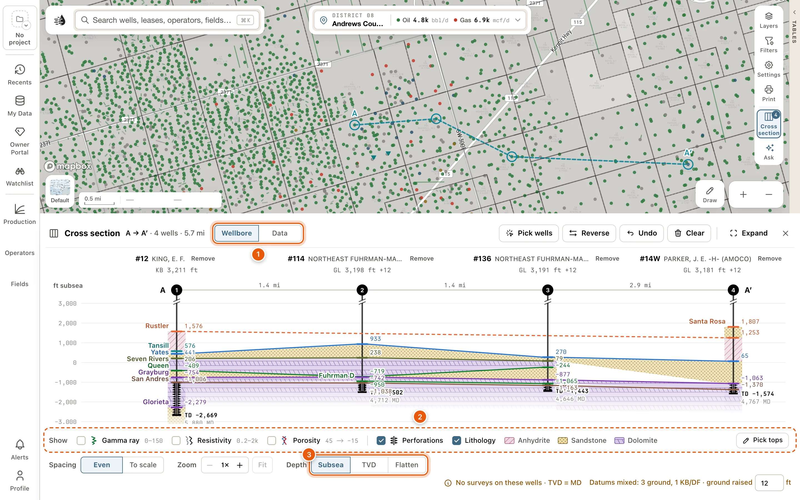
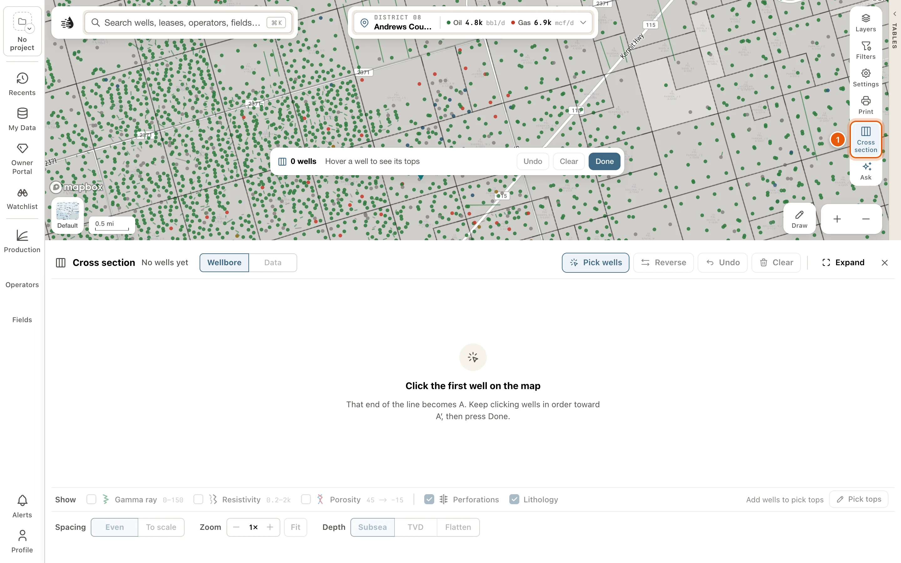
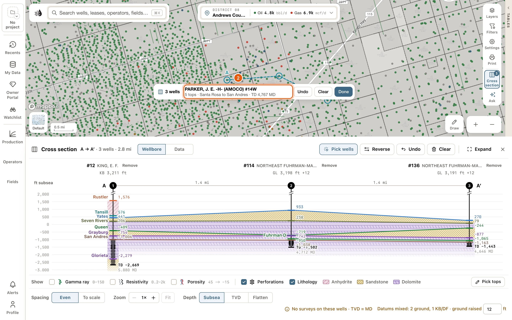
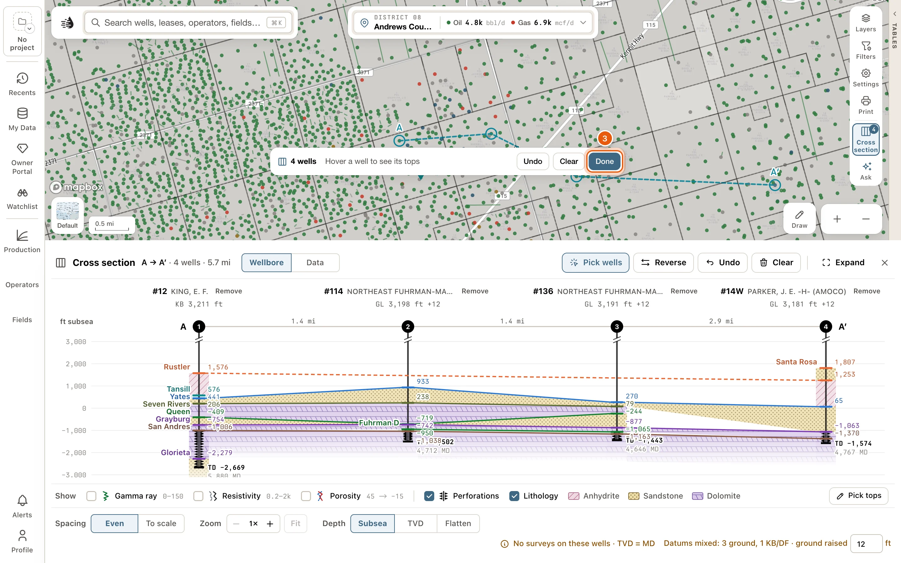
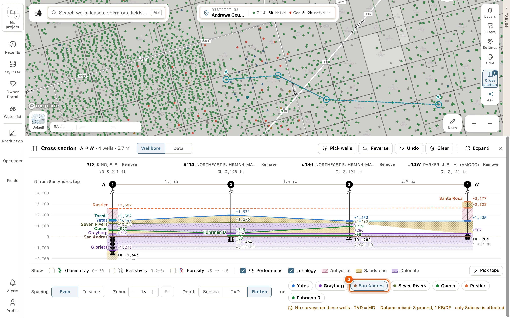
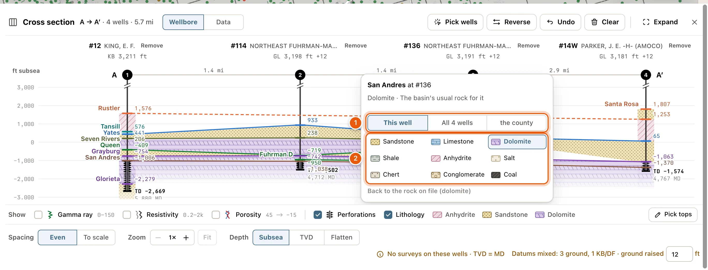
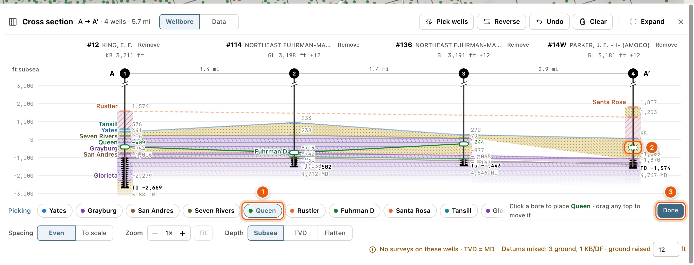
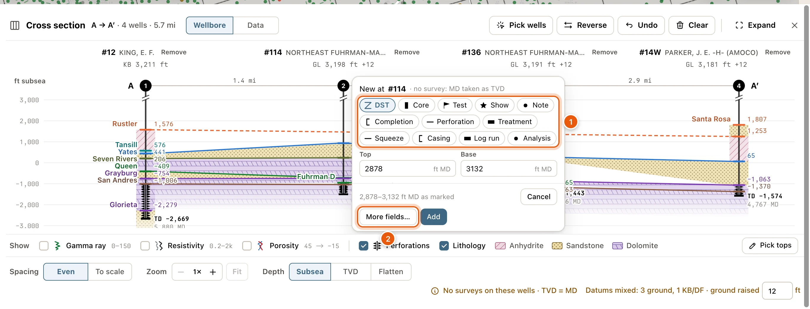

A cross-section lines up the wells you click on the map, from A to A′, and hangs them by their formation tops: yours, your team's and the RRC's. Each formation is carried from well to well, so you can see where it thickens, thins or drops.

<Note>
  - The **Cross section** tool, on the right side of the map, is there for everyone.
  - The section itself opens at the bottom of the map with a [paid plan](/get-started/plans). Without one, the panel asks you to sign in or choose a plan.
</Note>

<Frame>
  
</Frame>

## Build a section

<Steps>
  <Step title="Click Cross section">
    Click **Cross section** on the right side of the map, above **Ask**, or press <kbd>X</kbd>. The section panel opens at the bottom of the map, and the map now takes clicks for the section: clicking a well won't open its popup or card until you're done.

    <Frame>
      
    </Frame>
  </Step>
  <Step title="Click wells from A to A′">
    Click the first well: that end of the line is A. Keep clicking wells in order toward A′.

    Before you click, point at a well. The bar at the bottom of the map says how many tops it has, from which formation to which, and its total depth, or *Nothing on file*, so you can pass over a well that would draw empty.

    <Frame>
      
    </Frame>
  </Step>
  <Step title="Click Done">
    Click **Done** in the bar, or press <kbd>Esc</kbd>. The map goes back to normal, and the section stays in the panel.

    <Frame>
      
    </Frame>
  </Step>
  <Step title="Flatten on a top">
    To line the wells up on one formation, click its top in the section, or choose **Flatten** beside **Depth** at the foot of the panel and pick the formation after **on**.

    <Frame>
      
    </Frame>
  </Step>
</Steps>

## Picking wells

While **Cross section** is pressed:

- Clicking a well adds it to the section. Clicking it again takes it out.
- The wells in the section are ringed on the map, with a dashed line from A to A′.
- The number on the **Cross section** button counts the wells.
- The bar at the bottom of the map has the well count, the preview of the well under the pointer, **Undo**, **Clear**, **Show section** (when the panel is shut) and **Done**.

A section holds up to 30 wells. Past that, the map says *A section holds 30 wells. Take one out to add another.*

You can also add a well from its card: click **Cross section** at the foot of its **Well logs** block. The button stays pressed while the well is in the section. See [Well logs on the map](/maps/well-logs#on-the-well-card).

With the **Wells** layer off and **Logs** on, you can click a well's log capsule to add it.

To make a section from an area of the map, select the area and click **Cross section** on its **Selected area** card. Up to 30 of its wells go into the section, in order along the area, and **Undo** brings back the wells you had. With more than 30, the map takes clicks so you can pick them, and the bar says so, such as *Pick up to 30 of the 412 wells in the area*. See [Select an area](/maps/selection).

## The section panel

The panel's top line says what you have: *A → A′ · 5 wells · 3.2 mi*, or *No wells yet*.

| Button | Does |
|---|---|
| **Wellbore** / **Data** | Draws the wells as bores with their tops, or lists their facts in the same columns. |
| **Pick wells** | Starts taking clicks on the map again. It stays pressed while the map takes clicks. Click it again, or **Done** in the bar on the map, to stop. |
| **Reverse** | Runs the section the other way. |
| **Undo** | Takes back the last change to the wells (an add, a removal, a move, **Reverse** or **Clear**) or the last top you picked. |
| **Clear** | Takes every well out. **Undo** brings them back. |
| **Expand** / **Restore** | Gives the section the whole screen, and back. |
| ✕ (**Close the cross section**) | Closes the panel. Its wells are kept. <kbd>Esc</kbd> closes it too. |

### Reading the section

- Across the top, the well strip gives each well's number and lease, with its datum (like *KB 2,746 ft*) under it, or what's wrong with it. With a log track on, that line adds what the well's log carries, such as *KB 2,746 ft · GR · Res*. Click a well's name to open its [card](/maps/records). **Remove**, beside the name, takes the well out of the section, and **Undo** puts it back.
- Under it, the ruler has the wells' numbered markers, the distance between neighbours, and A and A′ at the ends.
- Each bore runs down to total depth. Perforations are triangles on the bore, and a drill-stem test is a Z across its interval. Point at either for its depths.
- Each formation is named once, where its line starts, and each well shows its depth. A formation fills its stretch of the bore down to the next top, and is carried to the next well as one layer.

Point anywhere in the section for a level line with its depth on the axis, and each formation's thickness beside the nearest bore. With log tracks on, the line also reads each curve at that depth, such as *GR 87*. The map follows along:

- The well whose column you're pointing at lights up on the map.
- Point at a formation, and its depth at every well in the section is written beside the well on the map.

### Data

**Data** lists each well's facts under its own name: the distance from the last well, its datum, total depth, the digital logs QuickScout holds for it, whether it has a directional survey, the depth of each top, and the same facts as [Compare](/maps/compare). Your compare list isn't touched.

## The Show row

The row under the section chooses what the bores carry. Each check has its mark beside it, so the row is the key too.

- **Gamma ray**, **Resistivity** and **Porosity** draw log tracks beside every bore, each with its scale: gamma ray on the left (*0–150*), resistivity (*0.2–2k*) and porosity (*45 → −15*) on the right. They draw from a digital log QuickScout holds for the well. Where the density log reads more porosity than the neutron, the porosity track is shaded between them.
- **Perforations**, drawn as triangles on the bores.
- One check for each kind of well record the section holds, such as **DST** or **Core**. See [Well records on the section](#well-records-on-the-section).
- **Lithology** fills each formation with its rock's pattern, and lists the rocks it uses. *No rock on file for these tops* means QuickScout has no rock for them yet. With **Gamma ray** on, it also fills the gamma ray curve: shale where it reads 75 API and up, and the formation's rock elsewhere. See [Set the rock](#set-the-rock).
- **Pick tops**, at the right end. See [Pick tops](#pick-tops).

With a log track on, a note in the row says when the logs can't be drawn, such as *No digital logs loaded for these wells*, *Regulatory logs need a paid plan*, or *The logs couldn’t be read · Retry*.

A log track says why it's empty, down its middle:

| Track says | Means |
|---|---|
| *No digital log* | QuickScout holds no digital log of this well that you can open. |
| *Not logged* | The well's log has no curve for this track. |
| *Scan only · Open* | The well's log is a scan. Click to open it in the [Log tab](/maps/well-logs#the-log-tab). |
| *Log above · Scroll up* / *Log below · Scroll down* | The log is above or below the depths shown. Click to scroll there. |
| *Log above · Open* / *Log below · Open* | The log is outside the section's depths. Click to open it in the Log tab. |
| *Not read · Retry* | The log couldn't be read. Click to try again. |

## The foot

- **Spacing**: **Even** spaces the wells evenly. **To scale** spaces them by the distance between them. It needs three or more wells.
- **Zoom**: **+** (**Zoom in**) and **−** (**Zoom out**) stretch the depth, up to 8×, and **Fit** shows the whole depth again. Zoomed in, scroll or drag the section to move up and down.
- **Depth**: **Subsea** hangs the wells by depth below sea level. **TVD** hangs them by true vertical depth from each well's own datum. **Flatten** hangs them on one formation's top, chosen from the chips after **on**: the tops two or more wells share.

Notes at the right end:

- *No surveys on these wells · TVD = MD*: none of the wells has a directional survey, so measured depth stands in for true vertical depth.
- *Datums mixed: 2 ground, 3 KB/DF · ground raised 12 ft*: some wells' depths are measured from the ground and some from the drilling floor. On **Subsea**, the ground ones are raised by the number in the box, 12 ft unless you change it. A well with both heights on file uses its own. On **TVD** and **Flatten**, the note says *only Subsea is affected*.

## Flatten, reorder and set the rock

### Flatten the section

Click a formation's top, or its name, in any well. The section hangs on it, level across every well. Click it again to stop. This works for tops that two or more wells share. Pointing at one fades the others.

### Move a well along the section

Drag a well's name in the strip, or its column in the section, sideways. The section is laid out as it will be while you drag, and the well stays where you let go. <kbd>Esc</kbd> puts it back.

Once you've clicked a well's name, or moved to it with <kbd>Tab</kbd>, **Move left** and **Move right** appear under it. Each moves the well one place toward A or A′. From the keyboard, <kbd>Alt</kbd> + <kbd>←</kbd> or <kbd>→</kbd> on the well's name does the same.

### Set the rock

Click a formation's layer in the section (not its top line) to open its rock. The picker says what the rock is now and where that came from, such as *Limestone · From the formation's name*.

1. Choose where to set it: **This well**, **All *5* wells** (every well in the section with the formation), or the well's county, like *Andrews County*.
2. Click a rock: **Sandstone**, **Limestone**, **Dolomite**, **Shale**, **Anhydrite**, **Salt**, **Chert**, **Conglomerate** or **Coal**.

It saves straight away, and a message under the section offers **Undo**. Your team sees the rocks you set. **Back to the rock on file** takes your own setting off, back to the rock QuickScout had.

<Frame>
  
</Frame>

## Pick tops

Pick or move formation tops right on the section. The tops you pick are yours: your team sees them, and they show on the well's card and on the [Formation tops](/maps/formation-tops) layer.

Click **Pick tops** at the right end of the Show row. The row becomes the picking row: **Picking**, a chip for each formation in the section, **Add formation** and **Done**. Until you choose a formation, the hint says *Choose a formation, then click a bore*.

1. Click a formation's chip. The hint says *Click a bore to place ‹formation› · drag any top to move it*.
2. Click a well's bore where the top belongs. The pick lands on the level line. With log tracks on, you can click anywhere across a well's tracks, so you can pick the top on its log.
3. Drag any top to move it. Dragging the RRC's or a teammate's top leaves theirs on file and makes a pick of yours where you let go.

Where a well has no pick of the formation, a faint mark shows where its neighbours put it. Click it, or drag it, to place a pick there.

Each pick saves on its own, and the message under the section offers **Undo**. **Undo** at the top of the panel takes picks back too.

Click a pick to select it, then use the keys:

| Key | Does |
|---|---|
| <kbd>↑</kbd> / <kbd>↓</kbd> | Moves it 1 ft. Hold <kbd>Shift</kbd> for 10 ft. |
| <kbd>←</kbd> / <kbd>→</kbd> | Moves to the same formation in the next well. |
| <kbd>Enter</kbd> | Places a pick where the neighbours put it. |
| <kbd>Delete</kbd> | Takes off your own pick. |
| <kbd>Esc</kbd> | Lets go of the pick. Press it again to stop picking. |

To pick a formation the section's wells don't have yet, click **Add formation** and type in **Find or name a formation**. **NEAR THIS SECTION** lists formations picked in wells nearby, and **YOUR FORMATIONS** your own. A name that isn't on either list can be added as a new formation.

<Frame>
  
</Frame>

When **Pick tops** can't be used, the reason is written beside it:

- *Sign in to pick tops*
- *Switch to Wellbore to pick tops*: you're on **Data**.
- *Add wells to pick tops*

On a section flattened on a formation, that formation sits level at every well and can't be picked there. The hint says to pick it on **Subsea** or **TVD**.

## Well records on the section

The wells' records are marked beside their bores at their depths: drill-stem tests, cores, tests, shows, notes, casing strings, log runs and the rest. A perforation record is drawn as the bore's perforation triangles, and a record with no depth isn't drawn. Add one right on the section:

1. Drag down a bore over the range to mark. A click on the bore marks one depth.
2. A box opens beside the bore, titled with the well's number, like *New at #303*. Choose the kind, such as **DST**, **Core**, **Test**, **Show**, **Perforation** or **Note**, or one your team made.
3. Check **Top** and **Base** (in ft MD), and fill in the few fields that matter for the kind, such as **Recovered** for a DST. Add a **Note** if you like. When the bore shows one of the well's completions, a perforation, treatment, test or squeeze can be filed **Under completion**.
4. Click **Add**. The message under the section offers **Undo**. **Cancel** closes the box without adding.

**More fields…** opens the full editor in the drawer on the left, with the kind and depths filled in. The section closes while it's open, and **Back to the cross-section** brings it back.

Click a record's mark to open it. Your own have **Edit** and **Delete**, and the message under the section offers **Undo**. Records you can't change, such as your team's, have **Open the well’s records**. See [Well records](/maps/depth-records).

<Frame>
  
</Frame>

## What's kept

Your section is kept for your account and project, so it's there after a reload and on another computer: its wells and their order, **Depth**, **Wellbore** or **Data**, **Spacing**, what the Show row shows, and whether the panel was open.

Picking wells, picking tops, the depth zoom and **Undo**'s history last only while Maps is open. The height you raise ground wells by is kept for your account in every project.

## Troubleshooting

<AccordionGroup>
  <Accordion title="A well says Nothing on file">
    QuickScout has no tops, perforations, records or total depth for that well, so there's nothing to draw. Take it out with **Remove** beside its name, or add its tops yourself in the [tops editor](/maps/formation-tops#edit-tops-on-a-well).
  </Accordion>
  <Accordion title="A well says No elevation: see it on TVD">
    The well has no elevation on file, so it can't be placed below sea level. Choose **TVD** beside **Depth** to see it.
  </Accordion>
  <Accordion title="A well is left out when I flatten">
    The well has no top for the formation you flattened on, and says *No ‹formation› top*. Flatten on a formation every well shares, or pick the top in that well.
  </Accordion>
  <Accordion title="A horizontal well stops short">
    *Horizontal, no survey: lateral left off* means the well has no directional survey on file, so only its vertical part can be drawn.
  </Accordion>
  <Accordion title="Clicking a well on the map opens nothing">
    The map is still taking clicks for the section. Click **Done** in the bar at the bottom of the map, or press <kbd>Esc</kbd>.
  </Accordion>
  <Accordion title="A well says Not read">
    The well couldn't be read just then. Click **Retry** beside it.
  </Accordion>
</AccordionGroup>
