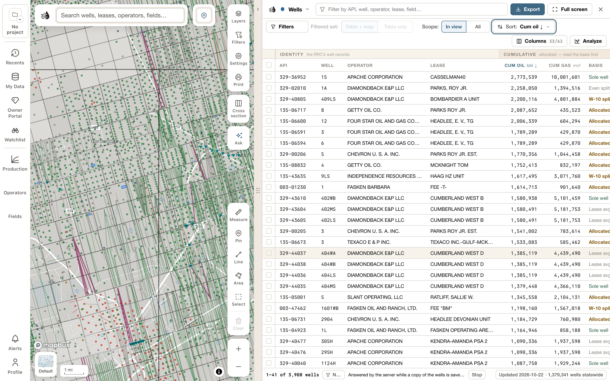
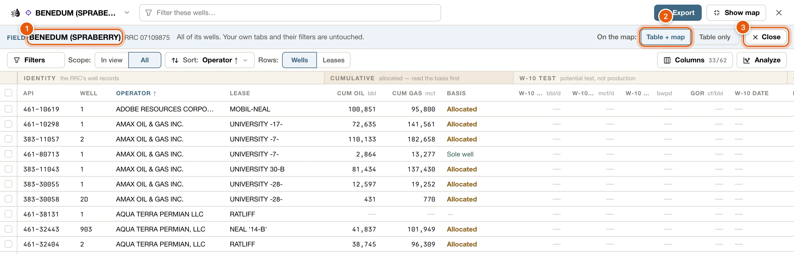
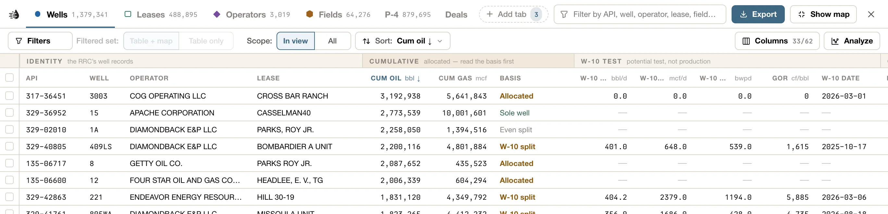
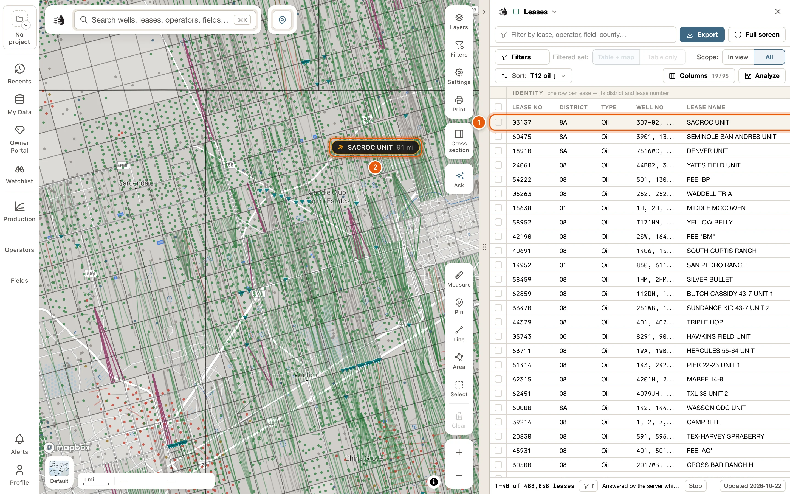

The data tables sit beside the map. You need to be signed in to use them.

- Click the **Tables** handle on the map's right edge to open them. Drag the handle to resize, or double-click it for the default width.
- **Full screen**, at the top right, gives the tables the whole window. The same button then reads **Show map**: click it, or press <kbd>Esc</kbd>, to bring the map back.
- The **×** (**Close the tables**) closes them.

<Frame>
  
</Frame>

<Tip>
  Every button keeps its words at any width. When the tables are narrow, the toolbar wraps onto more lines, and the tabs fold into one button named after the tab you're on. Click it for every tab with its count, and for **Add or arrange tabs**.
</Tip>

## Tabs

| Tab | What it shows |
|---|---|
| **Wells** | One row per well. Historic wells can share an API number, so an API may appear more than once. |
| **Leases** | One row per lease (district + lease number). For gas, one row is one well. |
| **Operators** | One row per operator, totalled over its leases in view. See [Operators & Fields](/maps/operators-fields#operators). |
| **Fields** | One row per RRC field, with its lifetime totals and how much the map can place. See [Operators & Fields](/maps/operators-fields#fields). |
| **P-4** | Operator transfers. Switch **Rows** to see one row per **Transfers** or per **Filings**. |
| **Frac** | One row per FracFocus treatment. |
| **Pads** | New ground detected from satellite imagery. |
| **Rigs** | Sites watched by radar for rigs and frac spreads. |
| **My wells** | The wells you and your team have corrected or added in [My Wells](/maps/my-wells). Open it from **Open the grid →** under *My wells* in My Data, **Open the grid** on the **Layers** card, or **My wells table** in the well editor. |
| Search | What your search found, on a tab named after your words, such as *“pioneer”*. See [Search results](/maps/search-results). |
| Record | One record's wells, leases or P-4 transfers, or everything inside an area you selected, on a tab named after it. See [The Record tab](#record-tab). |
| **Compare** | The records in your compare tray, side by side. See [Compare](/maps/compare). |
| **Log** | One well log opened from the map. See [Well logs on the map](/maps/well-logs). |
| **Deals** | Your deals, part of the Enterprise workspace (called Prospect in some places). It comes with a [paid plan](/get-started/plans). |

Every tab except Pads and Rigs shows its statewide row count; **My wells** and **Deals** count yours. A dot on a tab means it has filters on.

Four tabs come and go: the Search tab, the Record tab, **Compare** and **Log**. Each sits after your own tabs, with its own symbol, only while it has something to show: a search is on, a record is open, the compare tray holds something, or a log is open. They never change your own tabs or their filters. They're never saved either, so they're gone on your next visit. (The records in your compare tray are kept; see [Compare](/maps/compare).)

### Choose your tabs

**Wells**, **Leases**, **Operators**, **Fields**, **P-4** and **Deals** are shown at first. To add **Frac**, **Pads** or **Rigs**, click **Add tab** at the end of the tab row (its number counts the tabs you can add) and pick one under **Add a tab**. **My wells** isn't in that list; it joins the row when you open it from My Data, the Layers card or the well editor.

The same popover arranges your tabs. Under **Your tabs, in order**, **Move up** and **Move down** move a tab, and **Remove** takes it off the row. You can also drag a tab by its grip, or press <kbd>Alt</kbd> + <kbd>↑</kbd> / <kbd>↓</kbd>. The last tab can't be removed. Your tabs are remembered for your account and project.

Running a search opens the panel on the Search tab. See [Search results](/maps/search-results).

Each tab keeps its place when you switch away and come back: its scroll position and ticked rows, as long as its rows haven't changed. Its search, filters and sort are kept too.

## The Record tab

Some buttons list one record's rows in a tab of their own, the Record tab, named after that record:

- **Show leases** or **Show wells** on an operator's, field's or county's card.
- A row of **Wells by status** on a county's card, such as **Permitted, not drilled**, for just those wells. The tab is named like *Midland County · permitted, not drilled*.
- **Show the whole filing** on a P-4 card.
- **Show on map** on a row of the Leases tab's **Midstream** view, for that company's leases.
- An operator, field or lease number typed in the [search box](/maps/search#search-by-number).
- The button that counts a record's wells under **GO TO — RRC RECORD** in the [start drawer](/maps/tour#the-start-drawer), such as *Show 12 wells on map*.

The card you came from stays open, and your own tabs and their filters are left exactly as they were.

An area you [select on the map](/maps/selection) gets the same tab. **Table**, on its **Selected area** card, opens the **Selected area** tab with everything inside the area. The card's lists open it too: a row of its **Wells by status**, for example, lists just those wells. **Rows** there switches between the area's **Wells**, **Leases**, **Operators**, **Fields**, **Frac jobs** and **Transfers**. See [Its rows in the data tables](/maps/selection#its-rows-in-the-data-tables).

<Frame>
  
</Frame>

The band at the top of the tab says:

- What the record is (*Field*, *Operator*, *Lease*, *County*, *P-4 filing*), its name, and its number, such as *RRC 23366500*. For a selected area, its size stands in place of a name.
- *All of its wells. Your own tabs and their filters are untouched.* The tab always opens on the whole record, with **Scope** on **All**. If you set **Scope** to **In view**, the note reads *Only its wells in view — not the whole field.*, and **Show all of them** puts the rest back.
- **On the map**, on the Wells and Leases rows: **Table + map** (the start) shows only the record's wells or leases on the map while you're on the tab with the tables open. Close the tables and the map goes back to your own tab's filters; open them again and the Record tab takes the map back. **Table only** leaves the map as your own tabs have it.
- **Close** ends the tab. Your own tab comes back as you left it, and so does the map.

**Rows** switches between the record's **Wells** and **Leases**; a P-4 filing lists its **Transfers**. Filter, sort, select and [export](/maps/exports#export-from-the-data-tables) them as on any other tab. Those filters belong to the Record tab and go when you close it.

One record at a time: opening another record's rows replaces the one on the tab. Running a search takes the screen, but the Record tab stays on the tab row, one click away.

## The top row

<Frame>
  
</Frame>

Beside the tabs:

- A filter box for the tab you're on. For example, Wells reads *Filter by API, well, operator, lease, field…* and looks in those columns. Type at least two characters. Several words must all match; put a phrase in quotes to keep it together. What you type counts as a filter. The Search tab has none: its results have their own **Filters**.
- **Export** downloads what the table is listing, as CSV, or as GeoGraphix, OpenWorks and DRI files. See [Export data](/maps/exports#export-from-the-data-tables).
- **Full screen** and **×**.

On a narrow panel, the filter box, **Export** and **Full screen** move to a line of their own under the tabs.

## The toolbar

From left to right:

- **Filters**: narrow the rows. Its number counts the filters that are on. See [Filters & the map](/maps/filters).
- **Filtered set**: whether the filters apply to **Table + map** or **Table only**. It's always there, greyed out until a filter or a search is on. See [The map follows your filters](/maps/filters#the-map-follows-your-filters).
- **Scope**: **In view** shows only rows inside the map's visible area. **All** shows every row the filters match, not just the ones in view, and dims the rows that are off the map. Wells and the Record tab start on All; the other tabs start on In view.
- **Sort**: order rows by any column on screen, **Ascending** or **Descending**, or choose **None**. Wells, Fields, Frac, Pads and Rigs can also sort by **Nearest the map center**. The button reads your choice, such as *Sort: Cum oil ↓*.
- **Rows**: on P-4, **Transfers** or **Filings**; on a Record tab, **Wells** or **Leases**. A selected area's tab has six kinds of row, so **Rows** is a menu there. Scope stays the same when you switch.
- **Columns**, at the right, with how many columns are showing, such as *33/62*: pick one of the **Views** (ready-made column sets, like *Screening*, or *Production* on Leases), or tick columns yourself. Each column shows how filled-in it is. **Row height** switches between **Compact** and **Roomy**.
- **Analyze**, at the far right: charts, type curves and more over these rows. See [Analyze](/maps/charts).

On P-4, a **Transfer window** band above the rows narrows transfers by date: **All**, **Since 2021**, **2011–2020**, **1993–2010** or **Pre-1993**.

### Column headers

- Click a header to sort by it.
- Drag a header to move the column. Drag its edge to resize it; double-click the edge to reset.
- Click the pin on a header to keep that column in view while you scroll sideways.

## The footer

The footer tells you which rows you're seeing (for example *1–50 of 12,345 wells*) and which filters are on. Click the filter summary to edit them.

On the right, a stamp shows the date of the data the table is reading. Click it to open **Map data**, which says what's stored on this device and fixes downloads that are stuck. A dot on the stamp means something there needs attention. See [Map data on this device](/maps/offline).

Exports report here too: while a file is written, and when it's done. A big file is written in batches, and the footer counts them off with **Cancel**. Downloads report here as well, with **Stop**.

When the QuickScout server answers the table instead of a copy on this device, the footer says so, and why: *Answered by the server — …*. P-4 and Frac are always answered by the server. Wells, Leases, Operators and Fields are answered by it until their copy is on this device, and always if you've [turned off keeping map data here](/maps/offline#answer-from-the-server-instead).

## Open a row

Click a row to open its [card](/maps/row-cards) beside the table. With a card open:

| Key | Does |
|---|---|
| <kbd>↑</kbd> / <kbd>↓</kbd>, or <kbd>k</kbd> / <kbd>j</kbd> | Steps to the previous or next row. |
| <kbd>c</kbd> | Adds the record to the [compare tray](/maps/compare), or takes it out. |
| <kbd>Esc</kbd> | Closes the card. |

The **Tables** handle shows and hides the tables. It doesn't close a card: with the tables hidden, the card stays open over the map. Close a card with its **×** or <kbd>Esc</kbd>.

### Where a row is on the map

Hover a row and the map marks it in amber with a pulsing pin: a well's path, a lease's outline and wells, a field's leases. The map doesn't move.

When that spot is out of sight, off the screen or under the tables or a card, a chip at the edge of the map points to it, with the row's name and how far away it is. Click the chip to move the map there. While a card is open, its row keeps its chip, so you can always find the record you're reading.

<Frame>
  
</Frame>

## Select rows

Tick the checkboxes to select rows. <kbd>Shift</kbd>-click selects a run of rows. The checkbox in the header selects every row in the view (**Select all *N* wells in this view**).

A bar opens under the rows, just above the footer, so ticking a row never moves the table. What it offers depends on the tab:

| Tab | Actions |
|---|---|
| **Wells** | **Show N on map**, **Export CSV**, **Add to watchlist**, **Add to compare**, **Edit** (one well) or **Edit together**, **Copy APIs** |
| **Leases** | **Export CSV**, **Export production**, **Compare production**, **Add to compare**, **Add to watchlist**, **Add to project scope**, **New project from these**, **Add to deal draft**, **Copy lease keys** |
| **Operators** | **Export CSV**, **Chart production**, **Add to compare**, **Copy operator numbers** |
| **Fields** | **Export CSV**, **Add to compare**, **Copy field numbers** |
| **P-4** | **Export CSV**, **Copy filing ids** |
| **Frac** | **Export CSV**, **Copy disclosure ids** |
| **Pads** | **Export CSV**, **Copy detection ids** |
| **Rigs** | **Export CSV**, **Copy site ids**, **Copy APIs** |

**Clear**, at the end of the bar, unticks everything.

- **Add to compare** puts the ticked wells, leases, operators or fields in the compare tray at the foot of the map, up to 12 of a kind. If that's more than the tray has room for, the button is greyed out; point to it to see how many to tick. See [Compare](/maps/compare).
- **Edit together** sets your own value for a field on every ticked well at once, up to 100 wells. Your team sees your values too; see [Your values and your team's](/maps/my-wells#your-values-and-your-teams). It's part of [My Wells](/maps/my-wells), which needs a [paid plan](/get-started/plans).

<Note>
  On a table the server answers (always **P-4** and **Frac**), a selection ticked row by row, or with <kbd>Shift</kbd>-click, can't be used past a few thousand rows. To act on more, tick the box in the header to take every row in the view, or narrow the table with **Filters** first.
</Note>

<Note>
  **Add to watchlist**, **Add to project scope**, **New project from these** and **Add to deal draft** are part of the Enterprise workspace (called Prospect in some places), which comes with a [paid plan](/get-started/plans). Without one they're greyed out. **Add to watchlist** and **Add to project scope** also need an active project. Point to a greyed-out button to see why.
</Note>

{/* enterprise-hold: the Deals row of the Tabs table, the end of the sentence under it, and the Note above.
| **Deals** | Your deals (Enterprise). See [Deals](/enterprise/deals). |

…show their statewide row count, and Deals shows how many deals you have.

<Note>
  Watchlists, projects and deals are part of the [Enterprise workspace](/enterprise/overview). Without it, those buttons are greyed out. **Add to watchlist** and **Add to project scope** also need an [active project](/enterprise/projects).
</Note>
*/}

On Wells, if the map is showing only certain wells and you pan away from all of them, the footer offers **Fly back to them**.
