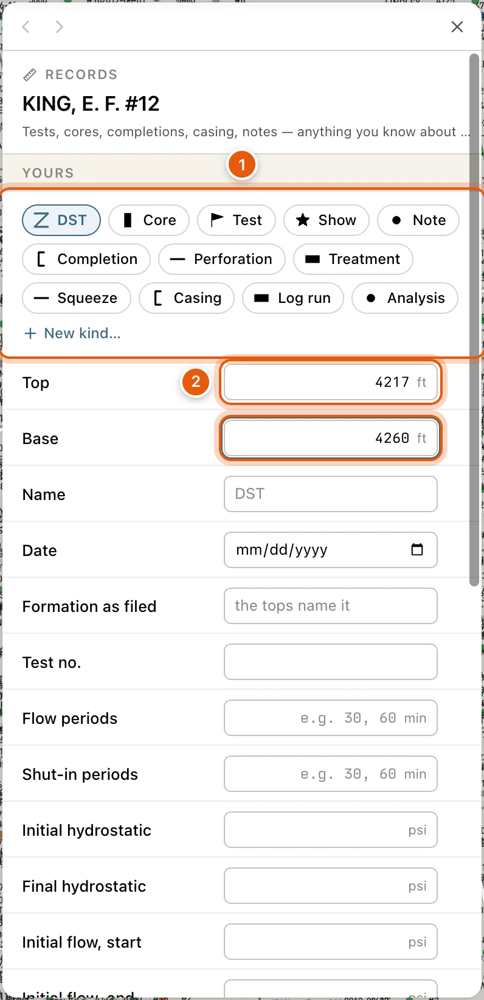

Anything you know about a well can be kept on it as a record: a drill-stem test, a core, a production test, a show, a completion with its perforations and treatments, a casing string, a log run, an analysis, or a plain note. A record sits over a depth range, or at one depth. A completion, an analysis or a note can also go without a depth. Your team sees what you add, and the records show on the well's card, on the [cross-section](/maps/cross-section) and along the [log](/maps/well-logs).

<Note>
  - Reading a well's records needs a free account. See [Sign in](/get-started/sign-in).
  - Adding and changing records needs a [paid plan](/get-started/plans).
</Note>

## On the well card

A well's [card](/maps/records) lists its records under **Records**, shallowest first, near its formation tops. The note beside the heading counts them by kind, like *2 completions · 6 perforations · 1 DST · 1 core*.

Each record is one line: its mark, then its kind, depths and what matters most for its kind. For example, *DST 3 · 5,616–5,640 ft · 1,800 ft gas cut oil · ISIP 1,940 / FSIP 1,880 psi*. Under it: the formation it's in, its date, and whose it is. A completion's perforations, treatments, tests and squeezes are listed under it, indented.

Click a record to open the whole of it: every figure, its lists (a DST's pipe recovery, a core's analysis) and its note. Click it again to close it.

- **Edit** opens the editor. A well with no records has **Add one** instead.
- The formation comes from the well's [formation tops](/maps/formation-tops). Where the tops don't name one, the formation the record itself gives is shown, marked *(as filed)*.
- Records you brought in with an import in [My Wells](/maps/my-wells#import-wells-and-records) are listed as *Yours · scout ticket*.
- The RRC's own potential tests aren't repeated here. They show on the cross-section and the log.

{/* screenshot: maps-depth-records-card — a well card scrolled to Records: a completion with two perforations under it, a DST opened to show its figures and pipe recovery, and Edit. Needs demo records on the well. Annotate: 1 = an opened record, 2 = a completion's records indented under it, 3 = Edit */}

## Add or change records

Open the editor with **Edit** or **Add one** under **Records** on the well's card. It opens in the drawer on the left, headed **RECORDS** and the well's name.

You can also get there from:

- The **Well data** tab of the well editor: **Add a record**, or **Records · 3** when the well has some. See [My Wells](/maps/my-wells#your-own-fields-and-records).
- The cross-section: **More fields…** on a new record, **Edit** on one of yours, or **Open the well’s records** on one that isn't yours. The editor then has **Back to the cross-section**. See [Cross-sections](/maps/cross-section#well-records-on-the-section).

<Steps>
  <Step title="Choose the kind">
    Under **YOURS**, click the button for the record's kind, such as **Add a DST**, **Add a Core** or **Add a Completion**. There's one for each kind in [the table below](#what-each-kind-holds). Kinds your team made appear here too, as **Add** and the kind's name.

    Under a completion of yours, **Add a perforation here** (or a treatment, a test or a squeeze) files the new record under that completion.
  </Step>
  <Step title="Give its depths">
    Type the **Top** in feet, measured depth. Leave **Base** blank for a record at one depth. A completion, an analysis or a note can go without a top.
  </Step>
  <Step title="Fill in what you know">
    - **Name**: leave it blank for a name made from the kind, like *DST 3*.
    - **Date**: the day of the test or core. For a completion, the day it was completed.
    - **Formation as filed**: the formation the record names. Leave it blank to let the well's tops name it.
    - **Under completion**: for a perforation, a treatment, a test or a squeeze, the completion it belongs to, or **None**. Offered when the well has a completion.
    - The kind's own fields. A list, such as a DST's pipe recovery, has **Add a row**, and **Remove** on each row.
    - **Note**: anything else, in your own words.
    - **Other details**: **Add a detail** for anything the kind has no box for, as a **Label**, **Value** and **Unit**.

    A note has no **Date** or **Formation as filed**.
  </Step>
  <Step title="Click Add">
    The record saves on its own, and a message confirms it. **Cancel** throws the form away.
  </Step>
</Steps>

<Frame>
  
</Frame>

Each of your records has **Edit**, which opens its boxes (then **Save**), and **Remove**. Clicking one of your records opens its boxes too. A removed record can be brought back with **Undo** in the message that follows.

**YOUR TEAM’S**, below yours, lists your teammates' records on the well, each with whose it is. You can read them, not change them.

### What each kind holds

| Kind | Its mark | Its own fields |
|---|---|---|
| **DST** | A Z across the interval | **Test no.**, **Flow periods**, **Shut-in periods**, the pressures (**Initial hydrostatic** and **Final hydrostatic**; **Initial flow, start** and **Initial flow, end**; **Final flow, start** and **Final flow, end**; **Initial shut-in** and **Final shut-in**), **Bottom-hole temperature**, **Choke**, **Pipe recovery**, **Materials to surface** and **Result** |
| **Core** | A bar beside the bore, filled by how much was recovered | **Core no.**, **Type** (**Conventional**, **Sidewall** or **Rotary**), **Recovered**, **Description**, **Shows** and **Analysis** |
| **Test** | A flag | **Type** (**IP**, **Potential**, **Swab**, **Production**, **CAOF** or **4-point**), **Test no.**, **Duration**, **Oil**, **Gas**, **Water**, **Condensate**, **Volumes per test (not per day)**, **GOR**, **Gravity**, **Choke**, the flowing and shut-in tubing and casing pressures, **Method** and **Treatment** |
| **Show** | A star | **Type** (**Oil**, **Gas**, **Fluorescence**, **Cut**, **Stain**, **Odor**, **Mud-log gas** or **Other**), **Gas units** and **Description** |
| **Note** | A dot | Just the **Note** |
| **Completion** | A bracket | **API-14**, **Sequence**, **Kind** (**Original**, **Recompletion** or **Workover**), **Status**, **Production method**, **Producing formation**, **Plug-back depth** and **Remarks**. Its perforations, treatments, tests and squeezes are filed under it. |
| **Perforation** | A tick | **Shots**, **Shots per foot**, **Type**, **Status**, **Method**, **Formation code**, **Formation** and **Test no.** |
| **Treatment** | A band | **Kind** (**Acid**, **Frac** or **Other**), **Fluid type**, **Fluid**, **Acid**, **Proppant** (as filed, and in pounds), **Stages**, **Breakdown pressure**, **Injection rate**, **Instant shut-in** and **Treatment no.** |
| **Squeeze** | A tick | **Type**, **Plug-back depth** and **Squeeze no.** |
| **Casing** | A bracket | **Kind** (**Casing**, **Liner** or **Tubing**), **Size**, **Size as filed**, **Weight**, **Grade**, **Hole size**, **Cement** and **Cement top**. Its top is where the string starts and its base where it's set. |
| **Log run** | A band | **Log**, **Logging company**, **Bottom-hole temperature** and **Run no.** |
| **Analysis** | A dot | **Kind** (**Oil**, **Gas**, **Water**, **Bottom-hole pressure** or **Pressure survey**), **Test no.**, **Depth**, the flowing and shut-in tubing and casing pressures, **Flowing bottom-hole pressure**, **Bottom-hole temperature**, **Period** and **Description**. Values filed with an analysis are shown as they came. |

When a DST has no **Result**, QuickScout reads one from what came up the pipe: an oil- or gas-cut mud is a show.

### Make a kind of your own

For records that don't fit the built-in kinds, such as lost circulation:

1. Click **New kind…**, after the buttons that add each kind.
2. Name it under **Kind**, and choose its **Mark** and **Color**. Each mark is named beside its shape, such as **Triangle** or **Diamond**.
3. Under **Fields it always has**, **Add a field** for each figure it should ask for, with its **Label**, **Type** (**Number**, **Text**, **Pressure**, **Minutes**, **Rate** or **Date**) and **Unit**.
4. Click **Make the kind**.

Your team can use the new kind on any well.

## On the cross-section and the log

- On the [cross-section](/maps/cross-section#well-records-on-the-section), each record is marked beside its well's bore at its depths, and the Show row has a check for each kind. Drag down a bore to add a record there. Your perforation records are drawn as the bore's perforations.
- In the [Log tab](/maps/well-logs#well-records-on-the-strip), records are marked at their depths along the strip's right edge.

A record with no depth shows only on the card. Both also show the RRC's potential tests from its W-2 and G-1 filings, as read-only tests marked *RRC*. They can't be changed or removed.

## Troubleshooting

<AccordionGroup>
  <Accordion title="A record's formation is blank, or wrong">
    The formation is read from the well's formation tops at the record's depth. Add or correct the tops in the [tops editor](/maps/formation-tops#edit-tops-on-a-well), or type the name into **Formation as filed**.
  </Accordion>
  <Accordion title="There's no Edit or Remove on a record">
    Only your own records can be changed. Your team's are read-only, and so are the RRC's tests.
  </Accordion>
  <Accordion title="Add says something is wrong">
    The message beside **Add** names what to fix, such as *The base is above the top*, or a box whose figure isn't a number.
  </Accordion>
</AccordionGroup>
