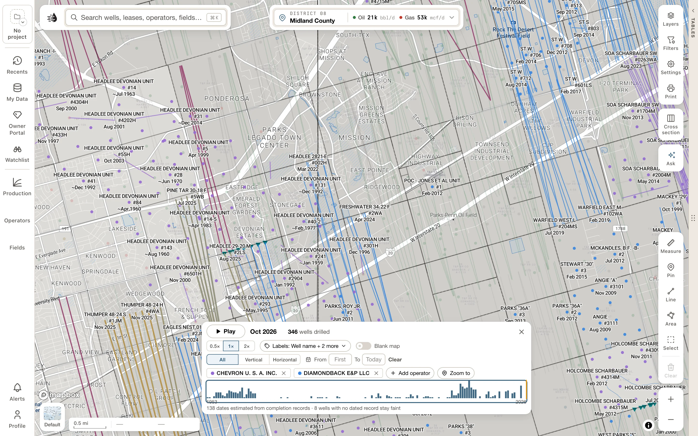

Frame your area in Maps, click **Layers**, and turn on **Drilling Timeline** in the **WELLS** group. A playback bar appears at the bottom of the map.

1. Click **Play** to watch wells appear in date order, or **Pause** to stop.
2. Click or drag along the date track to inspect a particular time. The bar shows the month and how many wells had been drilled by then.
3. Choose **0.5×**, **1×** or **2×** for playback speed.
4. Turn on **Blank map** to remove the ordinary well backdrop. Turn it off to keep later wells faint for context.

Pan or zoom to replay another area. Close the timeline with **×**, or switch its layer off, to return to the ordinary map.

<Frame>
  
</Frame>

## Label the wells

The label button beside playback speed opens **Label wells with**. Choose names, well numbers, operator, drilled date, depth, lateral length, field, API or cumulative BOE. **No labels** clears the choices.

Labels need a closer zoom; **Zoom in for labels** tells you when. During playback they label wells as they appear. When paused, labels are shown for the wells that fit without crowding.

## Read the dates carefully

The timeline uses reported spud dates when available, with drilling or completion records as fallbacks. The bar states how many dates are estimated. Wells without a dated record stay faint, or appear as rings on the blank map; they cannot be assigned a drilling date.

The timeline needs the well snapshot. If it is loading, wait for the status in the bar. An older publication may not support drilling dates yet.

Playback speed, blank-map and label choices are remembered for your account and project. The timeline itself closes on a reload.
