Almost everything you can see in Maps, you can download. Pick by what you want:

<CardGroup cols={2}>
  <Card title="One lease" icon="file-arrow-down" href="#export-one-lease">
    Open the lease's card. In its **Lease record** block, use **Production** or **Wells**, beside **Export**.
  </Card>
  <Card title="Many wells, leases, operators or fields" icon="table" href="#export-from-the-data-tables">
    Open the data tables, narrow them down, and click **Export**.
  </Card>
  <Card title="Everything in an area or a county" icon="file-zipper" href="#export-an-area-or-a-county">
    Click **Export** on a **Selected area** card or a county's card, pick the files, and download them in one zip.
  </Card>
  <Card title="All of an operator's, a field's or a county's wells" icon="building" href="#wells-by-operator">
    Click **Show wells** on its card, then **Export** on the tab that opens.
  </Card>
  <Card title="A production chart" icon="chart-line" href="#from-a-row-card">
    Use **Export CSV** or **Save PNG** at the foot of a card's **Production** block.
  </Card>
</CardGroup>

You need to be signed in to export from the data tables and from cards. Rows in the data tables open their cards with a free account; opening a card from the map needs a [paid plan](/get-started/plans). Valuation exports also depend on your access.

## Find your export

| I want… | Go to | Choose |
|---|---|---|
| Monthly production for **one lease** | The lease's card → **Lease record** → **Production** | **Production CSV — a row per month** |
| Monthly production for **many leases** | Data tables → **Leases** → **Export** | **Production CSV — a row per lease-month** |
| Production for decline or economics software | Either of the two above, or the **Wells** tab | **DRI v2.4 production (.dri)** |
| The estimated monthly production of each well on a lease | The lease's card → expand **Production** → **By well** → **Export** | **By well CSV · monthly (estimate)** |
| Monthly production for **one well** | The well's card → **Report** | The [well report](/tools/well-report), printed or saved as a PDF |
| The wells on one lease, as a spreadsheet | The lease's card → **Lease record** → **Wells** | **Wells CSV — a row per bore** |
| A list of wells I've filtered | Data tables → **Wells** → **Export** | **Table CSV — the rows on screen** |
| Well headers for GeoGraphix | A lease's **Wells**, or Data tables → **Wells** → **Export** | **GeoGraphix ASCII4 (.WB4)** |
| Wells with tops, tests, casing, perfs and surveys, for OpenWorks | The same two places | **OpenWorks OWX (.ASC)** |
| A ranked list of **operators** in an area | Data tables → **Operators** → **Export** | **Table CSV — the rows on screen** |
| Every **field's** RRC totals and how much the map places | Data tables → **Fields** → **Export** | **Table CSV — the rows on screen** |
| All of an operator's, a field's or a county's **wells** | Its card → **Show wells**, then **Export** | Any of the Wells tab's formats |
| An operator's, a field's or a county's **leases**, with production | Its card → **Show leases**, then **Export** | **Production CSV — a row per lease-month** or **DRI v2.4 production (.dri)** |
| Production for an **operator** or a **field** | Its card → the foot of its **Production** block | **Export CSV** |
| Production for a **county** | The county's card (**View county** on the place card) → the foot of its **Production** block | **Export CSV** |
| Everything in an **area** of the map, in one zip | The **Selected area** card → **Export**. See [Export an area or a county](#export-an-area-or-a-county) | The rows and formats you want: wells, monthly production, the land grid, leases, the outline and the tables |
| Everything in a **county**, in one zip | The county's card → **Export** | The same rows, with the county line in place of the outline |
| Well spots and laterals for ArcGIS, QGIS, Petra or Google Earth | **Export** on a **Selected area** card or a county's card → **Wells** | **Shapefile** or **KML** |
| The land grid: the Original Texas Land Survey's tracts | **Export** on a **Selected area** card or a county's card → **Land grid** | **Shapefile** or **KML** |
| A lease's valuation, cash flow or NPV profile | The lease's card → **Valuation & EUR** → **Full valuation** → **Export** | **Report (PDF)**, **Cash flow stream (CSV)** or **NPV profile (CSV)** |
| A picture of a production chart | The foot of a card's **Production** block | **Save PNG** |
| A well's permits, plats, completions and surveys | The well's card → **Filings & documents** | The document |
| A well log's original file | The log drawer | **Open log** |
| Just the API numbers | A lease's **Wells**, or tick rows in the Wells table | **Copy API numbers**, or **Copy APIs** |
| Just the operator or field numbers | Tick rows in the Operators or Fields table | **Copy operator numbers**, or **Copy field numbers** |
| Operator transfers, frac jobs, satellite pads or rig sites | Data tables → **P-4**, **Frac**, **Pads** or **Rigs** → **Export** | **Table CSV — the rows on screen** |
| A printable report on one well | The well's card → **Report** | See [Well report](/tools/well-report) |

Looking for something else, like your own wells or layers, what's producing in view, or your own properties? See [More places to export](#more-places-to-export).

## Export one lease

<Steps>
  <Step title="Open the lease's card">
    Search for the lease by name and click it, or click the lease's name in a well's popup. You can also click a production spike on the map, or a row in the Leases table.

    <Frame>
      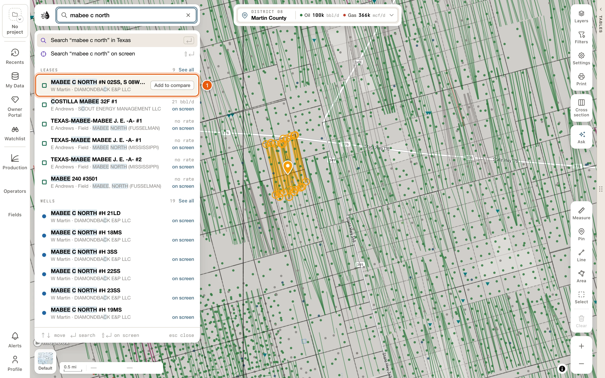
    </Frame>
  </Step>
  <Step title="Find Export in the Lease record block">
    Scroll the card to the **Lease record** block. At its foot, beside **Export**, are two buttons: **Production** and **Wells**.

    If the block isn't on the card, choose the **Overview** layout, or add **Lease record** from **Blocks**.

    <Frame>
      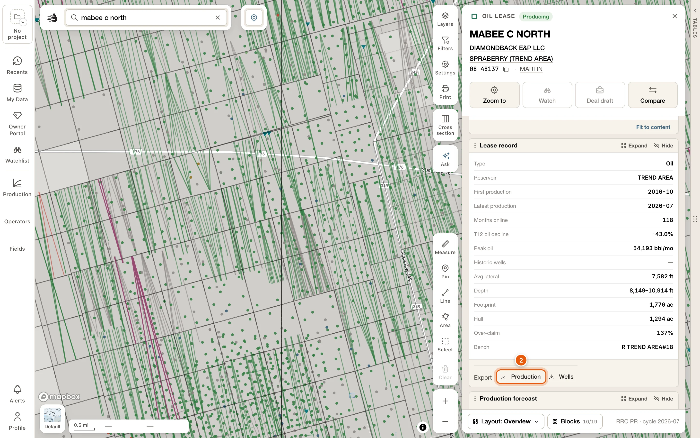
    </Frame>
  </Step>
  <Step title="Pick a format">
    Click **Production** or **Wells**, then a format. The line under each format says what this lease would give you, such as *40 wells — well headers*.

    <Frame>
      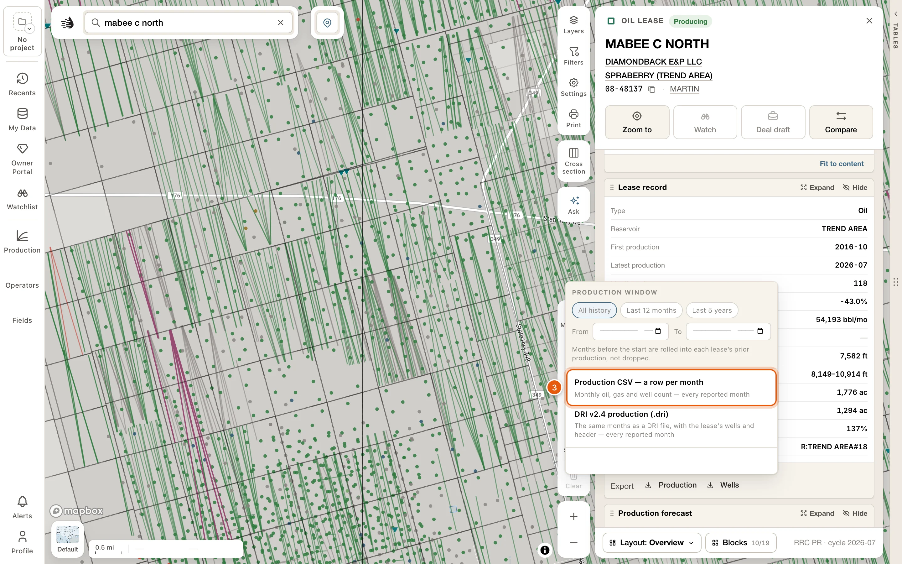
    </Frame>
  </Step>
  <Step title="Check what was written">
    The file downloads. A line at the bottom of the menu confirms it, for example *Production CSV written — 247 months, every reported month*.

    <Frame>
      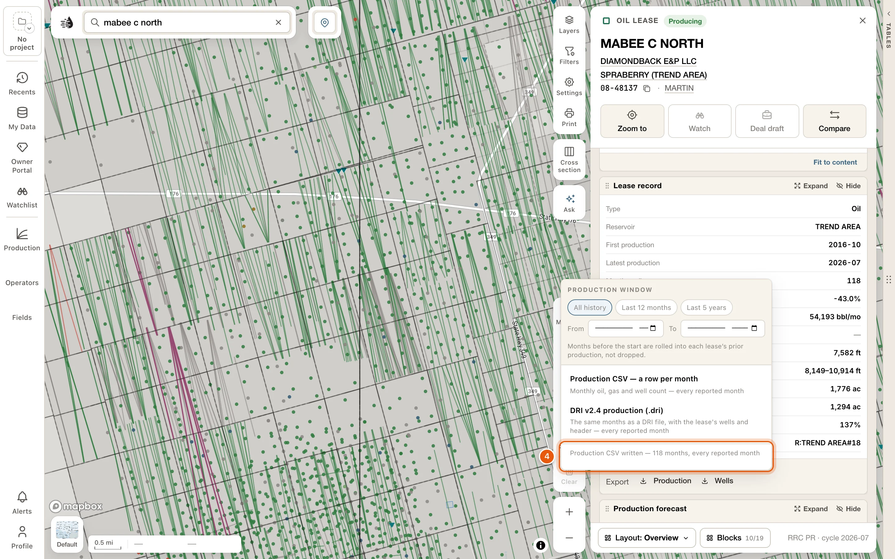
    </Frame>
  </Step>
</Steps>

A lease that stopped producing before 1993 has no **Export**.

### Production

| Format | What you get |
|---|---|
| **Production CSV — a row per month** | Monthly oil, gas and well count for the lease. |
| **DRI v2.4 production (.dri)** | The same months as a DRI file, with the lease's wells and header. |

Set the [Production window](#choose-the-months) at the top of the menu first, if you don't want every month.

### Wells

<Frame>
  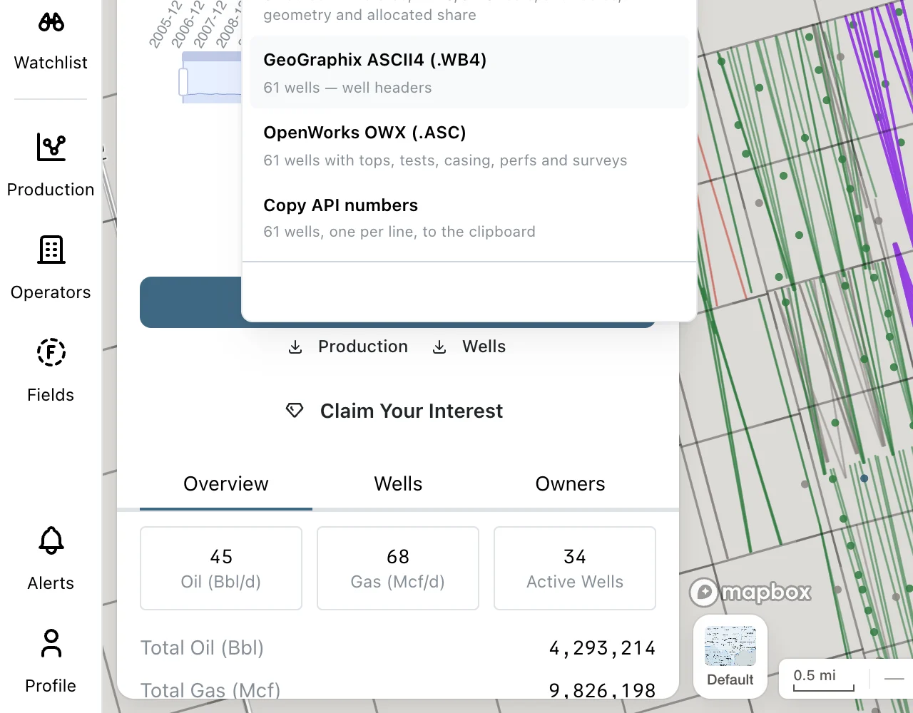
</Frame>

| Format | What you get |
|---|---|
| **Wells CSV — a row per bore** | Every wellbore on the lease, with status, W-10 and G-10 tests, allowables, geometry and its allocated share of the lease's production. |
| **GeoGraphix ASCII4 (.WB4)** | Well headers. |
| **OpenWorks OWX (.ASC)** | Wells with tops, tests, casing, perfs and surveys. Up to 5,000 wells. |
| **Copy API numbers** | The lease's API numbers on your clipboard, one per line. |

The first time you open **Wells**, QuickScout reads the lease's wells. On a big lease the options stay greyed out for a moment and show how far along it is (*Reading the lease's wells — 120 of 400*).

Historic wells are left out of ASCII4, OWX and **Copy API numbers**, because their API codes are shared between wells. The confirmation line tells you how many were left out. **Wells CSV** includes every bore.

The lease's **Production** block has two more downloads at its foot: **Export CSV** and **Save PNG**. See [From a card's chart](#from-a-row-card).

### By well

The lease's production split between its wells is an estimate, because Texas reports production by lease. To download it, **Expand** the lease card's **Production** block, choose **By well**, then **Export** → **By well CSV · monthly (estimate)**. The file has every well's estimated production, month by month. See [By well](/maps/row-cards#by-well).

### Valuation and cash flow

**Full valuation**, in the lease card's **Valuation & EUR** block, opens the lease's full valuation report. **Export**, at the top of the report, has:

| Format | What you get |
|---|---|
| **Report (PDF)** | A one-page summary of the lease's economics. |
| **Cash flow stream (CSV)** | The lease's forecast cash flow, by year. |
| **NPV profile (CSV)** | The lease's value at each discount rate. |

**Export** is greyed out until the report has loaded. The two CSVs stay greyed out when the lease has no production forecast (*CSV needs a production forecast; this lease has none.*). The PDF still works.

In the report's **Wells** section, **Download all *N* wells (CSV)** has every wellbore on the lease.

## Export from the data tables

<Steps>
  <Step title="Open the data tables and pick a tab">
    Click the **Tables** handle on the map's right edge, then **Wells**, **Leases**, **Operators**, **Fields** or another tab. **Frac**, **Pads** and **Rigs** aren't shown at first: add them with **Add tab** at the end of the tab row. See [Data tables](/maps/data-panel).
  </Step>
  <Step title="Narrow the rows to what you want">
    Use [Filters](/maps/filters), the tab's filter box, and **Scope**. **In view** lists only what's on the map. **All** lists everything your filters match, on the map or off it.

    The footer tells you how many rows you have, for example *1–39 of 578 leases*. That's what an export will carry.
  </Step>
  <Step title="Optional: tick just the rows you want">
    With rows ticked, every export carries only those rows.
  </Step>
  <Step title="Click Export and pick a format">
    **Export** is at the top right of the tables, beside **Full screen**. On a narrow panel it moves to a second line, under the tabs. Each option says what it will export: *578 leases × 19 columns — this view, built here*, or *3 selected* when rows are ticked.

    <Frame>
      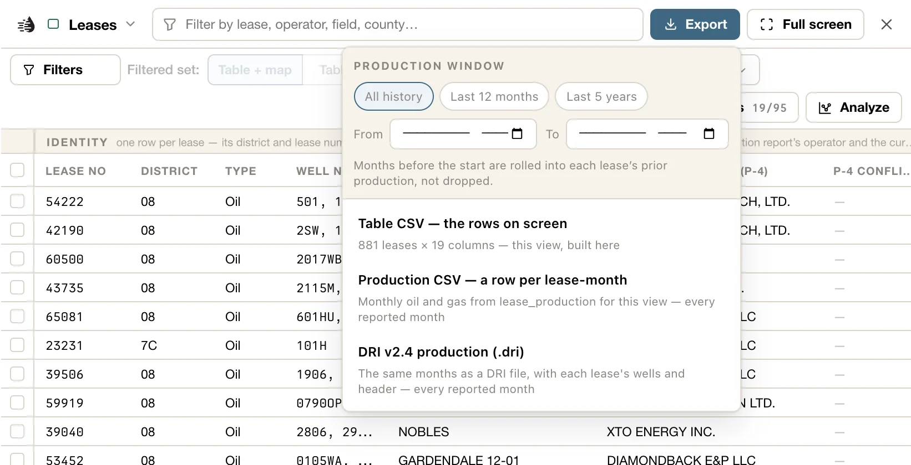
    </Frame>
  </Step>
  <Step title="Watch the footer">
    While a file is written, and once it's done, the table footer says so. A big file is written in batches, and the footer counts them off, such as *Writing OWX — 500 of 8,627 wells*, with **Cancel**.
  </Step>
</Steps>

<Tip>
  **Table CSV** carries the columns you have showing, in the order they're in, sorted the way the table is. Missing a column? Add it under **Columns**, or pick one of its **Views**, then export again.
</Tip>

Whichever format you pick, the file matches what the table lists. If a filter can't be passed along to an industry format (a search, for example), QuickScout sends the exact list of wells instead, and says so. You never get more than the table showed.

### Wells tab

<Frame>
  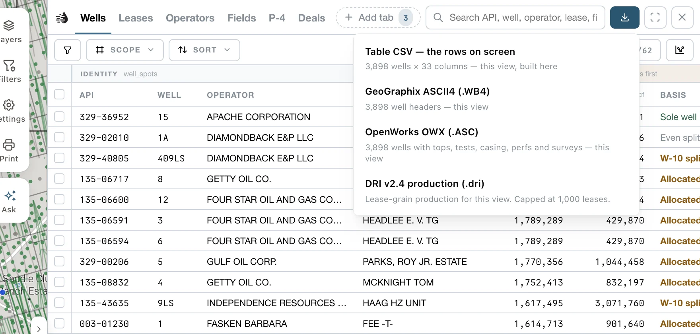
</Frame>

| Format | What you get |
|---|---|
| **Table CSV — the rows on screen** | The rows, and the columns you have showing |
| **Your edits (Excel)** | Your own values on wells, from [My Wells](/maps/my-wells#export-your-wells), with the RRC's beside them: values, attributes, records and tops. It holds every well of yours, whatever the table lists, and is greyed out until you've corrected or added one |
| **GeoGraphix ASCII4 (.WB4)** | Well headers |
| **OpenWorks OWX (.ASC)** | Wells with tops, tests, casing, perfs and surveys |
| **DRI v2.4 production (.dri)** | Production for the wells' leases, each lease with its wells |

There's no limit on how many wells a file holds. A big ASCII4, OWX or DRI file is written in batches and put together as one file, while the footer counts the batches off; **Cancel** stops it, and nothing is saved. OWX takes longest: thousands of wells take several minutes. If the server can't write a well even on its own, the file leaves it out, and the footer names it.

OWX and DRI files leave out historic wells, whose API codes are shared.

### Leases tab

| Format | What you get |
|---|---|
| **Table CSV — the rows on screen** | The rows, and the columns you have showing |
| **Production CSV — a row per lease-month** | Monthly oil and gas for each lease |
| **DRI v2.4 production (.dri)** | The same months as a DRI file, with each lease's wells and header |

There's no limit on how many leases, either. The production is read in batches, and the footer counts them off (*Reading production — 300 of 1,204 leases*), with **Cancel**.

### Operators and Fields tabs

These tabs export **Table CSV — the rows on screen**: one row per operator, or per field, with the columns you have showing. There's no limit.

For the leases or wells behind them, open a row's card and click **Show leases** or **Show wells**. They open in a tab of their own, where the Leases or Wells formats are ready. See [An operator's, a field's or a county's wells and leases](#wells-by-operator).

### P-4, Frac, Pads and Rigs

These tabs export **Table CSV — the rows on screen**. On P-4, **Rows** chooses whether the file has a row per **Transfers** event or per **Filings**.

### Shortcuts for ticked rows

Tick rows and a bar opens under the rows, just above the table's footer. It has the exports you'll use most, and copies the rows' IDs:

<Frame>
  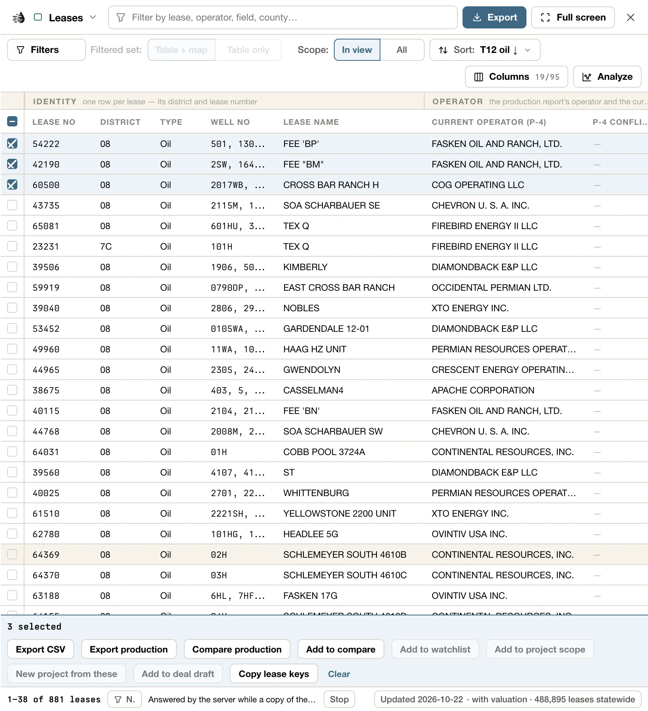
</Frame>

| Tab | Export | Copy |
|---|---|---|
| **Wells** | **Export CSV** | **Copy APIs** |
| **Leases** | **Export CSV**, **Export production** (the Production CSV) | **Copy lease keys** |
| **Operators** | **Export CSV** | **Copy operator numbers** |
| **Fields** | **Export CSV** | **Copy field numbers** |
| **P-4** | **Export CSV** | **Copy filing ids** |
| **Frac** | **Export CSV** | **Copy disclosure ids** |
| **Pads** | **Export CSV** | **Copy detection ids** |
| **Rigs** | **Export CSV** | **Copy site ids**, **Copy APIs** |

Copied IDs go on your clipboard one per line. **Clear**, at the end of the bar, unticks everything. On Wells, Leases, Operators and Fields, the bar also has **Add to compare**; see [Compare](/maps/compare).

You can also tick rows [from a chart](/maps/charts#select-from-the-chart): drag across a scatter, or click a bar.

## Export an area or a county

The **Selected area** card and every county's card have **Export**. It writes what you pick about the area or the county as files for your own software, all in one zip: its wells, their production, the land grid, its leases, its outline and its tables.

<Steps>
  <Step title="Open the card">
    [Select an area](/maps/selection) of the map, or open a county's card: click the place control (📍) at the top of the map, then **View county**. See [Counties](/maps/records#counties).
  </Step>
  <Step title="Click Export">
    **Export** is among the buttons under the card's name. The Export card opens under it, with each kind of data on a row of its own and how many there are, such as *970 wells* or *450 leases*.

    <Frame>
      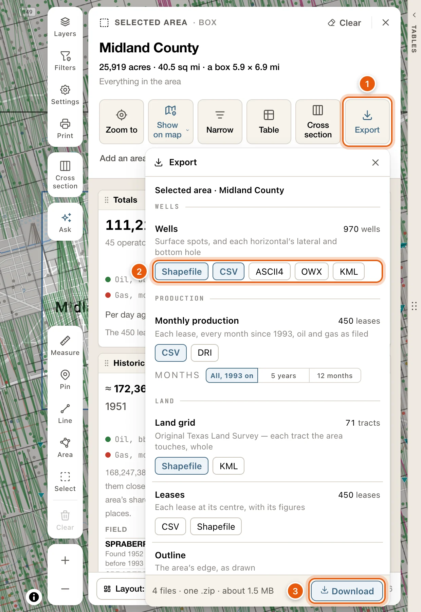
    </Frame>
  </Step>
  <Step title="Pick the formats on each row">
    Each row has a button for every format it can be written in. Press the ones you want, and press one again to drop it. A row with none pressed isn't written. Point at a format to see which software it's for.

    The first time, **Wells** is pressed as **Shapefile** and **CSV**, **Monthly production** as **CSV**, and the **Land grid** as **Shapefile**. Your choice is kept for the next area or county you export.
  </Step>
  <Step title="Click Download">
    The foot says how many files you'll get and about how big the zip will be, such as *4 files · one .zip · about 1.5 MB*. Click **Download**.
  </Step>
</Steps>

The rows, under **WELLS**, **PRODUCTION**, **LAND** and **TABLES**:

| Row | Formats | What's in it |
|---|---|---|
| **Wells** | **Shapefile**, **CSV**, **ASCII4**, **OWX**, **KML** | The wells: their surface spots, and each horizontal's lateral and bottom hole. The shapefile comes as three layers: the wells, their laterals and their bottom holes. |
| **Monthly production** | **CSV**, **DRI** | Each lease, every month since 1993, oil and gas as filed. With a format pressed, **Months** chooses **All, 1993 on**, **5 years** or **12 months**. |
| **Land grid** | **Shapefile**, **KML** | The Original Texas Land Survey: each tract the area touches, whole. A county's is every tract in it, and wells you picked one by one get the tracts under them. |
| **Leases** | **CSV**, **Shapefile** | Each lease with its figures. The shapefile marks each lease at its centre, not its outline. |
| **Outline** | **Shapefile**, **KML** | The area's edge, as you drew it. On a county's card this row is **County line**, the county's boundary. Wells you picked one by one have no outline, and the row says so. |
| **Operators**, **Fields**, **Frac jobs**, **P-4 transfers** | **CSV** | The operators and fields, added up from the area's leases and wells, and its frac jobs and P-4 filings. |

What goes in follows the card. A narrowed selection exports the wells you narrowed it to, and their leases. The land grid and the outline are always the whole area's. In a county, a lease that crosses the county line is exported whole, so its leases can add up to more than the county's own figures on its card.

### While it's written

- Each format you pressed shows how it's going: a tick when its file is written, a spinner while it's being written, a cross if it failed. The foot counts off the work, such as *Writing OWX — 3,000 of 24,512 wells · file 3 of 5*, with **Cancel**.
- You can close the Export card, or the area's card, and keep working. A row at the bottom of the map says *Exporting ‹name›* and how far along it is. **Open** brings the Export card back, and **Cancel** stops the export.
- One export runs at a time. Another Export card says so while one is running, with **Cancel it**.
- When it's done, the zip downloads, and the foot reads *Saved* with its name and size. **Save again** saves it once more, in case your browser didn't finish the download. **Done** closes the card.
- If a file can't be written, the export stops and says which file and why, such as *Monthly production (CSV) could not be written*. The files written so far are kept, and **Retry** carries on from the file that failed.
- A record the server can't write, even on its own, is left out of that file. The foot names how many, and the README lists them.
- An export of a gigabyte or more asks once more before it starts: **Download anyway**, or **Back**. A zip can hold up to 4 GB; past that, the export says so, and you drop a format or two (OWX and the CSVs are the largest) and download again.

OWX takes longest: a county's thousands of wells take several minutes.

### What's in the zip

- The zip is named for the area or the county and the day, such as `midland-county-2026-10-24.zip`. If you pick just one file, and it isn't a shapefile, it downloads on its own instead.
- `README.txt` says what each file holds and where it came from, how the area was drawn or narrowed, which coordinates each file uses, and what the short field names in the shapefiles mean.
- Shapefiles are NAD27, the datum the RRC files well spots and the land survey in, and each has its `.prj`. KML is WGS84, for Google Earth. The wells CSV has the app's WGS84 coordinates and NAD27 ones beside them. ASCII4 and DRI carry the RRC's NAD27 points as filed, and OWX is WGS84.
- NAD27 and WGS84 positions of the same point are 36 to 44 m apart in West Texas, so tell your software which datum each file is in.
- ASCII4 and OWX carry the RRC's wells. Your [My Wells](/maps/my-wells) edits are in the shapefile and the CSV. The card reminds you when you press either one.
- Wells from old maps have no API number, so they're in the shapefile and the CSV only. With ASCII4 or OWX pressed, the card says how many there are.

## From a card's chart

Open a lease, operator, field, county, P-4 or frac [card](/maps/row-cards), or the card of an area you [selected](/maps/selection). Its **Production** block has two buttons at its foot:

- **Export CSV**: one row per month, with `month`, `oil_bbl`, `gas_mcf`, `water_bbl`, `reported` and `basis`. `basis` says whether the month is the lease's reported figure or an **allocated estimate**. The file has every month, whichever way the chart is set to show them.
- **Save PNG**: the chart as you see it.

<Frame>
  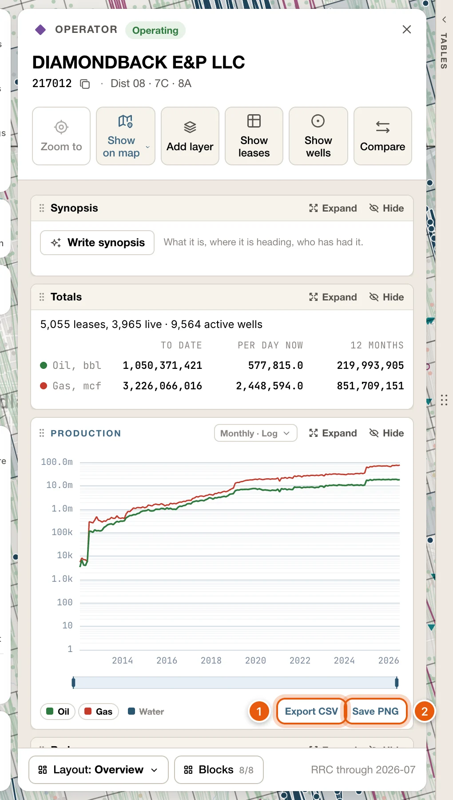
</Frame>

A well's card has no production chart. For a well's numbers, export its lease's production, or print its [well report](/tools/well-report).

On an injection well's card, **Export CSV** at the foot of its **Volume & pressure** block has the monthly injected volumes and pressures: `month`, `inj_bbl`, `inj_mcf`, `avg_inj_pressure_psi` and `max_inj_pressure_psi`.

## Export an operator, a field or a county

### The production chart

An operator's, a field's and a county's card each have a **Production** block, with the same **Export CSV** and **Save PNG** at its foot as a lease's. See [From a card's chart](#from-a-row-card).

To open a county's card, click the place control (📍) at the top centre of the map, then **View county**. You can also click the county on a well's or a lease's card. See [Counties](/maps/records#counties).

### An operator's, a field's or a county's wells and leases

Open the operator's, the field's or the county's card and click **Show wells**. Every one of its wells opens in a tab of its own, the [Record tab](/maps/data-panel#record-tab). Click **Export**, at the top right of the tables, for the same formats as the [Wells tab](#wells-tab).

<Frame>
  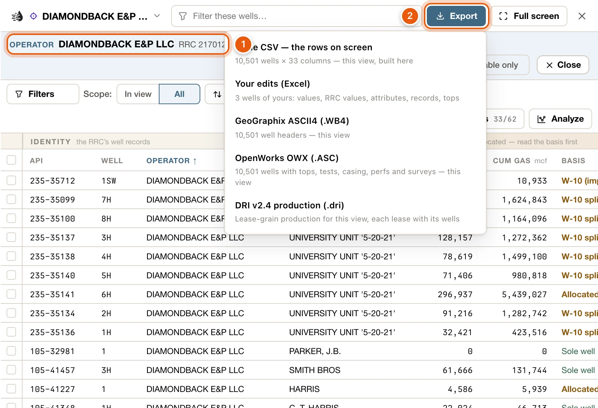
</Frame>

- **Show leases** opens the record's leases instead, with the [Leases tab](#leases-tab) formats, including **Production CSV — a row per lease-month** and **DRI v2.4 production (.dri)**. **Rows** switches between the two.
- The tab starts on the whole record. If you set **Scope** to **In view**, the export carries only what's in view.
- Your own Wells and Leases tabs and their filters stay as they are, and the card stays open.

Searching for an operator, field or lease number opens the same tab with its wells. See [Search by number](/maps/search#search-by-number).

## Well documents

On a well's card, the **Filings & documents** block lists the well's permits, plats, completions and surveys. A permit's card shows it from the start. On other wells it's off at first: add it from **Blocks**, or click **More** → **Documents** in the well's popup, which opens the card with the block showing.

<Frame>
  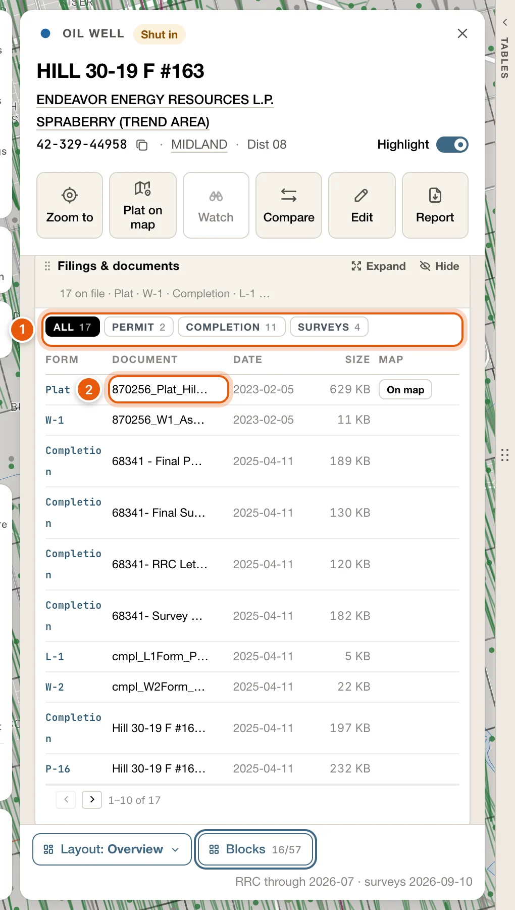
</Frame>

- When the well has more than one kind of document, chips filter the list, each with a count: **All**, **Permit**, **Completion** and **Surveys**.
- Each row shows the **Form**, the **Document**, its **Date** and **Size**. Click a document to open it in a new tab, where you can save it.
- A **Map** column appears when one of the well's plats can be laid over the map. See [W-1 plats on the map](/maps/plats).

You can also right-click a well on the map: its **Documents** list the W-1 files of its permit, each with **Download**. For the documents of every well in an area, [select the area](/maps/selection) and add the **Documents** block to its card from **Blocks**.

## Well logs

Logs open in the **Log** tab beside the map. When a log opens in its drawer instead, **Open log** opens the original file, a scan or a LAS file, in a new browser tab, where you can save it. **Open the scan** does the same for a log's scanned copy. See [Well logs on the map](/maps/well-logs).

## Choose the months

The production exports have a **Production window** at the top of the menu:

- **All history**, **Last 12 months** or **Last 5 years**.
- Or set your own range with **From** and **To**.

In a DRI file, months before the start aren't lost. They're rolled into each lease's prior-production totals, so the lease's cumulative still adds up. A Production CSV carries only the months in the window.

<Note>
  Operators report production to the RRC two to four months behind. The last few months of any window are usually empty.
</Note>

## What the files contain

CSV files are made to open cleanly in Excel, a database or a GIS:

- The header row uses column keys, such as `cum_oil_bbl`, not the on-screen labels.
- Numbers are plain: `1234`, not `1,234`. A blank cell means there's no value.
- When a Wells CSV has a cumulative in it, `cum_basis` comes with it, even if you've hidden that column. It says how the per-well figure was worked out. The RRC reports oil by lease, so many per-well cumulatives are allocated.
- The file name says what's inside: the table, the place you're looking at, the date, and the table's row count. For example, `wells-midland-county-2026-09-19-3885-rows.csv`. The count is the whole view's, even when you exported ticked rows. A Production CSV's count is its monthly rows.

**Production CSV** has these columns: `district_name`, `lease_no`, `lease_name`, `month`, `oil_bbl`, `gas_mcf`, `wells`, `lateral_ft` and `months_online`.

**GeoGraphix ASCII4 (.WB4)**, **OpenWorks OWX (.ASC)** and **DRI v2.4 production (.dri)** are import files for other software. Load them with that program's own import tool.

## Troubleshooting

<AccordionGroup>
  <Accordion title="I can't find the Export button">
    In the data tables it's at the top right, beside **Full screen**. On a narrow panel it moves to a second line, under the tabs.

    On a lease's card, **Export** is at the foot of the **Lease record** block, with **Production** and **Wells** beside it. If the block isn't showing, add it from **Blocks**.

    On a card's chart, **Export CSV** and **Save PNG** are at the foot of the **Production** block. A well's card has no production chart; see [Find your export](#find-your-export).

    On a **Selected area** card or a county's card, **Export** is among the buttons under its name. See [Export an area or a county](#export-an-area-or-a-county).
  </Accordion>
  <Accordion title="I can't find the Frac, Pads or Rigs tab">
    They aren't shown at first. Click **Add tab** at the end of the tab row and pick one.
  </Accordion>
  <Accordion title="An option is greyed out">
    The line under the option says why:

    - ***Nothing to export***, or every option greyed: the table has no rows. Loosen your filters, or switch **Scope** to **All**.
    - ***The production window runs backwards***: the **From** month is after the **To** month.
    - ***Reading the lease's wells…***: wait a moment. A big lease takes a few seconds.
    - ***No wells on record for this lease***: there's nothing to put in a wells file. The production exports still work.
    - ***CSV needs a production forecast***: the lease's valuation has no forecast. **Report (PDF)** still works.
  </Accordion>
  <Accordion title="The file has fewer wells than I expected">
    - Historic wells are left out of OWX and DRI files, and out of a lease's ASCII4 file.
    - Check **Scope**. **In view** exports only what's on the map; **All** exports everything your filters match.
    - Check whether rows are ticked. With rows ticked, exports carry only those rows. **Clear** unticks them.
    - In an area's or a county's ASCII4 and OWX files, wells from old maps are left out, because they have no API number. They're in its shapefile and CSV.
    - A well the server couldn't write, even on its own, is left out and named: in the table's footer, or on the Export card and in the zip's `README.txt`.
  </Accordion>
  <Accordion title="An area's export stopped">
    The Export card says which file couldn't be written and why. The files written so far are kept: click **Retry** to carry on from the file that failed. If you closed the card, the row at the bottom of the map says *The export of ‹name› stopped*, with **Open** and **Retry**.

    If it says the files are past the 4 GB a single zip can hold, drop a format or two (OWX and the CSVs are the largest) and download again.
  </Accordion>
  <Accordion title="A column is missing from my CSV">
    **Table CSV** exports the columns you have showing. Open **Columns**, tick what you need (or pick one of the **Views**), and export again.
  </Accordion>
  <Accordion title="It says no production is reported">
    The lease reported nothing in the window you chose. Widen the **Production window**, or choose **All history**.
  </Accordion>
  <Accordion title="It says Sign in to export">
    Your session has ended. [Sign in](/get-started/sign-in) again, then export.
  </Accordion>
</AccordionGroup>

## More places to export

| What | Where |
|---|---|
| The leases, operators or fields producing in view | **Production** on the left rail → **Export CSV**, for the list you're on. See [Production in view](/maps/production-panel) |
| Your corrected and added wells, or your team's | **My Data** → *My wells*: choose **Mine** or **Team**, then **Export CSV**, **Export Excel** or **Export GeoJSON**. The Wells table's **Export** has **Your edits (Excel)**. See [Export your wells](/maps/my-wells#export-your-wells) |
| Everything in an area you selected, or in a county | **Export** on the **Selected area** card or the county's card. See [Export an area or a county](#export-an-area-or-a-county) |
| The wells of an operator, field or lease number you searched for | The search opens them on the [Record tab](/maps/data-panel#record-tab): **Export** there |
| A land description | Right-click the map → **Copy description**. See [Land and owners](/maps/records#land-and-owners) |
| A scaled map sheet | [Print a map](/maps/printing): **Print**, on the right of the map → **Export PDF**, **Save PNG** or **Export GeoTIFF** |
| A printable well report | [Well report](/tools/well-report): **Print** → **Save as PDF** |
| A wellbore diagram | [Wellbore Builder](/tools/wellbore-builder#save-and-export): **File** → **PNG image** or **PDF** |
| Your own layers | [My Data](/maps/my-data#work-with-a-layer): in the library, a layer's **More** menu has **Export GeoJSON** and **Export CSV**. Tick several layers and click **Export GeoJSON** for a GeoJSON of each |
| What an alert matched | In the [Alerts](/maps/alerts#view-all-and-export) drawer, expand an alert and click **View all** → **Export CSV** |
| Your properties (mineral owners) | [Owner Portal](/owners/overview#download-a-copy): **Download Report** and **Download CSV** on **Properties**, and **Download CSV** on **Valuation** |

{/* enterprise-hold: a second table for this section.
In the [Enterprise workspace](/enterprise/overview):

| What | Where |
|---|---|
| A project's watchlist | [Watchlist](/enterprise/watchlist#see-your-watchlist) in Maps: **Export CSV** |
| A project's events | [Activity](/enterprise/activity#arrange-the-list): **View** → **Export this list as CSV**, or tick rows → **Export CSV** |
| One well's timeline | **Wells** → pick a well → **Timeline** → **CSV** |
| Lease valuations and cash flows | [Economics](/enterprise/economics#lease-reports): **Export CSV** for the project, **CSV** on the table for just the filtered rows, and each lease's **Report (PDF)**, **Cash flow stream (CSV)** and **NPV profile (CSV)** |
| Chart data | [Charts](/enterprise/charts#work-with-a-chart): a chart's **⋯** menu → **Export CSV**, and the download icon on **Totals by target** |
| A deal | [Deals](/enterprise/deals#reports-and-exports): the CIM, the Excel **Workbook**, **Lease table (current filter)** and **Package cash flow** |
| What an alert matched | [Project alerts](/enterprise/alerts#manage-alerts): **Replay** → **Export CSV** |
| A log report, and charts from a log discussion | [Well logs](/enterprise/well-logs#analyze-a-log): **Report** → **Generate PDF**. On a chart in **Discuss**, the download icon has **PNG image** and **CSV data** |
| Files you've uploaded | **Files**: the download icon on a document |
| A dataset | **Datasets** → **Local datasets**: **Export as CSV**, **Export as JSON** or **Export as Parquet** |
*/}
