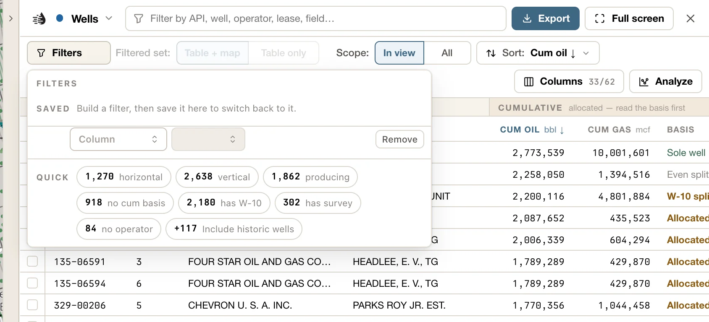

## Add a filter

<Steps>
  <Step title="Click Filters">
    It's the first button above the table. Its number shows how many filters are on.

    <Frame>
      
    </Frame>
  </Step>
  <Step title="Use a quick filter, or build your own">
    **Quick** pills are one-click filters, with a count of how many rows each would match. For example, on Wells: *horizontal*, *vertical*, *producing*, *has W-10*, *has survey*.

    For anything else, use the blank row at the top (once a filter is on, **+ Add filter** adds another). Choose a **Column**, then an operator (is, between, contains…) and a value. Common values appear as chips you can click. While you edit, the popover shows how many rows would match.
  </Step>
  <Step title="Edit or remove">
    Every filter stays in the list, where you can change it, or take it off with its **Remove**. **Clear all** removes them all.
  </Step>
</Steps>

The tab's filter box, at the top of the tables, counts as a filter too. It lights the dot on the tab, and the map follows it.

### Saved filters

Save a set of filters to switch back to it later. The **Saved** line sits at the top of the Filters popover.

- Build your filters, then click **+ Save as…**, name it, and press <kbd>Enter</kbd>.
- Click a saved filter to apply it. The one in effect is highlighted.
- Change a filter you loaded, and it gets a dot: **Update “‹name›”** saves the change, **Save as new…** keeps both.
- Each saved filter has **Rename** and **Delete** beside it. **Undo** brings back a deleted one.

A saved filter belongs to one tab, and keeps that tab's filter box, filters and hidden-row pills. It doesn't keep **Scope** or the sort. Saved filters are yours: they follow your account to every project and device, and other people don't see them. You need to be signed in to save one.

### Rows that are hidden until you ask

Some rows are left out by default. A pill with a **+** count brings them back:

| Tab | Pill |
|---|---|
| **Wells** | **Include historic wells** |
| **Operators** | **No live lease** |
| **P-4** | **Renames** |
| **Frac** | **Include flagged rows** |
| **Pads** | **Include ponds and roads** |

### Wells inside your own areas

On Wells, **Inside a My Data layer** keeps only wells inside one of your [uploaded or drawn areas](/maps/my-data). Choose **Wellbore** to match any part of the well path, or **Surface hole** to match the surface location. It appears once you have an area layer in My Data.

{/* enterprise-hold:
With an Enterprise [project](/enterprise/projects) active, the project pill in the command bar has **Only this project's wells**. While that's on, the Filters list has a *project is ‹name›* row. Remove it with **×**, or choose **Show all wells again** on the pill.
*/}

<Tip>
  Once the table lists what you want, **Export** downloads exactly those rows. See [Export data](/maps/exports#export-from-the-data-tables).
</Tip>

## The map follows your filters

**Filtered set**, beside **Filters**, sets where your filters and the tab's filter box apply. It's greyed out until one of them is on:

- **Table + map**: the map shows only what matches. This stays on even after you close the tables.
- **Table only**: the map is left alone.

What the map narrows to depends on the tab:

| Tab | On the map |
|---|---|
| **Wells** | The matching wells. |
| **Leases** | The matching leases' footprints, and their wells. |
| **Operators** | Those operators' lease footprints, and their wells. |
| **Fields** | Those fields' lease footprints. |
| **Pads** | The matching detections on the **Satellite pads** layer. |
| **Rigs** | The matching sites on the **Rig Watch** layer. |
| **P-4**, **Frac** | Nothing: **Filtered set** stays on **Table only**. A transfer is an event, not a place; filter the Leases tab to put leases on the map. |
| The Search tab | The search's matches, drawn in violet. **Only these on map** hides every other well, following the Search tab's own **Filters**. See [Search results](/maps/search-results#on-the-map). |
| The Record tab | The record's wells or leases, while its band is on **Table + map** and the tables are open. A selected area's tab does the same on its Wells and Leases rows. See [The Record tab](/maps/data-panel#record-tab). |
| **Compare** | Nothing changes. The map keeps following your own tab, and **Show on map** marks the compared records on top. |

### One tab shapes the map at a time

Only the tab you're on puts its filters on the map. Switch from Wells to Leases, and the map follows the Leases filters instead. Switch back, and the Wells filters return. Nothing is forgotten. With the tables closed, the last tab you had open keeps the map.

The tabs that come and go work the same way. While the Search or Record tab is up, it shapes the map; switch to one of your own tabs, or close it, and that tab's filters come back as you left them. The Record tab shapes the map only while the tables are open: close them and your own tab's filters are back on the map. The **Compare** tab never changes what the map shows.

### The badge on the map

A badge at the bottom of the map tells you what's happening, with a count beside it (for example *wells 188 · leases 1*):

| Badge | Meaning |
|---|---|
| **Map filtered** | The map is showing only what matches. Click **Edit filters** to change them. |
| **Map filtered · off screen** | Everything that matches is outside your view. Click **Zoom to** to go there. |
| **Map filtered · zoom in** | Too many rows match to filter the map at this zoom. |
| **Filters not on the map** | You chose **Table only**. |

Filters on Operators and Fields show in the badge as leases. Filters on Pads and Rigs don't show in it.

### When the map can't follow

The map can filter up to **100,000** matches at once. If more match, you'll see **too many to filter the map here**. Zoom in, or narrow the filter. When you're zoomed in, the map filters just the area around your view.

Lease filters are drawn as lease footprints. If the **Lease footprints** layer isn't on, the footer says *Lease Footprints is off — the map has no leases to filter* and offers **Turn on**. Footprints turned on this way go off again with the filter; **Turn off** removes them sooner. Footprints draw from zoom 10, so zoom in to see them.

## Show only your selection

Tick rows on the Wells tab and click **Show *N* on map** to see only those wells, up to 30,000.

The button then reads **Back to filters** (if the map was following your filters) or **Show all wells**; on a Record tab, **Back to this tab’s wells**. Click it to stop showing only your selection.
