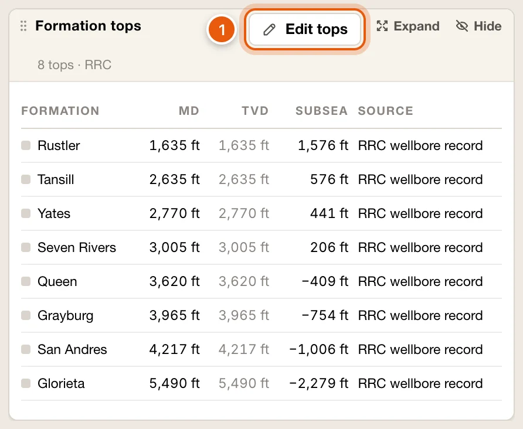
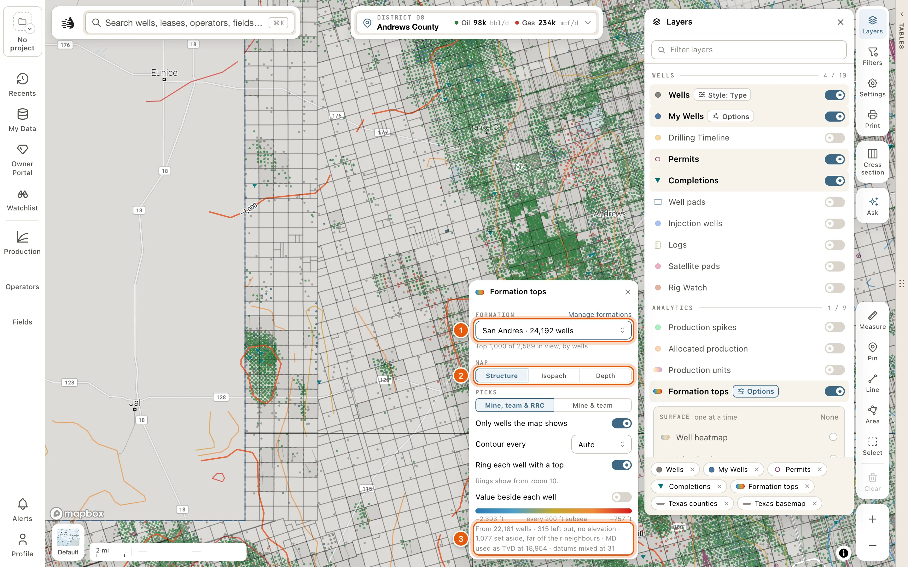
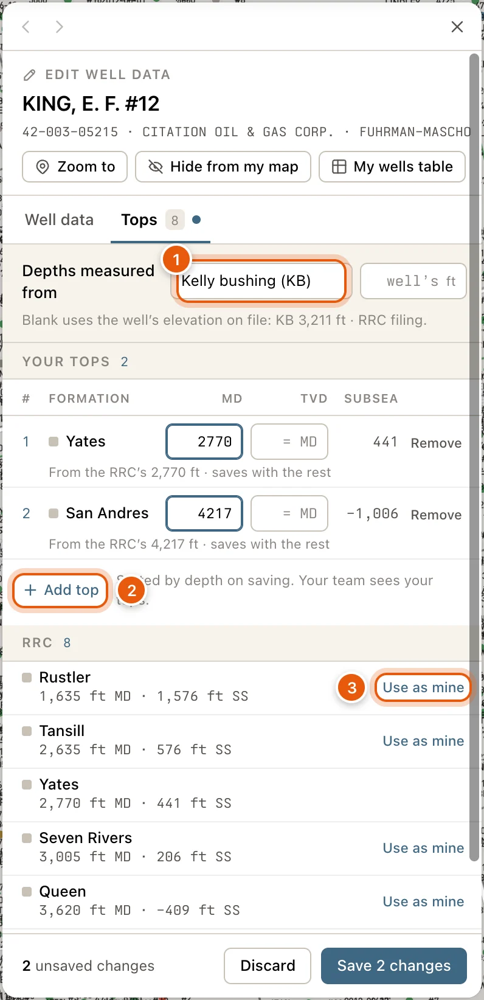

Formation tops belong to the well. Each formation on a well shows one pick: yours if you've picked it, else a teammate's, else the RRC's from its filings. Everyone in your organization sees the tops you pick; only you can change yours.

The same tops are used everywhere: on the well's card, on the **Formation tops** map layer, in the [cross-section](/maps/cross-section), in the [Log tab](/maps/well-logs#pick-tops-and-intervals) and in [My Data](#your-tops-and-formations-in-my-data).

<Note>
  - Seeing formation tops needs a free account. See [Sign in](/get-started/sign-in).
  - Adding or changing tops needs a [paid plan](/get-started/plans).
</Note>

## On the well card

A well's [card](/maps/records) lists its tops under **Formation tops**, shallowest first. The note beside the heading counts them, like *9 tops · 2 yours*.

| Column | Shows |
|---|---|
| **FORMATION** | The formation, with its colour. |
| **MD** | Measured depth, in feet. |
| **TVD** | True vertical depth, along the well's survey. With no survey on file, TVD is the same as MD and is shown fainter. |
| **SUBSEA** | Depth below sea level: the elevation minus the TVD, so a negative number is below sea level. A dash means the well has no elevation on file. |
| **SOURCE** | Whose pick it is: *Yours* (with a blue dot), a teammate's name, *RRC W-2* or *RRC wellbore record*. *+1* means someone else picked it too: point at it to see who, and at what depth. |

The footer says once where subsea is measured from, such as *Subsea from KB 2,914 ft · RRC filing*, and when TVD is taken as MD for want of a survey.

Click **Edit tops** to add or change your tops. A well with none has **Add a top** instead. See [Edit tops on a well](#edit-tops-on-a-well).

<Frame>
  
</Frame>

## Map a formation

The **Formation tops** layer contours one formation from the wells in view: how deep it lies, how thick it is, or its depth from the surface.

1. Click **Layers** on the right side of the map, and turn on **Formation tops** in the **ANALYTICS** group.
2. Click **Options** on its row, and choose the formation under **FORMATION**. The list holds the formations picked in the wells in view, most wells first, such as *Wolfcamp · 1,204 wells*. Type to find one.
3. Under **MAP**, choose what the lines show:
   - **Structure**: the top's depth below sea level (subsea).
   - **Isopach**: the thickness from this top down to a second formation, which you choose in **Down to…**.
   - **Depth**: the top's true vertical depth.

The lines run from blue for the lowest values to red for the highest. Every fifth line is heavier and carries its value. Point at a line for its formation and value, such as *−6,488 ft* subsea.

From zoom 10, a ring marks each well the contours are built from. Point at a ring for the well's name and its value.

The contours are worked out for the view you're looking at, so they redraw when you pan or zoom. *Updating…* shows while they do.

<Frame>
  
</Frame>

### The other choices

- **PICKS**: **Mine, team & RRC** uses every pick. **Mine & team** leaves out the RRC's, for a map of your organization's work alone.
- **Only wells the map shows**: on at first. It uses only the wells your [filters](/maps/layers#well-filters) leave on the map. Turn it off to use every well in view.
- **Contour every**: **Auto**, or a fixed spacing from 10 to 500 ft.
- **Ring each well with a top**: on at first. Turn it off to see the contours alone.
- **Value beside each well**: writes each well's value beside it, from zoom 13, in a spot your [well labels](/maps/well-labels) leave empty. Point at one for the well's name.
- **Manage formations** opens your formations in My Data. See [Your tops and formations in My Data](#your-tops-and-formations-in-my-data).

Your choices are kept for your account and project.

### The legend

Under the choices, the colour ramp gives the lowest and highest values, and the spacing of the lines, like *every 50 ft subsea*. A line under it says what the map was built from, such as *From 412 wells · 38 left out, no elevation · MD used as TVD at 61*. Wells with no elevation can't give a subsea value, and wells with no survey use their measured depth as TVD.

When there's nothing to draw, the panel says why:

- *Pick a formation to contour.*
- *Pick the formation to measure down to.* for **Isopach**.
- *Fewer than 3 wells in view have a Wolfcamp top to contour.* Zoom out, or turn off **Only wells the map shows**.
- *Every Wolfcamp value in view is the same: nothing to contour.*

## Edit tops on a well

Correcting a well's tops needs a [paid plan](/get-started/plans). Open the tops editor from:

- **Edit tops** (or **Add a top**) under **Formation tops** on the well's card.
- **Edit tops** where the well's popup lists its tops.
- **Edit** on the well's card or popup, then the **Tops** tab.
- A well in a formation's list in My Data. See [Your tops and formations in My Data](#your-tops-and-formations-in-my-data).

It opens in the drawer on the left, as **EDIT WELL DATA** with the **Tops** tab chosen. The **Well data** tab beside it is where you correct the well's other facts. See [My Wells](/maps/my-wells).

<Frame>
  
</Frame>

<Steps>
  <Step title="Check where your depths are measured from">
    **Depths measured from** is your tops' datum: **Kelly bushing (KB)**, **Derrick floor (DF)** or **Ground level (GL)**. Beside it, type that datum's elevation in feet, or leave it blank to use the elevation QuickScout has on file for the well. The line underneath says which, and how subsea is worked out.
  </Step>
  <Step title="Add or change your tops">
    Under **YOUR TOPS**, each of your tops is a row: **#**, **FORMATION**, **MD**, **TVD** and **SUBSEA**.

    - **Add top** adds a row. Pick one of your formations, or type a new name, then its MD.
    - Leave **TVD** blank to work it out along the well's survey, or to use the MD when the well has no survey.
    - **SUBSEA** is worked out as you type.
    - **Remove** takes a top off when you save. *Taken off on saving* lists what will go, and **Undo** keeps them.

    To change a top's formation, remove it and add the formation again.
  </Step>
  <Step title="Copy the RRC's tops if you agree with them">
    The **RRC** list, below your team's, has the Railroad Commission's tops. **Use as mine** on any of them adds it to your tops at the RRC's depth. Change the depth before saving if you need to.
  </Step>
  <Step title="Save">
    Click **Save** (it counts your changes, like **Save 2 changes**), or press <kbd>Enter</kbd> in any box. **Discard** throws your changes away. Your tops are sorted by depth when they save, and your team sees them.
  </Step>
</Steps>

**YOUR TEAM’S** lists your teammates' tops on the well, each with whose it is. You can read them, not change them.

The line under each of your tops says what to fix or check:

- What's missing: *Pick or type a formation*, *Enter the MD*.
- What can't be right: *TVD cannot be deeper than MD*.
- What's worth a look: *Below the well’s TD*, or the same formation picked twice.
- Otherwise, the other picks of the formation (*Also RRC W-2 7,412 ft*) or where yours came from: *Picked on a log*, *Picked on the map* or *Imported* from a file.

## Your tops and formations in My Data

Open **My Data** on the left rail, and click **Open** on the *Formation tops: your picks and your formations* row. Choose between two lists, **Picks** and **Formations**. My Data is part of the [paid plans](/get-started/plans).

### Picks

Every formation you or your team has picked, most wells first. Each row counts the wells with a pick, and how many are yours and your team's.

Click a formation to list its wells, each with the pick's **MD, FT** and **SUBSEA, FT** and whose pick it is. Click a well to open it in the tops editor; its back button brings you back to the list. Above the list:

- **Show on map** contours that formation with the [Formation tops layer](#map-a-formation). Press it again to turn the layer off.
- **Zoom to** frames every well listed, not only the page on screen.
- **Edit formation** opens the formation, when it's one of yours.

{/* screenshot: maps-tops-my-data — My Data → Formation tops on Picks, then one formation's wells with Show on map, Zoom to and Edit formation. Annotate: 1 = Picks and Formations, 2 = a formation's row, 3 = Show on map */}

### Formations

Your formations are the names and colours your tops show by, wherever you see them. **Find a formation, yours or the catalog’s…** narrows the list.

Click one of yours to change it:

- **Name** and **Colour**. With no colour picked, the map gives it one.
- **Stage or age** and **Basin**.
- **Other spellings**: names in RRC filings or your files that mean this formation, separated by commas. Their tops show as this one.

Click **Save**, or **Discard** to drop your changes. **Delete formation** deletes it and your tops of it on every well; your team's tops stay. Confirm with **Delete** and the formation's name, or click **Keep it**.

**New formation**, at the top, starts one of your own. Click **Add formation** to keep it.

Under **FROM THE CATALOG**, type a name, or pick a basin, to find the catalog's formations. **Add** puts one on your list.

## Other places to pick tops

- On the cross-section, [Pick tops](/maps/cross-section#pick-tops) places and drags tops on several wells side by side.
- On a log, **Pick tops** in the [Log tab](/maps/well-logs#pick-tops-and-intervals) places a top where you click the log.
- Importing scout tickets, or a table with formation tops, in [My Wells](/maps/my-wells#import-wells-and-records) adds the tops it carries.

Wherever you pick them, they're the well's tops, and they show in all of these places.

## Troubleshooting

<AccordionGroup>
  <Accordion title="The Formation tops layer draws nothing">
    - Sign in. Signed out, the panel just says *No formation tops in view*.
    - Pick a formation under **FORMATION**. Nothing is drawn until you do.
    - Zoom out until at least three wells in view have the formation, or turn off **Only wells the map shows**.
  </Accordion>
  <Accordion title="Subsea is blank">
    The well has no elevation on file. In the tops editor, type the elevation beside **Depths measured from**.
  </Accordion>
  <Accordion title="I can't change a top">
    Only your own tops can be changed. To correct a teammate's or the RRC's, add your own pick of the formation: on the RRC's, **Use as mine** starts from its depth. Yours then shows first.
  </Accordion>
</AccordionGroup>
