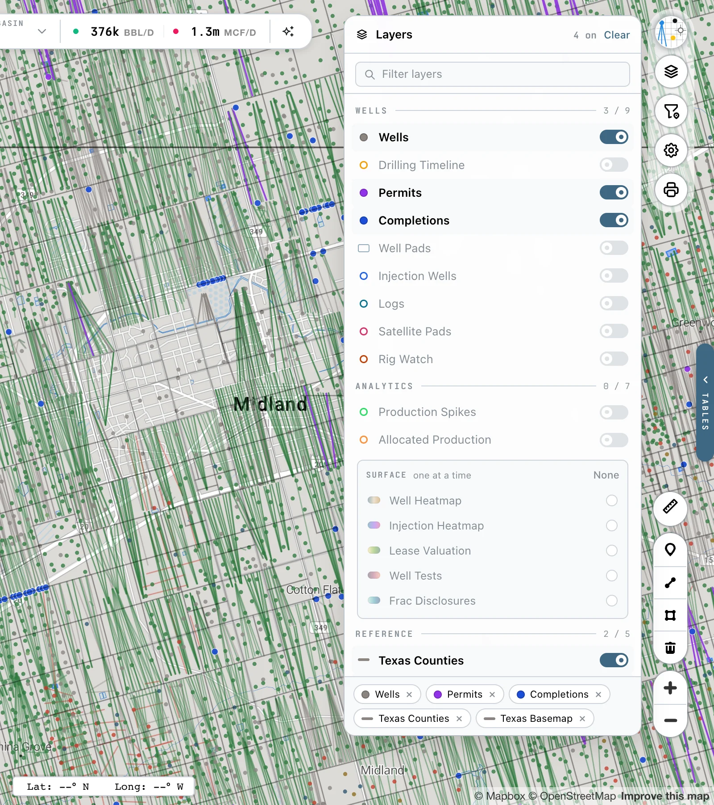
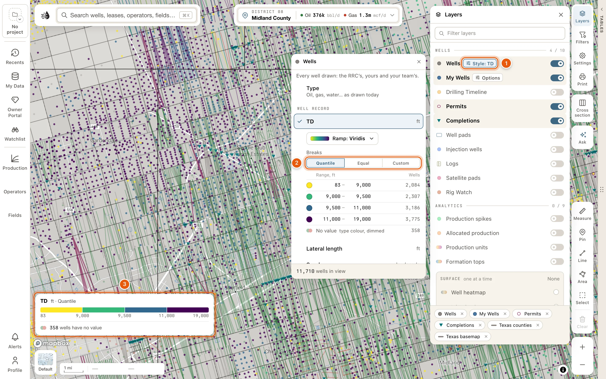
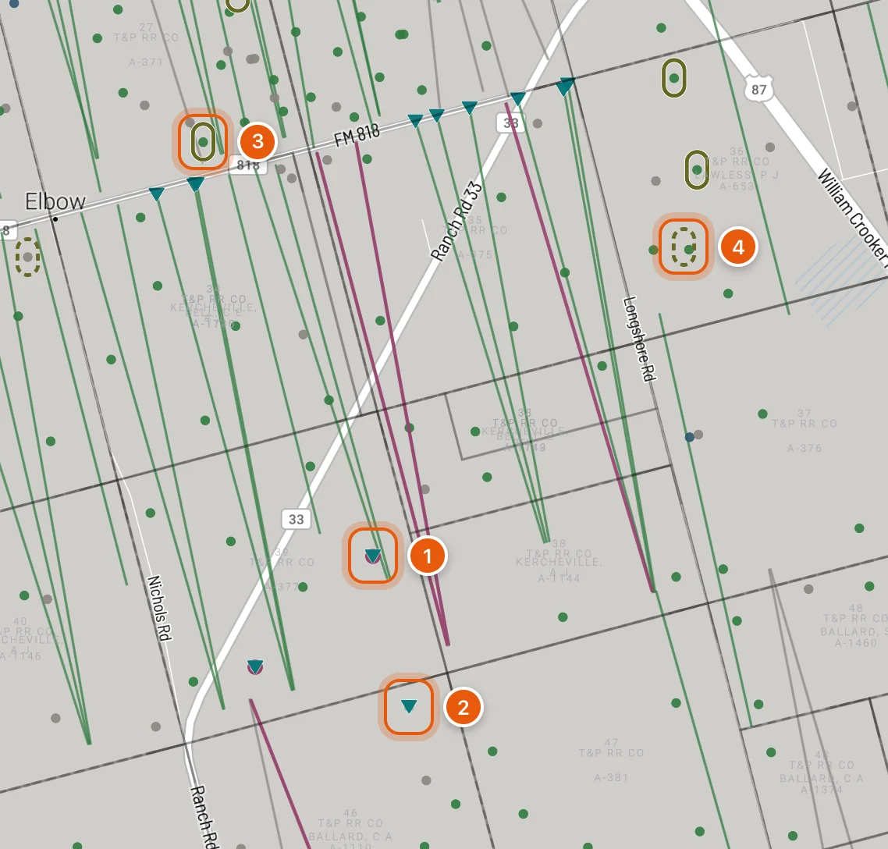
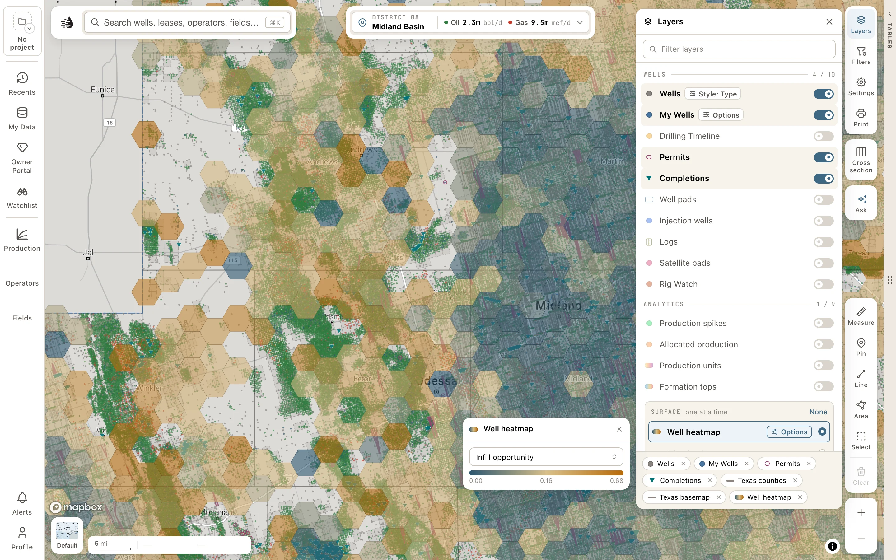
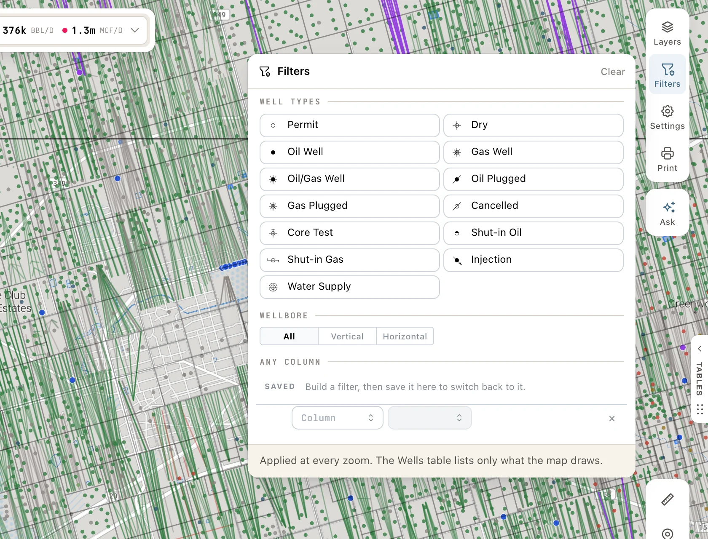

Click **Layers**, the top button on the right side of the map, to open its card. **Wells**, **Permits**, **Completions**, **Texas counties** and **Texas basemap** (survey lines) are on from the start.

<Frame>
  
</Frame>

## Using the Layers card

- **Filter layers** narrows the list as you type.
- Each group (**WELLS**, **ANALYTICS**, **REFERENCE**) shows how many of its layers are on, out of how many, like *2 / 10*.
- Each row's swatch shows what the layer draws: a dot for points, an outline for areas, a bar for lines, a color strip for a shaded layer, the record's own mark for **Permits** and **Completions**, and a log strip for **Logs**. A faded swatch means the layer is off.
- Once a layer is on, an **Options** button appears on its row. On the **Wells** row it names the current style instead, like *Style: Type*; see [Style wells by your data](#style-wells-by-your-data). It opens the layer's options and legend in a panel to the left. Close it with **✕**.
- The chips at the bottom of the card name everything that's drawn. Click a chip's **×** to turn that layer off. With nothing on, the card reads *Nothing drawn — the map is basemap only.*
- Point at something a layer draws, such as an injection well, a log or a heatmap hexagon, for a small card that names it and gives its figures.
- Close the card with its **✕**, by clicking **Layers** again, or with <kbd>Esc</kbd>.

## Wells

| Layer | Shows |
|---|---|
| **Wells** | Every RRC well. Switch it off for a map of just your other layers. The **Style: …** button on its row colors the wells by your own data; see [below](#style-wells-by-your-data). |
| **My Wells** | The wells you've corrected or added, marked in blue. The row appears once you have one. See [My Wells](#my-wells). |
| **Drilling Timeline** | Replay wells in drilling-date order. See [Drilling timeline](/maps/drilling-timeline). |
| **Permits** | New drilling permits. See [the marks](#permit-completion-and-log-marks). |
| **Completions** | Recently completed wells. |
| **Well pads** | Wells grouped by the pad they were drilled from. |
| **Injection wells** | Underground injection wells: Disposal, EOR, Storage and Other. See [below](#injection-wells). |
| **Logs** | Where a well log is on record. See [Well logs](#well-logs). |
| **Satellite pads** | New ground cleared, detected from satellite imagery. Colored by what's on RRC record within 150 m: **Permit, no spud**, **Spudded**, **Older wells only** or **Nothing on record**. |
| **Rig Watch** | Permitted pads watched by radar, colored by what the latest look saw: **Rig on site**, **Frac spread**, **Equipment**, **Facility** or **Nothing on site**. |

**Satellite pads** and **Rig Watch** cover only the counties being watched. The **Satellite pads** options list them. Outside those counties, no mark means *not watched*, not *no pad* or *no rig*.

### Style wells by your data

The button on the **Wells** row, which reads *Style: Type* at first, opens a panel that colors the wells on the map by one thing you choose. It colors every well drawn: the RRC's, your versions of them and your team's.

<Frame>
  
</Frame>

Pick one row:

| Row | Colors the wells by |
|---|---|
| **Type** | Oil, gas, water and the rest, as the map draws them anyway. The default. |
| Under **WELL RECORD**: **TD**, **Lateral length**, **Spud year**, **Completion year**, **IP oil**, **IP gas** or **IP water** | A figure from the well record. Numbers fall into five classes on a color ramp; years go by decade. |
| Under **YOUR ATTRIBUTES** | An attribute you've added to your wells in [My Wells](/maps/my-wells). Text values fall into eight colors and **Other**; a number goes on a ramp. Until you've added one, it reads *No attributes yet*. |
| Under **RECORDS**: **Has a DST**, **Has a core**, **Has a test**, **Has a show**, or one of your own record kinds | Whether a well has a [depth record](/maps/depth-records) of that kind. |
| **Latest DST result** | The result of the well's latest DST, in seven fixed colors. |
| Under **WHOSE VERSION**: **Whose** | Whether each well is the RRC's, yours or a teammate's. |

The row you pick opens its options under it:

- **Ramp: …** chooses the colors for a ramp.
- **Breaks**: **Quantile**, **Equal** or **Custom**. **Custom** starts from the breaks on the map and lets you type your own four.
- A table of the classes, with how many wells in view fall in each. Wells with no value keep their type color, dimmed.
- For a text attribute, **Edit classes** lets you give each value a color of its own, or put it in **Other**.

On the map, every well in view takes the color of its class, and a legend at the bottom left says what the colors mean. Quantile and equal breaks and decades are worked out for the wells in view, so they change as you pan and zoom; your custom breaks and class colors stay put. Under **Type** there's no legend, and the map looks as it always does.

The style works from zoom 9, with up to 30,000 wells in view. Zoomed further out, or with more wells than that in view, the wells keep their type colors, and the foot of the panel says so, like *48,210 wells in view · zoom in to colour them*.

Your choice is kept for your account and project.

### Permit, completion and log marks

**Permits**, **Completions** and **Logs** each draw a mark of their own, so you can tell them from the wells around them:

- A permit is a raspberry ring with no fill: a well that isn't drilled yet.
- A completion is a teal triangle pointing down.
- A log is an upright capsule around the well: solid for a digital LAS log, dashed for a scan. See [Well logs](#well-logs).

<Frame>
  
</Frame>

### My Wells

The **My Wells** row appears once you've corrected a well's data or added a well of your own. Its **Options** have two choices:

- **Replace RRC** (the default): your version of each well replaces the RRC's mark.
- **Compare**: the RRC's location stays on the map beneath each of your wells.

**Open in My Data** and **Open the grid** take you to your wells' list and their table. See [My Wells on the map](/maps/my-wells#on-the-map).

### Injection wells

Its **Options** have two choices:

- **SIZE BY**: **Uniform**, or **Rate** (the default), which sizes each well by its injection rate in bbl/d.
- **COLOR BY**: **Purpose** (the default: Disposal, EOR, Storage, Other), **Pressure** (as a share of permitted pressure) or **Utilization** (as a share of permitted rate). Wells that aren't reporting are grey.

Rates are averaged over the months each permit actually reported. A permit whose last report is stale draws at the smallest size.

Click an injection well to open it in a drawer on the left: **Permits**, **Sources**, **Integrity** and **Compliance**.

### Well logs

**Logs** marks each well that has an electric log on record with a capsule around it: solid for a digital LAS log, dashed for a scanned image or document. Olive capsules are the regulatory catalogues' logs; blue ones are yours or your organization's.

Its **Options** have three switches: **Regulatory catalogues**, **Mine & my org** and **LAS logs only**, and a key to the capsules.

To open a well's log, zoom in and use **Logs** in the well's popup. Zoomed further out, click the capsule itself. A digital log opens in a viewer beside the map. See [Well logs on the map](/maps/well-logs).

## Analytics

| Layer | Shows |
|---|---|
| **Production spikes** | Leases whose production jumped. |
| **Allocated production** | Each well's lifetime production and the reservoir it came from. See [below](#allocated-production). |
| **Production units** | Each producing well as the land it produces from, colored by how it ranks. See [below](#production-units). |
| **Formation tops** | One formation contoured from the tops of the wells in view: its **Structure**, its thickness (**Isopach**) or its **Depth**. Needs a free account. See [Formation tops](/maps/formation-tops). |
| **Well heatmap** | Well metrics including infill opportunity, well density, lateral spacing, production, IP, completion intensity and vintage. |
| **Injection heatmap** | Injection metrics: volumes, pressures, EOR share, permit density and capacity. |
| **Lease valuation** | Lease metrics including PV-10, net asset value, PDP reserves, production, producing wells and lease counts. |
| **Well tests** | Well test metrics grouped into screening, oil, gas & BOE, trend, fluid quality, shut-in, allowable and coverage. |
| **Frac disclosures** | FracFocus metrics such as proppant intensity, job size, water and chemistry. |

Valuation metrics (net asset value, PV-10 and PDP reserves) appear only when your account includes lease valuation.

### Reading a heatmap

<Frame>
  
</Frame>

- The five heatmaps are choices in the **SURFACE** box, marked *one at a time*. Picking one turns off any other. Pick it again, or click **None**, to turn it off.
- Picking a heatmap opens its options panel: a menu of metrics (long lists have a search box) and a legend of what the colors mean. While it's on, its **Options** button opens the panel again.
- Point at a hexagon for a small card with its figures. Click it to open what's inside: the **Wells** (or **Leases**) and their **Aggregates**. On **Frac disclosures**, a hexagon opens **Jobs**, **Chemistry** and **Aggregates**.

### Allocated production

Allocated production writes each well's lifetime production on the map: the amount in thousands **above** the well, and its reservoir **below**. For example, *50* over *STRAWN* is 50,000 boe from the Strawn.

- Each well is colored by its reservoir, which is the field of the lease it produces on. Laterals take the same color.
- A well producing from several reservoirs is drawn as a **pie**, with a slice for each, largest first.
- In its **Options**, **SHOW** switches between **boe** (the default), **Oil** (bbl) and **Gas** (mcf). **Oil** and **Gas** show only wells that made some.
- **Size by amount** draws each well as a bubble sized by what it made. The key shows the scale.
- Dots show from a statewide view, pies from zoom 10, and the numbers and reservoir names from zoom 13.

Hover or click a well as usual; the layer doesn't change what opens. Switch the **Wells** layer off to see only the allocated wells.

<Note>
  The RRC reports oil by lease, so each well's oil is split from the lease's well tests. It's an **estimate**. Gas wells report their own gas.
</Note>

### Production units

**Production units** draws each producing well as the land it produces from: a vertical well as its share of its survey tract, a horizontal as a strip along its lateral. The units appear from zoom 9. Zoomed further out, you see the survey tracts that produce, darker where something produces now.

{/* screenshot: maps-production-units — Production units on over a stretch of the Permian Basin at about zoom 12, verticals as cells of their tracts and horizontals as strips, with the layer's options open beside the Layers card and one unit's card open on the map. Annotate: 1 = Colour by, 2 = First production with Play, 3 = a unit's card */}

Its **Options**:

- **COLOUR BY**: **Size** (how big a well this was, by cumulative boe against every well in Texas), **Within field** (against the same kind of well in the same field) or **Per acre** (boe per acre of its unit, so small and large units share one scale). A legend shows the classes.
- **SURVEY TRACTS**: a key to the tracts' shades, and **Shade tracts by boe per acre when zoomed out**.
- **WELLS**: **All**, **Vertical** or **Horizontal**, and **Producing now only**.
- **FIRST PRODUCTION**: a range of years. **Play** shows the wells appearing in the order they first produced.

From zoom 10, point at a unit for a small card. Clicking a unit zooms in to it; from zoom 12, a click opens the unit's card, which answers all three rankings and gives its figures, and a click on bare ground opens the survey tract's card.

Texas reports oil by lease, so a well's oil here is an estimate unless it's a gas well or the only well on its lease.

## Reference

- **Texas counties**
- **Texas basemap**: survey lines and abstracts
- **RRC districts**: each district is filled with the color the RRC uses on its own district map. Districts that share an office share a color (01 & 02, 05 & 06), and 6E is drawn over 06. Switch **Fill by district** off in its **Options** for outlines only.
- **Pipelines**
- **Surface tracts**
- **W-1 plats**: the permit plats you've placed on the map from a well's card. The switch shows or hides them all. Its **Options** list each one with its opacity, **View plat**, **Zoom to** and **Remove**, and **Clear all** takes every plat off the map. See [W-1 plats in the Layers card](/maps/plats#in-the-layers-card).

<Tip>
  Right-click anywhere on the map to see the survey abstract and the surface owner at that spot. See [Land & owners](/maps/records#land-and-owners).
</Tip>

## Basemaps

Click **Map style**, the thumbnail at the bottom left of the map, to choose a background: **Default**, **Dark**, **Light**, **Streets**, **Satellite** or **Topo**. There are also six plain backgrounds, from **White** to **Charcoal**, for a map with nothing but your data on it.

## Well filters

Click **Filters**, the second button on the right side of the map, or press <kbd>⌘</kbd> <kbd>⇧</kbd> <kbd>K</kbd>. These filters apply at every zoom level:

<Frame>
  
</Frame>

- **WELL TYPES**: show only some types (Permit, Oil Well, Gas Well, Dry, Injection, Shut-in Oil…).
- **WELLBORE**: **All**, **Vertical** or **Horizontal**.
- **ANY COLUMN**: filter wells on any column, like operator, completion date or cumulative oil, the same way as in the [data tables](/maps/filters#add-a-filter). Your [saved filters](/maps/filters#saved-filters) are here too. The Wells table then lists only what the map draws.

The header counts the filters that are on, and **Clear** turns them all off. While filters are on, the **Filters** button lights up and shows how many. The bottom of the card says how many wells are on the map.

<Tip>
  Filters on the other tables, like Leases or Operators, put their matches on the map too. See [The map follows your filters](/maps/filters#the-map-follows-your-filters).
</Tip>

## Settings

**Settings**, the gear on the right side of the map, has its own page: light or dark colors, where record cards open, the place control's units, the status bar, well popups, well marks and well labels, and the map data on this device. See [Map settings](/maps/settings).
