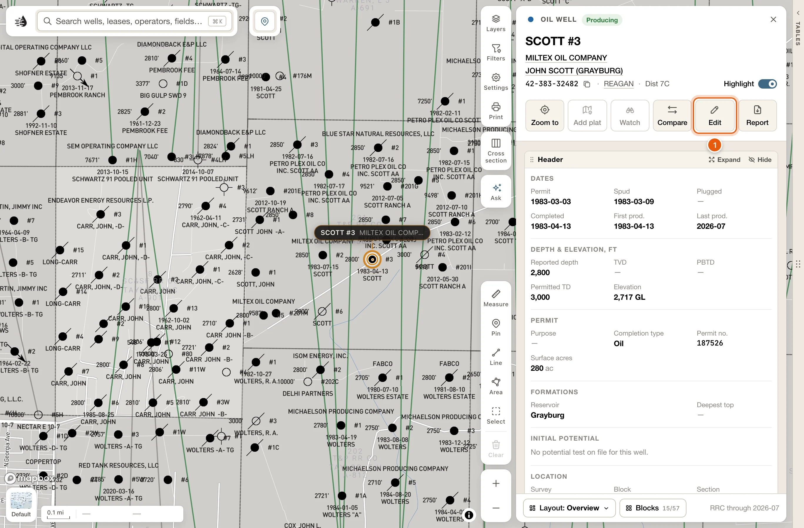
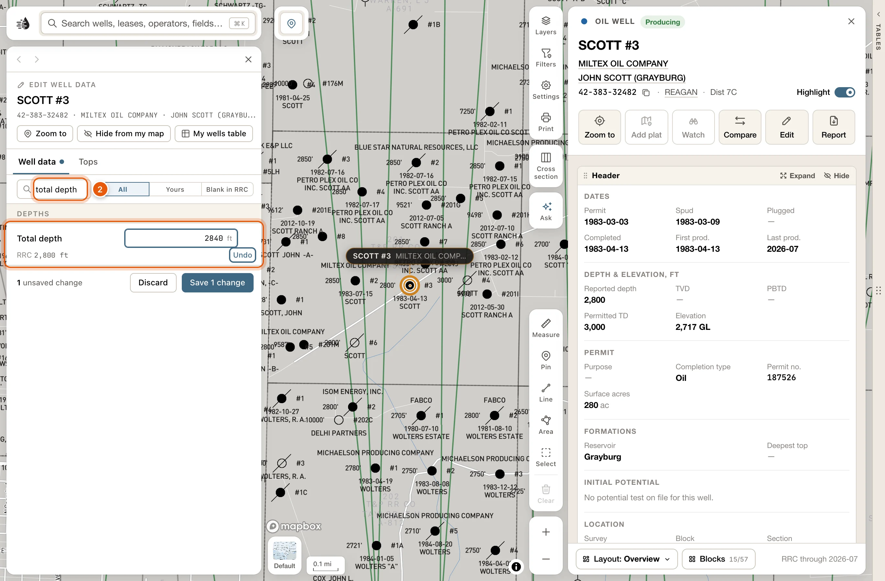
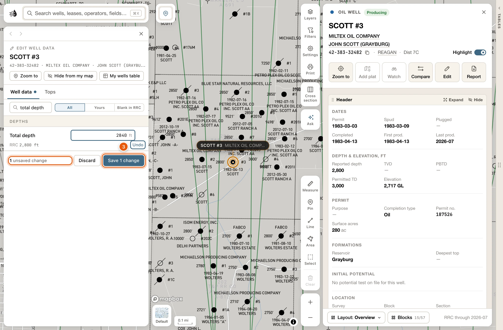
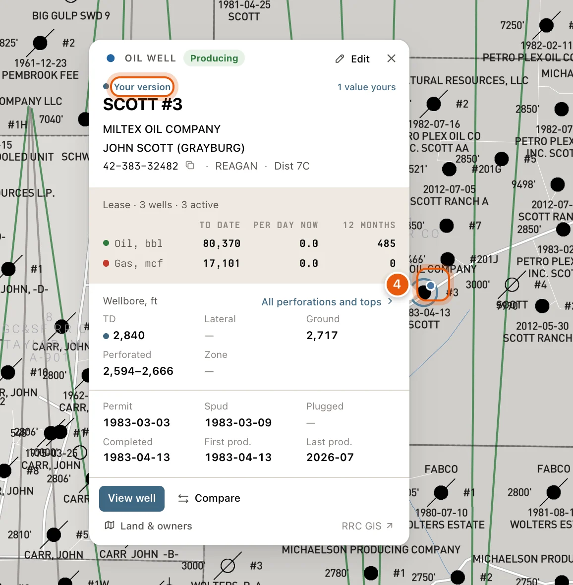
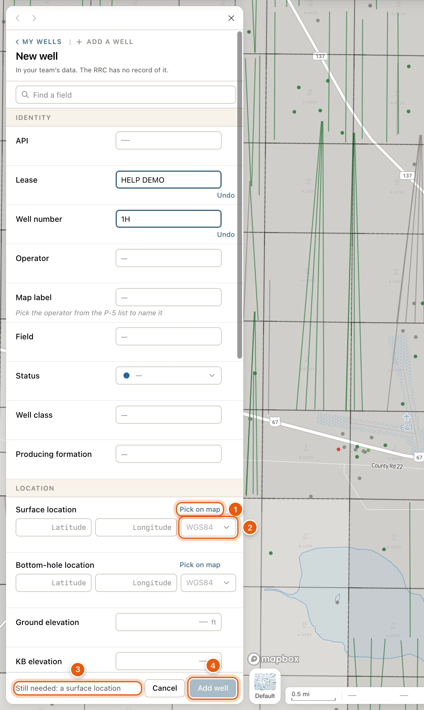
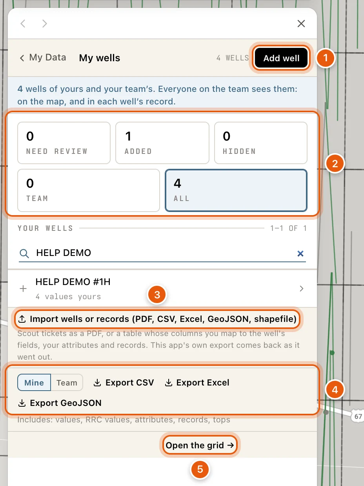
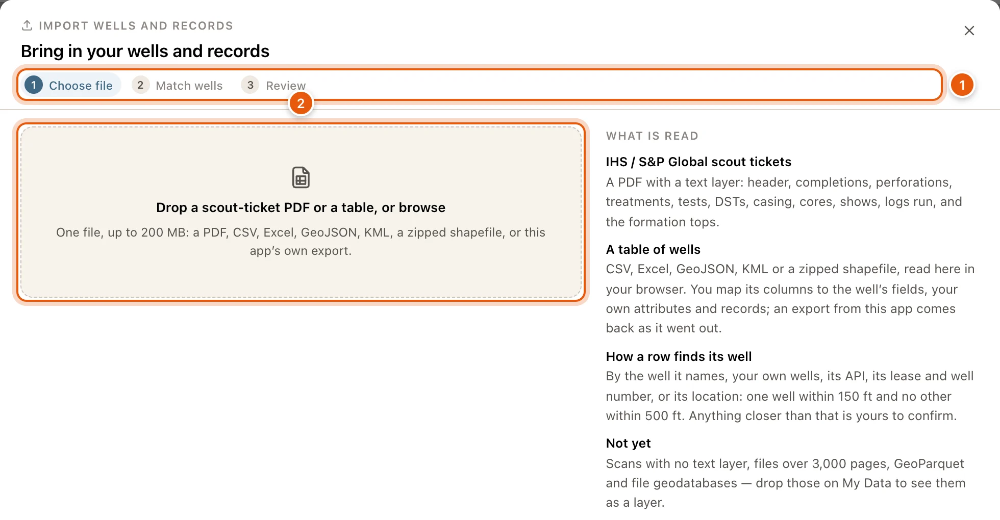
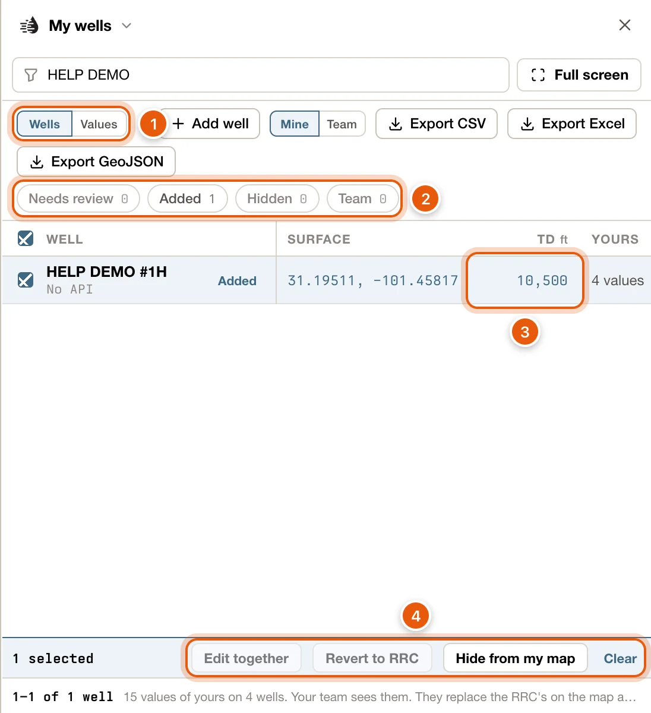
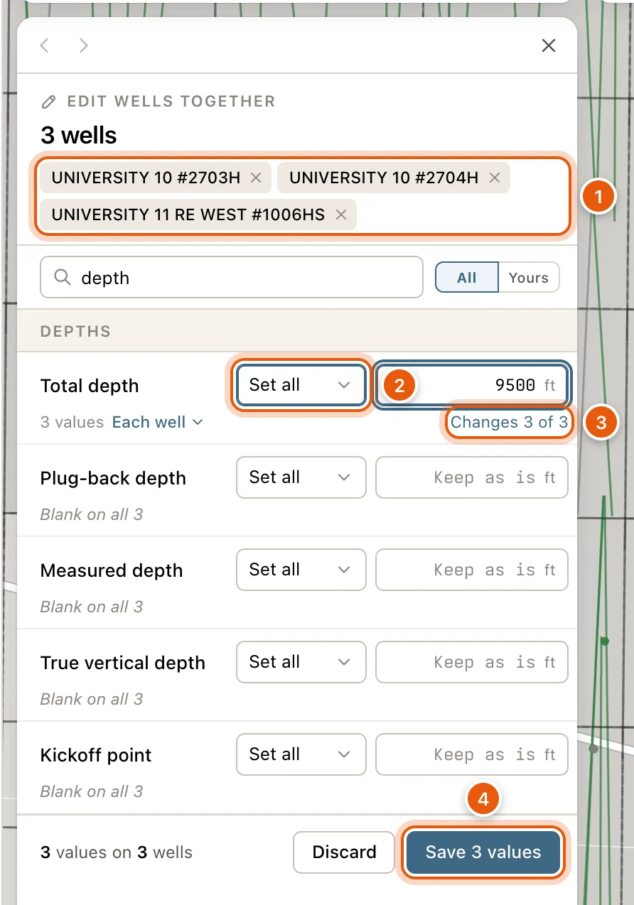
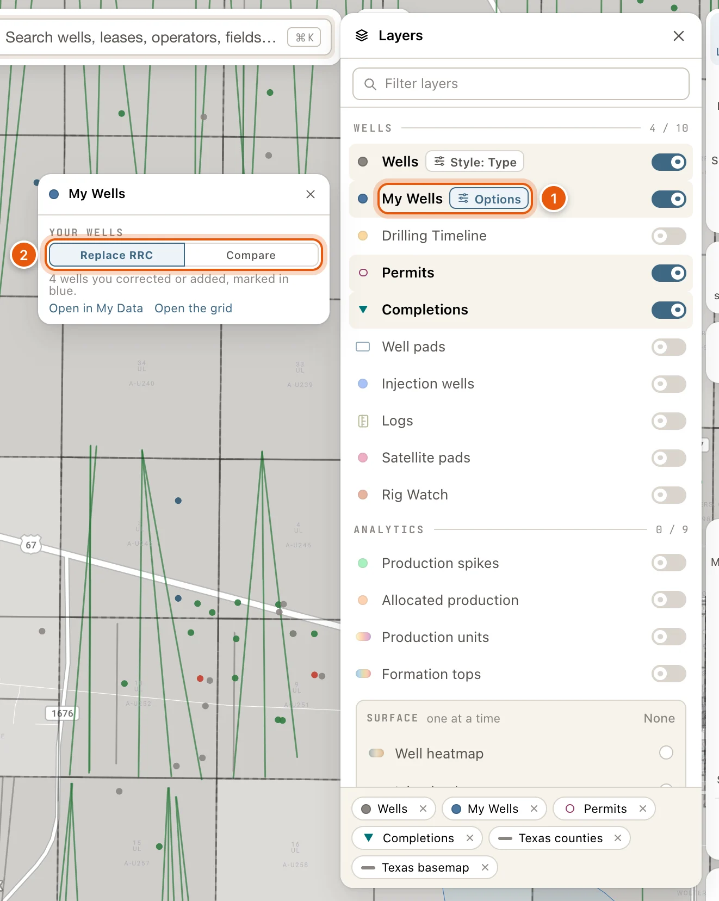

My Wells is your team's own version of the well data. Fix a depth, a location, a status or an operator the RRC has wrong. Fill in a value the RRC left blank. Or add a well the RRC has no record of at all.

Your values take the RRC's place on your map, on the well's card, in the tables and in search. Your team (everyone in your organization) sees them too, and you see theirs. The RRC's own data is never changed, and you can go back to it at any time.

My Wells is part of the [paid plans](/get-started/plans). Without a plan, the editor shows **Subscription required** and **View plans** instead. Signed out, you're asked to sign in first.

## Your values and your team's

Each value on a well is the first of these that exists:

1. Yours.
2. The latest one a teammate set.
3. The RRC's.

- Under a teammate's value, the editor names them, such as *Dana's · RRC 9,850 ft*. **Use as mine** makes the value yours as well. Typing over it does too.
- A well a teammate added is theirs to change. You can read it, and its editor says *Added by Dana · only they change it*.
- Hiding a well takes it off your map only. Your team still sees it.
- If you're not part of an organization, your values are yours alone.

## Fix a value on a well

<Steps>
  <Step title="Open the well and click Edit">
    Click the well on the map, or find it with [Search](/maps/search), to open its [card](/maps/records). Click **Edit** in the card's row of buttons.

    The editor opens in the left drawer, on its **Well data** tab. If the card stands where the editor opens, the card steps aside. You can also click **Edit** at the top of the well's popup.

    <Frame>
      
    </Frame>
  </Step>
  <Step title="Find the field and type your value">
    Type part of a field's name in **Find a field**, such as *total depth*, to show just that field. Then type your value in its box.

    The RRC's value stays on the line under the box (*RRC 9,850 ft*), so you can see what you're replacing. To take back what you typed, click **Undo** at the end of that line.

    <Frame>
      
    </Frame>
  </Step>
  <Step title="Save">
    The bar at the bottom counts what you've changed, such as *1 unsaved change*. Click **Save 1 change**.

    A message confirms the save, with **Undo** for a few seconds. **Discard** throws away what you typed instead.

    <Frame>
      
    </Frame>
  </Step>
  <Step title="See your version on the map">
    The map now draws the well with your values. Zoomed in to 12 or closer, a small blue dot on the symbol's shoulder marks the well as yours.

    Hover or click the well. Its popup says **Your version**, counts the values that are yours (*1 value yours*), and puts a dot beside each one.

    <Frame>
      
    </Frame>
  </Step>
</Steps>

## Add a well of your own

Add a well the RRC doesn't have, such as an old well you know from a scout ticket or a field visit. Your team sees the wells you add.

<Steps>
  <Step title="Start a new well">
    Open **My Data** on the left rail, click **Open** on the *My wells* row, then **Add well**.

    Or right-click the spot on the map and click **Add a well here** in the box that opens. The new well starts at that spot.
  </Step>
  <Step title="Give it a surface location">
    A new well needs a surface location before it can be added. Until it has one, the bottom bar says *Still needed: a surface location*.

    Type its latitude and longitude and choose their datum, or click **Pick on map** and click the spot. See [Locations](#locations).
  </Step>
  <Step title="Fill in what you know, then click Add well">
    Lease, well number, operator, status, depths, dates: fill in whatever you have and leave the rest blank. Click **Add well**.

    The editor then shows the saved well, where you can also add its tops and records.
  </Step>
</Steps>

<Frame>
  
</Frame>

A well you added is drawn like any other well, with the symbol of the status you gave it. It opens as a card like any other well, and **Edit** on its card opens the editor. To remove it, click **Delete** in the editor. See [The well's buttons](#the-wells-buttons).

## Ways to open My Wells

| Where | Click | Opens |
|---|---|---|
| A well's [card](/maps/records) | **Edit**, or **Edit · 3** when three values are already yours | The editor |
| A well's popup | **Edit** at the top, or **Edit tops** where the popup lists the well's tops | The editor; **Edit tops** opens its **Tops** tab |
| The popup of a historic well with no RRC data | **Edit this well's data** | The editor |
| Right-click a well | **Edit** in the box that opens | The editor |
| Right-click open ground | **Add a well here** | A new well at that spot |
| Right-click one of your own wells | **Edit this well** | The editor |
| The Wells table, with wells ticked | **Edit** for one well, **Edit together** for several | The editor. See [Edit several wells together](#edit-several-wells-together). |
| My Data | **Open** on the *My wells* row | Your list of wells. See [Your wells in My Data](#your-wells-in-my-data). |
| My Data, **Formation tops** | A well in a formation's list | The editor, on its **Tops** tab. See [Formation tops](/maps/formation-tops#your-tops-and-formations-in-my-data). |
| [Layers](/maps/layers), **Options** on the **My Wells** row | **Open in My Data** or **Open the grid** | Your list, or [the grid](#the-my-wells-grid) |
| [Search](/maps/search) | A well marked **Yours** | Your version of the well |

## Your wells in My Data

Every well you or your team corrected or added is listed in [My Data](/maps/my-data). Open **My Data** on the left rail. Near the top, the row reads *My wells: correct a well's data, or add your own*, or counts your wells once you have some. Click **Open**.

The list's header reads **My wells**, with how many wells there are, and **Add well**. A line under it counts your values, such as *15 values of yours on 4 wells*. Below it, click a count to list those wells:

| Count | Lists |
|---|---|
| **NEED REVIEW** | Wells where the RRC changed a value you edited. See [When the RRC changes a value you edited](#when-the-rrc-changes-a-value-you-edited). |
| **ADDED** | Wells you added, which the RRC doesn't have. |
| **HIDDEN** | Wells you took off your map. |
| **TEAM** | Wells with a teammate's values on them, and wells your teammates added. |
| **ALL** | Every well you corrected or added. |

**Find by well, API, operator, field…** narrows the list. Each row shows the well's name, its API, and how many values are yours or a teammate's. Click a row to open the well in the editor; **MY WELLS**, at the top left of the editor, brings you back. The list shows 25 wells to a page.

At the bottom:

- **Import wells or records (PDF, CSV, Excel, GeoJSON, shapefile)** brings in scout tickets or a table of wells. See [Import wells and records](#import-wells-and-records).
- **Mine** or **Team**, then **Export CSV**, **Export Excel** or **Export GeoJSON**, downloads your wells or your team's. See [Export your wells](#export-your-wells).
- **Open the grid →** opens all your wells as a table. See [The My wells grid](#the-my-wells-grid).

<Frame>
  
</Frame>

## The editor

The editor shows one well, with your values beside the RRC's. Nothing is saved until you save.

At the top are the well's name, its API, operator and field, and how many values are yours (*3 yours*). A tag says **Added by you** on a well you added (*Added by Dana* on a teammate's), and **Hidden** on a well you took off your map. Under them is a row of buttons. See [The well's buttons](#the-wells-buttons).

It has two tabs:

- **Well data**: the well's fields, your own fields, and the way to its records. The rest of this section covers it.
- **Tops**: the well's formation tops. Yours are listed with **Add top**, then your team's and the RRC's, each RRC top with **Use as mine**. Your team sees your tops. See [Formation tops](/maps/formation-tops).

The one **Save** at the bottom saves both tabs. A well you're adding has no **Tops** tab until it's saved.

### Fields

The fields are grouped: the well's identity (API, lease, well number, operator, field, status), its location and elevations, depths, dates and initial potential. **Find a field** shows only the fields whose names match. The chips show **All** fields, only the ones that are **Yours**, or the ones **Blank in RRC**.

Each field is one row:

- The box holds the value your map uses: yours if you've set one, else a teammate's, else the RRC's.
- The line under it shows the RRC's value, such as *RRC 5,095 ft*, or **Blank in RRC**. A value of yours is marked *Yours* with the date you set it.
- Under a value of yours, **Use RRC** at the end of the line gives it back to the RRC when you save. The line then says *Goes back to RRC … when you save*, and **Keep mine** changes your mind.
- While you're typing, the same place reads **Undo**, which takes back what you typed.

Emptying a box that holds your value also gives it back to the RRC. You can't blank out an RRC value; type your own instead.

A value that can't be read is explained in red under its box, such as *Not a number* or *A date, as YYYY-MM-DD*. Fix it before saving. Some notes only warn, such as *Deeper than the measured depth*, and never stop a save.

If another well already has the API you type, the line under **API** says so, such as *API also on your SPRING CREEK #4*. **View well** opens that well, or **Show 2** lists them when there are several. Nothing stops you from saving.

### Status and operator

**Status** is picked from a list of the map's well symbols, each shown beside its mark: *Oil*, *Shut-in gas*, *Oil, plugged* and so on. The map draws the symbol you pick.

**Operator** is picked from the RRC's P-5 list. Type two letters of the company's name, or its P-5 number, and pick it from the list. Its P-5 number shows at the end of the box.

**Map label**, under the operator, is your short name for that operator on the map, such as *CMO* for a long company name. Wherever your [well labels](/maps/well-labels) show the operator, every well of that operator then reads your short name: the RRC's wells and yours. It's saved as soon as you leave the box, and cards and tables keep the name as filed. **Clear**, at the end of the line under it, takes it off.

### Locations

**Surface location** and **Bottom-hole location** each take a latitude and a longitude in decimal degrees, such as *31.997345* and *-102.077456*.

- When you type coordinates, choose their datum in the box beside them (**Datum…**): NAD27, NAD83 or WGS84. RRC plats and W-1s are usually NAD27. The editor remembers the last datum you chose.
- **Pick on map**: click it, then click the spot on the map. **Cancel** stops. A spot picked on the map needs no datum.
- **Move by feet**: shifts the location a number of feet east and north. West and south are negative. **Coordinates** goes back to typing coordinates.

Moving the surface location of a horizontal well moves its bottom hole with it, keeping the lateral as the RRC has it, unless you've set the bottom hole yourself. The surface row says *The bottom hole moves with it*, and the bottom hole then reads *Moved with the surface*.

### Your own fields and records

Below the RRC's fields:

- **Add a field** adds a value the RRC doesn't keep, such as a working interest or an AFE number. Type a name and a value. A name you've used on one well is offered on your other wells. **Remove** takes a field off when you save.
- **Add a record**, or **Records · 3** when the well has some, opens the well's records in their own editor: tests, cores, completions with their perforations and treatments, casing, notes and more. Each record saves on its own, and your team sees them. See [Well records](/maps/depth-records).

### The well's buttons

Under the well's name:

- **Zoom to** moves the map to the well.
- **Hide from my map** takes the well off your map. It stays pressed while the well is hidden; press it again to put the well back. Hidden wells stay in your list under **HIDDEN**.
- **My wells table** opens [the My wells grid](#the-my-wells-grid).
- **Revert to RRC**, on an RRC well with values of yours, drops all of them.
- **Delete**, on a well you added, deletes it.

Hiding, reverting and deleting happen straight away, with **Undo** for a few seconds.

### Save

The bar at the bottom says what's waiting, such as *2 unsaved changes*, *3 unsaved changes · 2 in Tops* or *Fix 1 value before saving*. With nothing to save, it reads *Your team sees your values*.

- **Save 2 changes** saves everything on both tabs. <kbd>⌘</kbd> <kbd>Enter</kbd> in a box does the same (<kbd>Ctrl</kbd> <kbd>Enter</kbd> on Windows).
- **Discard** throws away what you typed on both tabs.

What you've typed is kept if the left drawer shows something else for a while, and if you reload the page. Come back to the well and it's still there, until you save or discard it or close the tab.

## When the RRC changes a value you edited

QuickScout checks your values against the RRC's every night and each time you save. When the RRC changes a value you've replaced, the well is flagged for review:

- It's counted under **NEED REVIEW** in My Data.
- On the map, its blue dot turns amber, and its popup says *The RRC has changed a value you corrected.*
- At the top of the editor, a note such as *2 to review* jumps to the changed rows. Each one reads *RRC now 9,900 ft, was 9,850 ft*, or *RRC moved it 212 ft E* for a location.

On each changed row:

- **Keep mine** keeps your value and stops flagging it. It's flagged again if the RRC changes it again.
- **Use RRC** drops your value and uses the RRC's new one.

If the RRC stops listing a well altogether, its editor says *The RRC no longer lists this well. Your values still show on your map.*

## Import wells and records

Bring in a whole file at once: IHS / S&P Global scout tickets as a PDF, or a table of wells. Each ticket or row finds its well, you confirm the ones in doubt, and the whole import can be undone later.

In My Data, open your wells and click **Import wells or records (PDF, CSV, Excel, GeoJSON, shapefile)**. A PDF takes three steps: **Choose file**, **Match wells** and **Review**. A table has a fourth, **Map columns**, after the first. Nothing changes on your wells until the last step.

<Steps>
  <Step title="Choose file">
    Drop the file on **Drop a scout-ticket PDF or a table, or browse**, or click it to pick the file. One file at a time, up to 200 MB.

    - A scout-ticket PDF: QuickScout reads IHS / S&P Global scout tickets, as a PDF with a text layer: the header, completions, perforations, treatments, tests, DSTs, casing, cores, shows, logs run and formation tops. Tickets for one wellbore land on the same well. A long file takes a minute or two to read. You can close the window meanwhile. The file keeps being read, and it waits for you in the list of imports at the bottom of this step.
    - A table: a CSV, Excel, GeoJSON, KML or zipped-shapefile file, or a file this app exported. It's read here, in your browser, and its rows are sent only once you've mapped its columns. A table can hold up to 50,000 rows and 200 columns.

    <Frame>
      
    </Frame>
  </Step>
  <Step title="Map columns (a table)">
    Each column of the file is a row: its name, a sample of its values, and where it goes. Choose what each column is:

    - What names the well: **Well: API**, **Well: Latitude** and **Well: Longitude**, **Well: ref** for a file this app exported, and so on.
    - One of the well's fields, such as its total depth.
    - **My attribute "*name*"**, to keep the column as a field of your own.
    - A record's field, such as **Record: DST · Test no.**, or a formation top's **Record: Formation top · Formation**.
    - **Ignore**.

    QuickScout fills in what it recognizes. **Shape** is **One row per well**, or **Long form (QuickScout export)** for a file this app exported. Once a location is mapped, choose its datum under **Coordinates are**. Anything that stops the import is listed under the table, such as *Map a column that names the well: its API, wid or ref, or a location.*

    Click **Next: Match wells**. Keep the window open until every row has been sent (*Sent 1,200 of 4,000 rows*).

    {/* screenshot: my-wells-import-map-columns — the import's Map columns step for a CSV of wells: Shape, then the Column / Sample / Goes to table with one column going to Well: API and one kept as My attribute, and Next: Match wells. Annotate: 1 = Shape, 2 = a Goes to choice, 3 = Next: Match wells */}
  </Step>
  <Step title="Match wells">
    In a table, each well's rows make one ticket. A ticket finds its well by the well it names, by your own wells, by its API, by its lease and well number, or by its location: one well within 150 ft of its spot, and no other within 500 ft. **MATCHED BY** says which. The tickets are sorted four ways. Click a count to list them:

    | Count | Means |
    |---|---|
    | **Matched** | Matched to a well, by API or another key, or by location with no other well near. |
    | **Confirm** | More than one well near the ticket's spot. Choose the right one from **Pick the well…**, or choose **New well of mine, at the ticket's spot** or **Skip this ticket**. A ticket left unpicked is left out. |
    | **New wells** | No RRC well near the ticket's spot. These are **added as my wells** or **skipped**, all together or one at a time. |
    | **No well** | No API the RRC knows and no location: nothing to attach the ticket to. |

    Click **Next: Review**.
  </Step>
  <Step title="Review, then import">
    Choose how the file meets what's already there:

    - **Where the file disagrees with your values**: **Keep mine** (the default) or **Use the file**.
    - **Operator, lease, well no., field, status over the RRC's**: **Fill blanks only** (the default) or **Use the file**. A ticket is a dated snapshot, and spellings differ.
    - **Locations**: **Move matched RRC wells to the ticket's spot** is off at first. A new well always takes the ticket's spot.

    The counts above the list show what the import will write: blanks filled, RRC values replaced, your earlier values replaced, and values that already match. Below, each ticket lists its fields as they are now and as the file has them. Every record in the file is added.

    Click **Import 12 values** (the button counts them). When it's done, click **Open My wells** to see them, or **Import another file**.
  </Step>
</Steps>

Imported values are labelled with the file they came from, so you can find them or undo the whole import later.

### Undo an import

Open the import again. Every import is listed under **YOUR IMPORTS**, at the bottom of the first step, with its file, date, status, tickets and what it wrote. **Review**, **Open** or **Read it** picks one up where it left off.

To take an import back, click **Revert**, then **Revert this import**. That removes every value, record and top the file put on your wells. **Cancel** leaves it as it is.

If an import's formation tops couldn't be saved, its status reads *Imported, tops pending*. Open it and click **Try the tops again**.

## Export your wells

At the bottom of your list in My Data, choose whose wells to export, **Mine** or **Team**, then a format:

- **Export CSV**: a zip of four CSV files: values, attributes, records and tops.
- **Export Excel**: one workbook with the same four sheets.
- **Export GeoJSON**: one feature per well, with its values, records and tops, to open in mapping software.

Every value comes with the RRC's beside it and whose it is. The line under the buttons says what's included, then *Preparing your export…*, then the name of the file once it's saved.

An export holds every well of yours, or of your team's, however the list is narrowed. Its columns are the ones the import reads, so an exported file comes back in as it went out.

The [My wells grid](#the-my-wells-grid) has the same buttons. In the Wells table, **Export** has **Your edits (Excel)**.

## The My wells grid

**Open the grid →**, at the bottom of your list in My Data, opens a **My wells** tab in the [data tables](/maps/data-panel). It lists every well of yours as a row, so you can work through them beside the editor. **My wells table** in the editor, and **Open the grid** in Layers, open it too.

- **Wells** shows a row per well, with a column for each field you've set. Click a cell to type your own value; <kbd>Enter</kbd> saves it and <kbd>Esc</kbd> cancels. Status, operator and location cells open the editor instead.
- **Values** shows a row per value, with the RRC's beside yours. **Keep mine** answers a value the RRC has changed. **Use RRC**, or **Remove** for a field of your own, takes your value off.
- **Needs review**, **Added**, **Hidden** and **Team** narrow the rows. **Add well** starts a new well. **Mine** or **Team** with **Export CSV**, **Export Excel** and **Export GeoJSON** are the same downloads as in My Data.
- Tick rows for **Edit together**, **Revert to RRC** or **Hide from my map**. **Revert to RRC** leaves the wells you added alone.
- Each row has **Edit** and **Zoom to**. Its **More** has **Hide from my map**, and **Revert to RRC** or **Delete this well**.

<Frame>
  
</Frame>

## Edit several wells together

To set the same value on many wells, tick them in the Wells table and click **Edit together** in the bar below the list. With one well ticked, the button reads **Edit**. You can edit up to 100 wells at a time. In the My wells grid, tick two or more rows and click **Edit together**.

The editor lists the wells at the top; the × on one takes it off this edit. Each field has a choice and a box:

| Choice | Does |
|---|---|
| **Set all** | Gives every well the value you type. |
| **Fill blanks** | Sets it only on the wells with no value. |
| **Add ±** | Adds or subtracts an amount. Numbers only. |
| **Use RRC** | Drops your values for that field and uses the RRC's. Offered when some of the values are yours. |

A box left at **Keep as is** changes nothing. The line under each field says how the wells stand now, such as *Same on all · 9,850 ft*, *Blank on all 3*, or *3 values, 1 blank* with **Each well** to list them. On the right, it counts the wells that would change (*Changes 4 of 6*).

- Locations move every well by the same number of feet east and north.
- API and well number are different on every well, so they're set one well at a time.
- Your own fields can be set, filled in, or taken off with **Remove**. **Add a field** adds one to every well here.

Click **Save 4 values** (the button counts them). The wells save together: every well takes its values, or none does. If the save fails, the bar says *Nothing saved*, and **Retry** sends it again. **Undo** in the message that follows a save takes them all back.

<Frame>
  
</Frame>

## On the map

Your wells are drawn like any other well, with your values in place: your symbol, your labels and your lateral. Zoomed in to 12 or closer, a small blue dot on the symbol's shoulder marks a well as yours or your team's. It turns amber when the RRC has changed one of your values.

Hover or click one of your wells for its popup. It says **Your version**, or **Added by you**, counts your values, and marks each value of yours with a dot. A teammate's well says whose it is, such as *Dana's version* or *Added by Dana*, and counts their values too (*2 by Dana*). **View well** in the popup opens the well's card, the same for a well you added.

Once you have a well, the [Layers](/maps/layers) card lists **My Wells** in its Wells group:

- Switch it off for the plain RRC map, tables and search.
- Its **Options** choose between **Replace RRC**, where your version takes the RRC well's place (the default), and **Compare**, where the RRC's location stays on the map beneath each of yours, so you can see how far you moved it.
- **Open in My Data** and **Open the grid** take you to your list or the grid.

<Frame>
  
</Frame>

## In the tables and search

Your values go wherever the wells do:

- In the Wells table, the [Search tab](/maps/search-results) and a record's list of wells, your values replace the RRC's. Filters, sorting, charts and [exports](/maps/exports) use them, and the wells you added are rows too. The first time a table opens, it may wait a moment on *Applying your well edits…*.
- [Search](/maps/search) finds your wells by your values. Give a well an operator, and searching for that operator finds it. In the search panel, your well is marked **Yours**. In the Search tab, its API is followed by *· yours*. It opens as it would from the map.

With **My Wells** switched off in Layers, the tables and search go back to the RRC's values.

## Troubleshooting

<AccordionGroup>
  <Accordion title="Save is greyed out">
    The bottom bar says why:

    - *Fix 1 value before saving*: a box has a red note under it. Correct it, or click **Undo** at the end of its line to take back your typing.
    - *Still needed: a surface location*: a new well needs one before **Add well** works.
    - *Added by Dana · only they change it*: a teammate added this well, and only they can change it.

    Under a location, *Choose the datum these coordinates are in* means the datum beside the coordinates is still blank.
  </Accordion>
  <Accordion title="That point is not in Texas">
    Check the latitude and longitude. They're decimal degrees, and every longitude in Texas is negative, such as *-102.077456*.
  </Accordion>
  <Accordion title="My values don't show in a table or in search">
    - Check that **My Wells** is switched on in [Layers](/maps/layers).
    - Your values join the tables and search once the map's data has loaded. Until then, the map's filter badge says *Filters use RRC values for your wells right now*, and the Search tab says *Your wells are not searched until the map’s data has loaded.* See [Map data on this device](/maps/offline).
  </Accordion>
  <Accordion title="Edit together is greyed out">
    More than 100 wells are ticked. Tick fewer and try again. In the My wells grid, tick at least two.
  </Accordion>
  <Accordion title="None of the ticked wells has an id to edit it by">
    Historic wells can't be edited from ticked rows. Open the well on its own instead: click it on the map, then click **Edit** on its card, or **Edit this well's data** in its popup.
  </Accordion>
  <Accordion title="The file could not be read">
    - A scout ticket must be an IHS / S&P Global PDF with a text layer. A scanned PDF has no text layer, so it can't be read. Files over 3,000 pages or 200 MB can't be read either.
    - A table must be a CSV, Excel, GeoJSON, KML or zipped-shapefile file, of up to 50,000 rows and 200 columns.
    - GeoParquet files and file geodatabases aren't read yet. Drop those on [My Data](/maps/my-data) to see them as a layer.
  </Accordion>
</AccordionGroup>
