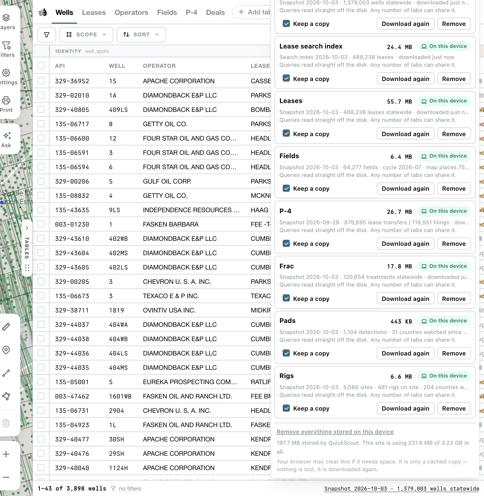

The data tables keep a copy of each statewide dataset in your browser. A stored copy reduces repeated downloads and usually makes tables faster. Without one, tables may read over the network or wait for a required dataset.

You don't need to set anything up. **Keep a copy** is on from the start, copies download in the background after giving the map priority. Opening a table gives its download priority. New snapshots can replace older copies automatically; if the panel says **newer published**, use **Download again** to fetch it now.

## Manage copies

Click the **Snapshot** stamp at the bottom right of the data tables (for example *Snapshot 2026-09-06 · 1,378,276 wells statewide*). This opens **Local data**.

<Frame>
  
</Frame>

There's a row for the **Lease search index** and for each table: **Leases**, **Fields**, **Wells**, **P-4**, **Frac**, **Pads** and **Rigs**. The **Operators** table is built from the **Leases** copy, so it has no row of its own. For each one:

- **Keep a copy** turns storing on or off.
- **Download now** / **Download again** fetches the latest copy. **Stop** pauses it; the next download picks up where it left off.
- **Remove** deletes the copy.

**Remove everything stored on this device** clears them all.

The same controls are under **Settings** (the gear) → **KEEP ON THIS DEVICE**, as a checkbox and icon buttons for each dataset.

## What the status means

| Status | Meaning |
|---|---|
| **On this device** | A current copy is stored. |
| **On this device · newer published** | A newer snapshot is available. **Download again** fetches it. |
| **Downloading N%** | A download is in progress. |
| **Downloading · waiting for the map** | Paused while the map or a table uses the connection; resumes automatically. A percentage may also appear. |
| **Downloading · waiting its turn** | Another dataset is downloading first. |
| **Downloading N% · stalled** | No bytes have arrived for a while. Use **Stop**, then **Download now** to resume. |
| **Checking…** | QuickScout is looking at what's stored. |
| **Not stored** / **Partly stored** | No copy, or an incomplete one. |
| **No room** | Your browser doesn't have space for a copy. |
| **Could not open** | The stored copy couldn't be read. Click **Try again**. |

A dot on the Snapshot stamp means a copy couldn't be opened, or storage is full.

While a copy downloads, the table footer reads *Saving a copy to this device · N%*, with **Stop**. Some tables can keep reading over the network or from an older copy. Others wait for their required copy; follow the footer status.

<Note>
  - Sizes change with each publication. The panel shows the current size of each copy. They're stored per browser, so each computer keeps its own.
  - Browser settings and private windows may prevent storage. **Not stored** explains when this browser cannot keep a copy.
  - Your browser may clear copies if it needs the space. Nothing is lost: they download again.
  - On a data-saver connection, background copies don't download by themselves. **Download now** requests one explicitly.
</Note>

## Does this make QuickScout work offline?

A local copy is a table dataset, not a copy of the whole app. Maps imagery, record details, sign-in, AI and other server features can still need a connection. Keep copies to reduce downloads; don't rely on them for a complete offline session.
