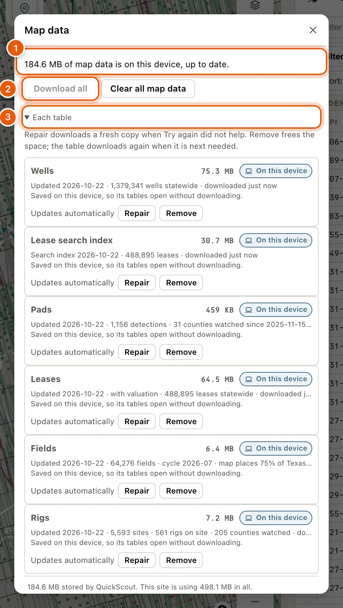
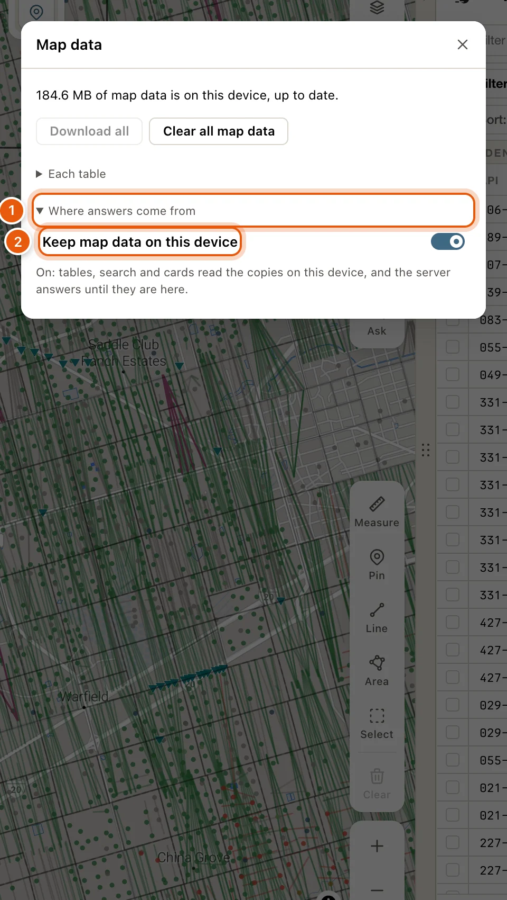
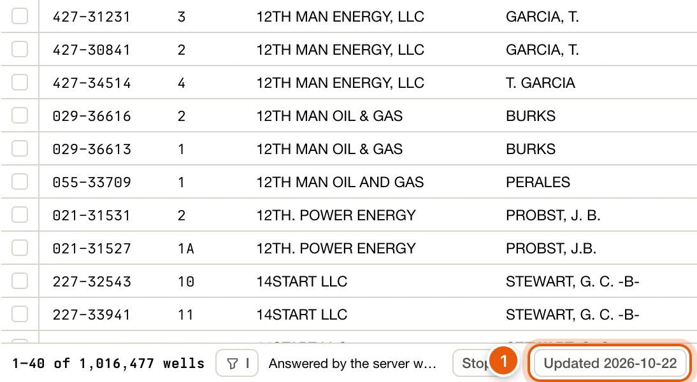
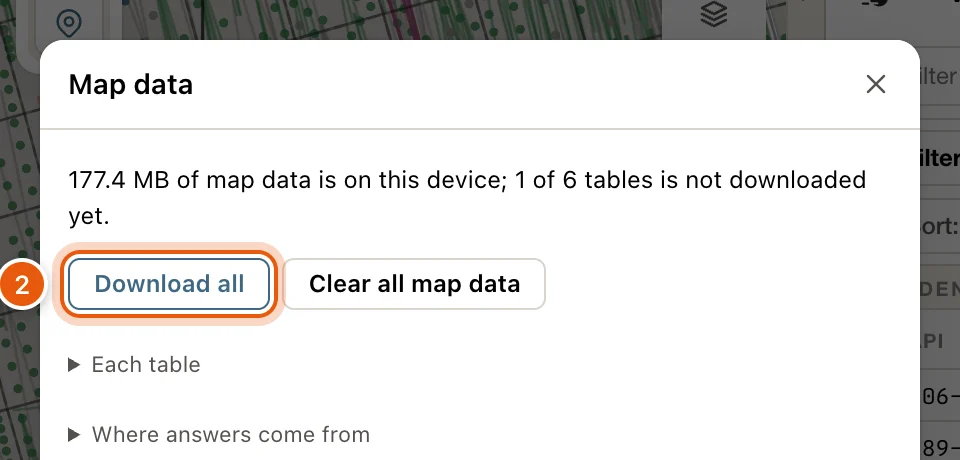
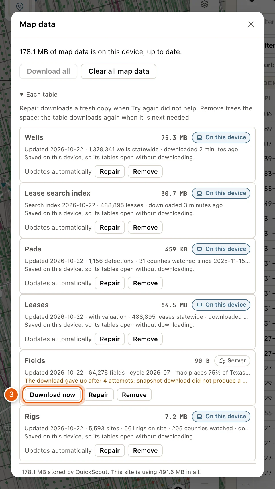
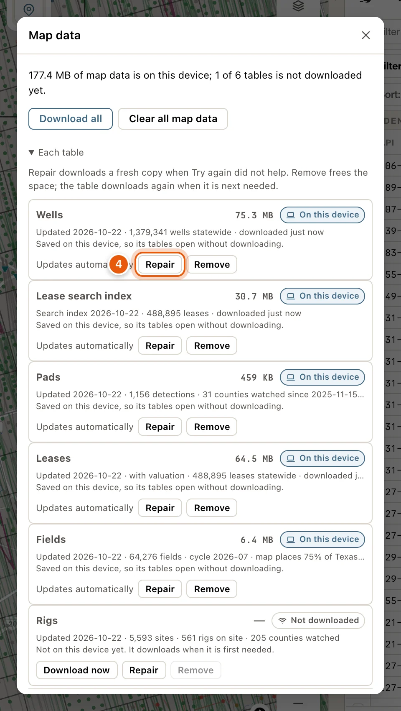
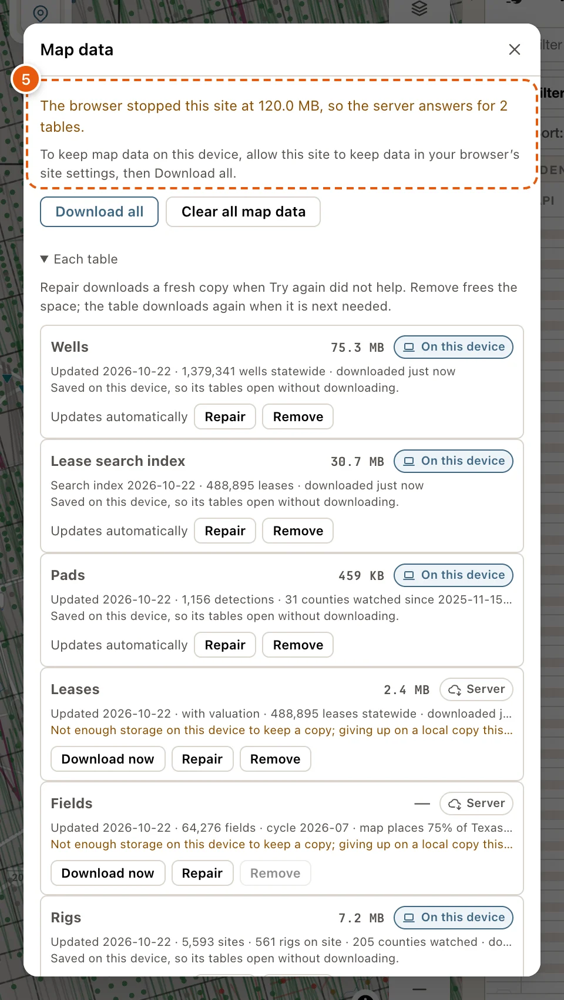

To keep the data tables and search fast, QuickScout keeps a copy of its statewide tables in your browser. They download by themselves while you use the map, once the map has what it needs; opening a table moves its download to the front. Until their copies are here, the QuickScout server answers for **Wells**, **Leases**, **Fields** and search, so they and the cards work from the start. **Pads** and **Rigs** wait for their own download. You don't need to set anything up.

The data tables and search need a free account, so this matters once you're signed in. If something looks stuck, see [Fix stuck or missing map data](#map-data).

## Open Map data

- Click the stamp at the right end of the data tables' footer. It shows the date of the data the table is reading. A dot on it means something needs attention.
- Or open **Settings** (the gear on the right side of the map) and click **Map data…** under **SUPPORT**.
- Or click **Map data…** in a search's waiting note.

<Frame>
  
</Frame>

## One sentence, two buttons

**Map data** opens on one sentence that says what's on this device, or what's in the way. For example:

- *1.2 GB of map data is on this device, up to date.*
- *1.2 GB of map data is on this device; 2 of 8 tables are not downloaded yet.*
- *1.2 GB of map data is on this device; 1 table has an update.*
- *Downloading wells 42%.*
- *The browser stopped this site at 300 MB, so the server answers for 3 tables.*
- *No room on this device, so 2 tables are kept for this visit only.*

Under it, two buttons act on everything at once:

| Button | Does |
|---|---|
| **Download all** | Downloads every table that isn't on this device yet. It reads **Update all** when newer data is out, and **Try again** when a table couldn't be opened. It's greyed out when there's nothing to do. |
| **Clear all map data** | Deletes every copy from this device, to free space. Nothing is lost: the map downloads what it needs again as you use it, or click **Download all**. |

## Each table

Click **Each table** for a row per table, such as **Lease search index**, **Leases**, **Fields** and **Wells**, plus **Pads** and **Rigs** once you've used them. The **Operators** table is built from the **Leases** copy, so it has no row of its own. **P-4** and **Frac** aren't downloaded at all: the QuickScout server answers them whenever you open them, so they have no row either.

Each row shows the table's name, how much space it takes, and a chip saying where it stands. Two lines under it say what the copy is and the latest thing that happened to it. Then its main button:

- **Stop** while it downloads. The next download carries on from where it stopped.
- **Try again** after a failure.
- **Download now**, or **Update now** when newer data is out. If **Download now** is greyed out, open that table once first.
- No button, just **Updates automatically**, when the copy is current.

The bottom of the list says how much QuickScout stores and how much this site uses in all. It may add: *Your browser may clear this if it needs space. Nothing is lost: it downloads again.*

### Repair and Remove

Beside the main button, every row has two more:

- **Repair** throws the copy away and downloads a fresh one. Use it when **Try again** didn't help.
- **Remove** frees that table's space on this device. It downloads again when it's next needed.

### What the chips mean

| Chip | Meaning |
|---|---|
| **On this device** | A current copy is stored, so its tables open without downloading. |
| **On this device · update ready** | Newer data is out. **Update now** fetches it; on a slow connection, or one set to save data, it downloads when you next open the table. |
| **Downloading** | A download is under way, with a percentage when the size is known. Meanwhile the server, or the copy already on this device, answers. |
| **Downloading · waiting for the map** | Paused while the map, or a table you're reading, uses the connection. It carries on by itself. |
| **Downloading · waiting its turn** | One table downloads at a time. This one starts when the one ahead of it finishes. |
| **Downloading · in another tab** | Another QuickScout tab is already downloading it. This tab uses that copy when it finishes. |
| **Downloading · making room** | The browser refused the space once. Older copies are being cleared before it tries again. |
| **Downloading · reconnecting** | The connection dropped. It tries again by itself and carries on from where it stopped. |
| **Downloading · offline** | This device is offline. The download carries on when the connection is back. |
| **Downloading · stalled** | Nothing has arrived for a while. It's asked for again by itself; nothing needs doing. |
| **Server** | Nothing of this table is on this device: the QuickScout server answers for it. The line under the chip says why, and what to do if you want a copy here. **Download now** saves one. |
| **This visit only** | Kept until this tab closes, because the device wouldn't keep it. It downloads again next time. |
| **Not downloaded** | Not on this device yet. It downloads when it's first needed. After you click **Stop**, **Download now** starts it again. |
| **Partly downloaded** | A download stopped part-way. It carries on from there rather than starting over. |
| **No room** | The browser refused the space. Free some space, then click **Download now**. |
| **Site limit** | The browser won't let this site keep more. See [When the browser limits this site](#when-the-browser-limits-this-site). |
| **Could not open** | The stored copy couldn't be read. Click **Try again**. |
| **Checking…** | QuickScout is looking at what's on this device. |

While a table downloads, its own footer says so, with **Stop**. While the server answers, it reads like *Answered by the server while a copy of the wells is saved to this device · 42%*: the rows are real, and nothing needs doing. Without the server, it reads like *Saving a copy to this device · 42% — rows appear when it finishes*. Some tables show the first rows of the file meanwhile, unsorted and unfiltered; your sort and filters apply once the download finishes.

## Slow connections

On a slow connection, or one set to save data, tables don't download in the background. Each one downloads when you first open it, while the server answers for it, and its row says why. On a slow connection, some tables also wait for the search index to finish, then start by themselves. **Download now** still works whenever you want a table sooner.

## When the browser limits this site

Some browsers cap how much one website may keep. When QuickScout reaches that cap, **Map data** says so, for example *The browser stopped this site at 300 MB, so 3 tables are kept for this visit only.*, and the rows read **Site limit**, **This visit only** or **Server**. The tables still work: the server answers for them, or they download again on every visit.

To keep map data on this device:

1. In your browser's settings for this site, allow it to keep data on your device. The dialog says the same: *To keep map data on this device, allow this site to keep data in your browser’s site settings, then Download all.*
2. Click **Download all**.

If you'd rather not change that setting, make room instead: clear data other websites keep, or **Remove** a table you don't use under **Each table**. Or have the server answer everything; see [Answer from the server instead](#answer-from-the-server-instead).

<Note>
  - When this device is simply full, the sentence reads *No room on this device…*. Free some space, then click **Download all**.
  - A private window, and some browsers, can't keep map data. **Map data** says so: the server answers for those tables, or they load for that visit only and download again next time.
  - Each browser keeps its own copy, so each computer downloads its own.
</Note>

## Answer from the server instead

If your browser won't keep the files, or you'd rather QuickScout kept nothing on your computer, have the QuickScout server answer everything:

1. Open **Map data** and click **Where answers come from**, at the bottom.
2. Switch off **Keep map data on this device**.
3. The dialog asks first, because what's kept here is deleted. Click **Answer from the server**, or **Keep map data here** to leave things as they are.

From then on the server answers for **Wells**, **Leases**, **Fields** and search, and their copies aren't downloaded. Scrolling and searching take a round trip to the server, charts draw a sample of 5,000 rows, and exports run page by page. **Map data** reads *Map data is answered by the server on this device; nothing is kept here.*

The switch belongs to this browser: its other QuickScout tabs follow it, and other browsers and computers keep their own. Switch it back on to download map data again.

<Frame>
  
</Frame>

## Fix stuck or missing map data

<Steps>
  <Step title="Open Map data">
    Click the stamp at the right end of the data tables' footer. Or open **Settings** and click **Map data…** under **SUPPORT**.

    <Frame>
      
    </Frame>
  </Step>
  <Step title="Click the first button">
    Read the sentence at the top, then click the first button: **Download all**, **Update all** or **Try again**. Most problems end here.

    <Frame>
      
    </Frame>
  </Step>
  <Step title="Look at the table that's stuck">
    Click **Each table** and find the table's row. Its chip and the two lines under it say what's wrong. Click its button: **Try again**, **Download now** or **Update now**.

    <Frame>
      
    </Frame>
  </Step>
  <Step title="Repair it">
    Still stuck? Click **Repair** on that row. It throws the copy away and downloads a fresh one.

    <Frame>
      
    </Frame>
  </Step>
  <Step title="Let the browser keep it">
    If the sentence says the browser stopped this site, allow this site to keep data in your browser's settings for it, then click **Download all**. See [When the browser limits this site](#when-the-browser-limits-this-site).

    <Frame>
      
    </Frame>
  </Step>
</Steps>

Still stuck, or the browser won't keep the files at all? Have the server answer instead; see [Answer from the server instead](#answer-from-the-server-instead).

## Does this make QuickScout work offline?

No. Map data is a copy of the tables, not of the whole app. The map's imagery, record details, sign-in, AI and other features still need a connection. Keeping map data saves downloads and makes the tables faster; don't rely on it for a whole session without a connection.
