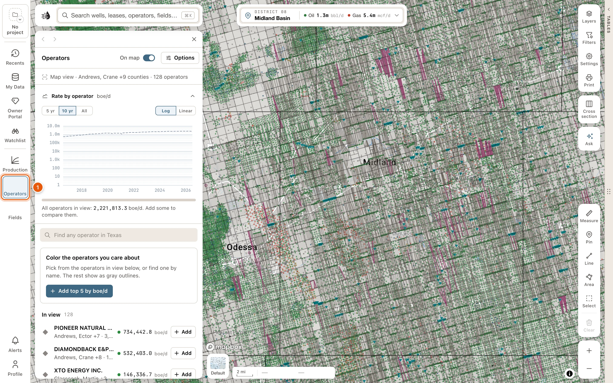
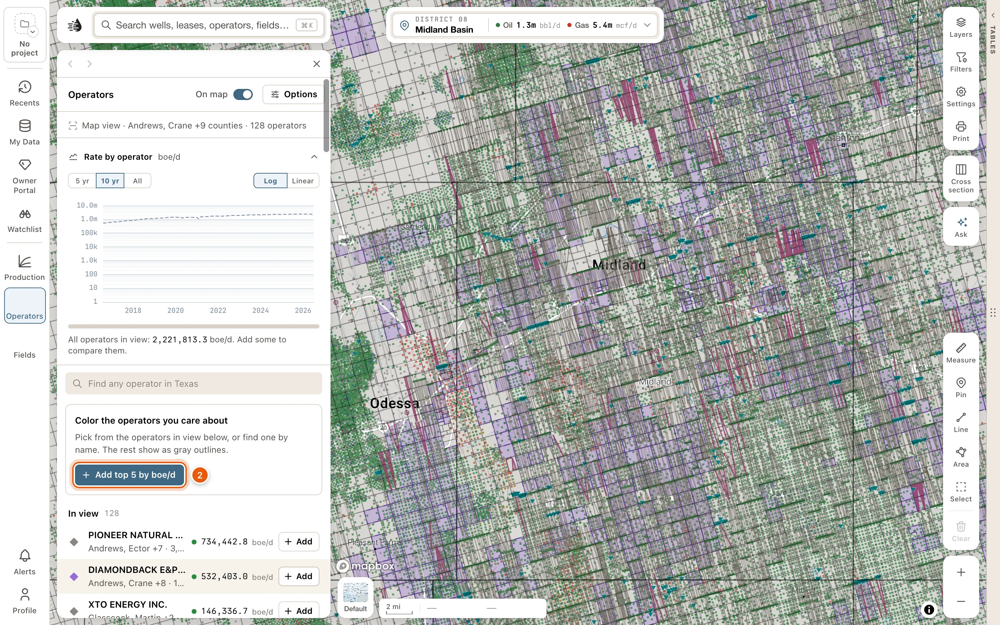
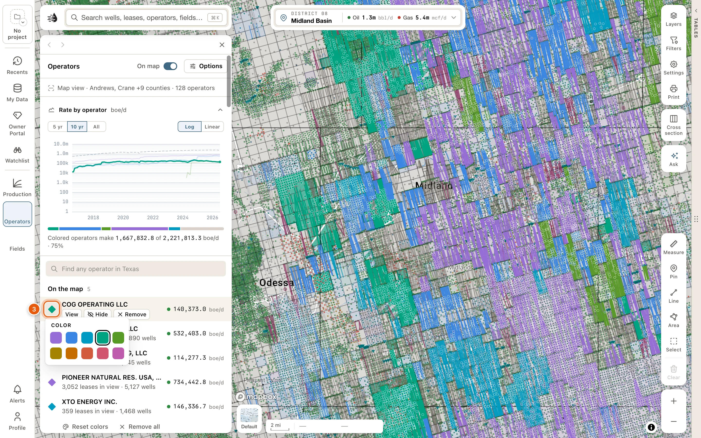
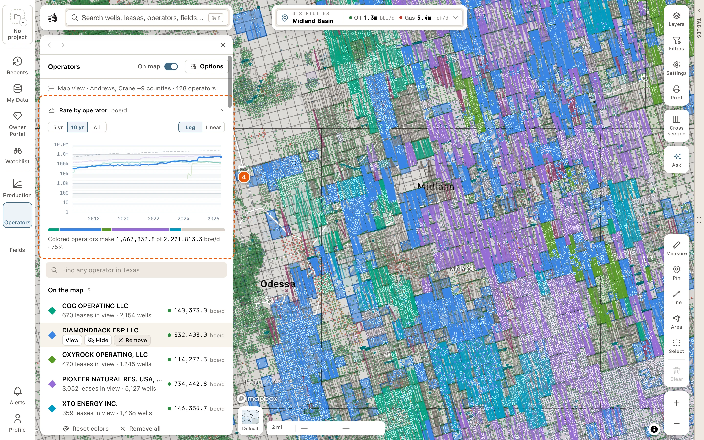
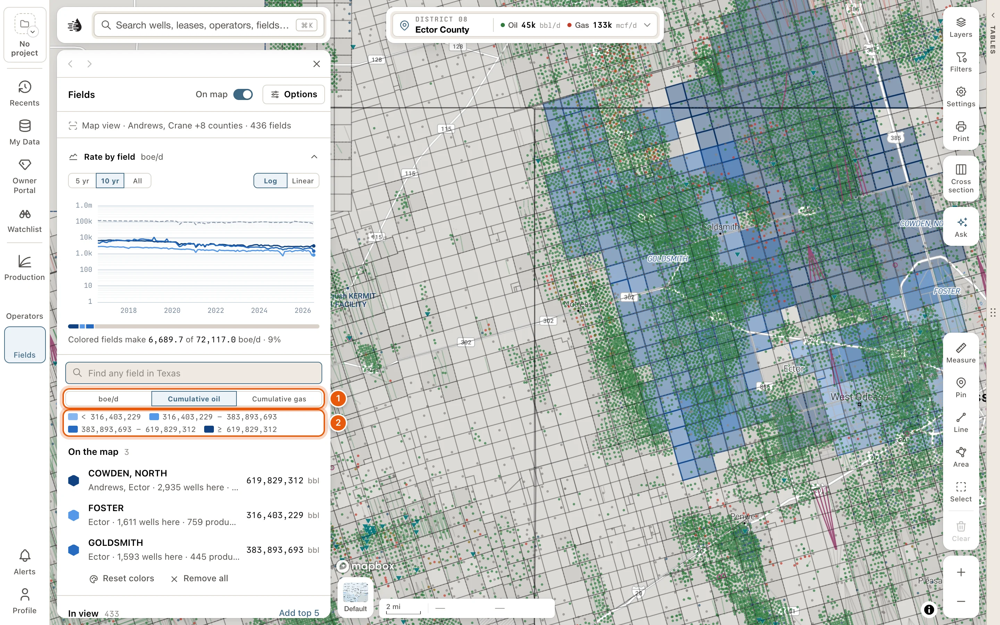

The **Operators** and **Fields** buttons on the left rail open two map layers. Pick operators or fields, and the map draws each one in a color of its own: an operator's leasehold, or the ground a field covers. Each panel also ranks everyone in view and charts their production.

Both panels need a [paid plan](/get-started/plans). For the **Operators** and **Fields** tabs in the data tables, see [Operators & Fields tabs](/maps/operators-fields).

<Steps>
  <Step title="Open the Operators panel">
    Click **Operators** on the left rail. The panel opens on the left of the map and lists the operators in view, biggest producers first.

    <Frame>
      
    </Frame>

  </Step>
  <Step title="Put operators on the map">
    Click **Add top 5 by boe/d** for the five biggest. To add one at a time, click **Add** on an operator's row under **In view**. To find one anywhere in Texas, type its name in **Find any operator in Texas**.

    <Frame>
      
    </Frame>

  </Step>
  <Step title="Choose a color">
    Each operator takes the next of ten colors. To change one, click the colored mark beside its name and pick another.

    <Frame>
      
    </Frame>

  </Step>
  <Step title="Read the map and the chart">
    On the map, each operator's leasehold and wells are drawn in its color. **Rate by operator**, above the list, draws each operator's production in view as a line, beside a dashed line for everything in view. The bar under it shows each one's share of the area's boe/d. Point at a row to bring its line forward and pick it out on the map.

    <Frame>
      
    </Frame>

  </Step>
</Steps>

## The panel

At the top:

- **On map** switches the whole layer on or off and keeps your picks. While it's off, a line below the lists reads *The layer is off. Nothing is drawn.* Click **Turn on** to put it back.
- **Options** opens a card of [switches for the layer](#options).
- Under the title, a line says what's in view, like *Map view · Midland County · 186 operators*.

Then:

- **Rate by operator** (or **Rate by field**): choose **5 yr**, **10 yr** or **All**, and **Log** or **Linear**. Click the chart's heading to fold it away, and again to open it.
- **On the map**: the operators you've added, from A to Z, each with what it holds in view and its boe/d. Point at a row, or click it, for **View** (its card), **Hide** and **Remove**. **Hide** takes it off the map but keeps it in the list: the button stays pressed and the row reads *Hidden*. Click **Hide** again to draw it. After a remove, **Undo** brings it back for a few seconds. Click a row to keep it picked out on the map and the chart.
- Under the list, **Reset colors** gives your picks fresh colors, in order, and **Remove all** takes every pick off the map. **Undo** brings them back.
- **In view**: everyone else in view, ranked by boe/d, each with **Add**. Pointing at a row previews it on the map in the color it would get. Once you've added some, **Add top 5** adds the next five biggest. **Show *N* more of *M*** lists more.
- The find box searches all of Texas. Matches **In view** come first, then **Across Texas**, each with how far away it is, like *12 mi NW*. <kbd>Enter</kbd> adds the top match, and **Clear** empties the box.
- **How operator polygons are drawn** (**How field polygons are drawn** on the Fields panel), at the bottom, explains the colored areas.

Your picks, their colors and each panel's switches are kept for your account and project.

## How the areas are drawn

- An operator's area is its leasehold: the Texas original land survey tracts that hold an active well the operator controls. Its wells are drawn in the same color. Where two of your operators hold wells on the same tract, the tract is striped in both colors.
- A field's area is the survey tracts that hold a well producing from that RRC field.
- Click a colored area on the map to open that operator's or field's card.

## Fields

The **Fields** panel works the same way, with **Find any field in Texas** and **Rate by field**. The differences:

- A field is in view by its wells. Each row says how many of its wells are here and how many produce. Under **On the map**, a row also counts the field's live leases.
- Choose what colors and ranks the fields with **boe/d** (today's rate, the default), **Cumulative oil** or **Cumulative gas** (the RRC's lifetime totals for the field). Under **Cumulative oil** or **Cumulative gas**, your fields are shaded by that total, with a key, instead of in colors you pick. *No RRC figure* means the RRC's field file has no total for that field.
- **Other fields in gray** starts off. Turn it on under **Options** to see the other fields in view as gray outlines.
- **Allocated well bubbles**, under **Options**, draws your fields' wells as bubbles sized by the production allocated to each well. It's an estimate, unless the lease has one well.

Fields overlap: one survey tract can lie under several fields. The gray outlines never get darker where fields overlap.

<Frame>
  
</Frame>

## Options

**Options**, beside **On map**, opens a card of switches for the layer:

| Switch | What it does |
|---|---|
| **Other operators in gray** | Draws every other operator in view as gray outlines, so you can see who else is there. On at first. On the **Fields** panel it reads **Other fields in gray**, and starts off. |
| **Label polygons** | Puts a name on each colored area. On at first. |
| **Allocated well bubbles** | Fields only. See [Fields](#fields). |

## More ways to add one

On an operator's or a field's [card](/maps/records), click **Add layer**. It puts the operator or field in the panel's **On the map** list, where it stays after the card closes. **Add layer** stays pressed while it's in the list; click it again to take it out.

The card's **Show on map** is different: it draws the record only while its card is open.

## The rail badges

A number on the **Operators** or **Fields** button counts how many you have on the map, hidden ones included. While that layer's **On map** switch is off, pointing at the number adds *layer off*.
