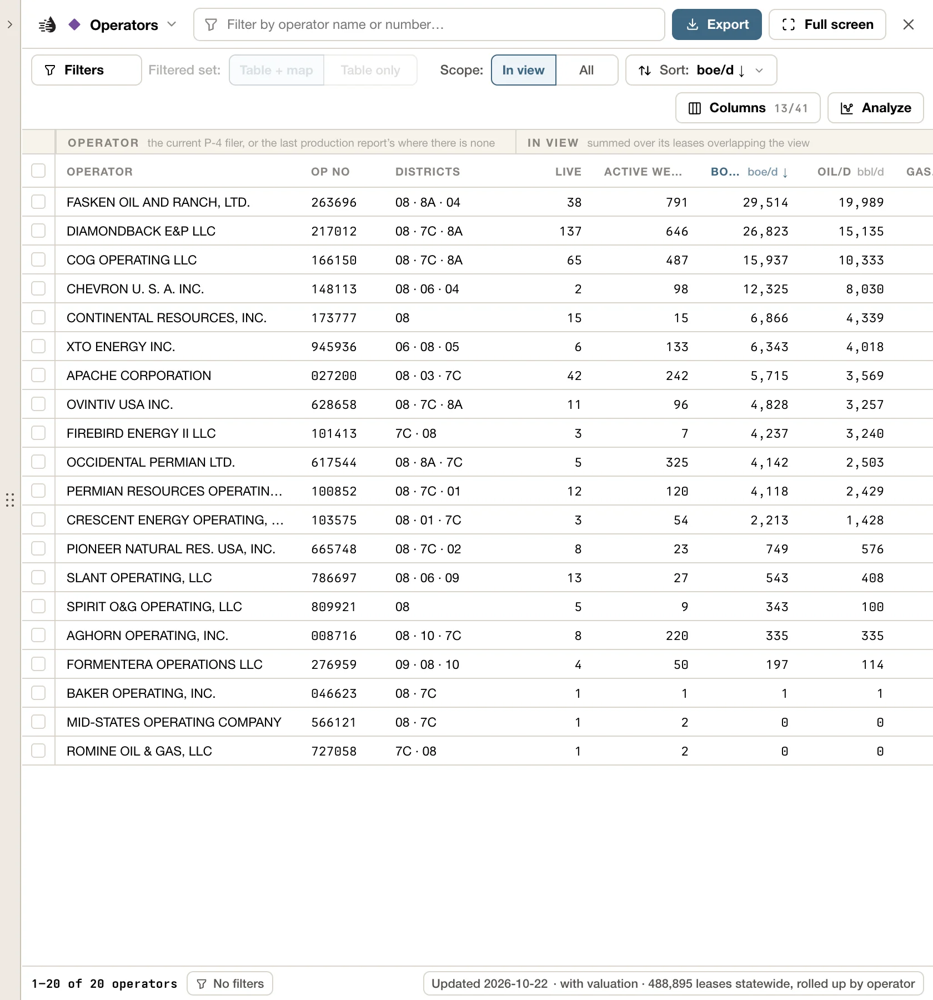
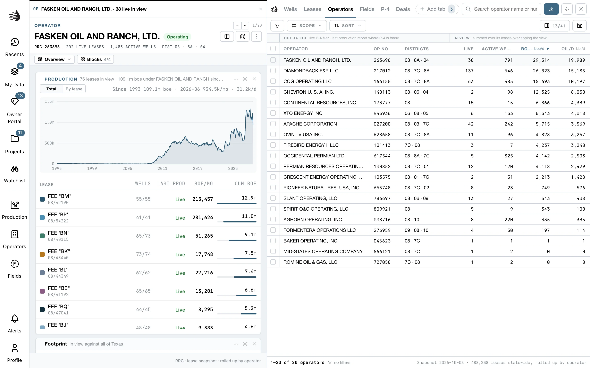
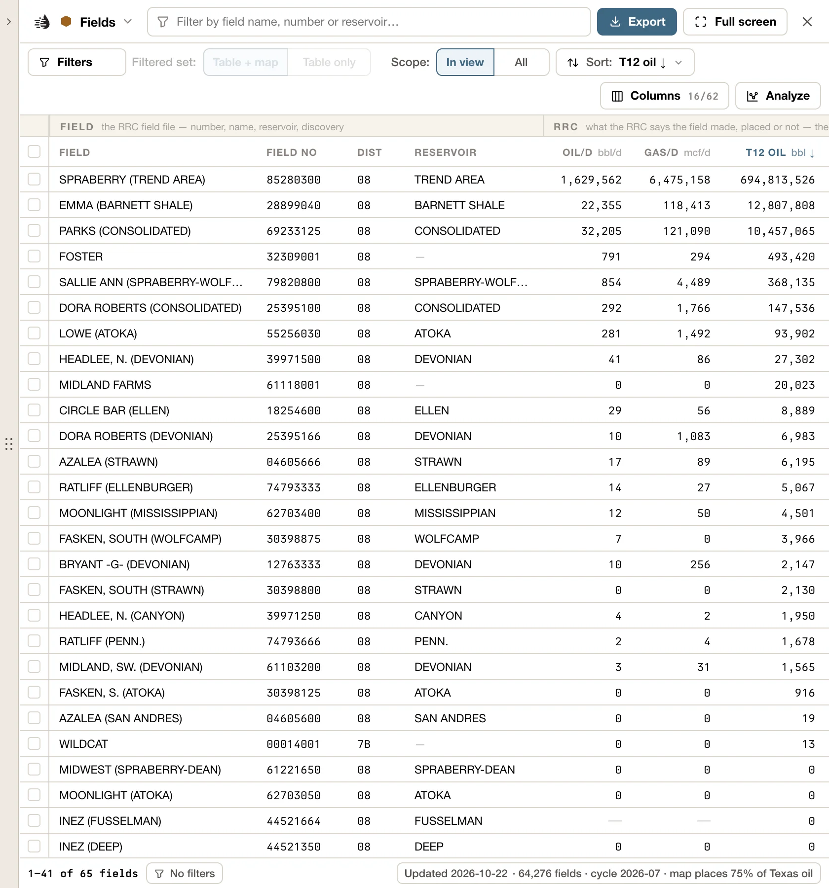
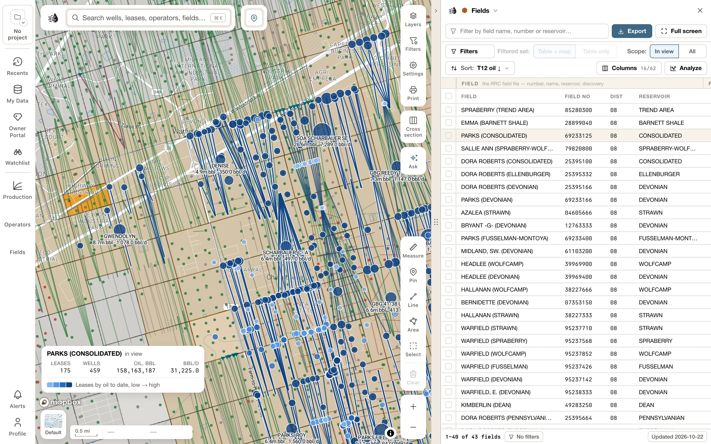
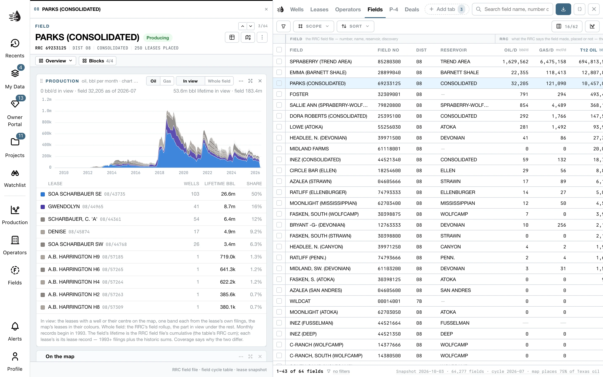

The **Operators** and **Fields** tabs sit beside **Wells** and **Leases** in the [data tables](/maps/data-panel). Like every tab, they need you to be signed in, and they follow your map: pan to an area and the tables re-rank what's there.

<Tip>
  Don't see a tab? If you've arranged your own tabs, click **Add tab** at the end of the tab row and pick it from **Add a tab**.
</Tip>

To put operators or fields on the map in colors of their own, use the **Operators** and **Fields** panels on the left rail. See [Operator and field layers](/maps/operator-field-layers).

## Operators

One row is one operator, totalled over its leases in view. It answers *who operates here, and how big are they?*

<Frame>
  
</Frame>

The operator is the one on the lease's current **P-4**. When a lease has no P-4 operator, QuickScout uses the operator on its last production report. Every figure is added up from the [Leases](/maps/data-panel#tabs) data, so the tab needs no download of its own.

### What in view means

**Scope** → **In view** lists operators with at least one lease in the map's visible area, and totals only those leases. Pan to Reeves County and *boe/d* is each operator's production in Reeves. **All** lists every operator and totals all of its leases in Texas.

Rows start sorted by **boe/d**, highest first.

### Views

Pick a view under **Columns**:

| View | For |
|---|---|
| **Screening** (the default) | Who is here, and how big: live leases, active wells, boe/d, oil and gas, trailing-12-month oil, share of Texas oil, pending P-4s, PV-10 and NAV. |
| **Here vs Texas** | Each in-view figure beside the operator's whole Texas book. |
| **Production** | Rates, trailing twelve months and cumulative, in view. |
| **Drilling** | Permits, spuds and completions in the last 12 months, here and statewide. |
| **Transfers** | Leases changing hands: pending P-4s and the last P-4 filed. |
| **Valuation** | PV-10, NAV and PDP, here and statewide. Needs the lease valuation add-on. |

A few columns worth knowing:

- **boe/d** is oil per day plus gas per day divided by 6.
- **Share of TX oil** is how much of the operator's Texas oil comes from the leases in view. *80%* means this area is most of their business.
- **Pending P-4** counts live leases where this operator has filed a P-4 but the production reports still name someone else. It's an early sign of an acquisition.
- **Districts** are the operator's top three RRC districts statewide.
- Columns in the **Texas** group are statewide whatever the view.

### Filters

Quick pills: **producing**, **≥100 live leases**, **pending P-4**, **mostly here** (at least half their Texas oil is in view), **drilling** (spudded a well in the last 12 months), **permitting** and **valued**.

Operators whose leases here are all dead or archived are hidden, so the list is who operates here today. The **No live lease** pill brings them back.

The search box finds an operator by name, or by RRC operator number.

### Hover and the map

Hover a row to spotlight that operator: the rest of the map dims, and the operator's leasehold, wells and laterals are drawn in blue. Hovering a bar on a chart spotlights every operator in it.

### The operator card

Click a row to open its card. The card covers the whole operator, all of Texas, whatever the table's **Scope** or the map's view. Only its **On the map** block follows the map.

<Frame>
  
</Frame>

- **Zoom to** flies the map to where the operator works now: its live leases.
- **Show on map** sets how the operator is drawn while its card is open. Its switch is on at first: the operator's leasehold and wells are lit on the map, and the rest of the map dims. Under it, **Wells**, **Polygons** (its leasehold) and **Dim the rest of the map** choose what's drawn. Your choices hold for every operator you open.
- **Add layer** adds the operator to your **Operators** layer, so it stays colored on the map after the card closes, as the **Operators** panel has it. It's pressed while the operator is in the layer; click it again to take it out. See [Operator and field layers](/maps/operator-field-layers).
- **Show leases** and **Show wells** list every one of the operator's leases or wells in a tab of their own, the [Record tab](/maps/data-panel#record-tab). The card stays open, and your own Leases and Wells tabs and their filters stay as they are.
- **Compare** puts the operator in the [compare tray](/maps/compare), to set beside other operators.

The Copy icon beside the operator number, under its name, copies the number.

Its blocks:

- **Totals**: its leases, live leases and active wells, then its oil and gas to date, per day now and over the last 12 months.
- **Production**: what it produced each month as the operator.
- **By lease**: which leases make its oil or gas, a band each, with every lease listed under the chart: its wells, what it has made and its share. Pick **Oil** or **Gas**. Click a lease to open its card. Click a lease's color swatch to take it out of the chart; **Show all** puts it back. Pointing at a lease lights its wells on the map.
- **On the map**: how many of its leases are in view, and their oil and gas.
- **By district**: its Texas leases in each RRC district, with boe/d.
- **Valuation**: PV-10, net asset value and PDP over its valued leases. It needs the lease valuation add-on. **Value this operator**, at its foot, starts a deal over every lease the operator operates, in the **Deals** tab beside the card; once there is one, it reads **Open valuation**.
- **Deals**: the leases it took over or handed on, by year, then each deal by counterparty and month.
- **Synopsis**, at the foot: **Write synopsis** writes a few sentences about the operator. See [Synopsis](/maps/records#synopsis).

## Fields

One row is one RRC field number. For each field, the tab shows what the **RRC** says it has made in its lifetime, how much of that the map can **place** on leases it can draw, and why the rest can't be placed.

<Frame>
  
</Frame>

### What in view means

A field is **in view** when at least one of its wells is on the map. A field with nothing in view shows up under **All**, and so does a retired field number, which has no wells.

The Fields tab needs the Wells data on your device to decide what's in view. Until it's there, the footer reads *Waiting for the wells snapshot*.

Rows start sorted by trailing-12-month oil, highest first. **Sort** also offers **Nearest the map center**.

### Placed, and the gap

The RRC keeps a lifetime total for every field, going back decades. The map can only draw production that sits on a lease it has a location for, and monthly lease records only start in 1993 (with an older archive before that). So the tab splits each field's lifetime three ways:

- **Placed**: production on leases the map can draw, since 1993 and from the archive before it. **Oil covered** and **Gas covered** are that as a share of the RRC total. Green is 95% or more.
- **Lost leases**: old producers with no location anywhere. They're tied to the field and counted, but can't be drawn.
- **Older than the archive**: history from before any lease record QuickScout holds. The archive starts in 1955 (1964 in District 6E).

Two other flags:

- **Retired no.**: the RRC moved this number's production to other field numbers. Retired rows are dimmed.
- **Excess**: the leases carry *more* than the field's own total. This happens when a successor field number's leases kept their months from before the renumbering. A coverage over 100% is real, not an error.

### Views

| View | For |
|---|---|
| **Screening** (the default) | What the RRC says, what the map can place, and the gap. |
| **The gap** | The RRC lifetime against the placed share, split by cause. |
| **RRC record** | The field's own record: class, discovery date, production since 1993, peak month and trend. |
| **On the map** | What the placed leases and wells account for. |
| **Everything** | Every column. |

### Filters

Quick pills: **oil this year**, **gas this year**, **lost leases**, **older than the archive**, **excess on successors**, **retired number** and **gas field**.

The search box finds a field by name, number or reservoir.

### Hover and the map

Hover a row to see where the field is:

<Frame>
  
</Frame>

- **Zoomed out.** The field's outline: the survey tracts its wells sit on, with a pin at its centre when you're zoomed far out. If the field is off screen, or behind the tables or a card, a chip at the edge of the map points to it.
- **Zoomed in.** From zoom 10, the field's leases, each in its own color, labeled with what it has made and makes per day (for example *1.2m bbl · 799.4 bbl/d*). Its wells are colored by their lease and sized by what they made, and a horizontal is drawn as its lateral. From zoom 12.5, each well shows its allocated cumulative above it, such as *~120k bbl*. The *~* means the figure is an estimate.
- The figures are in the field's main product, oil or gas, until you pick another under **Show on map** on its card.
- The biggest fields, like the Spraberry Trend, have too many leases to draw one by one. Each lease becomes a bubble sized and shaded by its lifetime production, and a readout in the bottom-left corner of the map sums up the field.

<Note>
  The RRC reports oil by lease, so a well's share of its lease's oil is **allocated** from well tests. Treat per-well figures as estimates.
</Note>

### The field card

Click a row to open its card. The card covers the whole field, whatever the table's **Scope** or the map's view. Only its **On the map** block follows the map.

While the card is open, or a lease you opened from it, the field stays drawn on the map, as it is when you hover its row. Under its name are its RRC district and the year it was found.

<Frame>
  
</Frame>

- **Zoom to** flies the map to the field's wells.
- **Show on map** sets how the field is drawn while its card is open. Its switch is on at first. Under it:
  - **Oil**, **Gas** or **boe**: what the wells are sized by and the labels say. A field starts on what it mostly makes.
  - **Wells**, each sized by what it has made, and **Polygons**, the survey tracts the field sits on and, zoomed in, its leases' outlines. Each has **Show** and **Labels**.
- **Add layer** adds the field to your **Fields** layer, so its outline stays on the map after the card closes, as the **Fields** panel has it. It's pressed while the field is in the layer; click it again to take it out. See [Operator and field layers](/maps/operator-field-layers).
- **Show leases** and **Show wells** list every one of the field's leases or wells in a tab of their own, the [Record tab](/maps/data-panel#record-tab). The card stays open, and your own Leases and Wells tabs and their filters stay as they are.
- **Compare** puts the field in the [compare tray](/maps/compare), to set beside other fields.

The Copy icon beside the field number, under its name, copies the number.

What you choose under **Show on map** holds for every field you open, except **Oil**, **Gas** or **boe**, which each field keeps for itself until you reload.

Its blocks:

- **Totals**: the field's oil and gas to date, per day now and over the last 12 months.
- **Production**: the whole field's monthly oil, gas and water.
- **By lease**: which leases make the field's oil or gas, a band each, with every lease listed under the chart: its wells, what it has made and its share. Pick **Oil** or **Gas**. Click a lease to open its card.
- **On the map**: how many of the field's leases are in view, and their oil and gas.
- **Record**: the RRC field file: class, depth, counties and peak month. Click a county to open its card.
- **Operators**: who operates the field, biggest today first. Click one to open its card.
- **Coverage**, on an older field the map can't fully place: the field's RRC lifetime oil, as a bar split into **Since 1993**, **Placed, before 1993**, **Lost leases** and **Older than the archive**.
- **Synopsis**, at the foot: **Write synopsis** writes a few sentences about the field. See [Synopsis](/maps/records#synopsis).

## Move between cards

Cards link to each other, so you can follow a thread without leaving the table:

- On a **field** card, click a lease under **By lease** to open that lease's card. <kbd>↑</kbd> / <kbd>↓</kbd> step through the field's leases. Click an operator under **Operators**, or a county under **Record**, to open its card.
- On an **operator** card, click a lease under **By lease**, or a deal under **Deals** to open its P-4 filing.
- On a **lease** card, click the field name to open the field's card, or the operator to open the operator's card.
- The name of the card you came from, above the card's name, or <kbd>Esc</kbd>, takes you back. See [Record cards](/maps/records#one-card-at-a-time).

## The map follows the table

Once a filter or search is on, **Filtered set** → **Table + map** narrows the map's lease footprints to the matching operators' or fields' leases. On Operators, the wells narrow too. See [Filters & the map](/maps/filters#the-map-follows-your-filters).

## Charts

**Analyze** → **Charts** has recipes for both tabs.

- **Operators**: *Daily boe by operator*, *PV-10 by operator*, *Leases × daily boe*, *Here vs Texas* and *Share of TX oil in view*.
- **Fields**: *RRC lifetime oil by field*, *Oil this year by field*, *RRC lifetime gas by field*, *Gas this year by field*, *How much the map can place*, *Lost oil by field*, *Older than the archive, by field* and *RRC lifetime × placed*.

Tick operators and click **Chart production** to chart each one's monthly production side by side. See [Charts](/maps/charts).

## Export

| What | How |
|---|---|
| The operators or fields listed | **Export** → **Table CSV — the rows on screen** |
| Only some of them | Tick rows, then **Export CSV** in the selection bar |
| Their RRC numbers | Tick rows, then **Copy operator numbers** or **Copy field numbers** |
| An operator's or field's leases, with production | **Show leases** on its card, then **Export** on the Record tab |
| An operator's or field's wells | **Show wells** on its card, then **Export** on the Record tab |
| An operator's or field's production chart | **Export CSV** or **Save PNG**, at the foot of the card's **Production** block |

The CSV carries the columns you have showing, in their order, with no row limit. The file is named for the tab, the place and the date, for example `operators-reeves-county-2026-09-25-214-rows.csv`. See [Export data](/maps/exports).

## Map data on this device

**Fields** has a table of its own in **Map data**. **Operators** is built from the **Leases** table, so having Leases on this device covers both. See [Map data on this device](/maps/offline).
