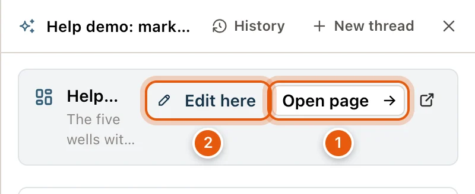
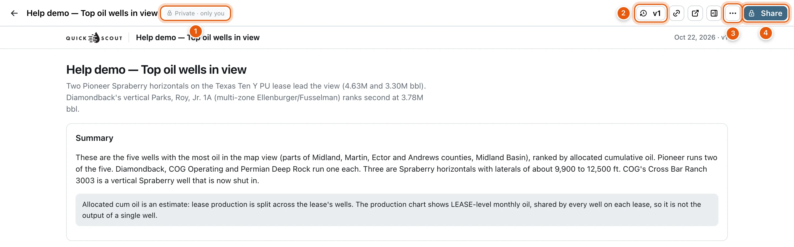
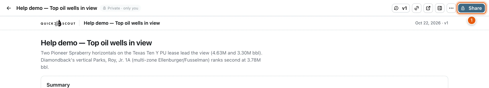
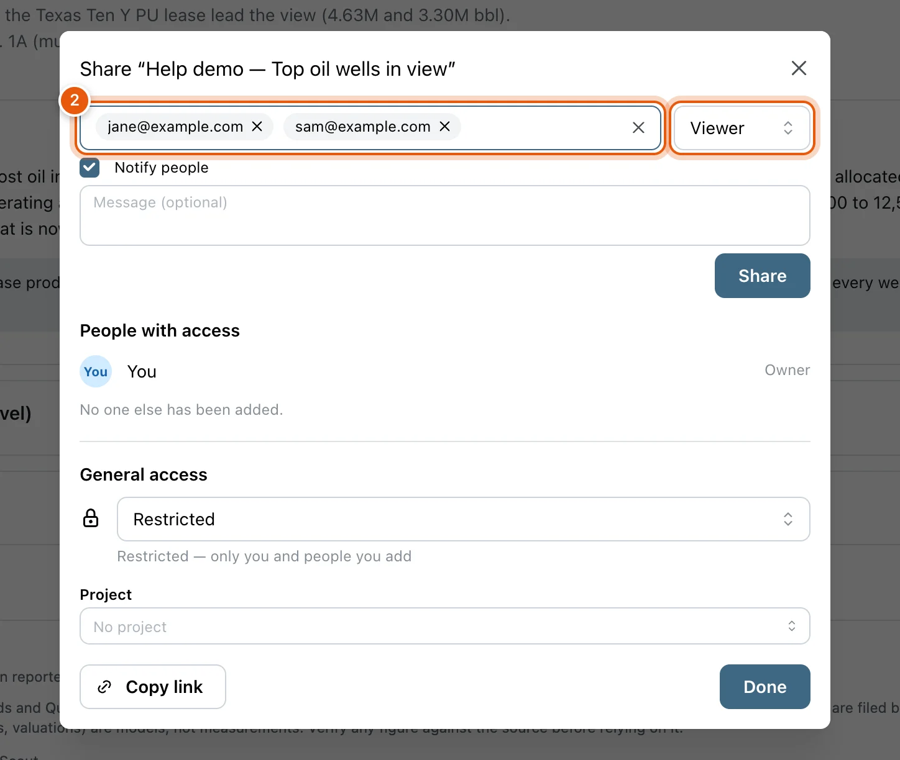
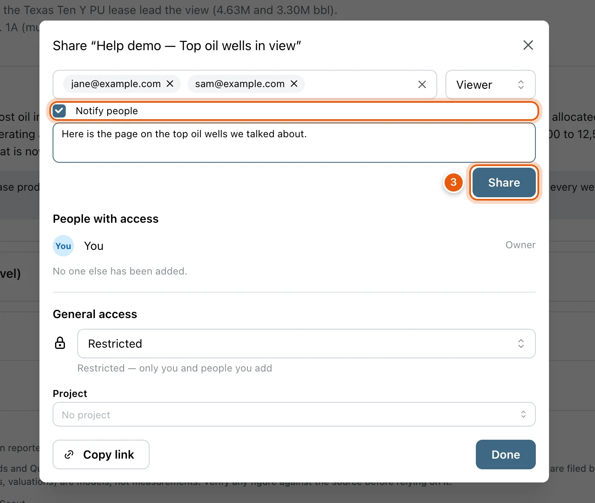
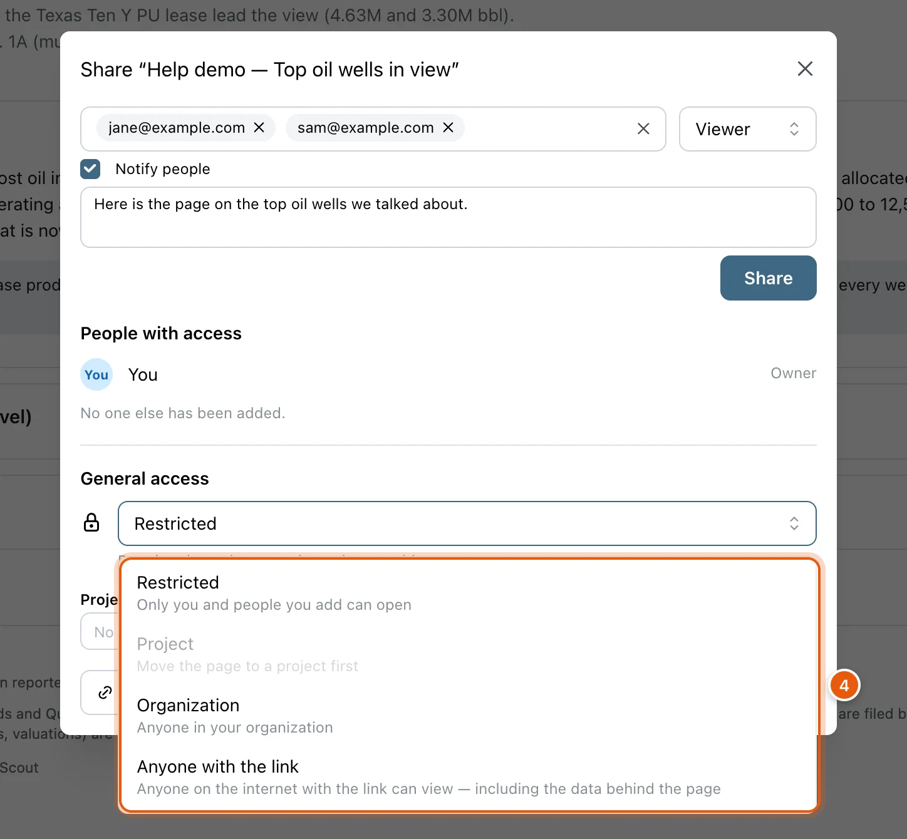
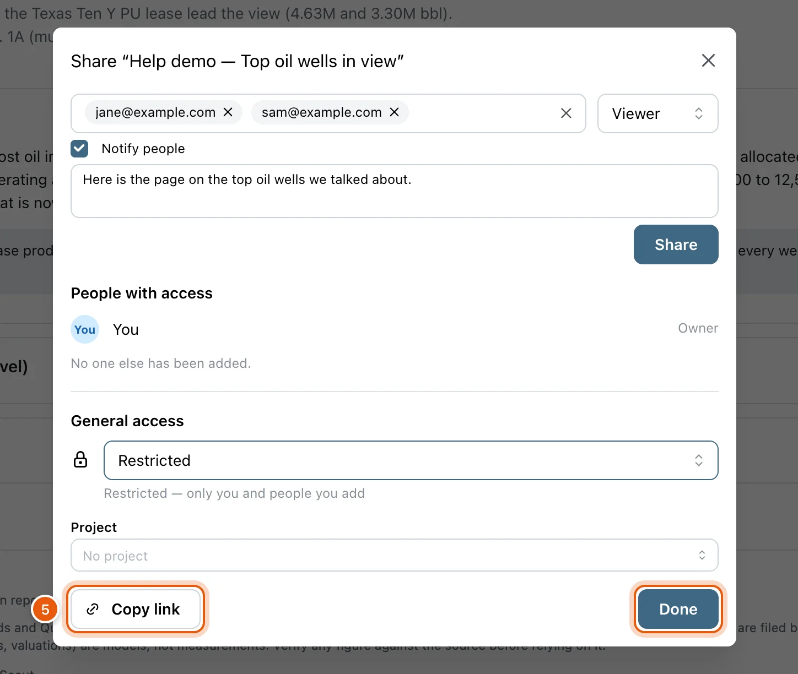
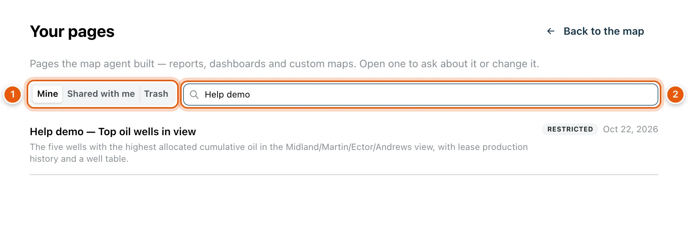

[Ask](/maps/ask-the-map) can build a page from its answer: a report, a dashboard or a custom map, with its own charts, tables and maps. The page has a link of its own. You can change it by asking, refresh its data, go back to an earlier version, and share it by email or by link.

<Note>
  - Making or changing a page goes through Ask, so it needs a free account and uses credits. See [Sign in](/get-started/sign-in).
  - People you share a page with open it by signing in; a free account is enough. A page shared with **Anyone with the link** opens for anyone, signed in or not, to view only.
  - [Your pages](#your-pages), the list of all your pages, needs you to be signed in.
</Note>

## Make a page

Ask for one in the Ask column, like *Make a one-page report on the wells in view* or *Build a dashboard of this operator's production*. The agent gathers the data, lays out the page and publishes it.

A card for the page appears in the answer:

- The page's title, and its version (*V2*, *V3*…) once it has changed.
- Its description, or *A page built from this answer's data*.
- **Open page** opens it in this tab. The icon beside it opens it in a new tab.
- **Edit here**, to change it from the map. See below.

New pages are private: only you can open one until you share it.

<Frame>
  
</Frame>

### Change a page from the map

**Edit here** on the card makes the page the subject of your next questions, without leaving the map:

- A chip above the question box reads *Editing: ‹title›*, and the box asks *Ask about or change this page…*.
- Ask for a change, like *add 2022* or *make the bars blue*. The agent publishes it as a new version, and the answer carries the page's card again.
- While it's on, the card's button reads **Editing**. Click it again, or the ✕ on the chip (**Stop editing this page**), to go back to asking about the map. A **New thread** clears it too.

On a page someone shared with you to view, the card offers **Copy & edit** instead. It makes your own copy, titled *‹title› (copy)*, and you change that.

The card's badge says how a page is shared with you: **CAN EDIT** or **VIEW ONLY**. Your own pages have no badge.

<Tip>
  Ask knows your most recent pages, so on the map you can also say *update my Midland dashboard* without clicking **Edit here**. It can rename, share, refresh, restore or copy a page when you ask, too: *share this page with jane@example.com as an editor*.
</Tip>

## The page

Open a page from its card, from a shared link, or from [Your pages](#your-pages). The page fills the window, with a bar across the top and a chat on the right.

<Frame>
  
</Frame>

Across the bar, from the left:

- The arrow (**Back to the map**).
- The title, and who can see the page: *Private · only you*, *Shared · 3 people*, *Shared · organization*, *Shared · project*, *Shared with you*, or *Anyone with the link*.
- **CAN EDIT** or **VIEW ONLY**, on a page someone shared with you.
- The version button, like *v3*. See [Versions](#versions).
- **Copy link**, **Open in a new tab**, and **Ask about this page** or **Hide the chat**.
- **More** (⋯) and **Share**.

### The More menu

| Item | Who sees it | What it does |
|---|---|---|
| **Refresh data** | Owner and editors | Re-runs the page's data against today's records. See [Refresh the data](#refresh-the-data). |
| **Rename** | Owner and editors | Edit the title in the bar. Press <kbd>Enter</kbd> to save it. |
| **Make a copy** | Everyone | Your own copy, which you can change and share. It opens straight away. |
| **Open conversation in map** | Anyone who has talked about the page | Opens Maps with your latest conversation about the page in the Ask column. For the owner, that starts as the conversation that made it. |
| **Print / Save as PDF (opens the page)** | Everyone | Opens the page on its own in a new tab. Print it, or save it as a PDF, from your browser there. |
| **Download page (HTML)** | Everyone | Downloads the page as one HTML file. |
| **Download data** | Everyone | Each set of data behind the page, by name, as **CSV** or **JSON**. |
| **Move to trash** | Owner | See [Move a page to the trash](#move-a-page-to-the-trash). |

### Versions

Every change makes a new version, and the older ones are kept. Click the version button (*v3*) to list them. Each shows its date, how it was made (**PUBLISHED**, **DATA REFRESHED**, **COPIED** or **RESTORED V2**), and a note on what changed.

Click an older version to view it. A banner reads *You're viewing version 2 of 3*:

- **Restore this version** makes it the latest again. It's saved as a new version, so the one you replaced is still in the list. Owner and editors only.
- **Back to latest** returns to the newest version.

### Refresh the data

**More** → **Refresh data** re-runs the page's data against today's records: the same queries, over the same area. The layout doesn't change.

Click **Refresh**. When it's done, *Version 4 is up with today's data.* and a line for each set of data say what changed. The new version is the latest, and the old one stays in the list. Refreshing doesn't use credits.

If a refresh fails, nothing changes: the page keeps its last version. Ask about the page in its chat to rebuild data that no longer runs.

### Ask about this page

The chat on the right is Ask, about this page. Ask what it shows, like *why is March low?*, or ask for a change, like *add 2022*. A change becomes a new version, and the page switches to it with a note saying what changed.

- The chat picks up your last conversation about the page. **New conversation** starts another.
- If you can only view the page, a change you ask for is made on your own copy, and the answer links to it.
- Asking uses credits, the same as Ask on the map.
- **Hide the chat** in the bar folds it away, and **Ask about this page** brings it back. The page remembers your choice on this device.

### Move a page to the trash

Only the owner can do this. **More** → **Move to trash** asks *Move this page to the trash?* Its link stops working for everyone.

To bring it back, open [Your pages](#your-pages) → **Trash** and click **Restore**. Every version comes back with it.

## Share a page with others

Only a page's owner can change who has access. Anyone else who clicks **Share** sees how the page is shared with them, with **Copy link** and **Make a copy**.

<Steps>
  <Step title="Open the page and click Share">
    **Share** is at the top right of the page.

    <Frame>
      
    </Frame>
  </Step>
  <Step title="Add people by email">
    Type an email address into **Add people by email**. To add several, paste them all at once, separated by commas or spaces. Beside the box, pick **Viewer** or **Editor**.

    <Frame>
      
    </Frame>
  </Step>
  <Step title="Tell them, then click Share">
    **Notify people** is ticked, so each new person gets an email with the link. Add a note in **Message (optional)** if you like. Click **Share**.

    They'll find the page under **Shared with me** in [Your pages](#your-pages) when they sign in with that address.

    <Frame>
      
    </Frame>
  </Step>
  <Step title="Choose who else can open it (optional)">
    Under **General access**, **Restricted** keeps the page to you and the people you add. Pick another choice to open it wider. See [The Share dialog](#the-share-dialog).

    <Frame>
      
    </Frame>
  </Step>
  <Step title="Copy the link and click Done">
    **Copy link** copies the page's address, to paste into an email or a message. **Done** closes the dialog. Your changes are already saved.

    <Frame>
      
    </Frame>
  </Step>
</Steps>

### The Share dialog

**People with access** lists you (Owner), then each person you added, marked *Notified by e-mail* or *Not notified*. Change a person's role with the menu beside them: **Viewer**, **Editor**, or **Remove**.

**General access** decides who else can open the page:

| Choice | Who can open the page |
|---|---|
| **Restricted** | Only you and the people you add. New pages start here. |
| **Project** | Anyone who can see the page's project. Projects are part of Enterprise; the **Project** box under the menu files a page under one. |
| **Organization** | Anyone in your organization, if your account belongs to one. |
| **Anyone with the link** | Anyone on the internet who has the link, signed in or not, to view only. |

<Warning>
  With **Anyone with the link**, the dialog warns: *Anyone on the internet with the link can view this page — including the data behind it — without signing in.* Choose it only for pages whose data you're happy to make public.
</Warning>

Every change in the dialog is saved as you make it. Adding people is the one step that waits for **Share**.

What each role can do:

| | Viewer | Editor | Owner |
|---|---|---|---|
| Open the page, ask about it, copy it, download it | ✓ | ✓ | ✓ |
| Change it by asking, refresh its data, restore a version, rename it | | ✓ | ✓ |
| Share it, and move it to the trash | | | ✓ |

## Your pages

Every page you've made, and every page shared with you, is listed at [quickscout.io/artifacts](https://quickscout.io/artifacts). You need to be signed in.

- **Mine**, **Shared with me** and **Trash** switch the list.
- **Search titles** finds a page by name.
- Each row shows the page's title and description, and badges: **SHARED** on someone else's page, who can see your own (like **RESTRICTED**), and its version.
- Click a row to open the page. In **Trash**, **Restore** brings a page back.
- **Back to the map** returns to Maps.

<Frame>
  
</Frame>

## Opening a page you don't own

What you see depends on how the page is shared:

| How it's shared | What you see |
|---|---|
| With you, your organization or your project | The whole page, with your role in the bar. Sign in with the address it was shared to. |
| With **Anyone with the link** | The page with **View only** beside its title, and **Open in a new tab**. Signed out, there's also **Sign in to QuickScout**. |
| Not with you | *This page is private*. Signed out, **Sign in to QuickScout** lets you try with your account. Signed in, ask the owner to share it with you or to turn on link sharing; **Your pages** goes back to your list. |

{/* screenshot: pages-view-only — A link-shared page opened while signed out: the QuickScout logo, the title, View only, Open in a new tab and Sign in to QuickScout. Fixture: the "Help demo" page set to Anyone with the link, captured signed out, then set back. Annotate: 1 = View only, 2 = Sign in to QuickScout */}

## Credits

<Note>
  Pages are made and changed by asking, so building or changing one uses credits, in the Ask column or in the page's own chat. Opening, sharing, copying, downloading and refreshing a page don't.
</Note>

## Troubleshooting

<AccordionGroup>
  <Accordion title="The Share button only shows how the page is shared with me">
    Only the owner can change who has access. Click **Make a copy** to get a page of your own that you can share and change.
  </Accordion>
  <Accordion title="Someone I shared a page with can't open it">
    They need to sign in to QuickScout with the email address you shared it to. If they use another address, add that one too.
  </Accordion>
  <Accordion title="Sharing says I've reached a limit">
    You can add up to 10 people at a time, and 50 people a day across your pages. Try again tomorrow, or use **General access**.
  </Accordion>
  <Accordion title="Download data says a table has no rows">
    Some data behind a page isn't a table, such as a single figure. Download it as **JSON** instead of **CSV**.
  </Accordion>
  <Accordion title="Refresh data failed">
    Nothing changed: the page still shows its last version. Ask about the page in its chat, for example *the wells table no longer loads, please rebuild it*.
  </Accordion>
</AccordionGroup>
