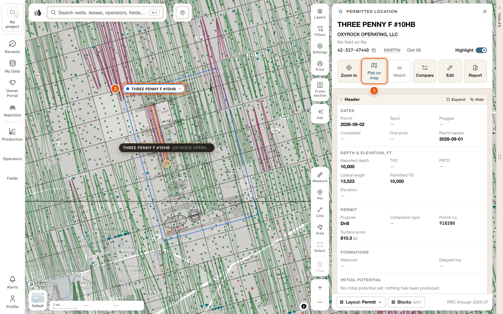
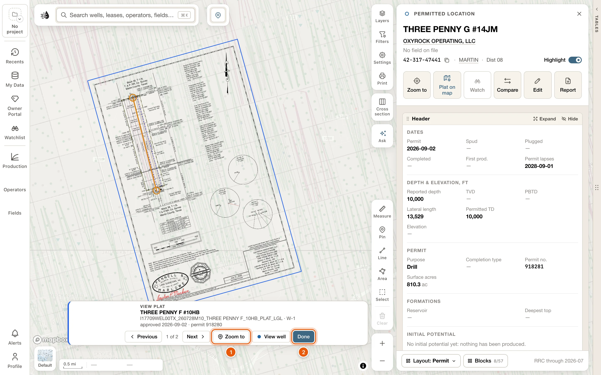
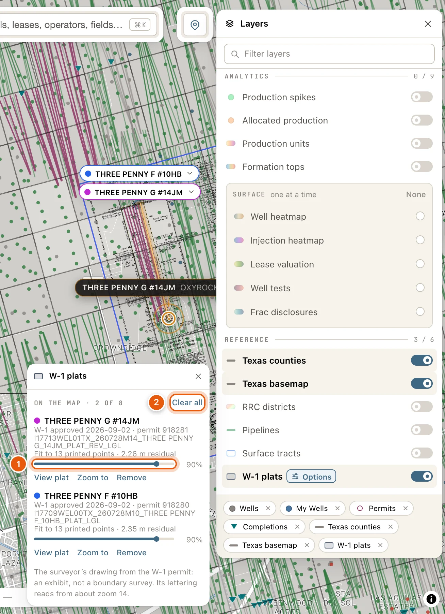

A W-1 plat is the surveyor's drawing filed with a drilling permit: the lease and survey lines, and where the well goes. QuickScout places the plat on the map from the coordinates printed on it, so you can read it over the ground, the wells and the survey lines around it.

<Note>
  You need to be signed in. You add a plat from a well's [card](/maps/records): rows in the data tables open cards with a free account, and opening a card from the map needs a [paid plan](/get-started/plans).
</Note>

Plats are on file for permits approved since mid-2020, and about half of those can be placed on the map.

## Add a plat

<Steps>
  <Step title="Open the well's card">
    Click the well on the map, or find it in search or the Wells table.
  </Step>
  <Step title="Click Plat on map">
    **Plat on map** is with the buttons under the well's name. Click it. The first time a plat is shown, the button reads **Placing plat…** for a few seconds. While the plat is on the map, **Plat on map** stays pressed.

    <Frame>
      
    </Frame>
  </Step>
  <Step title="Read it on the map">
    The plat lies over the map where the surveyor drew it. Zoom in to about 14 to read its lettering. The plat doesn't take clicks, so the wells under it still open.
  </Step>
</Steps>

Click **Plat on map** again to take the plat off.

When a well has more than one plat on file, the button reads **Plats · *N***, counting the ones that can be placed, and opens a list. Under **Placed · newest W-1 first**, each plat shows its sheet, its W-1 date and its permit number; click one to lay it on the map, and again to take it off. Plats that are filed but couldn't be placed are listed under **Filed, not placed**, with why. Once some are on the map, the button reads **Plats on map · *1* of *3***.

When the well has no plat that can be placed, the button reads **Add plat** and is greyed out. Hover it to see why, for example *No W-1 plat is on file for this well. Plats are on file for permits approved since mid-2020.*

## From the well's documents

The **Filings & documents** block of a well's card has a **MAP** column on a plat's row. A permit's card shows the block from the start. On a producing well's card it's off at first: click **Blocks** and tick **Filings & documents**.

- **On map** lays that plat on the map, and stays pressed while it's there. Another click takes it off.
- **Placing…** shows while it's being drawn, and **Failed** if it couldn't be.
- **Not placed** means the plat couldn't be placed. Hover it to see why.

## On the map

Each plat on the map has a tag at its top-left corner with its name, in the plat's own color. Hover the tag to outline the plat. Click it for:

- **View plat**: the plat and its well, with the rest of the map veiled.
- **Zoom to** frames the whole plat.
- **View well** opens the permitted well's card.
- **Opacity**: how strongly the plat shows.
- **Remove** takes the plat off the map.

In **View plat**, a strip near the bottom of the map names the plat, with **Previous** and **Next** when you have more than one, **Zoom to**, **View well** and **Done**. <kbd>Esc</kbd> leaves too.

<Frame>
  
</Frame>

## In the Layers card

Click **Layers** on the right side of the map. **W-1 plats**, under **REFERENCE**, shows or hides all your plats at once. Switching it off keeps your list; adding a plat switches it on.

With the row on, click **Options** beside its name for the list of your plats:

- **ON THE MAP · *N* OF 8**, and **Clear all**, which takes every plat off the map.
- Each plat, the last one you added first: its name, its W-1 date and permit number, its sheet, and how closely it fits the printed coordinates, such as *Fit to 4 printed points · 0.14 m residual*.
- An opacity slider, and **View plat**, **Zoom to** and **Remove**.

Hover a plat in the list to outline it on the map. On a dark map, the plat's ink is drawn light.

<Frame>
  
</Frame>

## Limits and saving

- Up to 8 plats can be on the map at once. Adding a ninth is refused: *The map holds 8 plats at most. Remove one in Layers → W-1 plats to add this one.*
- Your plats, and how strongly each shows, are remembered for your account and project. They're still there after a reload and on another computer.
- A plat is a permit exhibit, not a boundary survey.

## Troubleshooting

<AccordionGroup>
  <Accordion title="Add plat is greyed out">
    Hover it to see why:

    - *No W-1 plat is on file for this well.* Plats are on file for permits approved since mid-2020.
    - *One plat is filed for this well, but it …* gives the reason, such as *a scan — scans are not placed yet*, or *could not be placed from what is printed on it*.
    - *Looking for this well’s W-1 plats…*: wait a moment.
  </Accordion>
  <Accordion title="The button says Plat failed">
    The plat couldn't be drawn. Hover the button for the reason, then click it to try again. In **Layers** → **W-1 plats**, the plat's row has **Try again** too. *This plat is no longer placed on the ground* can't be fixed by trying again: click to take it off.
  </Accordion>
  <Accordion title="I can't read the plat">
    Zoom in to about 14, where its lettering is readable, and raise its opacity in its tag's menu or in **Layers** → **W-1 plats**.
  </Accordion>
  <Accordion title="Nothing shows after Plat on map">
    Check that **W-1 plats** is switched on in **Layers**. If the plat is off screen, click **Zoom to** beside it in **Layers** → **W-1 plats**.
  </Accordion>
</AccordionGroup>
