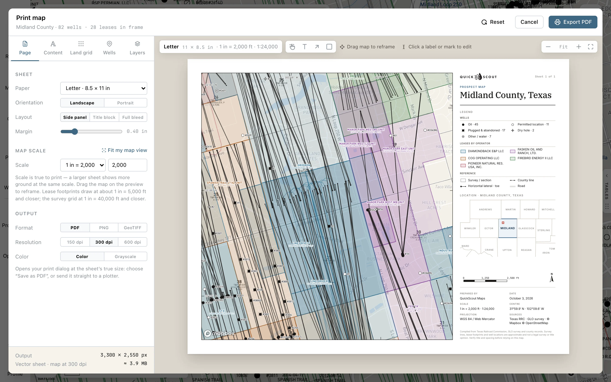

Frame the area you want in Maps, then click **Print** (the printer on the right rail). Map Print Studio opens, titled **Print map**, with a sheet preview centered on that view.

<Steps>
  <Step title="Choose the sheet">
    On **Page**, choose **Paper**, **Orientation** and **Layout**: **Side panel**, **Title block** or **Full bleed**. Set the **Scale**, then drag the map on the preview to frame your area. **Fit my map view** centers the sheet on your Maps view again, at the scale that shows all of it.

    Scale is feet on the ground per inch on paper. A larger sheet shows more ground at the same scale. **−** and **+** above the sheet zoom the preview, and **Fit** shows the whole sheet again. They change the preview size on screen, not the printed scale.
  </Step>
  <Step title="Choose what prints">
    Use **Content** for the title, subtitle, credits, notes and map elements. **Land grid** controls survey lines and section labels. **Wells** controls well statuses, symbols and labels. **Layers** chooses the basemap and reference layers.

    Check the preview: the print has its own layer and label settings. Don't assume every overlay on the live map is included.

    While **My Wells** is on in Layers, your own wells from [My Wells](/maps/my-wells) print the way your map draws them: a well you moved prints once, where you put it.
  </Step>
  <Step title="Export">
    On **Page**, pick **Format**, **Resolution** (150, 300 or 600 dpi), and **Color** or **Grayscale**. The button at the top follows the format: click **Export PDF**, **Save PNG** or **Export GeoTIFF**.
  </Step>
</Steps>

<Frame>
  
</Frame>

## Choose the format

| Format | Includes | Use it for |
|---|---|---|
| **PDF** | The sheet, title block and marks | Printing or sharing a finished map. The browser opens its print dialog; choose **Save as PDF** or your printer. |
| **PNG** | The whole sheet, including your marks | A presentation or image attachment. |
| **GeoTIFF** | The map frame only, georeferenced in EPSG:3857 | Loading the map into a GIS. The title block and annotation marks are left out. |

For a scaled PDF or paper copy, use the chosen paper size and print at **Actual size / 100%**. **Fit to page** changes the scale.

<Tip>
  Exports work in Safari as well as Chrome. A PDF prints straight from the Maps page: the print dialog opens with just your sheet in it, and **Save as PDF** suggests the sheet's title as the file name.
</Tip>

## Add notes and edit labels

Above the sheet, choose **Text** and click to place a note, or choose **Arrow** or **Box** and drag. The tool returns to **Pan** after you place the mark.

- Drag a mark to move it. Its handles move individual ends or corners.
- Click a mark to change its text or size, or click **Remove**. <kbd>Delete</kbd> or <kbd>Backspace</kbd> removes a selected mark. The **Content** tab lists your marks, each with **Remove**.
- Click a section, lease or well label to edit or hide its text for this print. Use **Revert** to undo an individual label edit.

Marks stay attached to their map locations when you reframe or change scale. Label edits affect the print, not the source records.

## Missing labels?

Section labels show **prints at … or closer** when the chosen scale is too broad. Choose a closer scale or reduce label size. **Print them anyway** overrides the section-label fit rule.

Well labels are held back when the sheet is too crowded; the **Wells** tab explains why. Reframe a smaller area or use a closer scale. Even when labels are enabled, overlapping labels may give way to each other.

Your sheet settings are remembered for your account and project, so closing the studio with **×** or <kbd>Esc</kbd> loses nothing. **Reset** puts the settings back to the defaults and keeps your label edits and marks. Each time you open Print Studio, its map starts from your current Maps view.
