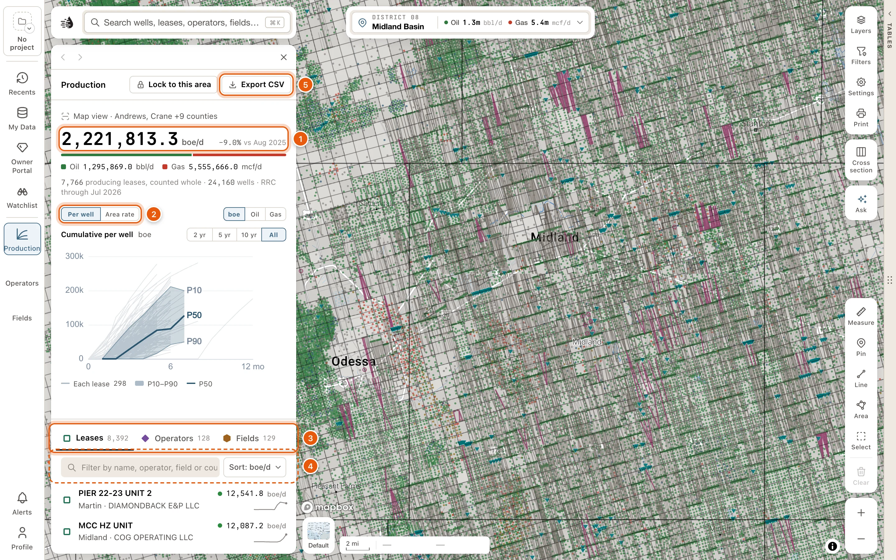

Click **Production** on the left rail. The panel adds up what the leases in the map view produce, and ranks them. It follows the map: pan or zoom, and the numbers change with it.

You can also open it from the [place card](/maps/ask-the-map#the-place-card): click **All production in view**, or **All *N*** beside **LEASES IN VIEW, COUNTED WHOLE**.

You need to be signed in to see the panel's figures; a free account is enough.

<Frame>
  
</Frame>

## The totals

At the top, a line says what the panel covers, like *Map view · Midland County*. Under it:

- The area's production in boe/d (oil plus gas, 6 mcf to the barrel), and how much it has changed over the last 12 months, like *+4.2% vs Sep 2025*.
- How it splits between oil, in bbl/d, and gas, in mcf/d.
- How many producing leases and wells make it, and the latest month the RRC has reported, like *812 producing leases, counted whole · 2,904 wells · RRC through Aug 2026*.

A lease is in view when one of its producing wells is in view, or its center is. It counts whole: its full rate, including its wells off screen. The [place control](/maps/tour#the-place-control) at the top of the map adds up only the wells in view, so the two figures can differ.

## The chart

Choose **Per well** or **Area rate**, and **boe**, **Oil** or **Gas**.

- **Per well** shows how the wells here perform with age. Texas reports production by lease, so each faint line is one lease's cumulative production per well, by months online. The shaded band runs from P10 to P90 across the leases, and the solid line is the P50. Choose **2 yr**, **5 yr**, **10 yr** or **All** for how many months online to show.
- **Area rate** shows the whole view's daily rate over the last 12 months. With **boe** chosen, it draws oil and gas on their own lines. **Log** or **Linear** sets the scale.

Point at a row below to light it on the chart: its leases' curves on **Per well**, its share of the area's rate on **Area rate**. Click the row to keep it lit: the line under the chart then names it, with **View** and **Clear**. While you filter the rows, the **Per well** chart lights the leases of every match.

## The rows

Choose **Leases**, **Operators** or **Fields**. Each tab says how many are in view.

Each row shows the name, where it is, its rate in boe/d (or *Not producing*), and its trend over the last 12 months. A lease row also names its operator and field.

- **Filter by name, operator, field or county** narrows the rows. **Clear** empties it.
- The sort button reads the current sort, like *Sort: boe/d*. Its menu has **Current boe/d**, **Oil bbl/d**, **Gas mcf/d**, **12-month change**, **Wells** and **Cumulative boe**.
- Pointing at a lease row outlines the lease on the map.
- Click a row to pin it on the chart. **View**, on the row you point at or have pinned, or <kbd>Enter</kbd>, opens its card. Cards need a [paid plan](/get-started/plans), unless the data tables are open.
- **Show *N* more of *M*** adds more rows.

## Lock to this area

To pan around without the numbers changing, click **Lock to this area** at the top of the panel. It stays pressed while the panel is locked, and the top line reads *Locked*. Click **Lock to this area** again, or **Unlock** beside *Locked*, to follow the map once more.

To add up an area you draw instead of the whole view, use the **Select** tool. See [Select an area](/maps/selection).

## Export the rows as CSV

**Export CSV**, at the top of the panel, downloads every row on the tab you're on, not just the rows showing, in the current filter and sort. While the panel is locked, the export covers the locked area.

| Tab | Columns |
|---|---|
| **Leases** | District, Lease no, Lease, Operator, Field, Counties, Wells, Oil bbl/d, Gas mcf/d, boe/d, 12-month change, Cumulative boe |
| **Operators** | Operator no, Operator, Counties, Leases, Wells, Oil bbl/d, Gas mcf/d, boe/d, 12-month change, Cumulative boe |
| **Fields** | Field no, Field, Counties, Operators, Leases, Wells, Oil bbl/d, Gas mcf/d, boe/d, 12-month change, Cumulative boe |

The 12-month change is a percentage. For exports of wells, leases and production beyond what's in view, see [Export data](/maps/exports).

The panel starts fresh each time you open it: on **Leases**, sorted by boe/d, following the map.
