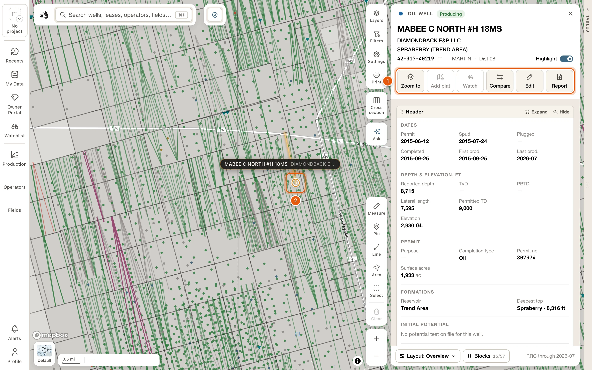
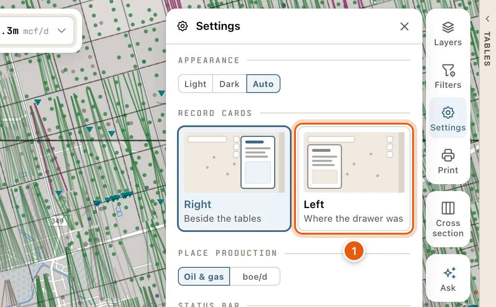
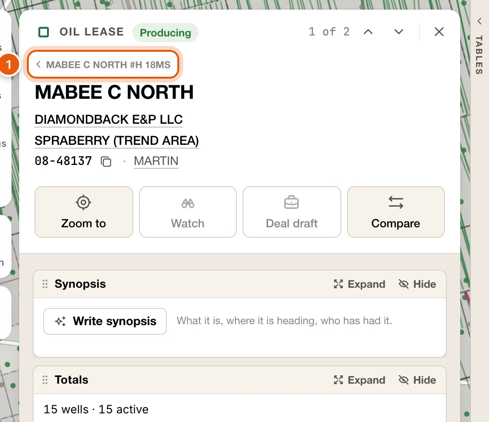
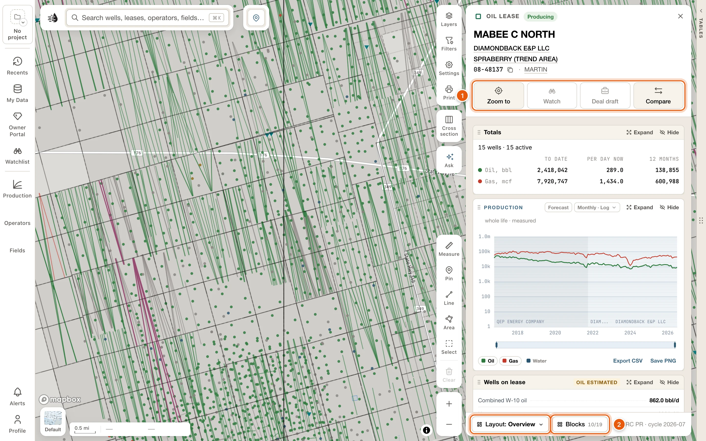
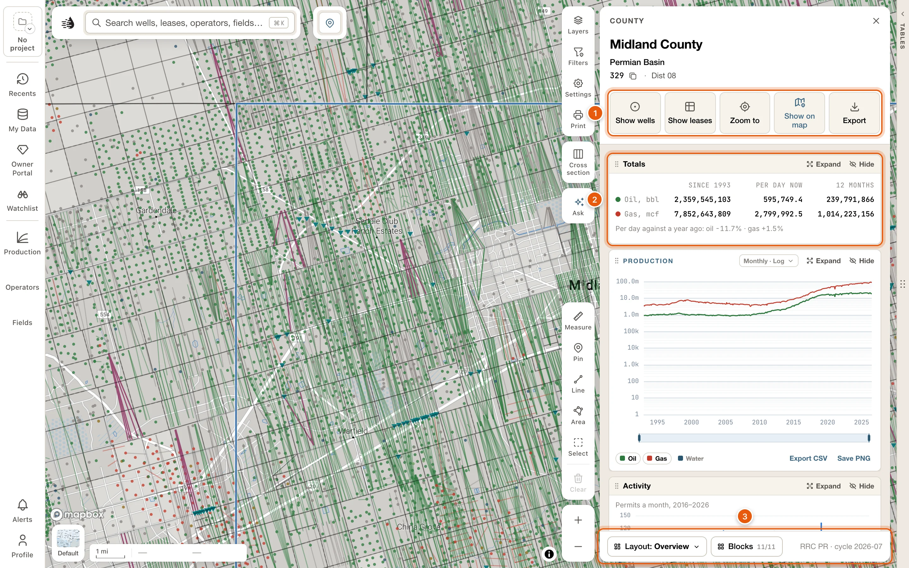

Click a well, lease, operator or field, and its card opens: one panel with what QuickScout has on that record. Counties have cards too. The card is the same whether you opened it from the map, a popup, search, the data tables or **Recents**.

<Note>
  You need to be signed in. Rows in the [data tables](/maps/data-panel) open their cards with a free account. Opening a record from the map or from search needs a [paid plan](/get-started/plans), unless the data tables are open. Without one, you'll see **Subscription required** and **View plans**.
</Note>

<Frame>
  
</Frame>

To find a record by name and open its card, follow [Find a record and open its card](/maps/search#find-a-record).

## Open a record

- **Click it on the map.** A well, permit or completion shows its popup first. Click **View well** in the popup: the popup closes and the well's card opens. A production spike or a lease footprint opens the lease. An operator's or field's outline opens its card.
- **From a well's popup.** Besides **View well**, the operator, lease and field names in the popup open their cards, and the county beside the API opens the county's.
- **From search.** Every lease, well, field and operator in the search panel opens its card. See [Search](/maps/search).
- **From the data tables.** Click a row. See [Row cards](/maps/row-cards).
- **From Recents.** **Recents**, on the left rail, lists the records you've looked at, and needs a paid plan. A card you stay on for a second or more is added to it.

Other places open cards too: the [compare tray](/maps/compare), the **Operators**, **Fields** and **Production** panels on the left rail, and the links inside another card.

<Note>
  With **Settings** → **WELL POPUP** set to **On hover**, a well's popup shows as you point at the well, and clicking the well opens its card.
</Note>

## Where the card opens

With the data tables open, the card stands against them. With the tables shut, it floats at the right of the map. Opening or shutting the tables leaves the card where it is, and clicking the map doesn't close it.

You can have cards open on the left instead, where records used to open:

1. Click **Settings**, the gear on the right side of the map.
2. Under **RECORD CARDS**, pick **Left** (*Where the drawer was*). **Right** (*Beside the tables*) is where cards open at first.

A card on the left takes turns with the drawer: whichever you opened last is in front, and the other waits behind it until you close the front one. Your choice is saved with your account and applies in every project.

<Frame>
  
</Frame>

## What every card shows

Every card is laid out the same way, from the top:

- **The bar.** What the record is, such as *Oil well* or *Gas lease*, and where it stands, such as *Producing* or *Plugged*. A card opened from the tables shows where you are in the table, with the ↑ ↓ arrows. The **×** closes the card.
- **The name.** On a well or a lease, the operator and the field each have a line under it. Click either to open its card.
- **The id line.** The record's number, with a Copy icon beside it, then where it is. Click the county to open the county's card.
- **The buttons.** Each shows its word. A few cards have a quieter row of buttons under them.
- **The blocks.** The body of the card.
- **The foot.** **Layout** and **Blocks**, which arrange the card (see [Row cards](/maps/row-cards#layouts)), and how recent its data is.

## One card at a time

One card shows at a time.

- **Back.** A card you open from another card goes on top of it: a lease from its well, say, or an operator from its lease. The card you came from is named above the new card's name. Click it, or press <kbd>Esc</kbd>, to go back to it. Up to eight cards are kept this way.
- **Close.** The **×** at the top right closes the card. So does <kbd>Esc</kbd> when there's nothing to go back to.
- **Step.** On a card opened from the data tables, the ↑ ↓ arrows at the top step to the previous and next row. <kbd>↑</kbd> / <kbd>↓</kbd>, or <kbd>k</kbd> / <kbd>j</kbd>, do the same. Beside them, the card shows where you are, such as *3 of 2,798*. A card opened from another card's list steps through that list.
- **Compare.** <kbd>c</kbd> adds the card's record to the [compare tray](/maps/compare), or takes it out.

Opening a record from anywhere else starts afresh. Point at the arrows or the **×** to see their keys.

<Frame>
  
</Frame>

## While a record is read

Most cards fill in at once. When one takes longer, on a slow connection or while the map's data is still downloading to this computer, the card shows the record's name and grey placeholders where its contents will go. The line at the bottom says what it's waiting for, for example *Reading — the lease file is still downloading to this device · 42% · about 3 min left*.

If the record can't be read, the card says why:

| The card says | What to do |
|---|---|
| *Not in the wells file* (or the lease or field file) | The record isn't in the current data. Try searching for it by name or number. |
| *The lease file is not on this device* | Its download was stopped. Click **Download**. |
| *The lease file could not be downloaded* | Click **Try again**. |
| *This lease could not be read* | Click **Try again**. |

**×** or <kbd>Esc</kbd> closes the placeholder. To see what's stored on this computer, see [Map data on this device](/maps/offline).

## Synopsis

At the foot of a well, lease, operator or field card, under its other blocks, **Write synopsis** writes a few sentences about the record from what the RRC has on file: what it is, where its production is heading, and who has had it.

- It takes a few seconds. The note under it says *Written by AI from the RRC record through ‹month›.*
- Every figure in it is checked against the RRC record first. When it can't write one that keeps to the record, it says *Couldn’t write one that keeps to the record.*
- Writing a record's first synopsis uses credits, like [asking about the map](/maps/ask-the-map). Once a record has one, showing it again is free.
- **Write again** writes a fresh one, and uses credits.
- When you're out of credits, it says *You’re out of credits for this month.*

## Wells

Every well opens the well card, made of blocks you can rearrange. A producing well starts on the **Overview** layout. A permit and an injection well start on layouts of their own; see [Permits and injection wells](#permits-and-injection-wells).

The card's name is the well's lease and its number. Click the lease's name to open the lease's card.

The buttons under its name:

- **Zoom to** flies the map to the well, with the whole bore in view.
- **Plat on map** lays the well's W-1 plat over the map, and is pressed while the plat is there. With several plats on file, it reads **Plats · *N*** and lists them. With none, it reads **Add plat** and is greyed out. See [W-1 plats on the map](/maps/plats).
- **Watch** adds the well to your project's watchlist, and is pressed while the well is on it. It needs a [paid plan](/get-started/plans) and an active project. When it can't be used it's greyed out; point at it to see why.
- **Compare** puts the well in the [compare tray](/maps/compare), and is pressed while it's there. Click it again to take the well out.
- **Edit** corrects the well's data, or adds your own. Your team sees your values. When some are yours, it shows how many: **Edit · *N***. See [My Wells](/maps/my-wells).
- **Report** opens the printable [well report](/tools/well-report) in a new tab.

The Copy icon beside the API copies it. **Highlight**, at the end of the same line, marks the well on the map. See [Where the well is](#where-the-well-is).

The **Overview** layout has:

| Block | What's in it |
|---|---|
| **Header** | The well as the RRC files it: the permit, its dates, its depths and elevation, the formations, the initial potential and where it is. |
| **Leases** | Every lease and gas ID the well is on or has been on, with its operator, its field, and the lease's own oil and gas to date. Click one to open its card. |
| **Allocated totals** | This well's cumulative oil, gas and boe, and its latest rate. The note under it says how its share was worked out. |
| **Wellbore** | The RRC drawing of the bore, from the W-2 and the survey. **Open in the wellbore builder** is at its foot. See [Wellbore Builder](/tools/wellbore-builder). |
| **Formation tops** | The tops on this well: yours, your team's and the RRC's. **Edit tops**, or **Add a top**. See [Formation tops](/maps/formation-tops). |
| **Perforations** | Every perforated interval, and the formation it's in. |
| **Records** | Drill-stem tests, cores, tests, shows, completions, casing, log runs, analyses and notes on the well: yours, your team's and scout tickets'. See [Well records](/maps/depth-records). |
| **Well logs** | The well's logs. See [Well logs on the map](/maps/well-logs). |
| **Frac & stimulation** | Each treatment's proppant and water, its fluid system, service company and proppant type. |
| **Latest test** | The latest W-10 or G-10, the allowable and this well's share. |
| **Test history** | Every W-10 and G-10 on file. |
| **Operator history** | Who operated it when, from the P-4. |
| **Filings & events** | Every permit, completion, test and transfer on file. |
| **Site** | The pad from above. See [Site](#site). |
| **Synopsis** | **Write synopsis**, at the foot of the card. See [Synopsis](#synopsis). |

**Blocks**, at the foot of the card, adds more, such as **Monthly volumes**, **Casing & cement**, **Survey stations**, **Mineral owners**, **Lease valuation & EUR** and **Rig & pad watch**. The other layouts are **Engineering**, **Production**, **Land & title** and **Acquisition**. See [Row cards](/maps/row-cards#layouts). Your layout is remembered for your account and project.

A gas well leads with its gas: its figures put gas first, and **Latest test** shows its G-10.

The well card has no production chart. The well's own volumes are in **Allocated totals**, and month by month in **Monthly volumes**; **Leases** has its leases' totals. For a chart, open the lease's card.

<Note>
  The RRC reports oil by lease, so a well's share of its lease's oil is an **estimate**, split from well tests. The note under **Allocated totals** says how this well's share was worked out.
</Note>

### Permits and injection wells

A well that is permitted or spudded but not yet producing starts on the **Permit** layout: the permit, its **Progress**, the **Rig & pad watch**, its documents, and the other wells at the same surface location.

An injection or disposal well starts on the **Injection** layout: what has gone down the hole against what its permit allows, the injection permit, its integrity tests, any enforcement, and the wellbore.

Their buttons are the same as a producing well's. Each kind keeps its own arrangement, so what you change on a permit stays with permits. See [Row cards](/maps/row-cards#kinds-of-card).

**Rig & pad watch** is what QuickScout's satellite watches see on the well's pad: a rig on site and since when, or new ground cleared beside it. Click a line to open that site's card.

### Where the well is

While a well's card is open, the well is marked in amber on the map at every zoom, with a pin naming it. A horizontal's bore is traced in amber too. If the well is off screen, or behind the drawer, the tables or the card, a chip at the edge of the map points to it and says how far away it is. Click the pin or the chip to fly to the well.

**Highlight**, on the card's id line, turns this marking off, and on again, for every well card.

### Site

**Site** shows the well's pad from above. **Timelapse**, on the picture, plays the imagery over time.

Click **Site history** for what the imagery saw at the pad, dated beside the RRC record. The first look at a site takes 10 to 40 seconds.

- A date window with a **High confidence**, **Medium confidence** or **Low confidence** badge, and an activity strip showing **Drilling**, **Frac** and what's **Not on record**.
- **Timeline**: events from the RRC, FracFocus and the imagery, such as *Permit issued*, *Spud reported*, *Ground cleared for the pad* and *Equipment arrived*.
- **Equipment on site**, **Pictures**, and **Also on this pad**: the pad's other wells.

The imagery begins in October 2014, so older wells have no site history.

## Leases

Click a production spike or a lease footprint on the map, the lease name in a well's popup, the lease's name on a well's card, a lease in a well card's **Leases** block, or a lease in search.

<Frame>
  
</Frame>

The operator's name under the title opens the operator's card, and the field's name opens the field's card. On the id line, the Copy icon beside the lease number copies the lease key, and the county opens the county's card. A lease in more than one county shows *+N* after the first; point at it to see the others.

The buttons:

- **Zoom to** flies the map to the lease.
- **Watch** adds the lease to your project's watchlist. **Deal draft** adds it to your deal draft. Both need a [paid plan](/get-started/plans), and **Watch** needs an active project too. When one can't be used it's greyed out; point at it to see why.
- **Compare** puts the lease in the [compare tray](/maps/compare), and is pressed while it's there.

The lease card is made of blocks you can rearrange. Its **Overview** layout has:

- **Totals**: its bores, then oil and gas to date, per day now and over the last 12 months.
- **Production**: the lease's whole life, month by month. Expand it to open the [decline workbench](/maps/row-cards#decline-workbench).
- **Lease record**: field, county, type, footprint and the RRC's own figures. **Export**, at its foot, downloads the lease's production or its wells. See [Export one lease](/maps/exports#export-one-lease).
- **Valuation & EUR**, with **Full valuation** for the full report: decline, cash flow and assumptions.
- **Wells on lease**: every bore, with its status, test and share. Click one to open its card.
- **Filings & events** and **Operator history**. Click an operator in the history to open its card.
- **Production forecast**.
- **Mineral owners**: the county appraisal roll for the lease.
- **Synopsis**, at the foot. See [Synopsis](#synopsis).

**Blocks** adds more, such as **Well share**, **Wells rollup**, **Monthly volumes**, **Decline projections**, **Valuation snapshot** and **Related leases**. The other layouts are **Production**, **Acquisition** and **Land & title**. See [Row cards](/maps/row-cards#layouts).

A lease that produced before 1993 also shows its **Historic production**. One that stopped producing before 1993 shows its **Archive record** and the **Bores on record** as well.

While a lease's card is open, its wells stay lit on the map.

<Note>
  Per-well oil on a lease is an **estimate**. The RRC reports oil by lease, so QuickScout allocates it across the lease's wells. In **Wells on lease**, these figures are marked **Oil estimated**.
</Note>

## Operators

Open an operator from a well's popup, search, the operator's name on a well's or lease's card, **View** in the **Operators** panel, or the [Operators table](/maps/operators-fields#operators).

- **Zoom to** flies the map to where the operator works now: its live leases.
- **Show on map** opens the operator's map settings. Its switch draws the operator on the map while its card is open, and is on at first. Under it, **Wells**, **Polygons** (its leasehold) and **Dim the rest of the map** choose what's drawn.
- **Add layer** adds the operator to your **Operators** layer, so it stays on the map after the card closes. It's pressed while the operator is in the layer; click it again to take it out. See [Operator and field layers](/maps/operator-field-layers).
- **Show leases** and **Show wells** list every one of the operator's leases or wells in a tab of their own beside the card. Your own tabs and their filters stay as they are. See [The Record tab](/maps/data-panel#record-tab).
- **Compare** puts the operator in the [compare tray](/maps/compare).

The Copy icon beside the operator number copies it.

The card covers the whole operator, all of Texas: **Totals**, **Production**, **By lease**, **On the map**, **By district**, **Valuation**, **Deals** and, at the foot, **Synopsis**. Only **On the map** follows the map. See [The operator card](/maps/operators-fields#the-operator-card).

## Fields

Open a field from a well's popup, search, the field's name on a well's or lease's card, **View** in the **Fields** panel, or the [Fields table](/maps/operators-fields#fields). Where a field's outline is on the map, click it.

- **Zoom to** flies the map to the field's wells.
- **Show on map** opens the field's map settings. Its switch draws the field while its card is open, and is on at first. **Oil**, **Gas** or **boe** sets what the wells are sized by and the labels say. **Wells**, and **Polygons** (the survey tracts the field sits on and, zoomed in, its leases' outlines), each have **Show** and **Labels**.
- **Add layer** adds the field to your **Fields** layer, so it stays on the map after the card closes. It's pressed while the field is in the layer; click it again to take it out.
- **Show leases** and **Show wells** list the field's leases or wells in a tab of their own. See [The Record tab](/maps/data-panel#record-tab).
- **Compare** puts the field in the [compare tray](/maps/compare).

The Copy icon beside the field number copies it.

Its blocks are **Totals**, **Production**, **By lease**, **On the map**, **Record** and **Operators**, then **Coverage** for an older field the map can't fully place, and **Synopsis** at the foot. See [The field card](/maps/operators-fields#the-field-card).

## Counties

Every Texas county has a card: what it produces, what's being drilled there, and who is busy in it. To open one:

- Click the place control (📍) at the top of the map, then **View county**. **Zoom to county**, beside it, fits the map to the county instead.
- Click the county on another card's id line, such as a well's or a lease's, or one of the counties in a field card's **Record**.
- Click the county beside the API in a well's popup.
- Pick a county you've looked at in **Recents**.

Like other records, a county opened from the map needs a [paid plan](/get-started/plans), unless the data tables are open.

<Frame>
  
</Frame>

Under the county's name are the basin it's in, such as *Permian Basin*, and the id line: its three-digit county code, with a Copy icon, and its RRC district.

The buttons:

- **Show wells** and **Show leases** list every well or lease in the county in a tab of their own, the [Record tab](/maps/data-panel#record-tab). A lease that crosses a county line is listed in each county it's in. Your own tabs and their filters stay as they are, and the card stays open.
- **Zoom to** fits the map to the county.
- **Show on map** draws the county's outline on the map while its card is open. It's on at first, and your choice holds for every county.
- **Export** writes the county's wells, production, land grid, leases, county line and tables as files for your own software, in one zip. See [Export an area or a county](/maps/exports#export-an-area-or-a-county).

Its blocks:

| Block | What's in it |
|---|---|
| **Totals** | The county's oil and gas since 1993, per day now and over the last 12 months, and the daily rate against a year ago. These are the RRC's own county figures. |
| **Production** | The county's monthly oil and gas on the standard production chart. See [The Production block](/maps/row-cards#the-production-block). |
| **Activity** | Permits, spuds, completions, first production, frac jobs and plugs, month by month for ten years. Each row sets the last 12 months against the 12 before; click one to chart it. |
| **New wells** | The wells **Permitted** or **Completed** here in the last 12 months, newest first. Click one to open its card. |
| **Operators** | Who produces here: each operator's boe/d, its share of the county, its change over 12 months, and its permits. Click one to open its card. |
| **Fields** | Every RRC field in the county, over a pie of each one's share. **Daily** ranks them by what they make here per day, **Cumulative** by what they've made here in their life, and **Newest found** by their discovery, newest first. A field that reaches other counties has its life here estimated, marked ≈. Click a field, or its slice, to open its card. |
| **P-4 transfers** | The P-4 filings that moved leases here: leases moved by year, then the **Filings**, **Buyers** or **Sellers**. Click a filing to open it, or a buyer or seller to open the operator. |
| **Wells by status** | The county's wells as they stand, by RRC status, then **Permitted, not drilled** and **Spudded, not completed**. Click a row to list those wells in a Record tab. |
| **Time to drill** | Permit to spud, spud to completion and completion to first production: the county's medians beside its district's, and each operator's own. Click an operator to open its card. |
| **Frac** | How the county's wells were fracked in the last 24 months: proppant and water per foot, and lateral length. |
| **Injection & disposal** | The county's injection and disposal wells: how many are active, what they took in the last 12 months, and what for. |

## Selected areas

Hold <kbd>Shift</kbd> and drag a box on the map, or use **Select** in the draw tools at the bottom right, and everything inside the area opens on a card of its own, **Selected area**. Its **Table** button lists the area's rows on a **Selected area** tab in the data tables, and **Export** writes them as files, in one zip. The W-1 and completion documents of the area's wells are in its **Documents** block, which you add from **Blocks**. See [Select an area](/maps/selection).

## What still opens in the drawer

A few things open in the drawer, the card that floats on the left under the search box, rather than as a record card.

### Injection wells

With the **Injection wells** layer on, click an injection well for its record: **Permits**, **Sources**, **Integrity** and **Compliance**. See [Layers](/maps/layers#injection-wells).

### Well logs

Open a well's logs from **Logs** in its popup, under **More**, or from the **Well logs** block of its card. A log opens in the **Log** tab beside the map, or in a log drawer when it can't be read in the app. See [Well logs on the map](/maps/well-logs).

### Heatmap cells

Click a hexagon on any [heatmap](/maps/layers#reading-a-heatmap) to see what's inside it: the **Wells** (or **Leases**, or injection permits) and their **Aggregates**. Frac Disclosures cells have **Jobs**, **Chemistry** and **Aggregates**.

The drawers in this section need a [paid plan](/get-started/plans).

## Land and owners

Right-click anywhere on the map to see the land at that spot. You need to be signed in.

A small box opens at your pointer with:

- The survey abstract (*A-1234 · Midland County*) and its legal description, such as *Section 12, Block 34, T&P RR Co Survey*, with its acres. If abstracts overlap there, it says so.
- **SURFACE OWNER**: the owner on the county appraisal roll, their mailing address, and the parcel's acres, appraisal district and tax year. When parcels stack at one spot, it says how many.
- **View land record** opens the full land record. It needs a [paid plan](/get-started/plans).
- **Copy description** copies the legal description.

The abstract is outlined on the map while the box is open. <kbd>Esc</kbd> or a click elsewhere closes it.

Right-clicking a well, permit, completion or spike shows that feature's popup instead, with **Compare** and **Land & owners**. **Land & owners** opens the same box at the well, with **Edit this well** and **Compare** for that well. A well's ordinary popup has **Land & owners** too, under **More**. On open ground, the box can offer **Add a well here**, to add a well of your own. See [My Wells](/maps/my-wells).

### The land record

The land record drawer has **Zoom to abstract** and **Copy description**, then:

- **Original Texas Land Survey**: abstract, survey (the original grantee), block, section, county and mapped area.
- **Surface owner at this spot**: owner, care of, mailing address, legal description, property and geo IDs, appraisal district and tax year.
- **Surface owners on this abstract**: every owner on the abstract with their acres and share.
- **Leases & mineral owners**: each lease with wells on the abstract. **Open lease** opens its card, and **Show owners** lists its mineral owners with their interest type, value and decimal interest.
- **Wells** and **Drilling permits** on the abstract. Click one to open its card.

<Note>
  Mineral owners come from the county appraisal rolls, which list interests on producing leases only. Unleased or non-producing minerals aren't on them. Survey lines are an approximation, **not a title opinion**.
</Note>
