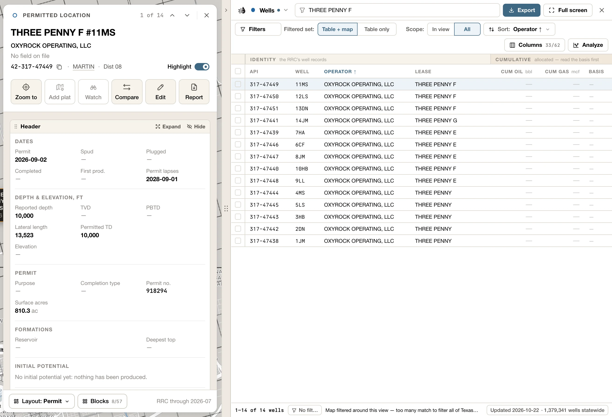
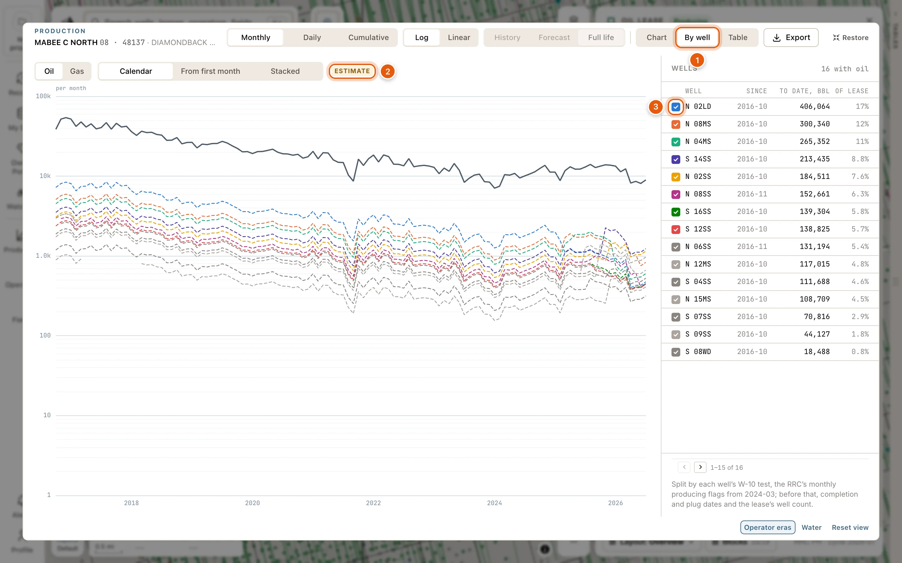

Click any row in the [data tables](/maps/data-panel) to open its card beside the table. It's the same card a click on the map opens; [Record cards](/maps/records) describes what each one shows. Rows open their cards with a free account.

<Frame>
  
</Frame>

- The ↑ ↓ arrows at the top of the card step to the previous and next row. <kbd>↑</kbd> / <kbd>↓</kbd>, or <kbd>k</kbd> / <kbd>j</kbd>, do the same. Beside them, the card shows where you are, such as *3 of 2,798*.
- One card is open at a time. A card you open from it, such as a lease's operator, goes on top, with the card you came from named above its name. Click that name, or press <kbd>Esc</kbd>, to go back. See [One card at a time](/maps/records#one-card-at-a-time).
- The **×** at the top right closes the card, and so does <kbd>Esc</kbd> when there's nothing to go back to.
- The card and the tables are separate. The **Tables** handle on the map's edge shows and hides the tables and leaves the card open: with the tables hidden, the card floats over the map. Closing the card leaves the tables as they are.

Well, lease, operator and field cards have **Compare**, which puts the record in the [compare tray](/maps/compare). The button is then pressed, and a second click takes the record out. <kbd>c</kbd> does the same. These cards also have a **Synopsis** at their foot; see [Synopsis](/maps/records#synopsis).

While a record is being read, its card shows the record's name and grey placeholders. If it can't be read, the card says why. See [While a record is read](/maps/records#while-a-record-is-read).

## Kinds of card

Every table has its own card. Every well gets the well card, which starts on one of three layouts, depending on the well:

| Well | Starts on | Other layouts |
|---|---|---|
| Producing, or produced | **Overview**: its leases, its totals, the wellbore, its tops, logs and tests, its history, and its site from above. See [Wells](/maps/records#wells). | **Engineering**, **Production**, **Land & title**, **Acquisition** |
| Permitted or spudded, not yet producing | **Permit**: the permit, its progress, the rig & pad watch, its filings and documents, and the other wells at the same surface location. A permit more than two years old without a spud is marked **Permit lapsed**. | **Engineering**, **Land & title** |
| Injection or disposal | **Injection**: injected volumes, what's authorised against what's reported, the injection permit, mechanical integrity tests, enforcement, and the wellbore. | **Compliance**, **Facility & field**, **Engineering** |

Each kind keeps its own arrangement, so what you change on a permit stays with permits.

Leases, operators, fields, P-4 transfers, P-4 filings, frac jobs, pads and rigs each have a card of their own, made of blocks you can arrange. So do counties and selected areas, which have no table of their own: see [Counties](/maps/records#counties) and [Select an area](/maps/selection).

A lease that stopped producing before 1993 opens with its **Historic production**, its **Archive record** and the **Bores on record**.

The **Operators** and **Fields** cards are described in [Operators & Fields](/maps/operators-fields).

## Follow a thread

Cards open other cards:

- On a **well** card, the lease's name in the title opens the lease, and so does a lease in the **Leases** block. The operator and the field under the title open their cards. In **Rig & pad watch**, a line opens the rig site's or the new ground's card.
- On a **lease** card, click the operator's or the field's name under the title. Click a well in **Wells on lease**, or an operator in **Operator history**.
- On a **field** card, click a lease under **By lease** to open that lease's card. <kbd>↑</kbd> / <kbd>↓</kbd> then step through the field's leases. Click an operator under **Operators**, or a county under **Record**, to open its card.
- On an **operator** card, click a lease under **By lease**, or a deal under **Deals** to open its P-4 filing.
- On a **P-4 transfer** card, the lease's name under the title opens the lease. On a **P-4 filing** card, the buyer's name, the title, opens the buyer, and the seller's name under it opens the seller.
- On a **frac job**, **pad** or **rig** card, **View well** opens the well.
- On a well, lease, frac job, pad or rig card, the county on the id line opens the county's card.

The card you came from is named above the new card's name. Click it, or press <kbd>Esc</kbd>, to go back.

## Layouts

A card is made of **blocks**, such as *Totals*, *Production*, *Wellbore* or *Frac & stimulation*. **Layout**, at the foot of the card, picks which blocks show and where. It reads the current layout, such as *Layout: Overview*.

- **Presets**:
  - Producing wells: **Overview**, **Engineering**, **Production**, **Land & title** and **Acquisition**.
  - Permits: **Permit**, **Engineering** and **Land & title**.
  - Injection wells: **Injection**, **Compliance**, **Facility & field** and **Engineering**.
  - Leases: **Overview**, **Production**, **Acquisition** and **Land & title**.
  - Frac: **Overview**, **Design** and **Production**.
  - Every other card: **Overview**.
- **Save layout as…** keeps your arrangement under a name. You'll find it under **Saved**, where you can also **Rename…** or delete it.
- **Reset to preset · ‹name›** undoes your changes.

Your layouts are remembered for your account and project.

## Arrange blocks

- Drag a block's header to move it. Drag its edge to resize it.
- **Blocks**, at the foot of the card, lists every block for this card and how many are showing, including ones hidden at first, such as *Monthly volumes* and *Related leases* on a lease, or *Casing & cement* and *Survey stations* on a well. Tick one to add it. A block the record has nothing for is greyed out, with the reason.
- Each block's header has **Expand**, to fill the card, and **Hide**, to take the block off the card. Blocks with a choice of figures also have **Fields**, to choose and reorder them. Your choices are saved with the layout.
- Double-click a block's header to expand it. **Restore**, or <kbd>Esc</kbd>, puts it back.
- A block's own actions, such as **Export CSV** and **Save PNG**, are buttons at its foot. **Fit to content** joins them once you've resized a block that fits its content, and **Reset view** once you've changed what it shows.

## The Production block

The **Production** block charts the record's monthly oil, gas and water. Lease, operator, field and county cards have one, and so do selected areas. P-4 and frac cards chart their lease's production. The well card has none.

- Pick **Monthly**, **Daily** or **Cumulative**, and **Log** or **Linear**. On a narrow card, the two fold into one menu that reads your choice, such as *Monthly · Log*. When a block has more than one series, pick the series at the top.
- The **Oil**, **Gas** and **Water** chips, under the chart, turn each line on and off. An **Estimate** tag means the line is an allocated estimate.
- **Chart options** turns **Events**, **Operator eras** (shading for who operated when) and **Unreported months** on and off. All three are on at first.
- Drag the chart to move along it. Hold <kbd>Ctrl</kbd> as you scroll, or pinch, to zoom. While you're zoomed in, the line under the chart sums up the months in view, and **Whole life** zooms back out.
- On a lease's series, **Forecast** draws the valuation's decline curve ahead of the history. **Decline** then lets you adjust it: pick **Oil** or **Gas**, and set the **b-factor** and **Initial decline**. Let go of a slider and the lease is re-valued; the button then reads **Adjusted**. **Reset to auto** goes back. Your adjustment lasts for this app session; a reload returns to the automatic fit.
- **Export CSV** and **Save PNG**, at the block's foot, save the months or the chart. See [Export data](/maps/exports#from-a-row-card).

## Decline workbench

On a lease card, **Expand** the Production block (or double-click its header) to open the decline workbench. It gives you a larger chart, decline parameters and a comparison against the automatic fit.

- Across the top: **Monthly**, **Daily** or **Cumulative**; **Log** or **Linear**; **History**, **Forecast** or **Full life**; and **Chart**, **By well** or **Table**.
- Change the oil or gas curve, terminal decline or economic limit and check the preview. **Apply to lease** shares your adjustment with the lease's valuation for this app session. **Reset** restores the automatic fit in the workbench. When there's no live preview, the panel says so, and **Apply to lease** re-values the lease.
- **Export** has **Production CSV**, **Forecast CSV · monthly**, **Forecast CSV · annual**, **Copy decline parameters**, **By well CSV · monthly (estimate)** and **Save PNG**.
- **Restore**, or <kbd>Esc</kbd>, returns to the card.

These changes are not permanent edits to the reported production.

### By well

**By well** splits the lease's production between its wells, one line per well.

<Frame>
  
</Frame>

- **Oil** or **Gas**.
- **Calendar** lines the wells up by date. **From first month** starts every well at its first producing month. **Stacked** piles the wells into the lease's total, on a linear scale, so they add up.
- Beside the chart, every well on the lease: when it started (**Since**), what it has made (**To date**) and its share of everything the lease has made (**Of lease**). Click a well's colour to take it out of the chart, or its name to open its card.
- On a lease with more than 40 wells, the 40 biggest get a line of their own. The rest are listed, and when **Stacked** they share one band.
- **Export** → **By well CSV · monthly (estimate)** downloads every well's estimated production, month by month.

<Note>
  Texas reports production by lease, not by well, so every figure under **By well** is an **estimate**, split from the lease's total. The wells add up to the lease.
</Note>

## Card actions

| Card | Buttons | Under them |
|---|---|---|
| Wells | **Zoom to**, **Plat on map**, **Watch**, **Compare**, **Edit**, **Report** | |
| Leases | **Zoom to**, **Watch**, **Deal draft**, **Compare** | |
| Operators | **Zoom to**, **Show on map**, **Add layer**, **Show leases**, **Show wells**, **Compare** | |
| Fields | **Zoom to**, **Show on map**, **Add layer**, **Show leases**, **Show wells**, **Compare** | |
| Counties | **Show wells**, **Show leases**, **Zoom to**, **Show on map** | |
| P-4 transfer | **Zoom to**, **Watch**, **Deal draft** | **Show the whole filing**, **Copy filing id** |
| P-4 filing | **Zoom to**, **Show leases**, **Show on map** | |
| Frac | **Zoom to**, **Watch**, **View well**, **Disclosure** | **Copy disclosure id** |
| Pads | **Zoom to**, **Full picture**, **View well** | **Copy permit API** |
| Rigs | **Zoom to**, **Full picture**, **View well** | **Copy API** (**Copy APIs** for a site with several wells), **About** |

The Copy icon beside each card's id copies it: a well's or a frac job's API, a lease key, an operator, field or county number, a filing id, a pad's detection id or a rig site's id.

- **Zoom to** flies the map to the row.
- **Plat on map** lays a well's W-1 plat over the map. See [W-1 plats on the map](/maps/plats).
- **Edit** corrects a well's data, or adds your own. See [My Wells](/maps/my-wells).
- **Report** opens the printable [well report](/tools/well-report) in a new tab.
- **Show on map** draws the record on the map while its card is open. On an operator or a field card, it opens settings for what's drawn; see [Record cards](/maps/records#operators).
- **Add layer** keeps an operator or a field on the map after its card closes, in the **Operators** or **Fields** layer. See [Operator and field layers](/maps/operator-field-layers).
- **Show leases** and **Show wells** list the record's leases or wells in a tab of their own, the [Record tab](/maps/data-panel#record-tab). **Show the whole filing** does the same for every lease a P-4 filing moved. Your own tabs and their filters stay as they are.
- **View well** opens the frac job's, the pad's or the rig site's well, on top of the card.
- **Disclosure**, on a frac card, opens the FracFocus disclosure in the drawer: every ingredient, its purpose and supplier.
- **Full picture** opens the site's imagery, full size, in a new tab. For a pad, that's the before and after.
- **About**, on a rig card, explains how to read a site.

To export a lease's production or wells, use **Export** in its **Lease record** block. To export many rows at once, tick them in the table. See [Export data](/maps/exports).

<Note>
  **Watch** adds the record to your project's watchlist, and **Deal draft** adds the lease to your deal draft. Both need a [paid plan](/get-started/plans), and **Watch** needs an active project too. When one can't be used it's greyed out; point at it to see why.
</Note>

{/* enterprise-hold: once the Enterprise pages are public, link "watchlist" in the Note above to /enterprise/watchlist and "deal draft" to /enterprise/deals. */}
