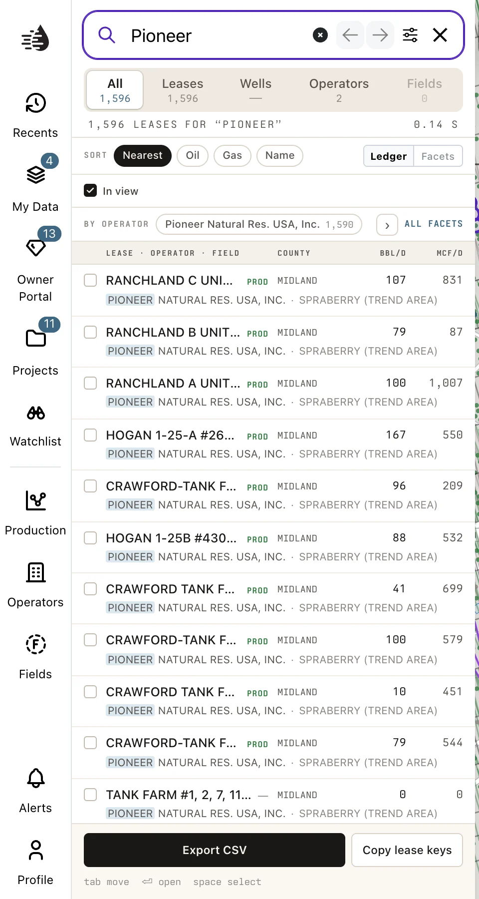
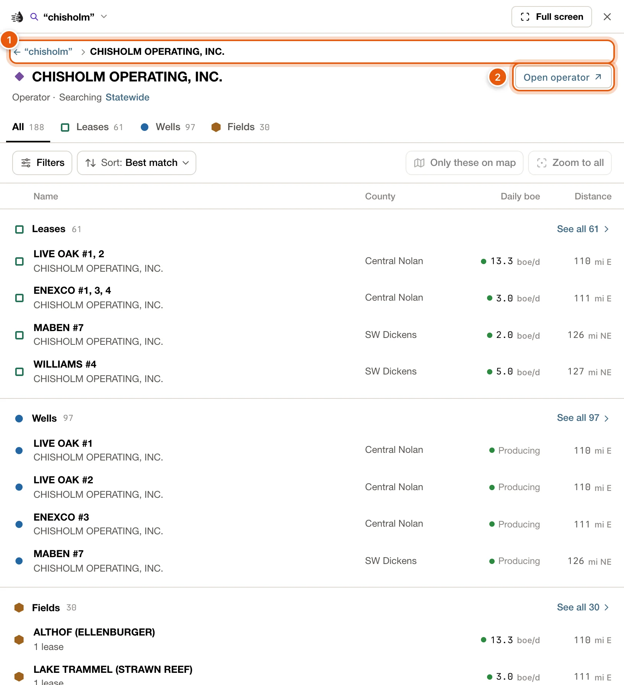
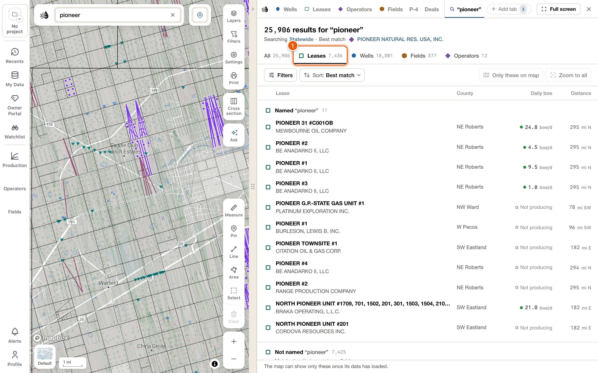
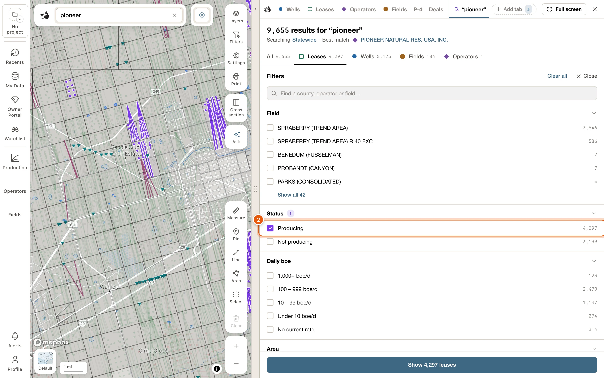
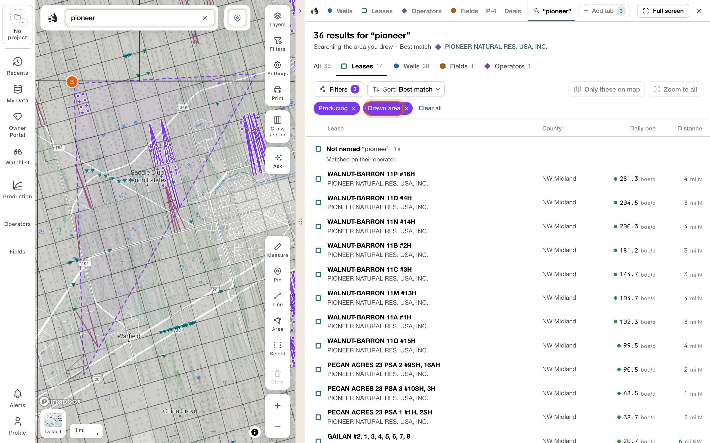
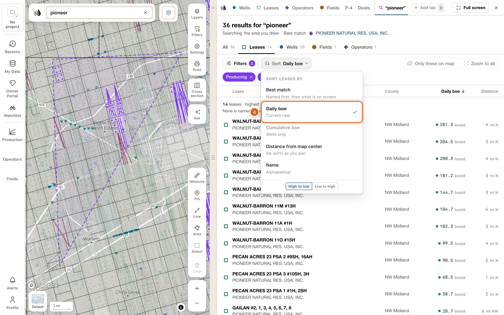
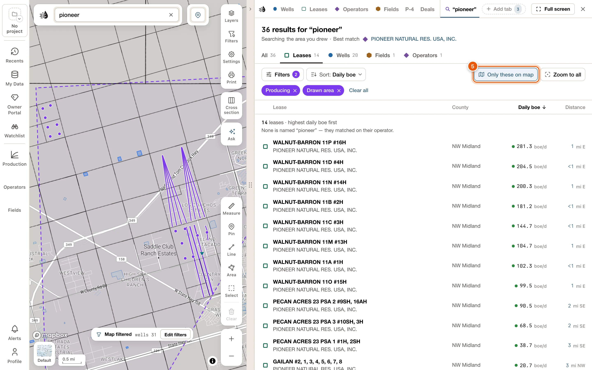

Type in the [search box](/maps/search) and press <kbd>Enter</kbd>. The data tables open on a Search tab named after your words, such as *“chisholm”*. It lists every lease, well, field and operator your words found, and marks the best match.

You need a free account to see search results. See [Plans & access](/get-started/plans).

<Frame>
  
</Frame>

The Search tab has its own filters and sort, so your Wells and Leases tabs and their filters stay as they were. It stays on the tab strip while the search is on. Clearing the search removes it, and it isn't kept for your next visit.

## The heading

- The count: *128 results for “chisholm”*, or *40 leases for “chisholm”* on a type tab. A **+** after the number means there were too many wells to count.
- Where it searches: *Searching Statewide*. Click **Statewide** to search only the part of the map you can see now; the line then reads *Searching the map area*, and clicking **the map area** searches all of Texas again. A county, a circle or an area you drew is named instead, such as *Searching Dickens County*.
- The best match: **Best match**, then the mark and name of the record QuickScout thinks you were after, such as a producing operator whose name starts with your words, or the busiest producing lease on screen. Click its name to open it the way its row does. Its row in the list says **Best match** too.

## Type tabs

Under the heading: **All**, **Leases**, **Wells**, **Fields** and **Operators**, each with how many it holds. A tab with nothing in it is greyed out.

### All

Four sections, in the same order as the search panel: **Leases**, **Wells**, **Fields** and **Operators**. Each lists its first few results, the ones named for your words first. **See all** and the section's count, such as *See all 115*, opens that type's tab.

Big counts are explained under the rows. A search for *chisholm* may find 115 leases of which only 24 are called Chisholm; the line under them then reads *91 leases run by the operators below*. Click the line to open the Leases tab at those 91. Other lines say *… in the fields below*, *… in the fields or run by the operators below*, *… that match on another column*, and under Fields, *… fields of the leases above*.

### Leases and Wells

Each lists everything **All** counted for it, in two lists:

- **Named “‹words›”**: the ones whose own name has your words.
- **Not named “‹words›”**: the ones that matched another way. A line under the heading says how, such as *Matched on their operator.*, *Matched on their field.* or *Matched on another detail (county or number).*

Each list shows 25 at a time. **Show 25 more** adds the next 25.

On the **Wells** tab, wells you've corrected or added in [My Wells](/maps/my-wells) come first, under **Your wells**.

### Fields and Operators

- **Fields** lists every field holding a lease your words matched. Fields named for your words come first; the rest follow under **Not named “‹words›”**, with a line such as *Matched on their leases' operators.* Each field says how many of its leases matched, such as *8 of 15 leases*.
- **Operators** lists the operators whose names have your words.

<Tip>
  Search again while a type tab is open, and the new search opens on the same tab.
</Tip>

## What a row shows

- The record's mark, the same symbol it has on the map, then its name. The best match says **Best match** after its name, and a record in your compare tray says **In compare**.
- Under the name, where it is and who runs it: the part of its county and its operator (*NE Schleicher · …*). Fields and operators show their leases (*61 leases*).
- On the right, what it makes today in boe/d (oil plus gas, 6 mcf to the barrel), or its status, such as *Not producing*. On the **Wells** tab, a producing well shows its lease's rate, because Texas reports production by lease; elsewhere a well shows its status, such as *Producing*.
- How far it is from the middle of your view, and which way, such as *4 mi NE*. The distance is highlighted when the record is on screen, and updates as you move the map.

When the list is wide, for example after **Full screen**, the rows line up in columns with headings: the name (**Name** on All, or the kind, such as **Lease**), **County**, **Daily boe** (**Lease boe/d** on Wells), **Cum boe** (on Wells), **Distance**, and on a wider list the RRC number (**RRC No.** on All, or **Lease No.**, **API**, **P-5 No.** or **Field No.**). Click the name, **Daily boe**, **Cum boe** or **Distance** heading to sort by it, and again to reverse the order.

## Open, drill down and go back

- Click a well to open its [card](/maps/records).
- Click an operator, field or lease to drill down into what it holds: an operator's leases, wells and fields; a field's leases, wells and operators; a lease's wells. The type tabs change to the kinds it holds.
- To open its card instead, hover the row and click **Open operator**, **Open field** or **Open lease** at its right end, or hold <kbd>⇧</kbd> and click the row.

<Frame>
  
</Frame>

At a drill level, the top of the tab shows the way back: your words, then each level you came through, such as *← “chisholm” › CHISHOLM OPERATING*. Click your words or a level to go back up, or press <kbd>Backspace</kbd> or <kbd>Alt</kbd> + <kbd>←</kbd>. **Open operator** (or **Open field**, **Open lease**) beside the name opens its card.

Rows also work from the keyboard. Reach one with <kbd>Tab</kbd>, then <kbd>Enter</kbd> does what a click does, <kbd>⇧</kbd> <kbd>Enter</kbd> opens its card, and <kbd>c</kbd> adds it to compare or takes it out.

## Narrow the results

Click **Filters**, under the type tabs. Each tab has its own:

| Tab | Filters |
|---|---|
| **All** | **County**, **Operator**, **Status**, **Area** |
| **Leases** | **County**, **Operator**, **Field**, **Status**, **Daily boe**, **Area** |
| **Wells** | **County**, **Operator**, **Field**, **Status**, **Well type**, **Wellbore**, **Last produced**, **Area** |
| **Fields** | **County**, **Operator**, **Status**, **Daily boe**, **Area** |
| **Operators** | **County**, **Field**, **Status**, **Daily boe**, **Area** |

- Tick a value to keep only those results. Each value says how many results it would leave. Ticking two values in one filter keeps either one; ticks in different filters narrow each other.
- A long list shows its top five; **Show all** and its count lists the rest. The box at the top, such as *Find a county, operator or field…*, finds a value in every filter at once.
- **Status** is **Producing** or **Not producing**. **Daily boe** comes in bands from *1,000+ boe/d* down to *Under 10 boe/d* and *No current rate*.
- **Last produced** (Wells) has a bar for each year. Click a bar, or drag across several for a range.
- **Area** is one of **Statewide**, **In current map view**, **Within 50 mi of map center**, **Within 100 mi of map center** and **An area you draw on the map**. A map view or circle is fixed when you pick it; moving the map afterwards doesn't change it.

What you've picked shows as chips under the buttons, such as *Irion Co.*, *Producing* or *Map area*. Each chip's **×** removes it, and **Clear all** removes them all. A pick that doesn't apply to the tab you're on stays as a faded chip that says where it does, such as *· wells only*.

On a narrow panel the filters open over the results. To get back to the list, click the button at the bottom, such as *Show 166 leases*, or **Close** at the top. On a wide panel they stand beside the results instead; click **Filters** again to put them away.

<Note>
  These filters belong to the search. Your own Wells and Leases filters, and the map's **Filters** card, aren't changed.
</Note>

### Draw an area

Choose **An area you draw on the map** under **Area**. Click the map to place each corner, then double-click to finish. While you draw, clicking the map doesn't open wells; <kbd>Esc</kbd> gives up.

The results narrow to the area. A dashed violet outline marks it on the map, its chip reads *Drawn area*, and the heading says *Searching the area you drew*. Click the chip's **×** to remove it.

The outline narrows only this search. To gather everything inside an area of the map on one card, use [Select an area](/maps/selection) instead.

### Walkthrough: producing leases in an area, by rate

<Steps>
  <Step title="Search, then open the Leases tab">
    Search for a name, such as *pioneer*, and press <kbd>Enter</kbd>. On the Search tab, click **Leases**.

    <Frame>
      
    </Frame>
  </Step>
  <Step title="Keep only producing leases">
    Click **Filters**. Under **Status**, tick **Producing**. The list and its count update at once.

    <Frame>
      
    </Frame>
  </Step>
  <Step title="Draw your area">
    Under **Area**, choose **An area you draw on the map**. Click the map at each corner, then double-click to finish.

    <Frame>
      
    </Frame>
  </Step>
  <Step title="Sort by today's rate">
    Click **Sort**, choose **Daily boe**, and keep **High to low**. The busiest leases are now at the top.

    <Frame>
      
    </Frame>
  </Step>
  <Step title="Show only these on the map">
    Click **Only these on map**. Every other well is hidden, so only these leases' wells are drawn. Click **Zoom to all** to frame them.

    <Frame>
      
    </Frame>
  </Step>
</Steps>

## Sort

Click **Sort**. The button says the order in force, such as *Sort: Best match*.

| Sort | Order |
|---|---|
| **Best match** | Named first, then what is on screen. The Leases, Wells and Fields tabs keep their **Named** and **Not named** lists. |
| **Daily boe** | Today's rate: **High to low** or **Low to high**. Anything producing comes before what isn't, either way. |
| **Cumulative boe** | Lifetime production, **High to low** or **Low to high**. Wells tab only. |
| **Distance from map center** | **Nearest first** or **Farthest first**. Re-sorts as you pan. |
| **Name** | **A to Z** or **Z to A**. |

On a type tab, any order but **Best match** makes one ranked list, with a line over it saying what it is, such as *228 leases · highest daily boe first*. A line under that says how many are named for your words and how the rest matched. On **All**, each section lists its first few in that order.

## On the map

The matches are always drawn in violet on the map; see [While a search is on](/maps/search#while-a-search-is-on). The Search tab adds two buttons at the right end of its toolbar:

- **Only these on map** hides every other well, so only the search's wells are drawn. Click it again to bring the other wells back. It works for up to 30,000 wells; narrow a bigger search first. When a search is too broad to mark on the map at all, the button's place reads *Too many to mark on the map*.
- **Zoom to all** moves the map to take in every match.

On a narrow panel the toolbar wraps onto a second line, so both buttons are still there.

Filters, sorting and drilling down never move the map. **Zoom to all** is the only button here that does.

### The map and the list point to each other

- Hover a row, or reach it with <kbd>Tab</kbd>, and its record lights up on the map. A lease's outline and wells, or a well's path, light in amber with a pin; an operator's or field's own wells light among the matches.
- When a lease or well is out of sight, a chip at the edge of the map points to it, with its name and how far away it is. Click the chip to go there.
- Open a record's card from the map, and its row lights up in the list and scrolls into view.

## Add to compare

Hover a row and click **Compare** at its right end, or press <kbd>c</kbd> on a row you've reached with <kbd>Tab</kbd>. The row then says **In compare**, and **Compare** stays pressed. Click it again, or press <kbd>c</kbd>, to take the record out. See [Compare](/maps/compare).

## While map data downloads

The search reads map data kept on this device. Until that has downloaded, you still get results, read over your connection. **Only these on map** waits for the download, and a note under the list says *The map can show only these once its data has loaded.* The count in the search box, such as *57 of 829 on screen*, arrives once the download finishes too. If you have wells of your own in [My Wells](/maps/my-wells), the note may say *Your wells are not searched until the map’s data has loaded.* instead.

If the results can't be read at all, the tab shows one note, *The search is waiting for its files.*, with the reason and what to do: **Download now**, **Try again**, or **Map data…**. When the QuickScout server isn't answering, the note says so instead. See [Map data on this device](/maps/offline).

## Troubleshooting

<AccordionGroup>
  <Accordion title="Nothing matches this search">
    Check the spelling, or try fewer words. A search needs at least three letters.
  </Accordion>
  <Accordion title="Nothing matches with these filters">
    Your picks left nothing. Click **Clear filters** in the message, or remove chips one at a time with their **×**.
  </Accordion>
  <Accordion title="A type tab is greyed out">
    Nothing of that type matched your words. Try **All**, or search with fewer words.
  </Accordion>
  <Accordion title="Only these on map is greyed out">
    Either the matches aren't on the map yet (give it a moment, or see [While map data downloads](#while-map-data-downloads)), or there are more than 30,000 wells. Narrow the search with **Filters** first.
  </Accordion>
  <Accordion title="The search is waiting for its files">
    The note says why and offers the next step. Click **Download now** or **Try again**, or open **Map data…** to check what's on this device. See [Fix stuck or missing map data](/maps/offline#map-data).
  </Accordion>
</AccordionGroup>
