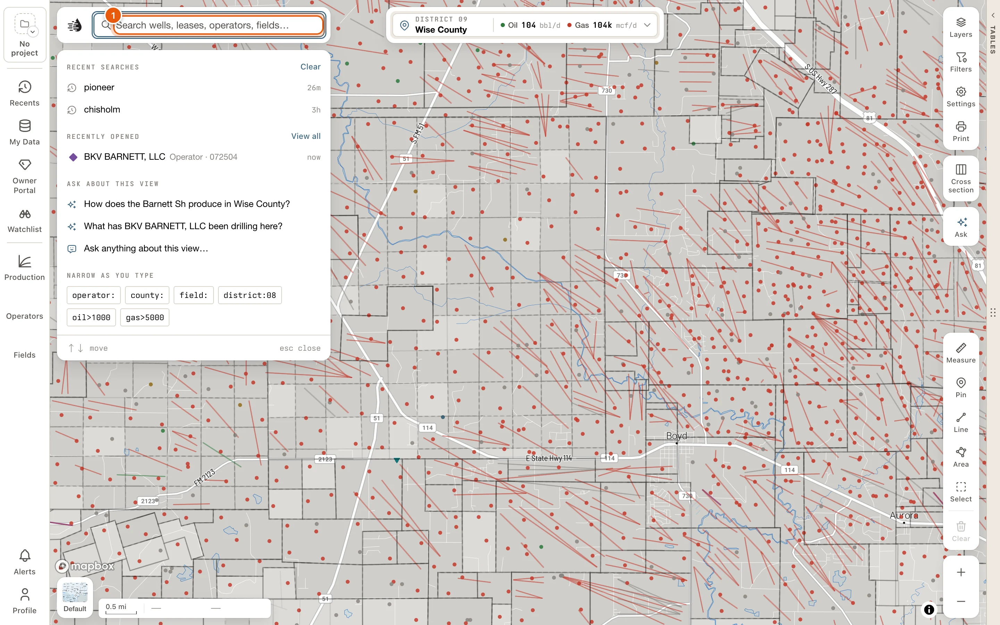
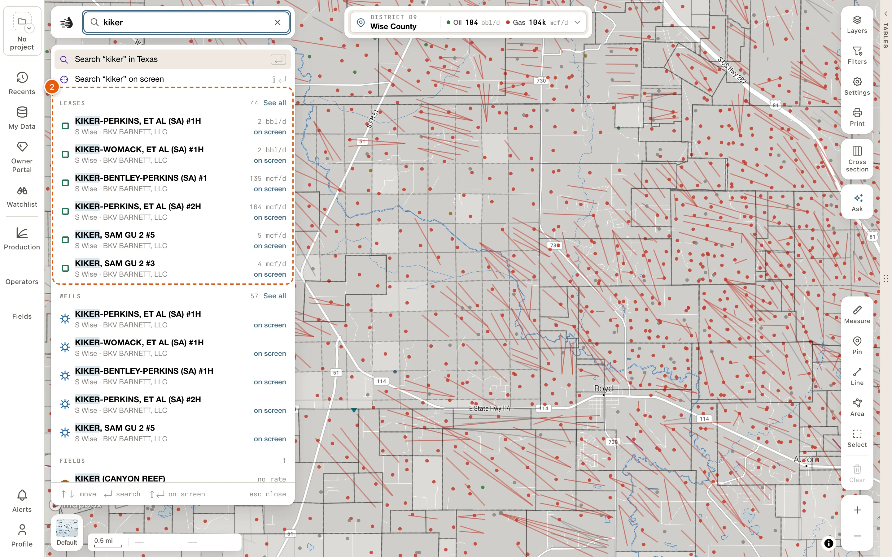
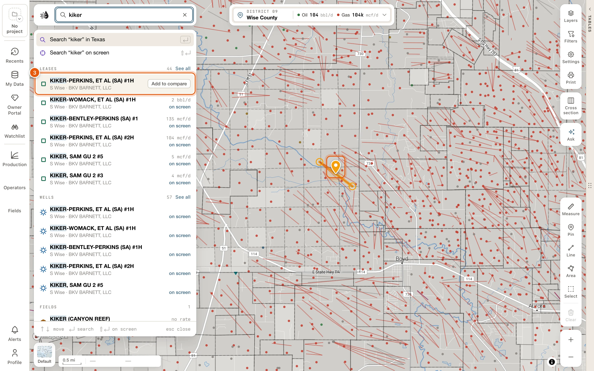
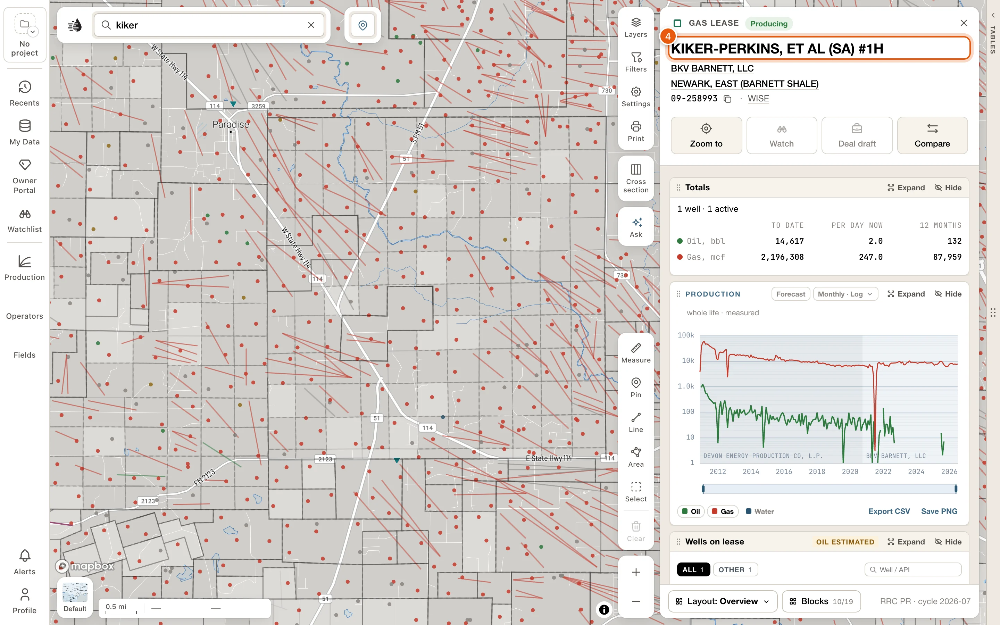
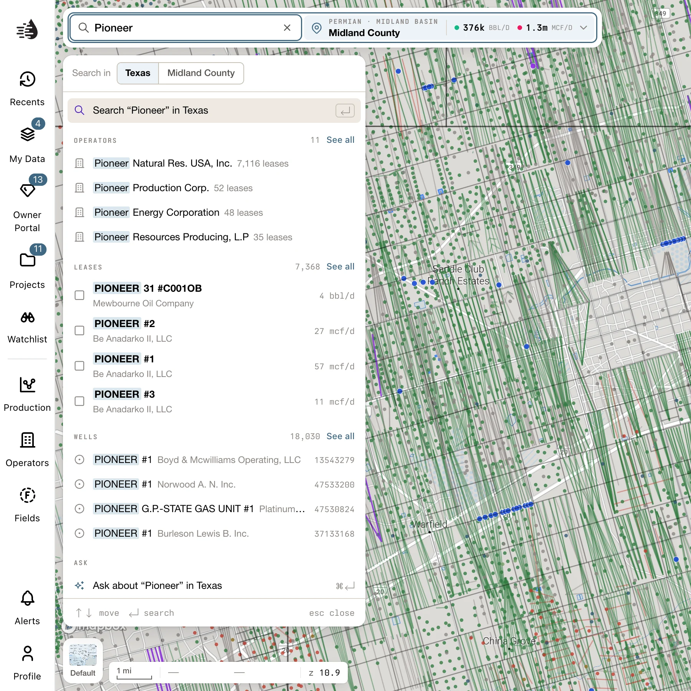
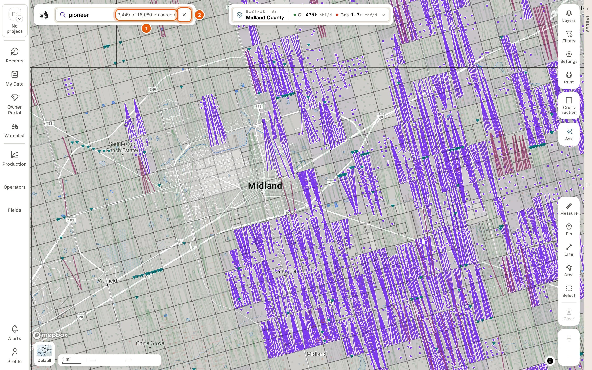

The search box is at the top left of the map, beside the QuickScout logo. When it's empty, it reads *Search wells, leases, operators, fields…* Click it, or press <kbd>⌘</kbd> <kbd>K</kbd> (<kbd>Ctrl</kbd> <kbd>K</kbd> on Windows) or <kbd>/</kbd>, to open the search panel.

When the map is narrow, for example with a card open beside it, the bar folds to the logo and a **Search** button. Click **Search** to open the bar.

Anyone can type in the box and see suggestions. Searching by name and seeing the [results](/maps/search-results) needs a free account. Opening a record's card from the panel needs a [paid plan](/get-started/plans), unless the data tables are already open.

The panel opens where the left drawer sits. If something is open there, such as a drawer or a card you've set to open on the left, the panel covers it until you're done. **Back to ‹name›** at the top of the panel, or <kbd>Esc</kbd>, brings it back.

## Find a record and open its card

<Steps>
  <Step title="Open the search panel">
    Click the search box, or press <kbd>⌘</kbd> <kbd>K</kbd>. With nothing typed, the panel shows your recent searches and the records you opened recently.

    <Frame>
      
    </Frame>
  </Step>
  <Step title="Type part of the name">
    Three letters are enough, for example *kiker*. The panel lists the matching **LEASES**, **WELLS**, **FIELDS** and **OPERATORS**, nearest your view first.

    <Frame>
      
    </Frame>
  </Step>
  <Step title="Check it on the map">
    Hover a row, or move to it with <kbd>↓</kbd>. The map lights that record in amber without moving, so you can tell which one you want.

    <Frame>
      
    </Frame>
  </Step>
  <Step title="Open its card">
    Click the row, or press <kbd>Enter</kbd> once you've moved to it with <kbd>↓</kbd>. The record opens as its [card](/maps/records). <kbd>Esc</kbd> closes the card.

    <Frame>
      
    </Frame>
  </Step>
</Steps>

## Search by name

Type at least three letters. The panel lists:

- First, a lit row: **Search “‹text›” in Texas**. Press <kbd>Enter</kbd> to run it. The results open in the data tables; see [Search results](/maps/search-results).
- **Search “‹text›” on screen**: the same search, limited to the part of the map you can see. See [Statewide or on screen](#statewide-or-on-screen).
- Four groups, always in this order: **LEASES**, **WELLS**, **FIELDS** and **OPERATORS**. Each shows how many match (*none* when nothing does). The four share twelve rows; when a group has more than it shows, **See all** runs the search and opens on that group's list.
- **Ask about “‹text›”**, to put the question to the [map assistant](/maps/ask-the-map).

<Frame>
  
</Frame>

What each row tells you:

- **LEASES**: the name; then where it is and who operates it (*NE Schleicher · QUESTA OIL & GAS CO.*), or why it matched when that isn't its name (*Field · Iron Bridge*). On the right, what it makes today (*4 bbl/d*, *27 mcf/d*, *no rate*) and how far it is from your view (*on screen*, *5 mi SW*).
- **WELLS**: where the well is and its operator, rather than its API. A well you've corrected or added in [My Wells](/maps/my-wells) says **Yours**.
- **FIELDS** and **OPERATORS**: how many leases they have, what those make today in boe/d, and how far their nearest lease is.

Hovering a row, or moving to it with <kbd>↑</kbd> <kbd>↓</kbd>, lights it on the map in amber: a lease's outline and wells, a well's path, an operator's wells, or a field's leases and wells. The map doesn't move. When the record is out of sight, a chip at the edge of the map points to it, with its name and how far away it is.

Clicking a row opens it. A lease, well, field or operator opens as its [card](/maps/records).

The keys at the bottom of the panel change with the row you're on:

| Key | Does |
|---|---|
| <kbd>↑</kbd> <kbd>↓</kbd> | Moves through the list. |
| <kbd>Enter</kbd> | Runs the lit row: searches, opens the record, asks, or shows a number's wells. |
| <kbd>⇧</kbd> <kbd>Enter</kbd> | On the **Search “‹text›” in Texas** row: searches only what's on screen. |
| <kbd>⌥</kbd> <kbd>Enter</kbd> | Adds the lit record to [compare](/maps/compare), or takes it out. |
| <kbd>⌘</kbd> <kbd>Enter</kbd> | Asks about what you typed. |
| <kbd>Esc</kbd> | Closes the panel, or goes back to what it was covering. |

To add a record to compare with the mouse, hover its row and click **Add to compare** at the right end. The row then shows **In compare**, and the same spot reads **Remove from compare**.

Messages you may see:

- *Three letters or more to search.*
- *No leases or wells match.* Try fewer letters, or check the spelling.
- *Downloading the wells — 42%. ↵ searches them now.* The **WELLS** group fills in once the wells have downloaded to this device. Press <kbd>Enter</kbd> to search them anyway.

### Statewide or on screen

A search looks at all of Texas. The panel lists what's near your view first, and each row says how far away it is.

To search only the part of the map you can see, choose **Search “‹text›” on screen**, or press <kbd>⇧</kbd> <kbd>Enter</kbd> on the search row. The area is fixed when you choose it, so moving the map afterwards doesn't change it. On the [Search tab](/maps/search-results) it shows as a **Map area** chip. Click the chip's **×** to search all of Texas again.

The Search tab's heading switches between the two as well. It reads *Searching Statewide*: click **Statewide** to search the map area, and click **the map area** to go back. To search a county, a circle around the map's center, or an area you draw, use the Search tab's [Filters](/maps/search-results#narrow-the-results).

## Search by number

Type a number and QuickScout lists what it could be under **INTERPRET AS**:

| You type | Read as |
|---|---|
| 8 or more digits | An **API** (well) |
| Up to 6 digits | An **operator** number |
| Up to 8 digits | A **field** number |
| A district and lease, like `08/12345` or `7C-4432` | A **lease** |

A plain number is never read as a lease number; include the district. When an oil lease and a gas lease in that district share the number, both are listed. Pick a row, or press <kbd>Enter</kbd> to take the first one.

- An API opens that well's card.
- An operator, field or lease number opens a Record tab in the data tables, listing every well of that operator, field or lease. The map shows only those wells while you're on the tab. Your own tabs and their filters aren't touched; **Close** on the tab's band brings them back. See [The Record tab](/maps/data-panel#record-tab).

If nothing has that number, the panel says *No well, operator, field or lease numbered “‹number›”.*

## Search in plain words

Type a sentence, like *wells in the cisco field*, and **INTERPRET AS** lists the ways QuickScout can read it: the search terms each becomes, and how many wells or leases match. The best reading comes first; <kbd>Enter</kbd> runs it. A note says when part of the sentence was ignored or isn't supported yet. For example, *wells spudded since 2024* gets *can’t do “spudded since” yet — dates can’t be searched yet*.

## Search terms

Type these yourself, or click one under **NARROW AS YOU TYPE** on the empty panel:

| Type | Finds |
|---|---|
| `operator:pioneer` | Records for that operator. Use quotes for more than one word: `operator:"pioneer natural"` |
| `county:midland` | Records in that county |
| `field:spraberry` | Records in that field |
| `district:08` | Records in an RRC district |
| `oil>1000` | Leases making at least 1,000 bbl/d of oil (for wells: cumulative bbl). `<` means at most. `4k` and `1m` work too. |
| `gas>5000` | Leases making at least 5,000 mcf/d of gas (for wells: cumulative mcf) |
| `wells>10` | Leases with at least 10 wells |
| `status:`, `depth>`, `lateral>`, `wellbore:horizontal` | Wells by status, total depth, lateral length or wellbore |

A term QuickScout doesn't know is searched as plain text.

## While a search is on

A search you've run stays on the map until you clear it.

- In the search box: your words, then how many of the search's wells are in view, such as *57 of 829 on screen* (or *all 12 on screen*, *none of 829 on screen*). Click that count to open the results.
- On the map: the other wells dim, and the matching wells are drawn in violet under their usual symbols. Zoomed out below zoom 10, the matches show as violet survey tracts instead; click one to zoom in on it.
- To end the search, click the **×** at the end of the search box (*Clear this search from the map*).

<Frame>
  
</Frame>

Narrowing a search, showing only its wells and framing them all are on the Search tab. See [Search results](/maps/search-results#on-the-map).

## The Search tab

Running a search opens the data tables on a Search tab, named after your words, such as *“pioneer”*. It lists every lease, well, field and operator your words found, and marks the best match. From there you can drill into an operator or field, filter, sort, and show only the matches on the map. See [Search results](/maps/search-results).

The Search tab has its own filters, so your Wells and Leases filters stay as they were. Clearing the search removes the tab, and it isn't kept for your next visit.

## Recents

Click the empty search box to see your **RECENT SEARCHES** and **RECENTLY OPENED** records, four of each. Click a record to open its [card](/maps/records) again. Counties you opened are listed too, and open the county's card.

- **Clear** empties the recent searches. They're kept on this device.
- **View all** opens **Recents**, which is also on the left rail and needs a [paid plan](/get-started/plans). **RECENTLY OPENED** follows your account to every project and device, and includes cards you stayed on for a moment.

The empty panel also suggests two questions under **ASK ABOUT THIS VIEW**, plus **Ask anything about this view…**, and offers search terms under **NARROW AS YOU TYPE**.

## Go to a place or RRC record

To jump to a county, an abstract, a latitude and longitude or a basin, or to look up an RRC record by number, click the QuickScout logo at the left end of the search bar (its tooltip says *Start panel*). See [The start drawer](/maps/tour#the-start-drawer).

<Tip>
  To filter the map by well type, wellbore or any well column, use the **Filters** card on the right side of the map. <kbd>⌘</kbd> <kbd>⇧</kbd> <kbd>K</kbd> opens it. See [Well filters](/maps/layers#well-filters). It's separate from the Search tab's **Filters**, which narrow only a search.
</Tip>
