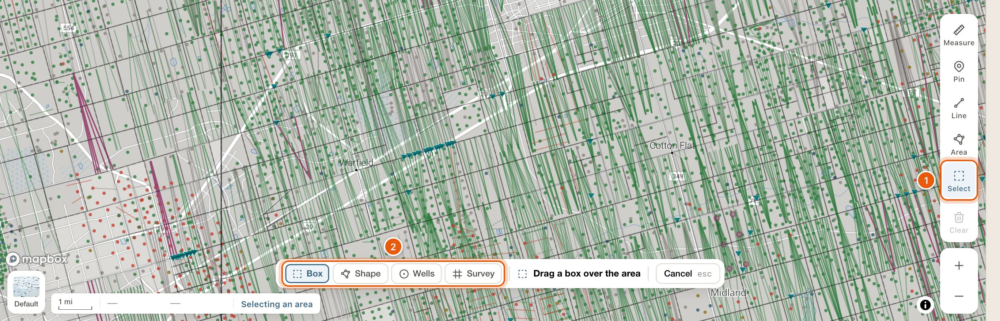
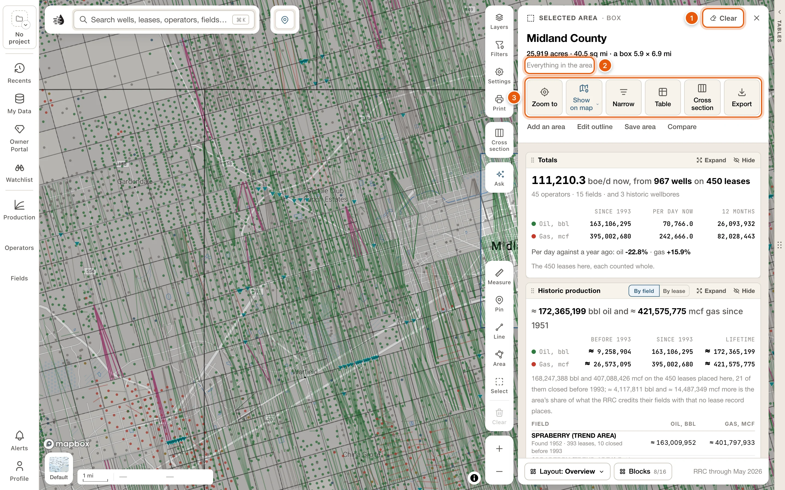
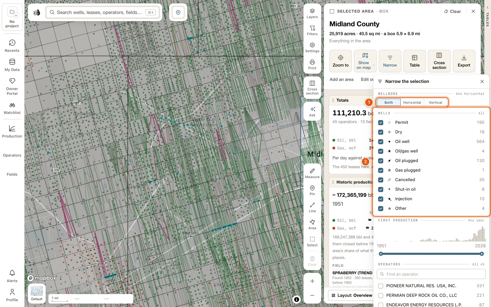
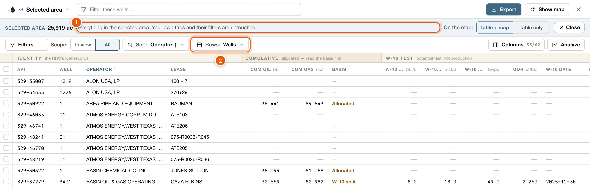
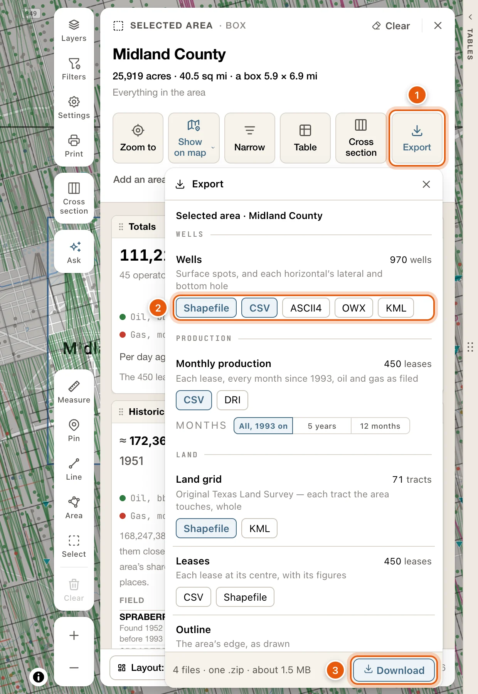
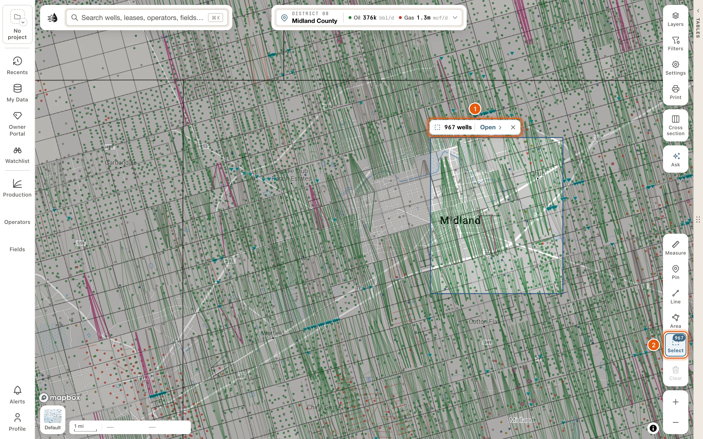

**Select** gathers everything inside an area of the map: its wells, leases, operators, fields, frac jobs and P-4 transfers. They're added up on one card, the **Selected area** card, and listed in the data tables on a tab of their own.

<Note>
  - The **Select** tool is there for everyone.
  - The card opens with a [paid plan](/get-started/plans). Without one, you'll be asked to sign in or choose a plan.
</Note>

## Select an area

<Steps>
  <Step title="Turn on Select">
    Click **Select** in the draw tools at the bottom right of the map, or press <kbd>S</kbd>. On a short map the tools are folded into **Draw**: click it, then **Select**.

    A bar at the bottom of the map says what to do next.

    <Frame>
      
    </Frame>
  </Step>
  <Step title="Choose how to select, and select">
    The bar's first buttons say how:

    - **Box**: drag a box over the area. Its size rides beside the pointer, such as *1.5 × 1.4 mi · 1,344 acres*.
    - **Shape**: click to place each corner. Double-click, or click the first corner, to finish. **Undo corner** takes the last corner back.
    - **Wells**: click wells to pick them, and click one again to drop it. Click **Done** when you have them all. The selection is exactly those wells.
    - **Survey**: click tracts of the original Texas land survey, then **Done**. If the bar says *Zoom in to see the survey grid*, zoom in until the tracts are drawn.

    **Cancel**, or <kbd>Esc</kbd>, stops without selecting. **Saved** appears beside the four once you've [saved an area](#add-reshape-save-and-compare).

    You don't need the tool for a box: hold <kbd>Shift</kbd> and drag on the map at any time.
  </Step>
  <Step title="Read the card">
    The **Selected area** card opens as soon as you finish. The map keeps the outline, and the rest of the map is dimmed.
  </Step>
</Steps>

### What counts as inside

- **Wells**: a well is in when its surface location is inside the area, or when its horizontal lateral, as the map draws it, crosses into the area. This works at any zoom, with no limit on how many wells.
- **Leases**: those with one of the area's wells on them, and those whose centre is inside the area.
- **Fields** are the fields of the area's wells, **frac jobs** those on its wells, and **P-4 transfers** those of its leases.

When your map is filtered, a box takes only the wells your map shows. The bar says so, for example *it takes the 188 wells your map shows*. The card names that filter on its narrowing line, with **Remove** to take in everything in the area.

## The Selected area card

<Frame>
  
</Frame>

At the top:

- **Selected area** and the kind: *Box*, *Shape*, *Wells*, *Tracts*, or *Joined* for one put together with **Add an area**.
- **Clear** takes the selection away: the outline, the card and its tab. ✕ only closes the card, and the selection stays on the map.
- The title is the counties the area's wells are in, most wells first. Survey tracts are named instead, such as *Sections 22, 27 · Blk 39 T1S · T&P RR CO*, and picked wells read like *3 wells you picked*.
- Its size, in acres and square miles.
- The narrowing line: *Everything in the area*, or what you've narrowed it to, such as *19 of 117 wells* followed by your choices and **Clear**.

The buttons:

- **Zoom to** fits the map to the area.
- **Show on map** sets how the area is drawn. See [Show it on the map](#show-it-on-the-map).
- **Narrow** narrows the selection. See [Narrow the selection](#narrow-the-selection).
- **Table** lists the area's rows in the data tables. See [Its rows in the data tables](#its-rows-in-the-data-tables).
- **Cross section** puts the area's wells in a [cross section](/maps/cross-section), ordered along the area's longer side. With more than 30 wells, you pick 30 of them: the section's picker opens with *Pick up to 30 of the 412 wells in the area*.
- **Export** writes the area's wells, production, land grid and tables as files for your own software, in one zip. See [Export](#export).

Under them are **Add an area**, **Edit outline**, **Save area** and **Compare**. See [Add, reshape, save and compare](#add-reshape-save-and-compare).

### The blocks

Every figure on the card is the area's own. Production comes from the area's leases, each counted whole.

| Block | What it shows |
|---|---|
| **Totals** | What the area makes per day now, from how many wells on how many leases; its oil and gas since 1993, per day now and over 12 months; and the change from a year ago. |
| **Historic production** | What the area has made since its fields were found, before and since 1993, **By field** or **By lease**. It counts leases closed before 1993, and shares out each field's production that no lease record places, so those figures are marked ≈. |
| **Production** | The area's oil and gas, month by month, on the standard production chart. |
| **By lease** | Which leases make the area's oil or gas, a band each, and every lease with what it has made since 1993. |
| **Operators** | Who produces here: each operator's share of the area's production now, its change over a year, its wells here and its permits. A row opens the operator. |
| **Activity** | Permits, spuds, completions, first production and frac jobs on the area's wells, month by month for ten years. **Alert me about new activity here** starts an [alert](/maps/alerts) for the area. |
| **Wells by status** | The area's wells by their map symbol, and the ones permitted but not drilled, or spudded but not completed. A row lists those wells in the data tables. |
| **First and newest wells** | Every well drilled here, **Oldest** or **Newest** first, with the likely discovery well of each field marked. A date worked out from the wells around it is marked ≈. |

More blocks are in the card's **Blocks** list: **Fields**, **New wells**, **Type curve**, **Frac**, **P-4 transfers**, **Valuation** (needs the lease valuation add-on), **Formations** and **Documents**. **Blocks** and **Layout** are at the foot of the card; see [Record cards](/maps/row-cards) for how blocks are arranged.

Point at a row in a well, lease or operator list and the map lights it. **Compare the top 3** in **Operators**, **By lease** and **Fields** puts the biggest ones in the [compare tray](/maps/compare). **Show all *N* in the table** lists them in the data tables.

## Narrow the selection

**Narrow** opens *Narrow the selection*:

- **From your map**: the map filter the box took in, with **Remove**. It's only there when your map was filtered.
- **Wellbore**: **Both**, **Horizontal** or **Vertical**.
- **Wells**: the area's wells by their map symbol, each with a count.
- **First production**: a range of years.
- **Operators** and **Fields**, each with a search box.

The foot says how many wells you're keeping, such as *19 of 117 wells*, with **Reset** and **Done**.

Narrowing changes everything at once: every block, the rows in the tables, and the map, where the area's other wells fade.

<Frame>
  
</Frame>

## Show it on the map

**Show on map** has three switches:

- **Outline**: the area's edge.
- **Dim the rest**: the map outside the area, faded.
- **Only matching wells**: after you narrow, draws only the wells that match. Every other well leaves the map, around the area as well as inside it.

For picked wells, **Rings** marks each one instead of an outline, and **Only matching wells** works without narrowing: it draws only the wells you picked.

## Its rows in the data tables

**Table** opens the **Selected area** tab in the [data tables](/maps/data-panel). It works like a [Record tab](/maps/data-panel#record-tab):

- The band says *Everything in the selected area. Your own tabs and their filters are untouched.* For picked wells it says *Every well you picked.*, and a narrowed selection says how far, such as *19 of 117 wells, narrowed on its card.*
- **Rows** switches between the area's **Wells**, **Leases**, **Operators**, **Fields**, **Frac jobs** and **Transfers**.
- **On the map**: **Table + map** shows only the rows' wells or leases on the map while you're on the tab. **Table only** leaves the map as it was.
- **Close** ends the tab. Your own tab comes back as you left it.

<Frame>
  
</Frame>

## Export

**Export** opens the Export card. Each kind of data the area holds is on a row of its own, with how many there are and a button for each format:

| Row | Formats |
|---|---|
| **Wells** | **Shapefile**, **CSV**, **ASCII4**, **OWX**, **KML** |
| **Monthly production** | **CSV**, **DRI** |
| **Land grid** | **Shapefile**, **KML** |
| **Leases** | **CSV**, **Shapefile** |
| **Outline** | **Shapefile**, **KML** |
| **Operators**, **Fields**, **Frac jobs**, **P-4 transfers** | **CSV** |

<Frame>
  
</Frame>

Press the formats you want, then click **Download**. Everything comes in one zip, with a `README.txt` that says what each file holds. There's no limit on how many wells or leases. A narrowed selection exports the wells you narrowed it to, and their leases, while the land grid and the outline are the whole area's. Wells you picked one by one have no outline.

You can close the card while the files are written: a row at the bottom of the map says how far along the export is, with **Open** and **Cancel**. See [Export an area or a county](/maps/exports#export-an-area-or-a-county) for what's in each file, the coordinates they use, and what to do if an export stops.

## Add, reshape, save and compare

- **Add an area**: what you draw or pick next joins this selection. The bar says *Adding to the selection*. Press it again, or <kbd>Esc</kbd>, to stop.
- **Edit outline**: drag a corner, or drag a midpoint to add one, then click **Done** in the bar at the bottom of the map. Picked wells have no outline to edit.
- **Save area**: give the area a name and click **Save**. Open it again from **Saved** in Select's bar. Once saved, the button reads **Saved as *name***, and it lets you **Rename** it, **Update** it with the narrowing you have now, or **Delete** it.
- **Compare**: puts the area in the [compare tray](/maps/compare), to set beside other areas.

## Come back to it, or clear it

There is one selection at a time. A new one replaces it.

The selection stays on the map when you close its card, and it's still there the next time you open Maps. To open the card again:

- click inside the area on the map,
- click **Open** on the tag at the top of its outline (the tag shows its well count), or
- click **Select**, which shows the well count while the card is closed, or press <kbd>S</kbd>.

<Frame>
  
</Frame>

**Clear**, on the card or the × on the tag, takes the selection away. *Selection cleared* shows at the bottom of the map with **Undo** for a few seconds.
