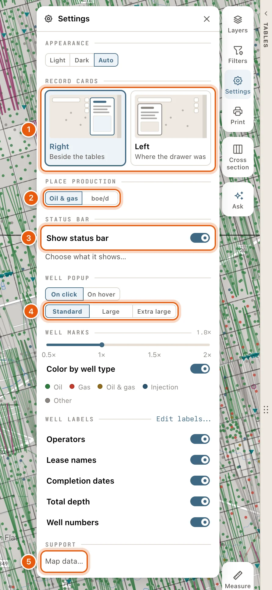
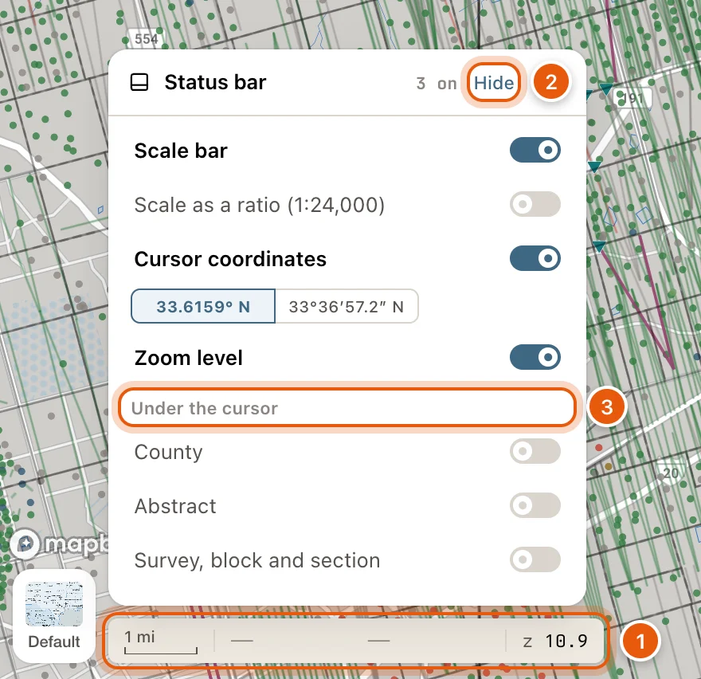

Click **Settings**, the gear on the right side of the map, to open its card. Click it again, click outside it, press <kbd>Esc</kbd> or click the card's **✕** to close it.

Anyone can change these settings. Once you're signed in, they're kept for you; see [Where your settings are kept](#where-your-settings-are-kept).

<Frame>
  
</Frame>

| Section | What it changes |
|---|---|
| **APPEARANCE** | Light or dark colors. |
| **RECORD CARDS** | Which side of the map a record's card opens on. |
| **PLACE PRODUCTION** | How the place control shows what the view produces. |
| **STATUS BAR** | Whether the bar at the bottom left of the map is shown, and what it shows. |
| **WELL POPUP** | What opens a well's popup, and how big it is. |
| **WELL MARKS** | The size of well symbols, and their colors. |
| **WELL LABELS** | The words beside each well. |
| **SUPPORT** | **Map data…**: the map data kept on this device. |

## Appearance

Choose **Light**, **Dark** or **Auto**. **Auto**, the default, follows your computer's light or dark setting.

## Record cards

A well, lease, operator or field opens as a card. Choose where it opens:

- **Right** (*Beside the tables*), the default. With the tables shut, the card stands on its own at the right of the map.
- **Left** (*Where the drawer was*): under the search box, where drawers like **My Data** and **Alerts** open. A card and a drawer take turns there: the one you opened last is in front.

Picking a side moves a card that's already open. See [Record cards](/maps/records).

## Place production

The place control at the top centre of the map shows what the wells in view produce. Choose how:

- **Oil & gas**, the default: oil in bbl/d and gas in mcf/d, side by side, so you can tell which one a place mostly produces.
- **boe/d**: one rate, with gas counted as barrels of oil equivalent, six mcf to the barrel.

See [The place control](/maps/tour#the-place-control).

## Status bar

The status bar sits at the bottom left of the map, beside the **Map style** thumbnail. **Show status bar** turns it on or off.

To choose what it shows, click **Choose what it shows…** under the switch, or click the bar itself. Its card has a switch for each part, in the order they appear on the bar.

<Frame>
  
</Frame>

| Part | Shows |
|---|---|
| **Scale bar** | A bar for distance on the map, like *1 mi*. On at first. |
| **Scale as a ratio (1:24,000)** | The map's scale as a ratio. |
| **Cursor coordinates** | The latitude and longitude under your pointer. On at first. While it's on, choose **33.6159° N** or **33°36′57.2″ N**. |
| **Zoom level** | The map's zoom, like *z 10.9*. |
| **County** | The county under your pointer. |
| **Abstract** | The survey abstract under your pointer. Zoom in to see it. |
| **Survey, block and section** | The survey, block and section under your pointer. Zoom in to see it. |

The last three sit under *Under the cursor* in the card.

**Hide**, at the top of the bar's card, takes the bar off the map in one click. Switching every part off does the same. Either way, **Show status bar** in Settings brings it back: with the parts it had if you used **Hide**, or with the scale bar and coordinates if you switched each part off.

## Well popup

The first pair of choices sets what opens a well's popup:

- **On click**, the default: clicking a well shows its popup, and **View well** in the popup opens its card. The popup stays open until you click elsewhere on the map, click another well, click its **✕** or press <kbd>Esc</kbd>. Hovering only changes the pointer.
- **On hover**: rest the pointer on a well to see its popup. It goes when the pointer leaves it. Clicking a well opens its card.

The second row sets the popup's size: **Standard**, the default, **Large** or **Extra large**. It's the same popup at every size, drawn smaller or larger as a whole, with the same facts in the same places.

See [The well popup](/maps/tour#the-well-popup).

## Well marks

The slider sets the size of well symbols, from **0.5×** to **2×**. The current size shows beside **WELL MARKS**.

**Color by well type**, on at first, colors wells as **Oil**, **Gas**, **Oil & gas**, **Injection** or **Other**. Switch it off to draw every well in one tone.

## Well labels

The switches show or hide **Operators**, **Lease names**, **Completion dates**, **Total depth** and **Well numbers** beside each well. **Edit labels…** opens the label editor, with more fields, presets and placement. See [Well labels](/maps/well-labels).

## Map data

Under **SUPPORT**, **Map data…** opens the **Map data** window: how much map data is kept on this device, with **Download all** and **Clear all map data**, and a switch to stop keeping map data on this device at all. See [Map data on this device](/maps/offline).

## Where your settings are kept

| Kept | Settings |
|---|---|
| In this browser only | **APPEARANCE**, and **On click** or **On hover** under **WELL POPUP** |
| With your account, on every device | **RECORD CARDS**, **PLACE PRODUCTION**, **STATUS BAR**, and the popup's size under **WELL POPUP** |
| With your account and project | **WELL MARKS** and **WELL LABELS** |

Signed out, your **RECORD CARDS**, **PLACE PRODUCTION**, **STATUS BAR** and popup size choices last until you reload the page.
