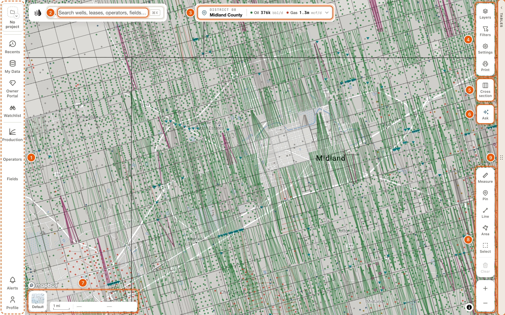
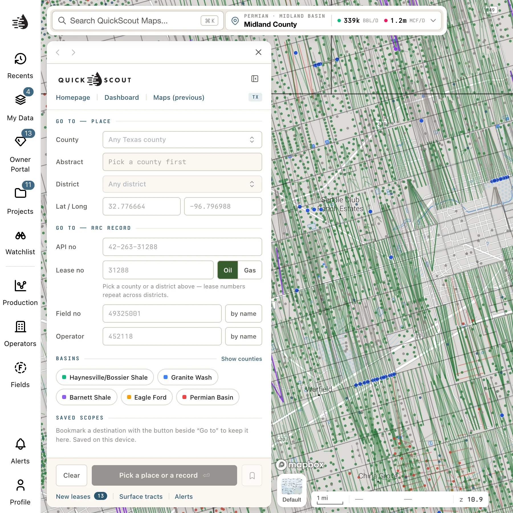
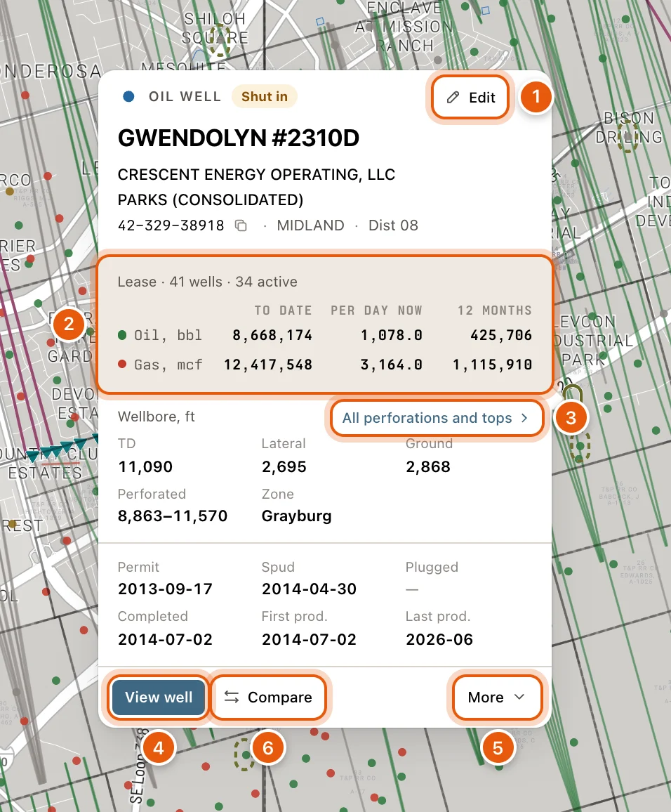

Anyone can look around the map without an account. Search results and the data tables need a free account. Record cards opened from the map, selected areas, projects, **Recents**, **My Data**, **Alerts**, the **Operators** and **Fields** panels and cross-sections need a paid plan. See [Plans & access](/get-started/plans).

## The screen at a glance

<Frame>
  
</Frame>

| # | Part | What it's for |
|---|---|---|
| 1 | [Left rail](#left-rail) | Panels for recents, your data, production, operators and fields, and alerts. |
| 2 | [Search box](#command-bar) | Find wells, leases, operators, fields and places. The logo at its left end opens the start drawer. |
| 3 | [Place control](#the-place-control) | Where you're looking, and what the wells in view produce. |
| 4 | [Right side controls](#right-side-controls) | Layers, well filters, settings and printing. |
| 5 | [Cross section](#right-side-controls) | A cross-section of the wells you click. |
| 6 | [Ask](#right-side-controls) | Questions about what's in view. |
| 7 | [Bottom of the map](#bottom-of-the-map) | The background map, and the status bar. |
| 8 | [Bottom of the map](#bottom-of-the-map) | Measuring, sketching, selecting an area, and zoom. |
| 9 | [Data tables](#data-tables) | The **Tables** handle. |

## Left rail

The rail on the left opens panels in a card on the left of the map, called a drawer. Its header has **‹** and **›** to step back and forward through what you've opened (<kbd>⌘</kbd> <kbd>[</kbd> and <kbd>⌘</kbd> <kbd>]</kbd> work from anywhere), and **✕** to close it.

| Button | Opens |
|---|---|
| The project tile at the top of the rail (**No project**), and **Watchlist** | Projects and their watchlists, part of the Enterprise workspace (called Prospect in some places). They come with a paid plan. |
| **Recents** | Items you've opened recently. |
| **My Data** | Your own uploaded and drawn layers, and *My wells*: your corrections to RRC wells, and wells you've added. See [My Data](/maps/my-data) and [My Wells](/maps/my-wells). |
| **Owner Portal** | Properties you own. See [Owner Portal](/owners/overview). |
| **Production** | What the wells in view produce: area totals, a chart, and every lease, operator and field ranked. See [Production in view](/maps/production-panel). |
| **Operators** / **Fields** | Color operators' leasehold or fields on the map, and compare their production. A number on the button counts how many are on the map. See [Operator and field layers](/maps/operator-field-layers). |
| **Alerts** | Your alerts: create them, and see what they found. See [Alerts in Maps](/maps/alerts). |
| **Profile** | Your account, and a link to this help site. See [Sign in](/get-started/sign-in#your-account-menu). |

{/* enterprise-hold: two rows for the Left rail table, in place of its project tile / Watchlist row.
| The project tile | The project you're in (Enterprise), at the top of the rail. Click it to find or switch projects. For the project you're in: **Zoom to its areas** (or **Zoom to its wells**), **Only its wells**, **Watchlist** and **Leave**. At the bottom: **All projects** and **New project**. |
| **Watchlist** | The active project's watchlist (Enterprise). |
*/}

## The start drawer

The start drawer opens by itself the first time you load Maps in a session. Click the QuickScout logo, at the left end of the search box, to bring it back; click it again to close it.

<Frame>
  
</Frame>

- **GO TO — PLACE**: a county, an abstract within it, or a latitude and longitude.
- **GO TO — RRC RECORD**: an API, a lease number with its district, a field number or an operator number. This needs a [plan](/get-started/plans).
- **BASINS**: click a basin to frame it. **Show counties** is a switch: while it's on, every county in these basins is shaded on the map.
- **SAVED SCOPES**: destinations you've saved on this device. **Save**, beside **Go to …**, saves one, and stays lit while that destination is saved. A scope's **×** removes it.
- **RECENTS**: once you've opened records, the last few of them, and **See all**.
- At the bottom: **Clear** empties what you've typed, and the **Go to …** button names where it will take you. **New leases** lists leases that recently started producing, **Surface tracts** turns that layer on or off, and **Alerts** opens your alerts.
- At the top: links to the **Homepage**, the **Dashboard** and **Maps (previous)**, the earlier version of Maps.

To find something by name, use [Search](/maps/search) instead.

## Command bar

The bar at the top left of the map holds the QuickScout logo and the search box. The logo opens the [start drawer](#the-start-drawer). Click the box, or press <kbd>⌘</kbd> <kbd>K</kbd> (<kbd>Ctrl</kbd> <kbd>K</kbd> on Windows) or <kbd>/</kbd>, to find wells, leases, operators, fields and places. See [Search](/maps/search).

While a search is on, the box keeps your words and says how many of the search's wells are on screen, like *57 of 829 on screen*. Click that count to open the results in the data tables; see [Search results](/maps/search-results). The **×** at the end of the box takes the search off the map. See [While a search is on](/maps/search#while-a-search-is-on).

When the map is narrow, for example with a card open beside it, the bar shrinks to the logo and a **Search** button. Click **Search** for the search box.

## The place control

At the top centre of the map, the place control (📍) names where you're looking: the county, or the basin when you're zoomed out. Beside the name is what the wells in view produce, like *Oil 632 bbl/d · Gas 40 mcf/d*. To see one rate in boe/d instead, choose **boe/d** in [Settings](/maps/settings#place-production). A view where nothing produces reads *No production*.

Click the control for the place card: **Zoom to county** and **View county**, two questions to ask about the view, and the leases in view, biggest producers first. See [The place card](/maps/ask-the-map#the-place-card).

When there isn't room for the whole control, it shrinks to its 📍 pin. Click the pin for the same card, which then names the place and its production itself.

## Right side controls

Click a button to open its card; click it again, click outside, press <kbd>Esc</kbd> or click the card's **✕** to close it. One card is open at a time, across the whole map: opening one closes any other, the place card included. From the top:

- **Layers**: turn map layers and heatmaps on and off, and color the wells by your own data. See [Layers & heatmaps](/maps/layers), including the [drilling timeline](/maps/drilling-timeline).
- **Filters**: show only certain well types (Oil Well, Gas Well, Permit…), wellbores (**Vertical** / **Horizontal**), or wells matching a filter on any column. While filters are on, the button lights up and shows how many. See [Well filters](/maps/layers#well-filters).
- **Settings** (the gear): light or dark colors, where record cards open, the place control's units, the status bar, well popups, well marks and labels, and the map data on this device. See [Map settings](/maps/settings).
- **Print**: make a scaled sheet and save it as PDF, PNG or GeoTIFF. See [Print a map](/maps/printing).

Below them, each on its own:

- **Cross section** (<kbd>X</kbd>): click wells on the map, in order, and see them side by side as a cross-section. The number on the button counts its wells. This needs a paid plan. See [Cross-sections](/maps/cross-section).
- **Ask**: ask about what's in view. Ask opens in a column on the right of the map, and its answers can mark wells, switch layers and open records. It needs a free account, and each question uses credits. See [The Ask column](/maps/ask-the-map#the-ask-column).

Every button keeps its label at every window size. On a short window the buttons get shorter, and on the shortest, **Cross section** and **Ask** move up into the group with **Layers** and **Print**.

## Bottom of the map

- **Map style**, the thumbnail at the bottom left: choose the background map, including Satellite and Topo. See [Basemaps](/maps/layers#basemaps).
- Beside it, the status bar: a scale bar, and the latitude and longitude under your pointer. Click the bar to choose what it shows, such as the zoom level, or the county and abstract under your pointer. See [Status bar](/maps/settings#status-bar).
- At the bottom right, the draw tools, each with its key. **Measure** (<kbd>M</kbd>) measures distance: click to add points, double-click to finish, and press <kbd>Esc</kbd> to stop.
- **Pin** (<kbd>P</kbd>), **Line** (<kbd>L</kbd>) and **Area** (<kbd>G</kbd>) sketch notes on the map. A line shows its length, and an area shows its acres. **Clear** removes them. These sketches aren't saved; to keep a shape, draw it in [My Data](/maps/my-data).
- **Select** (<kbd>S</kbd>) selects an area (a box, a shape, survey tracts or wells you pick) and opens a card that sums up everything inside it, with a *Selected area* tab in the data tables. It needs a paid plan. While a selection is on the map and its card is shut, **Select** shows the selection's well count, and clicking it brings the card back. See [Select an area](/maps/selection).
- On a short window the draw tools fold into one **Draw** button. Click it for the tools.
- **+** and **−** zoom.
- Along the bottom, the compare tray appears once you add a well, lease, operator, field or selected area to compare. **Compare *N* wells** (or leases, fields, operators or areas) opens the comparison. See [The compare tray](/maps/compare#the-compare-tray).
- At the bottom centre, a badge appears while filters shape the map; see [The badge on the map](/maps/filters#the-badge-on-the-map). After **Ask** changes the map, an **Ask** row there lets you **Undo** it; see [Undo what the agent changed](/maps/ask-the-map#undo-what-the-agent-changed). While you select an area, the bar there offers **Box**, **Shape**, **Wells** and **Survey**.

## Data tables

The handle on the map's right edge, labeled **Tables**, opens the data tables beside the map: **Wells**, **Leases**, **Operators**, **Fields**, **P-4** and more. Drag it to resize. See [Data tables](/maps/data-panel).

The tables are also where you export wells, leases and production in bulk. To export one lease, open its card and use **Export** in its **Lease record** block. See [Export data](/maps/exports).

## Clicking and hovering

- **Click a well** to see its popup. It stays open until you click elsewhere on the map, click another well, click its **✕** or press <kbd>Esc</kbd>. **View well** in the popup opens the well's card. See [The well popup](#the-well-popup).
- Clicking a colored operator or field area opens that operator's or field's card. See [Record cards](/maps/records).
- Cards open beside the tables, or at the right of the map when the tables are shut. To have them open on the left instead, see [Record cards](/maps/settings#record-cards) in Settings.
- While a well's card is open, the well is marked in amber on the map, and a chip at the map's edge points to it when it's out of sight. The card's **Highlight** switch turns this marking off. Clicking the map doesn't close the card: use its **×**, or press <kbd>Esc</kbd>.
- **Right-click** anywhere for the survey abstract and surface owner at that spot. See [Land and owners](/maps/records#land-and-owners).
- Hold <kbd>Shift</kbd> and drag a box to select an area, as **Select** does: its card and a *Selected area* tab list everything inside it. This needs a paid plan. See [Select an area](/maps/selection).

<Tip>
  Prefer a popup when you point at a well, and its card on click? In **Settings**, under **WELL POPUP**, choose **On hover**. Resting the pointer on a well then shows its popup, and clicking the well opens its card. Zoomed out over a crowd of wells, hovering shows how many wells are there and which operators they belong to, instead of a single well; zoom in to pick one.
</Tip>

### The well popup

<Frame>
  
</Frame>

- At the top: the kind of well and its status, **Edit** and **✕**. Then its lease and well number, its operator, its field, and its API, county and district. Click the lease, operator, field or county to open its card. The Copy icon beside the API copies it.
- **Edit**: correct this well's data, or add your own. Your team sees your changes. This needs a paid plan; see [My Wells](/maps/my-wells).
- The lease's production, oil in bbl and gas in mcf: **To date**, **Per day now** and the last **12 months**. The RRC reports oil by lease, so every well on a lease shows the same figures. You need to be signed in to see them.
- The wellbore: total depth, lateral length and elevation, and where the well is perforated and in what. **All perforations and tops** opens both lists in the popup, with **Edit tops** for your formation tops; see [Formation tops](/maps/formation-tops).
- The well's dates: permitted, spudded, plugged, completed, and its first and last production. A date that isn't on file shows a dash.
- At the bottom: **View well** opens the well's card and closes the popup. **Compare** puts the well in the compare tray, and stays lit while it's there. **More** holds the rest:
  - **Logs** opens the well's log beside the map, or the well's card at its logs when there's nothing to open there; see [Well logs on the map](/maps/well-logs). It reads *None* when the well has no logs on file.
  - **Documents** opens the well's card at its documents: every regulatory file on record for the well.
  - **Land & owners** opens the land record at the well, as a right-click there does: the survey abstract and the surface owner.
  - **RRC GIS** opens the well in the RRC's own map viewer, in a new tab.

To make the popup bigger or smaller, choose its size under **WELL POPUP** in [Settings](/maps/settings#well-popup): **Standard**, the default, **Large** or **Extra large**. Every size shows the same facts in the same places.
