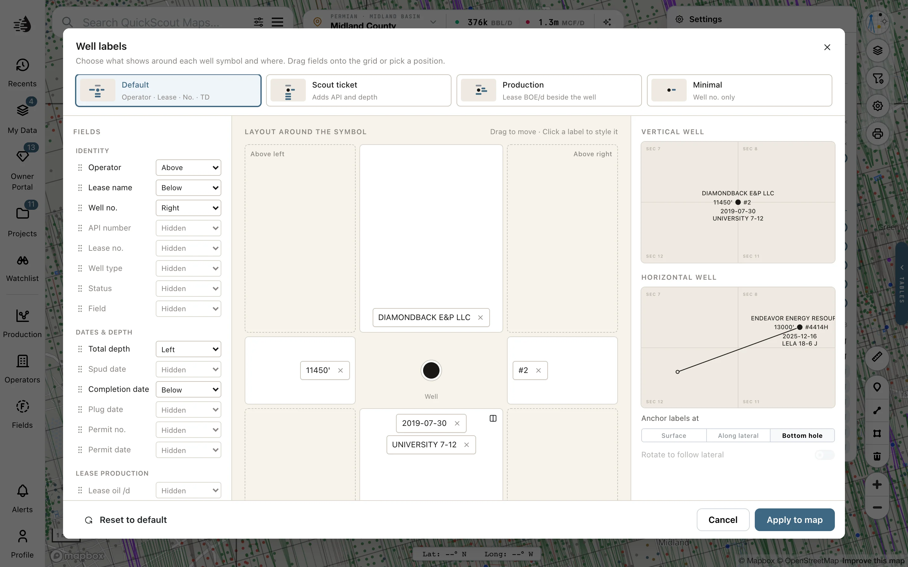

Click **Settings** on the map's right rail. Under **Well labels**, the switches show or hide operator names, lease names, completion dates, total depth and well numbers. For a custom layout, click **Edit labels…**.

<Steps>
  <Step title="Start with a preset">
    Choose **Default**, **Scout ticket**, **Production** or **Minimal**, or work from your current layout.
  </Step>
  <Step title="Place the fields">
    Drag a field onto a position around the well symbol, or choose its position from the field's menu. Multiple fields can share a position. Reorder them there, or use the position's inline option to put them on one line.

    Use a label's **×** to remove it. You can also choose **Hidden** in its position menu.
  </Step>
  <Step title="Style and apply">
    Select a placed label to change its **Size**, **Weight** or **Case**. **Text size** changes the overall size; **Halo behind text** improves contrast with the basemap.

    Check the vertical and horizontal previews, then click **Apply to map**. Closing the editor without applying leaves the map's labels as they were.
  </Step>
</Steps>

<Frame>
  
</Frame>

## What can a label show?

Fields include operator, lease, well number, API, field, well type and status; total depth and drilling dates; permit information; and lease oil, gas or BOE per day.

<Note>
  **Lease production is not per-well production.** It is the lease's latest-month daily rate. The RRC reports oil by lease, so every well on that lease shows the same figure.
</Note>

Horizontal-well options choose where labels anchor and whether they rotate with the lateral. If labels are hard to read, zoom in, use fewer fields, or reduce their size. Changing **WELL MARKS** in Settings adjusts symbols separately.

Your layout is remembered for your account and project, and survives basemap changes. Printed maps have [their own label controls](/maps/printing).
