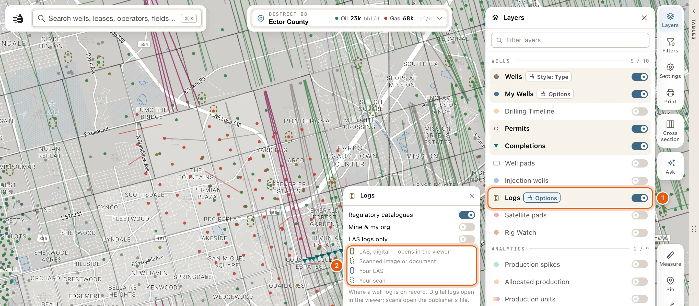
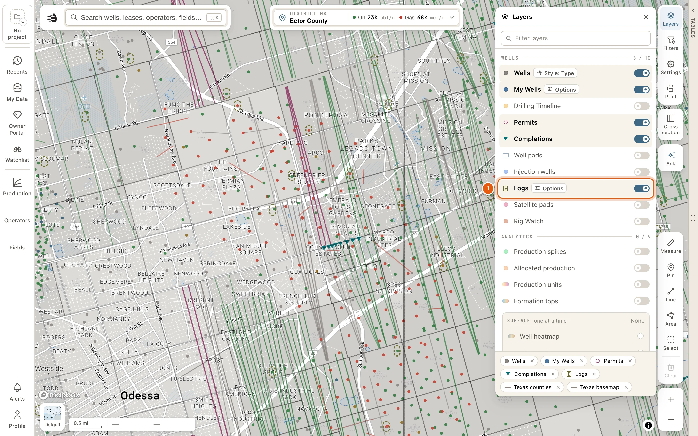
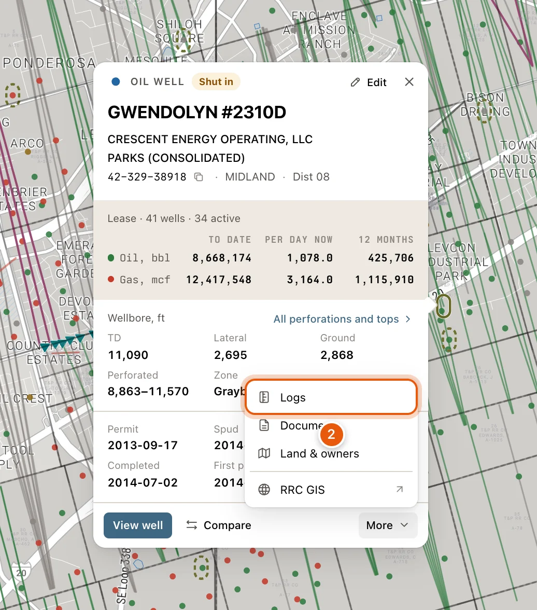
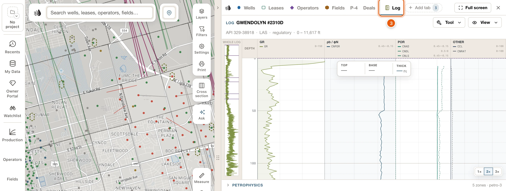
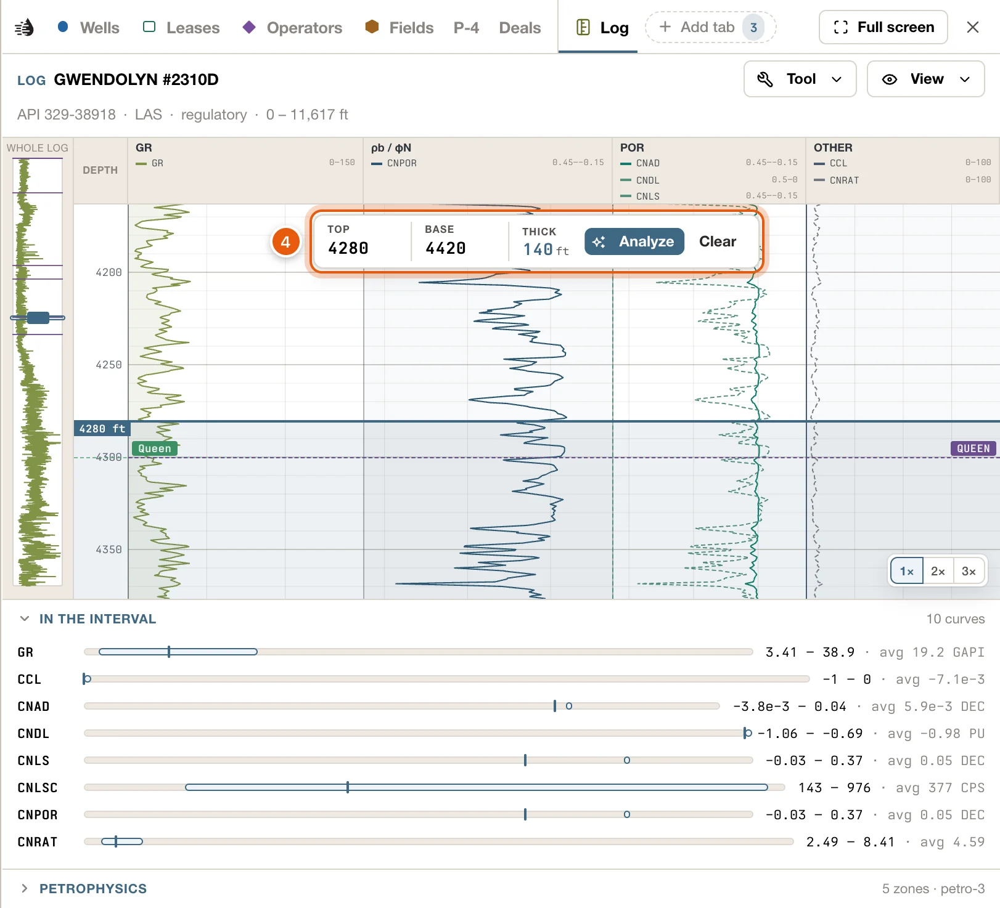
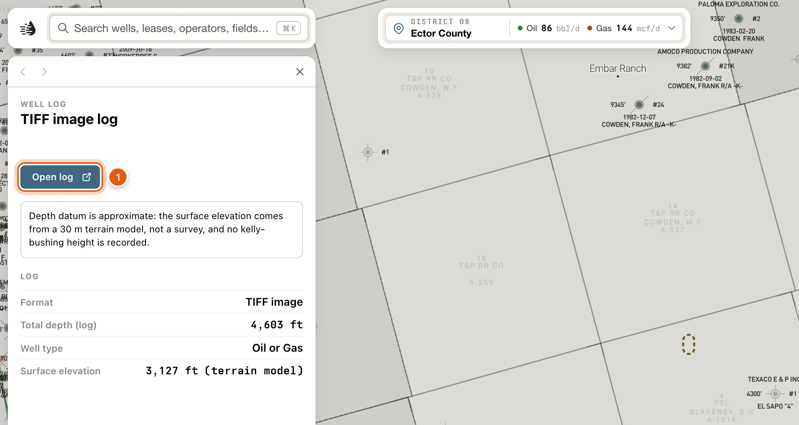
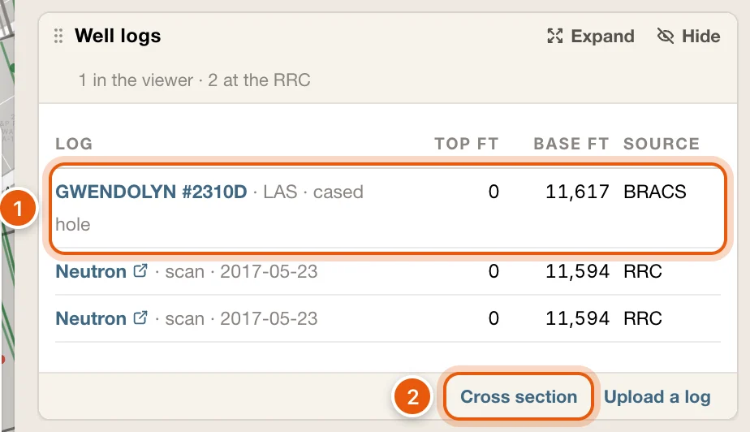
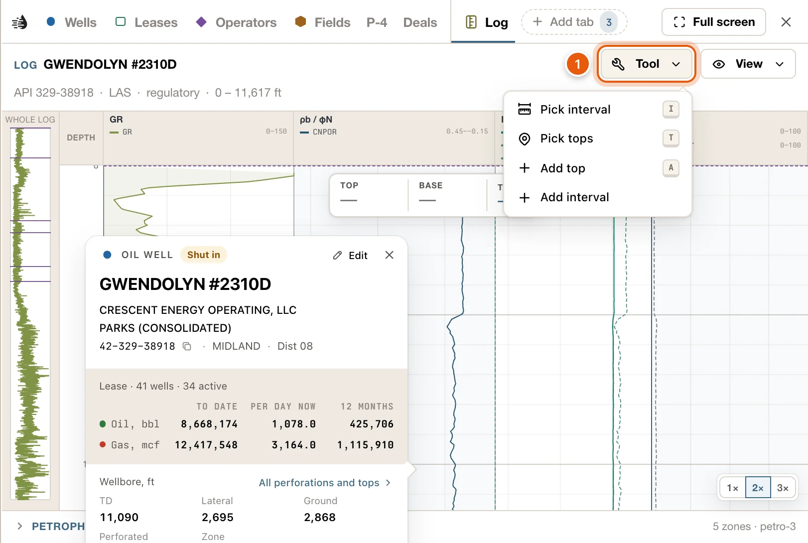
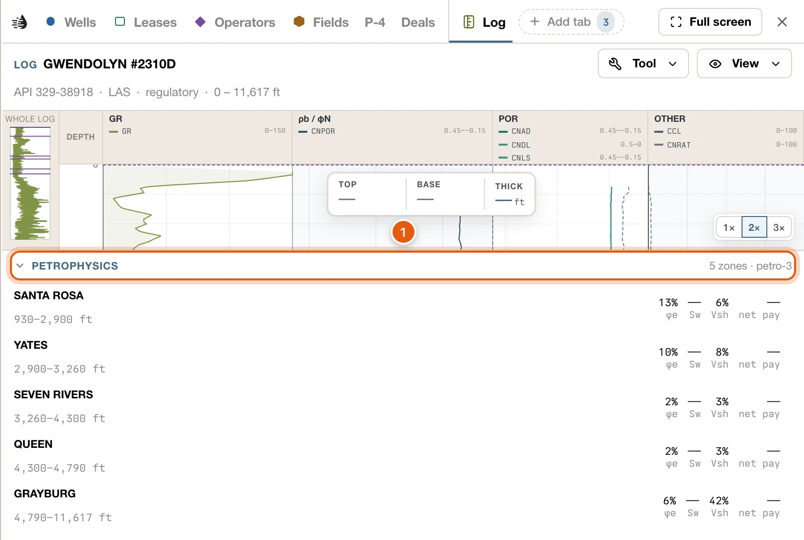

The **Logs** layer marks every well that has an electric log on record: logs from the public regulatory catalogues, and logs you or your organization uploaded. Open one and it reads in a **Log** tab beside the map, where you can choose an interval and pick formation tops.

<Note>
  - Anyone can turn on the **Logs** layer and point at its marks.
  - Logs you or your organization uploaded open for anyone signed in. See [Sign in](/get-started/sign-in).
  - The log drawer, the regulatory catalogues' digital logs, uploading a log and asking questions about one need a [paid plan](/get-started/plans).
</Note>

## Turn on the Logs layer

Click **Layers** on the right side of the map, then turn on **Logs** in the **WELLS** group.

Each well with a log gets a capsule around its dot. The well's own dot and symbol still show inside it.

| Mark | The key says | What it is |
|---|---|---|
| Solid olive capsule | *LAS, digital — opens in the viewer* | A digital (LAS) log from a regulatory catalogue. |
| Dashed olive capsule | *Scanned image or document* | A scan of a log, such as a TIFF or PDF, from a regulatory catalogue. |
| Solid blue capsule | *Your LAS* | A digital log you or your organization uploaded. |
| Dashed blue capsule | *Your scan* | A scanned log you or your organization uploaded. |

Once the layer is on, **Options** beside its name opens three switches:

- **Regulatory catalogues**: the public catalogues' logs.
- **Mine & my org**: logs you or your organization uploaded.
- **LAS logs only**: hides the scans, leaving the digital logs.

<Frame>
  
</Frame>

## Open a well's log

<Steps>
  <Step title="Turn on Logs">
    Click **Layers**, then **Logs** in the **WELLS** group. Capsules appear around the wells that have a log.

    <Frame>
      
    </Frame>
  </Step>
  <Step title="Open the well's popup and choose Logs">
    Zoom in and click the well to open its popup. If you've set popups to open on hover, point at it instead. See [Map settings](/maps/settings#well-popup).

    At the bottom of the popup, click **More**, then **Logs**.

    <Frame>
      
    </Frame>
  </Step>
  <Step title="Read the log in the Log tab">
    The data tables open beside the map on a tab named **Log**, showing the well's best log. The band at the top names the well. Below it is the log itself: its curves for a LAS, or its scanned sections for a scan.

    <Frame>
      
    </Frame>
  </Step>
  <Step title="Drag down the strip to choose an interval">
    Press on the strip at the top of the interval you want and drag down to its base. The box over the strip gives its **TOP**, **BASE** and **THICK**, and **IN THE INTERVAL**, under the strip, gives each curve's range and average there.

    <Frame>
      
    </Frame>
  </Step>
</Steps>

## Pointing and clicking on the marks

What a capsule does depends on how close you're zoomed in.

- Zoomed in to zoom 10 or closer, the well under a capsule comes first: it opens its own popup, as any well does. Use **More** → **Logs** in the popup to open its log.
- Zoomed out further, or where a log has no well dot under it, the capsule takes over. Pointing at it shows a card with how many logs are on file and their format, the well's name from zoom 10, and **Uploaded by** on your own: *You* or *Your organization*. Click it to open the log.

When you click a capsule:

- If QuickScout has a copy of the well's log it can read, the log opens in the **Log** tab.
- If QuickScout only has a link to the log, such as a scan kept by its publisher, or several wells sit under the pointer, the log drawer opens on the left instead. See [The log drawer](#the-log-drawer).

**Logs**, under **More** in a well's popup, opens the well's best log in the **Log** tab the same way. When there's nothing to open there, it opens the well's card at its **Well logs** block instead.

Every well with an API has **Logs** in its popup. It's greyed out, with *None* beside it, when QuickScout knows the well has no log on file.

## The log drawer

The log drawer describes one log on record, and links to the file where the log is kept. It needs a [paid plan](/get-started/plans).

At the top, **WELL LOG** (or **YOUR LOG**) and the lease and well number. Under that is the way to open the log:

- **Open in viewer** opens the log in the **Log** tab.
- **Open the scan** opens the publisher's scan of the same log in a new browser tab.
- **Open log** opens the original file in a new browser tab, where you can save it.
- *This log is on record, but there is no copy to open.* means there's nothing to open.

The rest of the drawer:

- *One more log on this well — the well card lists every one.* when the well has others.
- **LOGS AT THIS LOCATION**, when several wells sit at one spot. Click one to describe it.
- **LOG**: **Format**, **Logged interval**, **Total depth (log)**, **Well type**, **Surface elevation**, **KB height**, and **Location** for a well outside Texas.
- A note when the depths are on an approximate datum: the elevation came from a terrain model rather than a survey, or no kelly-bushing height is recorded.
- **WELL**: the well's API, operator, lease, field, county, total depth and dates. **View well** opens its card.

Opened below zoom 10, the drawer can't give the log's depths and datum, and says so.

<Frame>
  
</Frame>

## On the well card

A well's [card](/maps/records) lists every log on the well in one table, in its **Well logs** block. Its header counts them, such as *2 in the viewer · 3 at the RRC*.

- First come the logs that open in the **Log** tab: yours, your organization's, and the regulatory catalogues' that your plan can open. Digital (LAS) logs come first. Click a row to open that log.
- Then the Railroad Commission's own index of logs filed on the well, newest first: its scans, and its L-1 statements that a log was run. A row with a link icon after its name opens the Commission's scans of the well on its site, in a new tab. The others have nothing to open.
- The columns: **LOG** (the log's name, then what it is, such as *LAS · cased hole* or *scan · 2021-10-05*), **TOP FT**, **BASE FT** and **SOURCE** (*Yours*, the catalogue, or *RRC*).

At the foot of the block:

- **Cross section** puts the well at the end of your map [cross-section](/maps/cross-section). It stays pressed while the well is in the section, and clicking it again takes the well out. To see the section, click **Cross section** on the right side of the map.
- **Upload a log** adds a LAS file or a scanned log to this well. When it's ready, it opens in the **Log** tab.

The block says when something's missing:

- *Sign in to see this well's logs.*
- *None of your own on file. The regulatory catalogues need a paid plan.*
- *No logs on file for this well.*
- *The regulatory catalogues need a paid plan; these are your own and the Commission's.*, under the table.

<Frame>
  
</Frame>

## The Log tab

The **Log** tab sits on the tab row with your tables, and doesn't change your other tabs or their filters. Click any other tab to go back to it; the log stays on the row, one click away.

The tab isn't saved with your tables. Opening another log replaces the one that's there, and the tab is gone the next time you load Maps.

### The band

- The first line: **LOG** and the well's name. The **Tool** and **View** menus sit at its right end.
- The second line: the API, *LAS* or *Scan*, *regulatory* or *yours*, the logged depths, and the file's name.
- When the well has more than one log, a list at the right switches between them. Each choice reads like *LAS · 8,120 – 9,340 ft · regulatory*.

### Read the strip

A LAS log draws its curves in tracks: gamma ray and SP, resistivity, density and neutron, and the rest. The narrow strip at the left draws one curve down the whole log, so you can see where you are.

- The chips at the bottom right (**1×**, **2×**, **3×**) stretch the strip.
- A scan shows its sections, placed at their depths. **Prev** and **Next** step through them.
- A log traced from a scan rather than a LAS file carries a warning, *Digitized data — verify before relying on it*, under the strip.

### Choose an interval

- Drag down the strip, or type depths into **TOP** and **BASE** in the box over the strip. **THICK** is the interval's thickness.
- Drag the edges of the shaded interval to adjust it. **Clear** lets it go.
- **IN THE INTERVAL**, under the strip, lists each curve: where its low and high sit on the curve's scale, and the figures, such as *45.2 – 118 · avg 87.4*. Click the heading to fold it away.

### Pick tops and intervals

Open **Tool** for:

| Tool | Key | Does |
|---|---|---|
| **Pick tops** | <kbd>T</kbd> | Click the strip to put a formation top at that depth. **Add formation top** opens with the depth filled in: choose the **Formation**, then **Add top**. |
| **Pick interval** | <kbd>I</kbd> | Drag down the strip to save a named interval: **Add interval** asks for a **Name**, **Color** and **Notes**. |
| **Add top** | <kbd>A</kbd> | Type a top's depth instead of clicking. |
| **Add interval** | | Type an interval's top and base instead of dragging. |

While a tool is on, the **Tool** button names it. Choose it again, or press its key, to turn it off.

The tops you pick here are the well's tops, not just this log's. They show on the well's card, on the [Formation tops](/maps/formation-tops) layer and in the [cross-section](/maps/cross-section), and your organization sees them. Drag one of your own tops to move it, or click it to change or delete it.

<Frame>
  
</Frame>

### The View menu

- **Curves** and **Scan** switch between a log's curves and its scan, when it has both.
- **Whole-log curve** picks the curve the narrow strip at the left draws. *Auto (gamma / first)* is the default.
- **Scale gridlines** turns the tracks' gridlines on and off.
- **RRC MARKERS · MD FT**: **Perforations**, **Casing shoes** and **Formations** from the RRC's filings, drawn on the strip at their depths.
- Each track has its own switch, and a box for each of its curves.
- **Reset to auto** puts the tracks and curves back.

### Well records on the strip

The well's records that have a depth are marked at their depths along the strip's right edge: drill-stem tests, cores, tests, shows, notes, perforations, casing strings and the rest. Point at one for its details. See [Well records](/maps/depth-records).

### Asking about a log

With a [paid plan](/get-started/plans), the space beside the strip is a chat about the log. Ask about it in plain English. The chat knows the interval you've chosen: **Analyze**, in the interval box, asks it about the interval's lithology, porosity, fluids, shows and net pay. Depths in its answers are links that move the strip there. Asking uses credits, as [Ask on the map](/maps/ask-the-map#credits) does.

Without a paid plan, the space says *Asking about a log needs a paid plan. The curves and the sections read as they are.*

{/* catalogue: the section below covers the regulatory catalogues' digital logs, which may still be preview-only in production. Confirm they open there before publishing; if not, gate this section. */}

## Regulatory logs in the viewer

With a [paid plan](/get-started/plans), the regulatory catalogues' digital (LAS) logs open in the **Log** tab, the same as your own. Without one, the tab says *The regulatory log catalogues need a paid plan.*

Under the strip of a well with one of these logs, **PETROPHYSICS** works out each zone the log covers. It starts folded; click its heading to open it.

- Each zone gives its depths and four figures: **φe** (effective porosity), **Sw** (water saturation), **Vsh** (shale volume) and **net pay**.
- *Rw low* beside a zone means the formation-water resistivity behind its water saturation is a low-confidence estimate.
- Click a zone to move the interval to it.
- A last line names any bypassed pay, pay the well's perforations may have missed, such as *Bypassed pay: 7,412–7,440 ft · 28 ft · φe 12% · Sw 38%.*

<Frame>
  
</Frame>

## Troubleshooting

<AccordionGroup>
  <Accordion title="A capsule opens the well's popup, not the log">
    From zoom 10, the well under a capsule comes first. In its popup, click **More**, then **Logs**. If **Logs** is greyed out, QuickScout has no log on file for the well.
  </Accordion>
  <Accordion title="Clicking a capsule opens the drawer instead of the Log tab">
    QuickScout has no readable copy of that log, only a link to it, or several wells were under the pointer. Use **Open log** to see the original file, or pick the well under **LOGS AT THIS LOCATION**.
  </Accordion>
  <Accordion title="This log isn’t released yet">
    The log is in a regulatory catalogue but isn't open to read in QuickScout yet. *This log is no longer available.* means a log that was uploaded has since been removed.
  </Accordion>
  <Accordion title="No curves or depth-registered sections to display">
    The log has no digital curves, and its scan hasn't been placed at depth. Use **Open log** in the log drawer to see the original.
  </Accordion>
  <Accordion title="The Log tab is still there after I've finished">
    The tab stays on the tab row while you work in your other tabs. Click any other tab to put it aside. It isn't saved, so it's gone the next time you load Maps.
  </Accordion>
</AccordionGroup>
