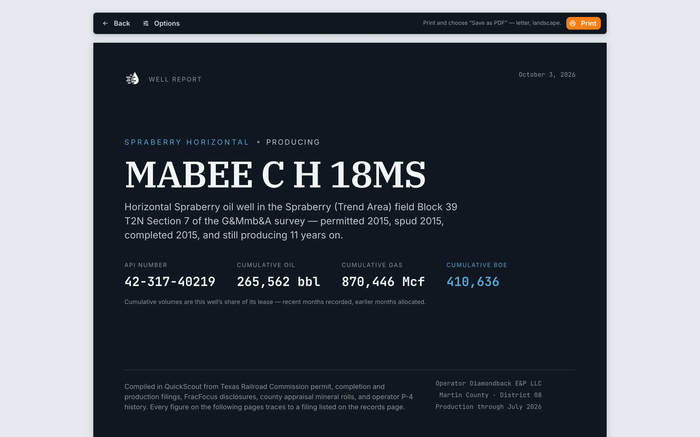
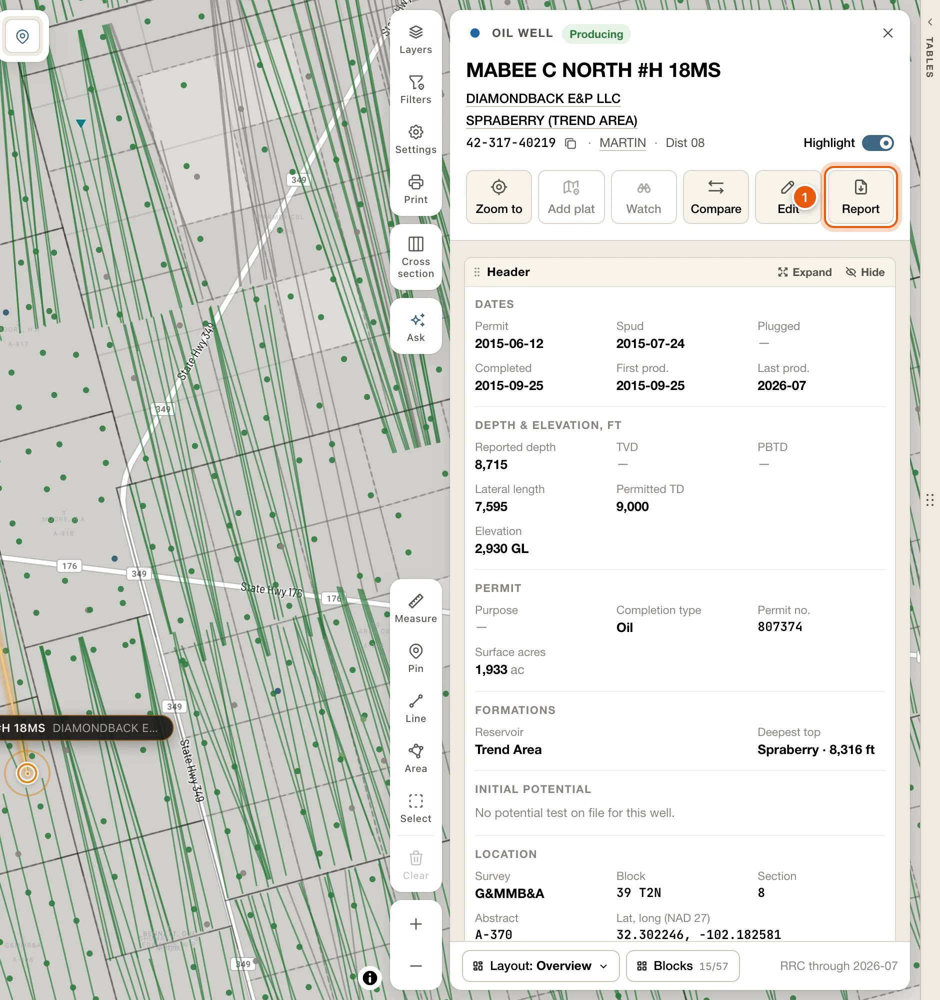
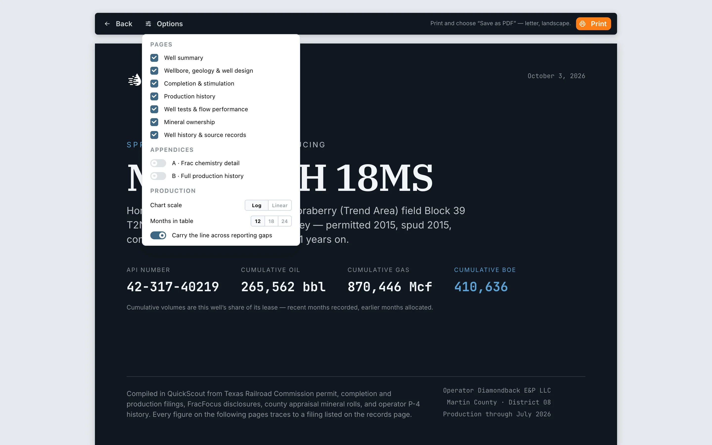

The well report gathers everything QuickScout has on a well into a document you can print or save as a PDF. You need to be signed in.

<Frame>
  
</Frame>

## Open a well report

Open the well's [card](/maps/records), from the map or the [data tables](/maps/data-panel), and click **Report** in the row of buttons under its name. Every well has it: a producing well, a permit, a well still being drilled and an injection well. It's greyed out only on a historic well with no RRC record behind it.

The report opens in a new tab. Opening a card from the map needs a [plan](/get-started/plans); from the data tables, any signed-in account can.

<Frame>
  
</Frame>

## Choose what's in it

The cover page is always included. Click **Options** to pick the rest:

- Well summary
- Wellbore, geology & well design
- Completion & stimulation
- Production history
- Well tests & flow performance
- Mineral ownership
- Well history & source records

Under **Appendices**, two more are off until you turn them on: **A · Frac chemistry detail** and **B · Full production history**.

<Frame>
  
</Frame>

You can also set the **Chart scale** (log or linear), the **Months in table** (12, 18 or 24), and whether to **Carry the line across reporting gaps**.

An option is greyed out when the well has nothing for it. For example, **Mineral ownership** reads *Not on the appraisal roll* when the lease has no owners on record.

<Tip>
  Your choices are saved in the page's link. Bookmark it or send it to someone, and they'll get the same report.
</Tip>

## Save as PDF

Click **Print** and choose **Save as PDF** in your browser's print dialog. The report is laid out for letter paper, landscape.
