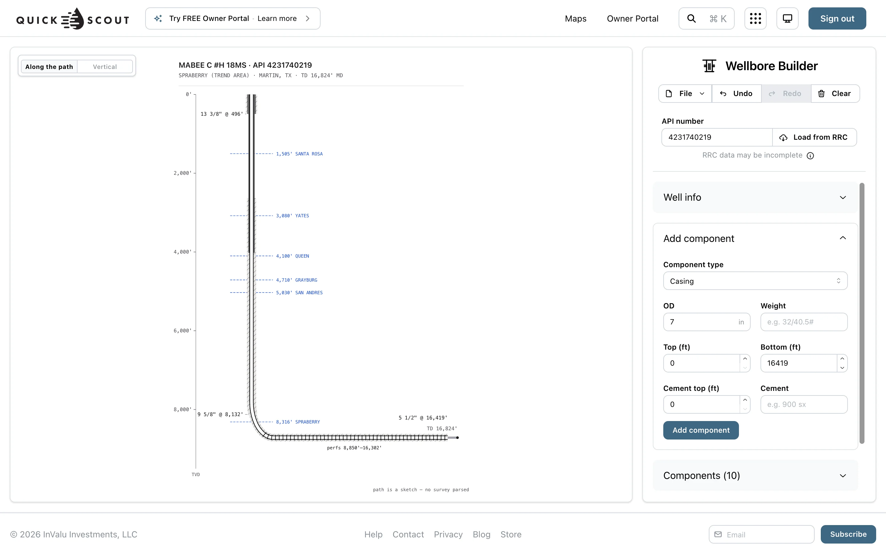
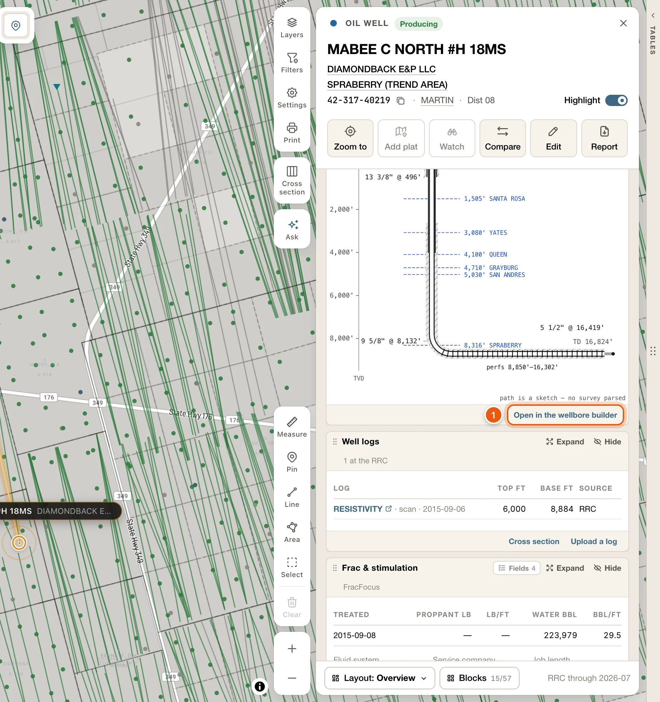

[Sign in](/get-started/sign-in), then open [Wellbore Builder](https://quickscout.io/wellbore) to start a diagram or load a well by API.

<Frame>
  
</Frame>

## Start from the RRC record

From Maps, open the well's [card](/maps/records). At the foot of its **Wellbore** block, click **Open in the wellbore builder**. The builder opens in a new tab with the well's RRC details already loaded.

If the card doesn't show the **Wellbore** block, as on a permit, tick it under **Blocks**, at the foot of the card.

<Frame>
  
</Frame>

To load a different well, enter its **API number** and click **Load from RRC**. This fills in the casing, tubing, perforations, formations and header details on record.

<Warning>
  **Load from RRC** replaces everything in the builder. Save your diagram first.
</Warning>

RRC data may be incomplete, so check it against your own files.

## Edit the diagram

- **Add component** adds a part: casing, tubing, perforations, a cement plug, a plug (CIBP or bridge), a formation, or a depth break.
- To change a part, click its label in the drawing, or its pencil under **Components**. This opens **Edit component**. Finish with **Save changes**.
- **Well info** holds the well's header details. **Well history** holds dated notes.
- **Undo**, **Redo** and **Clear** are in the toolbar. <kbd>⌘</kbd> <kbd>Z</kbd> and <kbd>⌘</kbd> <kbd>⇧</kbd> <kbd>Z</kbd> work too.

## Change the view

- For a horizontal well, switch between **Along the path** (or **Along the survey**, when a survey is on file) and **Vertical**.
- Use the zoom buttons to zoom in and out, move shallower or deeper, or fit the whole well. When zoomed in, drag to pan.

## Save and export

From the **File** menu:

- **Save as…** names and saves a new diagram. After that, the item reads **Save**.
- **Open…** lists your saved diagrams. You can delete them there too.
- Under **Export**, choose **PNG image** or **PDF**.

A saved diagram has its own link, so you can bookmark it and come straight back.
