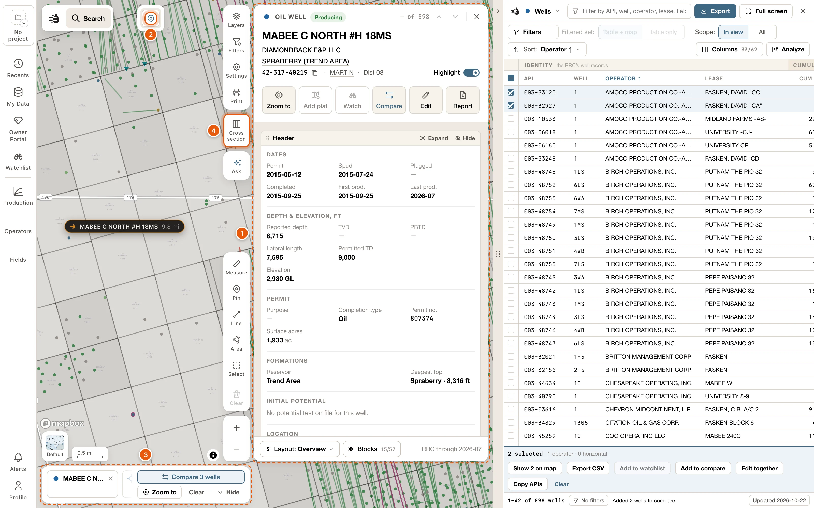

This update changes how records open and how search works. It also brings area selections, county cards, exports of a whole area, well logs, cross-sections and side-by-side comparisons to the map. Each change below links to its guide.

Coming back after a while? [Where things moved](#where-things-moved) lists the buttons that have a new home.

<Frame>
  
</Frame>

<Note>
  Several of these need a paid plan. [Plans & access](/get-started/plans) lists what's free.
</Note>

## Records open as cards

- A well, lease, operator, field or county now opens as its card, wherever you click it: the map, a popup's **View well**, search, the tables or **Recents**. The card sits beside the tables, or on its own at the right of the map. See [Record cards](/maps/records).
- Would you rather have records on the left, where the drawer was? Choose **Settings** → **RECORD CARDS** → **Left**.
- One card shows at a time. A card you open from another card has a link back to it above its name, and <kbd>Esc</kbd> goes back too.
- Every card is made of blocks. Add and remove them with **Blocks**, drag them into place, and switch arrangements with **Layout**. A well's card starts with its **Header**: the well as the RRC files it. See [card layouts](/maps/row-cards).
- Every button shows its word, and cards have no **More** menu. A block has **Expand** and **Hide** at its top, and its own buttons, such as **Export CSV** and **Save PNG**, at its foot.
- **Write synopsis**, in the **Synopsis** block at the foot of a well, lease, operator or field card, writes a few plain sentences about the record from the RRC filings. It uses credits the first time.
- On a lease card, **Expand** the **Production** block and choose **By well** to see each well's estimated share of the lease's production.
- On a field's or an operator's card, **Show on map** opens its map settings: draw it on the map while its card is open, and choose what's drawn.

## Select an area

- Click **Select** in the draw tools at the bottom right, or press <kbd>S</kbd>. Then drag a box, draw a shape, click wells, or click tracts of the original Texas land survey. Holding <kbd>Shift</kbd> and dragging on the map draws a box at any time.
- Everything inside opens on a **Selected area** card: what the area makes now and has made over its history, its leases and operators, its activity, and its wells from the first drilled to the newest. **Narrow** cuts it down to the wells you want.
- **Table** lists the area's wells, leases, operators, fields, frac jobs and P-4 transfers on a **Selected area** tab in the data tables. **Export** writes them as files, in one zip; see [Export an area or a county](#export-an-area-or-a-county-in-one-zip).
- **Cross section** puts the area's wells in a section, **Save area** keeps the area under a name, and **Compare** sets it beside other areas. See [Select an area](/maps/selection).

## Counties have cards

- **View county**, on the place card at the top centre of the map, opens the county's card. So does the county named on a well's or a lease's card.
- The card has the county's production, activity, new wells, operators, fields, P-4 transfers, wells by status, time to drill, frac, and injection and disposal. Its **Fields** block ranks the county's fields by **Daily**, **Cumulative** or **Newest found**, over a pie of each one's share.
- **Show wells** and **Show leases** list the county's wells or leases in a tab of their own. See [Counties](/maps/records#counties).

## Export an area or a county, in one zip

- **Export**, on a **Selected area** card or a county's card, writes its wells, monthly production, land grid, leases, outline, operators, fields, frac jobs and P-4 transfers as files for your own software. Pick the formats on each row (**Shapefile**, **CSV**, **ASCII4**, **OWX**, **KML** or **DRI**), then **Download**: one zip, with a README that says what each file holds. See [Export an area or a county](/maps/exports#export-an-area-or-a-county).
- The **Land grid** row downloads the Original Texas Land Survey's tracts, as a shapefile or KML.
- Shapefiles are NAD27, as the RRC files well spots and the survey. KML is WGS84.
- The data tables' exports have no limits any more. A big ASCII4, OWX, DRI or production file is written in batches, and the footer counts them off, with **Cancel**. See [Export from the data tables](/maps/exports#export-from-the-data-tables).

## A new search

- Results now come in four groups as you type: **Leases**, **Wells**, **Fields** and **Operators**. Every result opens its card. See [Search](/maps/search).
- The row **Search “‹text›” on screen** searches only the part of the map you can see.
- A search you run stays in the search bar as one line: what you searched for, how many of its wells are on screen, and **×** to clear it. Click the count to open the results beside the map.
- The results have tabs (**All**, **Leases**, **Wells**, **Fields** and **Operators**), plus **Filters**, **Sort** and **Only these on map**. Click an operator, field or lease in the results to narrow them to it. See [Search results](/maps/search-results).
- **Filters** → **Area** → **An area you draw on the map** keeps the results inside a shape you draw.
- Type an API number to open the well's card. An operator, field or lease number opens a tab of its wells, and the map shows only those wells.

## Compare

- Put wells, leases, fields, operators or selected areas side by side. **Compare** on a card adds the record to the compare tray at the foot of the map. So do **Add to compare** on ticked table rows, <kbd>⌥</kbd> <kbd>Enter</kbd> in search, and **Compare** in a well popup.
- The tray holds up to 12 of each kind. **Compare ‹N› wells** (or leases, fields, operators or areas) opens their production overlaid or side by side, and their facts in a grid. **Differences only** hides the facts they share. See [Compare](/maps/compare).

## Well logs, cross-sections, formation tops and well records

- Turn on **Logs** in **Layers** to mark every well with a log on record. In a well popup, **More** → **Logs** opens the well's log in a **Log** tab beside the map. See [Well logs on the map](/maps/well-logs).
- Click **Cross section** on the right of the map (or press <kbd>X</kbd>), then click wells in order. The section shows their tops, perforations, tests and cores side by side. You can flatten it on a formation, show the rock, and pick your own tops with **Pick tops**. See [Cross-sections](/maps/cross-section).
- The **Formation tops** layer maps a formation's **Structure**, its thickness (**Isopach**) or its **Depth** from the tops in view. On a well's card, **Edit tops** (or **Add a top**) adds your own picks. **My Data** lists your picks and formations. See [Formation tops](/maps/formation-tops).
- The **Records** block on a well's card keeps tests, cores, completions, casing, shows and notes at their depths, shared with your team. Add them with **Edit** on the block, or by dragging along a well in a cross-section. See [Well records](/maps/depth-records).

## Ask draws on the map, and makes pages you can share

- **Ask** now opens a column beside the map. As it answers, it can move the map, mark and highlight wells, turn on layers and open records. See [The place card and Ask](/maps/ask-the-map).
- You can take back anything Ask changed: the **Ask** row at the bottom of the map has **Undo**, and **New thread**, at the top of the column, starts over and clears its changes. Your earlier threads are under **History**. Asking uses credits.
- Ask can publish an answer as a page of its own. **Share** it with people or by link, refresh its data, and go back to an earlier version. See [Pages from Ask](/maps/pages).

## My Wells

- **Edit** on a well's card lets you correct its operator, status, location, depths, dates and more. Your team sees your values, and you see theirs. If you're not part of an organization, your values are yours alone. See [Your values and your team's](/maps/my-wells#your-values-and-your-teams).
- In **My Data**, open the *My wells* row to add a well the RRC doesn't have (**Add well**), or to import wells and records: IHS / S&P Global scout tickets as a PDF, or a table (CSV, Excel, GeoJSON, KML or a zipped shapefile). Your wells show on the map, in the tables and in search. See [My Wells](/maps/my-wells).

## Color wells by your data, and production units

- The **Wells** row in **Layers** has a style button, *Style: Type* at first. It colors every well on the map by a figure from its record, such as **TD** or **Spud year**, by an attribute of yours, or by the records kept on it. A legend says what the colors mean. See [Style wells by your data](/maps/layers#style-wells-by-your-data).
- **Production units**, a new layer under **ANALYTICS** in **Layers**, draws each producing well as the land it produces from, colored by how big a well it is, how it ranks in its field, or its boe per acre. See [Production units](/maps/layers#production-units).

## Operator and field layers, and the Production panel

- **Operators** and **Fields** on the left rail now open panels. Put any operator or field on the map in a color of its own, add the top producers in view with one click, and compare their rates on one chart. See [Operator and field layers](/maps/operator-field-layers).
- **Production** on the left rail shows what the area in view produces: its total, a chart, and its leases, operators and fields ranked by boe/d. **Export CSV** downloads the list you're on. See [Production in view](/maps/production-panel).

## The place card, map data, the status bar and the well popup

- The place you're looking at now sits on its own at the top centre of the map. Its card lists the leases in view by boe/d (or the wells in view where nothing produces), with **Zoom to county** and **View county**. See [The place card and Ask](/maps/ask-the-map).
- **Settings** → **SUPPORT** → **Map data…** tells you in one sentence what's stored on this device, with **Download all** and **Clear all map data**. It replaces the old switch for keeping a copy. Until the wells, leases and fields are on this device, the QuickScout server answers for them, so the tables, search and cards work from the start. P-4 and Frac aren't downloaded at all: the server always answers them. See [Map data on this device](/maps/offline).
- To keep no map data on a computer at all, switch off **Keep map data on this device** under **Where answers come from** in **Map data**. The server then answers the tables, search and cards. See [Answer from the server instead](/maps/offline#answer-from-the-server-instead).
- The status bar at the bottom left shows the scale and your pointer's coordinates. Click it to add the zoom, a scale ratio, or the county, abstract and survey under your pointer. See [Map settings](/maps/settings).
- The well popup is new: the lease's production, the well's depths and dates, then **View well** and **Compare**. **More** holds **Logs**, **Documents**, **Land & owners** and **RRC GIS**. Under **Settings** → **WELL POPUP**, **Standard** is the default size; **Large** and **Extra large** draw the same popup bigger. See [The well popup](/maps/tour#the-well-popup).

## Drilling timeline, W-1 plats and printing in Safari

- The drilling timeline now lets you choose which wells it plays: **All**, **Vertical** or **Horizontal** wellbores, the years they were drilled (**From** and **To**), and up to 10 operators (**Add operator**), each in a color of its own. **Zoom to** frames the operators' wells. Horizontal wells are drawn along their laterals. See [Drilling timeline](/maps/drilling-timeline).
- **Add plat** on a well's card lays the well's W-1 plat over the map, where the surveyor drew it. **Layers** → **W-1 plats** lists the plats you've added. See [W-1 plats on the map](/maps/plats).
- Printing a map now works in Safari: **Export PDF** opens the print dialog, and **Save PNG** saves the whole sheet. See [Print a map](/maps/printing).

## Your plan, and Billing in the Profile menu

- **Profile** shows your plan under your email, such as *Free account* or *Independent · $250/month*. See [Your account menu](/get-started/sign-in#your-account-menu).
- **See plans** (on a free account) and **Billing** (on a plan of your own) replace Manage Subscription. See [Manage billing](/get-started/billing).
- Subscribe from Maps and, once you've paid, the map opens again at the same view, with the record you were opening. See [Subscribe](/get-started/plans#subscribe).
- Projects, watchlists and deals, parts of the Enterprise workspace (called Prospect in some places), now come with every paid plan: the project tile and **Watchlist** on the left rail, **Watch** on a card, **Add to watchlist**, **Add to project scope**, **New project from these** and **Add to deal draft** on ticked rows, and the **Deals** tab. See [Paid plans](/get-started/plans#paid-plans).

## Where things moved

| Before | Now |
|---|---|
| Records opened in a drawer on the left | They open as cards. **Settings** → **RECORD CARDS** → **Left** puts them on the left. |
| Open full lease record, and Open in the drawer | Gone. The card is the whole record. |
| Builder on a well | **Open in the wellbore builder**, at the foot of the well card's **Wellbore** block |
| Claim Your Interest under a lease's name | In the [Owner Portal](/owners/overview#find-your-properties): **Add a property**, then **Add Claim** on your lease. A lease's card in Maps doesn't offer one. |
| Production and Wells under a lease's name | The lease card's **Lease record** block → **Export** |
| The gear on a production chart | **Export CSV** and **Save PNG**, at the foot of a lease, operator, field or county card's **Production** block |
| A card's or a block's ⋯ menu | Gone. Each button is on the card with its word: a block has **Expand** and **Hide** at its top, and its own buttons at its foot. |
| An operator's Wells tab | **Show wells** on the operator's card |
| The county drawer, from Open county on the place control | **View county** opens the county's card. Fit county is now **Zoom to county**. |
| Up to four cards, in tabs | One card at a time, with a link back to the card before |
| Profile → Manage Subscription | **Profile** → **Billing**, or **See plans** on a free account |
| Keep a copy, under Settings → Keep on this device | **Settings** → **SUPPORT** → **Map data…**. To keep nothing on this device, switch off **Keep map data on this device** under **Where answers come from**. |
| Search in: Texas or one county | Search is statewide. Narrow it with **Filters** → **Area**, or the **Search “‹text›” on screen** row. |
| The search's second row: Narrow to, More, Hide other wells | The results beside the map: **Filters**, **Sort**, **Only these on map** |
| A number search opened the Filters card | It opens a tab of the record's wells |
| The place control inside the search bar | On its own, at the top centre of the map |
| The QuickScout logo at the top of the left rail | At the left end of the search box. It still opens the start drawer. |
| Shift-drag to compare wells side by side | Shift-drag, or **Select** in the draw tools, opens a **Selected area** card. **Compare** on it puts the area in the compare tray. To compare its wells, click **Table**, tick them, and click **Add to compare**. Its **Documents** block lists the area's W-1 and completion files. |
| Clear, in the Ask panel | **New thread**, which also undoes Ask's changes to the map |
